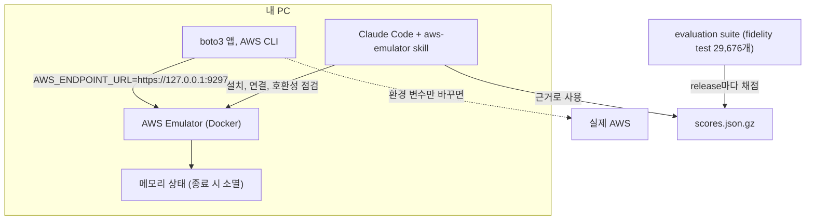

# 시나리오 1. AWS Emulator 기능 지도

## 이 시나리오의 목표

| 항목 | 내용 |
|---|---|
| 기능 | AWS 계정 없이 내 PC에서 AWS API를 호출하고, 실제 AWS와 같은 응답과 오류를 받는 기능 |
| 쓰는 도구 | 없음. 전체 지도와 읽는 순서만 정합니다 |
| 입력 | 2026년 11월 AWS Emulator 발표, User Guide, `aws/aws-emulator` 저장소, release v1.0.322의 fidelity 점수 |
| 작업 | 1. 기능 지도 확인 2. 시나리오 순서 확인 |
| 달성할 것 | 무엇을 emulator에 맡길 수 있고 무엇은 실제 AWS에서 확인해야 하는지 시나리오 번호와 함께 안다 |

## AWS Emulator는 AWS API 서버를 내 PC에 한 대 띄우는 것입니다

AWS CLI와 SDK는 요청을 `https://<서비스>.<리전>.amazonaws.com`으로 보냅니다. AWS Emulator는 이 주소 대신 `https://127.0.0.1:9297` 한 곳에서 350개 서비스의 API를 받아 메모리 안에서 처리하는 Rust 프로그램입니다. 코드는 바꾸지 않고 `AWS_ENDPOINT_URL` 같은 환경 변수만 바꾸면, 같은 boto3 코드가 실제 AWS 대신 emulator에 버킷을 만들고 메시지를 보냅니다.

오해하기 쉬운 경계는 다음과 같습니다.

- 다루는 것: API의 요청 형식, 응답, 오류 코드와 메시지, 리소스 상태(만들면 남고 지우면 사라짐). AWS가 공개한 API 모델(Smithy)을 그대로 써서 만들었습니다.
- 다루지 않는 것: 권한 판단 전체, 성능과 부하, 장기 실행. 이번 실습에서 IAM identity 정책은 평가하지 않는 것을 확인했습니다([4-limits.md](4-limits.md)).
- LocalStack이나 moto와의 차이: 같은 종류의 도구이지만, AWS가 직접 만들고 실제 AWS에 대해 검증한 테스트(fidelity test) 결과를 release마다 공개합니다. 서비스마다 얼마나 맞는지를 숫자로 볼 수 있습니다.
- AI agent가 만든 도구: 발표에 따르면 수천 개의 자율 AI agent가 서비스별 crate를 만들고 고칩니다. release 노트의 변경 항목도 `fix: <서비스>-<동작>` 형태로 하루에 여러 번 쌓입니다.

### 용어

| 용어 | 뜻 | 이 실습의 예 |
|---|---|---|
| server mode | emulator를 별도 프로세스로 띄우고 HTTPS로 요청을 받는 방식. macOS는 Docker로만 됩니다 | `docker run ... aws-emulator -p 9297` |
| embedded mode | Rust 테스트 프로세스 안에 emulator를 넣는 방식. 테스트마다 상태가 분리됩니다 | 이번 실습에서 하지 않음 |
| fidelity | emulator가 실제 AWS와 같은 결과와 오류를 내는 정도 | 오류 7건 중 6건 일치([3-fidelity.md](3-fidelity.md)) |
| fidelity test (trace) | 실제 AWS에서 검증한 boto3 프로그램. 결과, 상태, 오류를 assert합니다 | `sqs/send-receive-delete-lifecycle` |
| fidelity score | 서비스별로 통과한 fidelity test 수 / 전체 수. release마다 `scores.json.gz`로 공개됩니다 | v1.0.322에서 S3 1,763/2,814 |
| `NotImplemented` | 아직 구현하지 않은 operation의 응답. HTTP 501이고 SDK가 재시도하지 않습니다 | IAM `TagMFADevice` |
| `aws-emulator` skill | AI coding agent에게 설치, 연결, 호환성 점검 절차를 가르치는 문서 묶음 | `~/.claude/skills/aws-emulator/` |

## 시스템이 이 기능을 제공해야 하는 이유

AWS를 쓰는 코드를 테스트하는 방법은 지금까지 세 가지였고, 각각 비용이 있습니다.

- 실제 AWS 계정에서 테스트하면 결과는 정확하지만 느리고, 돈이 들고, 정리를 잊으면 리소스가 남습니다. 같은 주문 처리 코드가 실제 AWS(서울)에서는 10.2초, emulator에서는 3.3초 걸렸습니다([2-endpoint-switch.md](2-endpoint-switch.md)).
- `unittest.mock`이나 moto로 SDK를 흉내 내면 빠르지만, 흉내 낸 응답이 실제 AWS와 같은지는 아무도 보장하지 않습니다.
- AI coding agent에게 실제 AWS 자격 증명을 주면 agent가 만든 리소스와 비용을 사람이 추적해야 합니다.

AWS Emulator는 "실제 AWS와 같은 응답"과 "로컬의 속도와 무비용"을 같이 주고, 얼마나 같은지를 fidelity 점수로 공개합니다. agent는 계정 `000000000000` 안에서만 일하므로 실제 계정에 손댈 수 없습니다.

## 대안 비교

| 방식 | 응답이 실제 AWS와 같은가 | 속도 | 비용 | 정확도를 확인하는 방법 |
|---|---|---|---|---|
| 실제 AWS 계정 | 같음(기준) | 느림(테이블 생성 8초) | 리소스 요금 | 해당 없음 |
| mock (`unittest.mock`, `botocore.stub`) | 내가 쓴 만큼만 | 매우 빠름 | 없음 | 없음 |
| moto, LocalStack | 도구마다 다름 | 빠름 | 무료 또는 유료 플랜 | 각 프로젝트의 테스트 |
| AWS Emulator | 서비스와 operation마다 다름 | 빠름(테이블 생성 3초) | 없음 | 공개 fidelity test와 release별 점수 |

## 기능 지도

| 기능 | 쓰는 도구 | 시나리오 |
|---|---|---|
| emulator 실행과 SDK 연결 | Docker, `emulator.env` | [setup.md](setup.md) |
| 코드 변경 없이 endpoint만 바꾸기, 속도 비교 | `app/order_flow.py` | [2-endpoint-switch.md](2-endpoint-switch.md) |
| 오류 응답 fidelity와 서비스별 점수 | `probes/error_cases.py`, `scores.json.gz` | [3-fidelity.md](3-fidelity.md) |
| 정책, 리전, 상태, 자격 증명의 한계 | `probes/*.sh`, AWS CLI | [4-limits.md](4-limits.md) |
| AI agent skill로 호환성 점검 | `aws agent-toolkit`, Claude Code | [5-agent-skill.md](5-agent-skill.md) |

## 시나리오 순서

"내 코드를 그대로 로컬에서 돌릴 수 있는가"가 독자가 가장 먼저 묻는 질문이라 2번에서 바로 확인합니다. 그다음 "그 결과를 믿어도 되는가"를 3번(맞는 것)과 4번(안 맞는 것)으로 나눠 봅니다. 마지막 5번은 이 판단을 AI agent에게 맡기는 방법입니다.

1. [setup.md](setup.md): Docker 이미지 빌드, 실행, 연결
2. [2-endpoint-switch.md](2-endpoint-switch.md): 같은 앱을 emulator와 실제 AWS에서 실행
3. [3-fidelity.md](3-fidelity.md): 오류가 실제 AWS와 같은지, 서비스별 점수
4. [4-limits.md](4-limits.md): emulator를 믿으면 안 되는 곳
5. [5-agent-skill.md](5-agent-skill.md): `aws-emulator` skill과 호환성 점검

## 참고 문서

1. [What is AWS Emulator?](https://docs.aws.amazon.com/emulator/latest/userguide/what-is-service.html)
2. [aws/aws-emulator](https://github.com/aws/aws-emulator)
3. [aws/aws-emulator-evaluation-suite](https://github.com/aws/aws-emulator-evaluation-suite)
4. [How autonomous AI agents built AWS Emulator](https://www.aboutamazon.com/news/aws/how-autonomous-ai-agents-built-aws-emulator)
