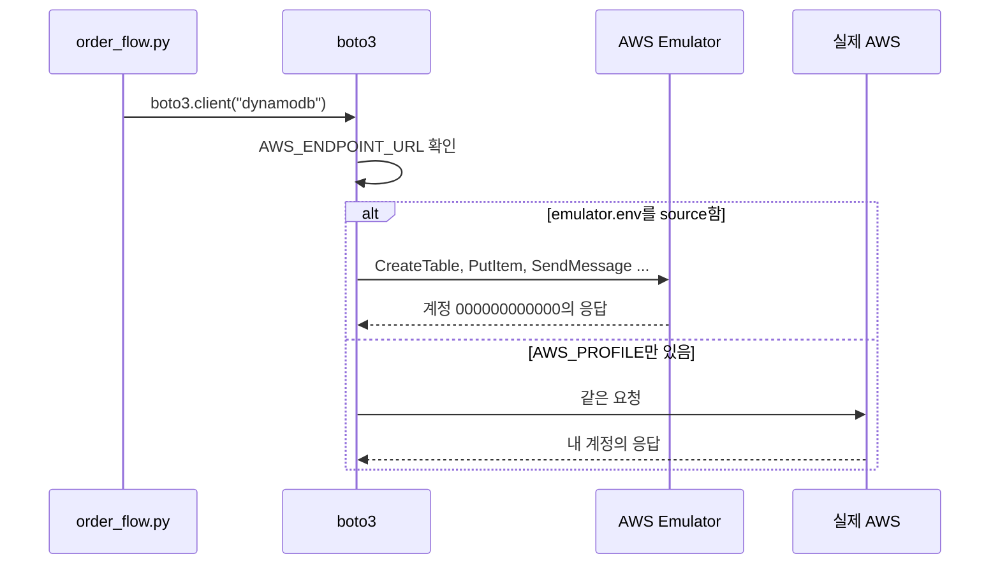

# 시나리오 2. 코드는 그대로 두고 endpoint만 바꾸기

## 이 시나리오의 목표

| 항목 | 내용 |
|---|---|
| 기능 | SDK가 읽는 환경 변수만 바꿔 같은 코드를 emulator와 실제 AWS 양쪽에서 실행하는 기능 |
| 쓰는 도구 | [app/order_flow.py](../app/order_flow.py)(boto3), `emulator.env` |
| 입력 | S3 버킷 1개, DynamoDB 테이블 1개, SQS 큐 1개를 만들고 주문 5건을 기록하는 흐름 |
| 작업 | 1 emulator에서 실행 2 실제 AWS에서 실행 3 반복 측정 4 테이블 생성 대기 시간 확인 |
| 달성할 것 | 코드 한 줄 바꾸지 않고 양쪽 결과가 같고, emulator가 몇 배 빠른지 숫자로 확인합니다 |

## SDK의 endpoint 결정 순서를 emulator가 이용합니다

AWS SDK는 요청을 보낼 주소를 코드 인자, 환경 변수, config 파일 순서로 찾고, 아무것도 없으면 서비스별 기본 주소(`dynamodb.us-west-2.amazonaws.com`)를 씁니다. `AWS_ENDPOINT_URL`은 이 순서에서 모든 서비스에 같은 주소를 주는 환경 변수입니다. 그래서 `boto3.client("s3")`처럼 endpoint를 모르는 코드도 emulator로 요청을 보냅니다. 자격 증명은 `AWS_SHARED_CREDENTIALS_FILE`이, 인증서 신뢰는 `AWS_CA_BUNDLE`이 맡습니다.

이 앱의 코드에는 endpoint, 리전, 자격 증명이 하나도 없습니다. 실행 첫 줄에 `sts:GetCallerIdentity`로 어느 계정에 붙었는지 출력해서, 의도와 다른 곳에 요청이 가면 바로 보이게 했습니다.

### 용어

| 용어 | 뜻 | 이 실습의 예 |
|---|---|---|
| `AWS_ENDPOINT_URL` | 모든 서비스의 요청 주소를 바꾸는 SDK 공통 환경 변수 | `https://127.0.0.1:9297` |
| waiter | 리소스가 원하는 상태가 될 때까지 describe를 반복 호출하는 SDK 기능 | `table_exists` (DynamoDB `DescribeTable`) |
| 비동기 상태 전이 | 생성 API가 바로 끝나지 않고 `CREATING`을 거쳐 `ACTIVE`가 되는 동작 | DynamoDB 테이블 |

## 시스템이 이 기능을 제공해야 하는 이유

테스트 환경을 바꿀 때 코드를 고쳐야 한다면, 테스트하는 코드와 배포하는 코드가 달라집니다. endpoint를 코드에 넣는 순간 "테스트에서는 되는데 운영에서는 안 되는" 차이가 생길 자리가 하나 늘어납니다. 환경 변수만 바꾸는 방식은 운영 코드를 그대로 테스트합니다.

속도도 이유입니다. 같은 앱이 실제 AWS(서울)에서는 10.2초, emulator에서는 3.3초 걸렸습니다. 리소스를 만들고 지우는 테스트를 하루에 수백 번 돌리는 CI나, 코드를 고치고 바로 확인하는 AI agent에게 이 차이는 반복 횟수 차이가 됩니다.

## 대안 비교

| 방식 | 코드 변경 | 실제 AWS 호출 | 이번 실습 |
|---|---|---|---|
| 코드에 `endpoint_url=` 인자 추가 | 필요 | 없음 | 하지 않음 |
| `AWS_ENDPOINT_URL` 환경 변수 | 없음 | 없음 | 사용 |
| `~/.aws/config`의 `endpoint_url` | 없음 | 없음 | emulator가 쓰는 `config` 파일이 이 방식 |
| mock으로 client 교체 | 테스트 코드 필요 | 없음 | 하지 않음 |

## 컴포넌트 역할

| 컴포넌트 | 역할 |
|---|---|
| `app/order_flow.py` | 생성, 주문 기록, 검증, 삭제를 실행하고 단계별 시간을 출력합니다 |
| `emulator.env` | endpoint, 자격 증명, 인증서, 리전 변수를 설정하고 실제 자격 증명 변수를 지웁니다 |
| AWS Emulator | 세 서비스의 상태를 메모리에 보관합니다 |
| 실제 AWS | 비교 기준입니다 |

## 흐름



## 실습

명령은 workspace 루트(`aws/aws-emulator`)에서 실행합니다. 환경 준비는 [setup.md](setup.md)에 있습니다.

### 1. emulator에서 주문 흐름 실행

```bash
source emulator.env
uv run app/order_flow.py
```

출력은 다음과 같습니다. 세 저장소에 주문이 5건씩 남았고 종료 코드는 0입니다.

```text
account    000000000000 (user/emulator)
create       3.12s
orders       0.11s
verify       0.04s
delete       0.03s
total        3.30s
result     {'s3_receipts': 5, 'dynamodb_records': 5, 'sqs_messages': 5}
```

### 2. 실제 AWS에서 같은 흐름 실행

[setup.md](setup.md)의 "실제 AWS와 비교할 때" 변수를 설정한 새 셸에서 실행합니다. 리전만 `ap-northeast-2`(서울)로 바꿔 네트워크 지연을 줄였습니다.

```bash
export AWS_REGION=ap-northeast-2 AWS_DEFAULT_REGION=ap-northeast-2
uv run app/order_flow.py
```

출력은 다음과 같습니다. 계정 ID는 가렸습니다. 결과 개수는 emulator와 같습니다.

```text
account    <계정 ID> (user/<IAM 사용자>)
create       8.35s
orders       0.55s
verify       0.40s
delete       0.94s
total       10.25s
result     {'s3_receipts': 5, 'dynamodb_records': 5, 'sqs_messages': 5}
```

### 3. 반복 측정 결과 비교

emulator 3회, 서울 리전 2회를 실행한 결과입니다. 한국에서 `us-west-2`로 한 번 실행했을 때는 19.29초였습니다.

| 단계 | emulator (3회) | 실제 AWS 서울 (2회) | 차이 |
|---|---|---|---|
| create | 3.11~3.12초 | 8.23~8.35초 | 약 2.7배 |
| orders (15회 호출) | 0.09~0.15초 | 0.55~0.60초 | 약 5배 |
| verify | 0.05~0.08초 | 0.40~0.45초 | 약 7배 |
| delete | 0.05~0.06초 | 0.91~0.94초 | 약 16배 |
| total | 3.31~3.38초 | 10.19~10.25초 | 약 3배 |

### 4. emulator의 테이블 생성 대기 시간 확인

emulator에서도 create가 3초 걸렸습니다. 원인을 찾으려고 테이블을 만든 직후 `DescribeTable`을 연달아 호출했습니다.

```bash
uv run --with boto3 python - <<'EOF'
import time, boto3
d = boto3.client("dynamodb")
d.create_table(TableName="probe-t3", BillingMode="PAY_PER_REQUEST",
  AttributeDefinitions=[{"AttributeName": "id", "AttributeType": "S"}],
  KeySchema=[{"AttributeName": "id", "KeyType": "HASH"}])
for i in range(3):
  t = time.perf_counter(); s = d.describe_table(TableName="probe-t3")["Table"]["TableStatus"]
  print("describe", i, f"{time.perf_counter() - t:.2f}s", s)
d.delete_table(TableName="probe-t3")
EOF
```

출력은 다음과 같습니다.

```text
describe 0 2.97s ACTIVE
describe 1 0.01s ACTIVE
describe 2 0.00s ACTIVE
```

- `CreateTable` 응답은 `CREATING`이고, 직후 첫 `DescribeTable`이 약 3초 걸린 뒤 `ACTIVE`를 돌려줍니다. 두 번째부터는 0.01초입니다.
- emulator가 실제 AWS처럼 비동기 상태 전이를 거치게 해서, waiter와 상태 확인 코드가 실제로 실행되게 한 것으로 보입니다. 첫 describe가 기다리는 정확한 방식은 확인 필요입니다.

## 부록. 실무에서 얻는 것

- emulator가 빠른 이유는 네트워크가 아니라 리소스 생성 대기와 왕복 지연이 없어서입니다. 호출 수가 많은 데이터 작업(orders, verify, delete)에서 차이가 5~16배로 커졌습니다.
- emulator도 리소스 생성을 즉시 끝내지 않습니다. 생성 직후 바로 쓰는 코드(waiter 없이 `PutItem`)가 실제 AWS에서 `ResourceNotFoundException`을 내는 경우를 emulator에서도 만날 수 있어서, 로컬에서 그 버그를 잡을 기회가 남습니다.
- `CreateQueue` 응답의 `QueueUrl`은 `https://sqs.us-west-2.amazonaws.com/000000000000/...`처럼 실제 AWS 주소입니다. boto3는 `AWS_ENDPOINT_URL`을 우선하므로 문제가 없었지만, 이 URL로 HTTP를 직접 보내는 코드는 실제 AWS로 나갑니다.
- 앱 첫 줄에서 `GetCallerIdentity`로 계정을 출력해 두면, 환경 변수를 빠뜨려 실제 계정을 건드리는 실수를 실행 첫 줄에서 알아챕니다.

## 참고 문서

1. [Pointing your AWS SDK at AWS Emulator](https://docs.aws.amazon.com/emulator/latest/userguide/point-sdk-to-emulator.html)
2. [Service-specific endpoints (AWS SDKs and Tools Reference Guide)](https://docs.aws.amazon.com/sdkref/latest/guide/feature-ss-endpoints.html)
