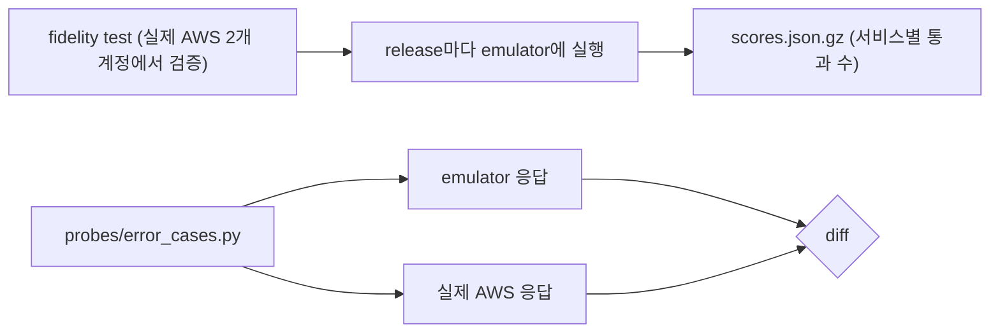

# 시나리오 3. 오류까지 실제 AWS와 같은가 (fidelity)

## 이 시나리오의 목표

| 항목 | 내용 |
|---|---|
| 기능 | 잘못된 요청에 실제 AWS와 같은 HTTP 상태, 오류 코드, 메시지를 돌려주는 기능과, 그 일치율을 서비스별 점수로 공개하는 기능 |
| 쓰는 도구 | [probes/error_cases.py](../probes/error_cases.py), release 자산 `scores.json.gz` |
| 입력 | 리소스를 만들지 않는 오류 요청 7개, v1.0.322 점수 42,937건 |
| 작업 | 1 emulator에서 오류 요청 2 실제 AWS에서 오류 요청 3 결과 대조 4 서비스별 점수 계산 |
| 달성할 것 | 오류 처리 코드를 emulator로 테스트해도 되는 범위를 숫자로 판단합니다 |

## fidelity는 성공 응답보다 오류 응답에서 차이가 납니다

정상 요청의 응답은 흉내 내기 쉽습니다. 버킷을 만들면 버킷이 생기면 됩니다. 어려운 것은 오류입니다. 테이블 이름이 두 글자일 때 AWS는 `ValidationException`과 함께 "Member must have length greater than or equal to 3"이라는 정확한 문장을 돌려주고, 많은 애플리케이션은 이 코드와 문장에 분기합니다. AWS Emulator는 실제 AWS가 쓰는 API 모델(Smithy)에서 요청 검증 규칙을 가져와 같은 오류를 만듭니다.

AWS는 이 일치 여부를 fidelity test로 잽니다. fidelity test는 실제 AWS 계정 두 곳 이상에서 검증한 boto3 프로그램이고, emulator가 모든 호출에서 같은 상태 코드, 리소스, 오류를 내야 통과합니다. release마다 서비스별로 "통과 수 / 전체 수"를 `scores.json.gz`로 공개합니다.

### 용어

| 용어 | 뜻 | 이 실습의 예 |
|---|---|---|
| control plane | 리소스를 만들고, 조회하고, 지우는 API | `CreateTable`, `CreateBucket` |
| data plane | 서비스의 본래 기능 API | `PutItem`, `GetObject`, `SendMessage` |
| behavioral unit | 한 workflow의 결과와 상태를 assert하는 fidelity test | 32,402건 |
| wire unit | 요청과 응답의 형식(상태 코드, body)을 비교하는 단위 | 10,535건 |

## 시스템이 이 기능을 제공해야 하는 이유

로컬 테스트 도구가 오류를 실제와 다르게 돌려주면, 오류 처리 코드는 로컬에서 통과하고 운영에서 처음 실행됩니다. 재시도 여부를 오류 코드로 정하는 코드, 사용자에게 보여 줄 메시지를 고르는 코드가 그렇습니다. 일치율이 공개되지 않으면 사용자는 어느 서비스를 믿어도 되는지 매번 직접 실험해야 합니다. AWS Emulator는 그 실험 결과(fidelity test 29,676개, 2026-11-12 기준)를 저장소로 공개합니다. 점수 파일의 unit 수(42,937건)와 다른 이유는, 점수 파일이 v1.0.322 채점 시점의 test 버전과 wire unit까지 세기 때문으로 보입니다(확인 필요).

## 대안 비교

| 방식 | 오류 응답의 근거 | 일치율을 알 수 있나 |
|---|---|---|
| mock | 테스트 작성자가 적은 값 | 없음 |
| 오픈소스 emulator(moto, LocalStack) | 구현자가 문서와 관찰로 만든 값 | 프로젝트별 테스트, 공개 점수 없음 |
| AWS Emulator | AWS API 모델과 실제 AWS에서 검증한 fidelity test | release별 서비스 점수 공개 |

## 컴포넌트 역할

| 컴포넌트 | 역할 |
|---|---|
| `probes/error_cases.py` | 오류가 나야 하는 요청 7개를 보내고 상태, 코드, 메시지를 한 줄씩 출력합니다 |
| `scores.json.gz` | release의 채점 결과. unit마다 서비스, 결과(`pass`, `fail`, `skipped`), 실패한 단계를 담습니다 |
| evaluation suite | fidelity test 원본과 `manifest.jsonl`(test마다 호출하는 operation 목록) |

## 흐름

공개된 fidelity test 채점 결과(`scores.json.gz`)와 `probes/error_cases.py`를 통한 양쪽 오류 응답 대조 흐름입니다.



## 실습

명령은 workspace 루트(`aws/aws-emulator`)에서 실행합니다. 환경 준비는 [setup.md](setup.md)에 있습니다.

### 1. emulator에서 오류 요청 7개 실행

emulator 셸에서 `probes/error_cases.py`를 실행해 7가지 오류 응답을 파일(`err-emulator.txt`)로 저장합니다.

```bash
source emulator.env
uv run probes/error_cases.py > err-emulator.txt
```

### 2. 실제 AWS에서 같은 요청 실행

[setup.md](setup.md)의 "실제 AWS와 비교할 때" 변수를 설정한 새 셸에서 실행합니다. 모든 요청이 실패하므로 실제 계정에 리소스가 남지 않습니다.

```bash
uv run probes/error_cases.py > err-aws.txt
```

### 3. 두 결과 대조

`diff`로 emulator와 실제 AWS에서 받은 오류 응답 파일 두 개를 비교합니다.

```bash
diff err-emulator.txt err-aws.txt
```

출력은 다음과 같습니다. 다른 줄은 마지막 하나뿐입니다.

```text
7c7
< iam-tag-missing-mfa-device   501 NotImplemented | operation TagMFADevice is scaffolded but not implemented in this emulator
---
> iam-tag-missing-mfa-device   404 NoSuchEntity | MFA Device with serial number arn:aws:iam::<account>:mfa/aws-emulator-handson-does-not-exist does not exist.
```

같았던 6건은 다음과 같습니다. 메시지는 110자에서 잘랐습니다.

| 요청 | 상태와 코드 | 메시지 |
|---|---|---|
| DynamoDB 두 글자 테이블 이름 | 400 `ValidationException` | 1 validation error detected: Value 'ab' at 'tableName' failed to satisfy constraint: ... |
| 없는 테이블에 `PutItem` | 400 `ResourceNotFoundException` | Requested resource not found |
| 없는 버킷에 `GetObject` | 404 `NoSuchBucket` | The specified bucket does not exist |
| 대문자와 `_`가 든 버킷 이름 | 400 `InvalidBucketName` | The specified bucket is not valid. |
| 없는 큐에 `GetQueueUrl` | 400 `AWS.SimpleQueueService.NonExistentQueue` | The specified queue does not exist. |
| 없는 secret 조회 | 400 `ResourceNotFoundException` | Secrets Manager can't find the specified secret. |

### 4. v1.0.322 서비스별 점수 계산

release 자산을 받아 서비스별로 통과 수를 셉니다. 설치한 emulator의 commit(`7753983c`)과 점수 파일의 `commit`이 같아야 이 점수가 내 emulator의 점수입니다.

```bash
gh release download v1.0.322 -R aws/aws-emulator -p scores.json.gz
python3 - <<'EOF'
import gzip, json, collections
d = json.load(gzip.open("scores.json.gz"))
score = collections.defaultdict(lambda: [0, 0])
for unit in d["units"]:
  for service in unit["services"]:
    name = service.split("#")[-1]
    score[name][1] += 1
    score[name][0] += unit["outcome"] == "pass"
print(d["commit"], len(d["units"]), len(score))
for name in ["AmazonS3", "DynamoDB_20120810", "AmazonSQS", "secretsmanager", "AWSIdentityManagementV20100508", "AWSGirApiService", "AmazonEC2", "CloudFormation"]:
  passed, total = score[name]
  print(f"{name:32} {passed:>5}/{total:<5} {passed / total:.0%}")
EOF
```

출력은 다음과 같습니다. `AWSGirApiService`는 Lambda의 Smithy 서비스 이름입니다.

```text
7753983c6e495ec3612695b1336bf4936fc7b7fd 42937 350
AmazonS3                          1763/2814  63%
DynamoDB_20120810                 1153/1694  68%
AmazonSQS                         1032/1523  68%
secretsmanager                     300/441   68%
AWSIdentityManagementV20100508     709/1223  58%
AWSGirApiService                  1561/3006  52%
AmazonEC2                          958/2470  39%
CloudFormation                     795/4206  19%
```

전체 42,937 unit 중 24,243건 통과, 18,614건 실패, 80건 건너뜀입니다.

## 부록. 실무에서 얻는 것

- 흔한 오류(없는 리소스, 이름 규칙 위반)는 상태 코드와 메시지까지 실제 AWS와 같았습니다. 이런 오류에 분기하는 코드는 emulator로 테스트할 만합니다.
- 구현하지 않은 operation은 그럴듯한 가짜 응답 대신 `501 NotImplemented`를 돌려줍니다. SDK가 재시도하지 않으므로 테스트가 바로 실패하고, 실제 AWS와 다른 결과를 조용히 통과하는 일은 없습니다. 다만 "없는 리소스면 404"를 기대하는 오류 처리 테스트는 emulator에서 다른 이유로 실패합니다.
- 점수 60%대는 "60%의 확률로 동작한다"는 뜻이 아닙니다. 실패한 test는 대부분 경계 조건과 드문 기능이고, 내 앱이 쓰는 호출이 그중에 있는지는 앱마다 다릅니다. 이 판단은 [5-agent-skill.md](5-agent-skill.md)의 호환성 점검이 operation 단위로 합니다.
- 서비스 점수는 test 수가 늘면 같이 움직입니다. 같은 fidelity test 버전끼리만 비교해야 합니다.
- CloudFormation(19%)처럼 IaC 경로는 아직 낮습니다. 공식 문서도 control plane이 가장 정확하고 IaC 지원은 서비스마다 다르다고 적고 있습니다.

## 참고 문서

1. [Fidelity in AWS Emulator](https://docs.aws.amazon.com/emulator/latest/userguide/fidelity.html)
2. [aws/aws-emulator releases](https://github.com/aws/aws-emulator/releases)
3. [aws/aws-emulator-evaluation-suite](https://github.com/aws/aws-emulator-evaluation-suite)
