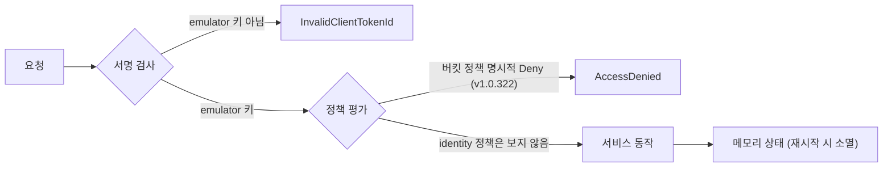

# 시나리오 4. emulator를 믿으면 안 되는 곳

## 이 시나리오의 목표

| 항목 | 내용 |
|---|---|
| 기능 | emulator의 설계상 한계: 권한 평가, 리전과 계정 분리, 메모리 상태, 서명 검사 |
| 쓰는 도구 | [probes/no_policy_user.sh](../probes/no_policy_user.sh), [probes/deny_policy.sh](../probes/deny_policy.sh), AWS CLI, Docker |
| 입력 | 정책 없는 IAM 사용자, GetObject를 Deny하는 버킷 정책, 두 리전의 리소스 목록 |
| 작업 | 1 정책 없는 사용자 2 버킷 Deny 정책 3 대조 실험 4 리전 분리 5 재시작 6 실제 자격 증명 거부 |
| 달성할 것 | emulator 결과로 판단하면 안 되는 영역을 실제 AWS와 나란히 놓고 확인합니다 |

## emulator는 기능을 흉내 내지 계정의 경계는 흉내 내지 않습니다

AWS에서 요청 하나는 세 단계를 거칩니다. 서명으로 누가 보냈는지 확인하고, 정책으로 허용 여부를 판단하고, 그다음 서비스가 일을 합니다. AWS Emulator가 정성 들여 맞추는 것은 마지막 단계입니다. 공식 문서는 다음을 한계로 적습니다.

- IAM 정책과 리소스 기반 정책을 AWS처럼 평가하지 않습니다. 보안 테스트에 쓰지 말라고 합니다.
- 리전과 계정을 받기는 하지만 리소스를 리전이나 계정별로 나누지 않습니다. 리전마다 emulator를 따로 띄우라고 합니다.
- 모든 상태가 메모리에만 있고, 프로세스가 끝나면 사라집니다.

이번 실습은 이 문장들을 실제로 확인했고, 두 곳에서 문서와 다른 결과가 나왔습니다. 버킷 정책의 명시적 Deny는 v1.0.322에서 평가했습니다. SQS와 DynamoDB는 리전별로 나뉘었습니다. 문서가 "보장하지 않는다"고 쓴 것을 "항상 틀린다"로 읽으면 안 되고, 반대로 이번에 맞았다고 다음 release에서도 맞는다고 가정해도 안 됩니다.

### 용어

| 용어 | 뜻 | 이 실습의 예 |
|---|---|---|
| identity 기반 정책 | IAM 사용자나 role에 붙는 정책 | 정책 없는 `no-policy-user-*` |
| 리소스 기반 정책 | 버킷이나 큐 같은 리소스에 붙는 정책 | `s3:GetObject` Deny 버킷 정책 |
| 명시적 Deny | 다른 Allow보다 항상 우선하는 Deny 문장 | `"Effect": "Deny", "Principal": "*"` |
| emulator 자격 증명 | 시작할 때마다 새로 만드는 access key. 이 키로 서명한 요청만 받습니다 | `~/.aws/emulator/9297/emulator_credentials` |

## 시스템이 이 기능을 제공해야 하는 이유

이 시나리오는 기능이 아니라 기능의 경계를 다룹니다. 경계를 모르면 두 가지 사고가 납니다. 첫째, 권한이 빠진 IAM 정책이 emulator 테스트를 통과하고 배포 후 `AccessDenied`로 실패합니다. 실습 1단계가 바로 이 상황입니다. 둘째, 테스트끼리 상태를 공유한다는 것을 모르고 순서에 따라 결과가 달라지는 테스트를 만듭니다. 한계를 알면 emulator를 쓸 곳과 실제 AWS 통합 테스트를 남길 곳을 나눌 수 있습니다.

## 대안 비교

| 확인하려는 것 | emulator | 실제 AWS | 권장 |
|---|---|---|---|
| API 호출 순서와 오류 처리 | 맞음 | 맞음 | emulator |
| identity 정책 누락 | 못 잡음 | 잡음 | 실제 AWS, IAM Access Analyzer |
| 버킷 정책 Deny | v1.0.322는 잡음 | 잡음 | 실제 AWS(release마다 바뀔 수 있음) |
| 리전 간 복제, cross-account | 지원하지 않음 | 됨 | 실제 AWS |
| 테스트 간 상태 격리 | 프로세스 하나에 공유 | 계정 하나에 공유 | emulator를 테스트마다 재시작하거나 embedded mode |

## 컴포넌트 역할

| 컴포넌트 | 역할 |
|---|---|
| `probes/no_policy_user.sh` | 정책 없는 IAM 사용자와 access key를 만들어 `ListBuckets`를 호출하고 지웁니다. 키는 출력하지 않습니다 |
| `probes/deny_policy.sh` | 버킷에 GetObject Deny 정책을 붙이고 객체를 읽은 뒤 정리합니다 |
| emulator 서명 검사 | emulator 키로 서명하지 않은 요청을 `InvalidClientTokenId`로 거부합니다 |

## 흐름

요청이 emulator에 도달했을 때 서명 검사, 제한적인 정책 평가, 메모리 상태 저장 순으로 처리되는 흐름입니다.



## 실습

명령은 workspace 루트(`aws/aws-emulator`)에서 실행합니다. emulator 쪽은 `source emulator.env`를 한 셸, 실제 AWS 쪽은 [setup.md](setup.md)의 "실제 AWS와 비교할 때" 셸에서 실행합니다.

### 1. 정책 없는 IAM 사용자로 ListBuckets 호출

emulator 셸에서 실행합니다.

```bash
./probes/no_policy_user.sh
```

출력은 다음과 같습니다. 권한이 하나도 없는 사용자의 요청이 성공해 버킷 수(0)를 돌려줍니다.

```text
list-buckets as no-policy-user-1794466246 (no policy):
  0
cleanup done: no-policy-user-1794466246
```

실제 AWS 셸에서는 새 access key가 전파될 시간을 10초 줍니다.

```bash
IAM_PROPAGATION_SECONDS=10 ./probes/no_policy_user.sh
```

출력은 다음과 같습니다. 계정 ID는 가렸습니다.

```text
list-buckets as no-policy-user-1794466248 (no policy):
  aws: [ERROR]: An error occurred (AccessDenied) when calling the ListBuckets operation: User: arn:aws:iam::<계정 ID>:user/no-policy-user-1794466248 is not authorized to perform: s3:ListAllMyBuckets because no identity-based policy allows the s3:ListAllMyBuckets action
cleanup done: no-policy-user-1794466248
```

emulator는 identity 기반 정책을 평가하지 않았습니다.

### 2. 버킷 정책 Deny 후 GetObject

양쪽 셸에서 같은 스크립트를 실행합니다.

```bash
./probes/deny_policy.sh
```

출력은 양쪽이 같았습니다. 버킷 이름의 숫자는 실행 시각이라 달라집니다.

```text
get-object after Deny policy:
  download failed: s3://deny-policy-test-1794466217/hello.txt to - An error occurred (403) when calling the HeadObject operation: Forbidden
cleanup done: deny-policy-test-1794466217
```

### 3. 버킷 정책 대조 실험

2단계의 403이 정책 때문인지 확인하려고, 정책을 넣기 전, 넣은 뒤, 지운 뒤를 emulator에서 비교했습니다.

```bash
B=deny-control-$(date +%s)
aws s3api create-bucket --bucket $B --create-bucket-configuration LocationConstraint=us-west-2 >/dev/null
echo hello | aws s3 cp - s3://$B/hello.txt >/dev/null
echo "before policy: $(aws s3 cp s3://$B/hello.txt - 2>&1)"
aws s3api put-bucket-policy --bucket $B --policy "{\"Version\":\"2012-10-17\",\"Statement\":[{\"Effect\":\"Deny\",\"Principal\":\"*\",\"Action\":\"s3:GetObject\",\"Resource\":\"arn:aws:s3:::$B/*\"}]}"
echo "get-object api: $(aws s3api get-object --bucket $B --key hello.txt /dev/stdout 2>&1 | tail -1)"
aws s3api delete-bucket-policy --bucket $B
echo "policy removed: $(aws s3 cp s3://$B/hello.txt - 2>&1)"
aws s3 rm s3://$B/hello.txt >/dev/null; aws s3api delete-bucket --bucket $B
```

출력은 다음과 같습니다.

```text
before policy: hello
get-object api: aws: [ERROR]: An error occurred (AccessDenied) when calling the GetObject operation: User: arn:aws:iam::000000000000:user/emulator is not authorized to perform: s3:GetObject on resource: "arn:aws:s3:::deny-control-1794466325/hello.txt" with an explicit deny in a resource-based policy
policy removed: hello
```

v1.0.322는 버킷 정책의 명시적 Deny를 평가합니다. `aws-emulator` skill 문서의 "emulator는 자기 키로 서명한 요청을 거부하지 않는다"는 문장과 다른 결과입니다.

### 4. 리전 분리 확인

emulator 셸에서 `us-west-2`에 리소스를 만들고 두 리전에서 목록을 조회합니다.

```bash
aws sqs create-queue --queue-name region-probe --region us-west-2 >/dev/null
aws dynamodb create-table --table-name region-probe --region us-west-2 --billing-mode PAY_PER_REQUEST \
  --attribute-definitions AttributeName=id,AttributeType=S --key-schema AttributeName=id,KeyType=HASH >/dev/null
aws s3api create-bucket --bucket region-probe-bucket --create-bucket-configuration LocationConstraint=us-west-2 >/dev/null
for r in us-west-2 ap-northeast-2; do
  echo "== list from $r"
  echo " sqs: $(aws sqs list-queues --region $r --query 'QueueUrls' --output text)"
  echo " dynamodb: $(aws dynamodb list-tables --region $r --query TableNames --output text)"
  echo " s3: $(aws s3api list-buckets --region $r --query 'Buckets[].Name' --output text)"
done
```

출력은 다음과 같습니다.

```text
== list from us-west-2
 sqs: https://sqs.us-west-2.amazonaws.com/000000000000/region-probe
 dynamodb: region-probe
 s3: region-probe-bucket
== list from ap-northeast-2
 sqs: None
 dynamodb:
 s3: region-probe-bucket
```

- SQS와 DynamoDB는 리전별로 나뉘었습니다.
- S3 버킷이 다른 리전에서도 보이는 것은 실제 AWS의 `ListBuckets`도 리전과 관계없이 계정의 모든 버킷을 돌려주므로 같은 동작입니다.
- 공식 문서는 "일부 서비스는 리전을 공유한다"고 하므로, 이번에 확인하지 않은 서비스는 리전마다 emulator를 따로 띄우는 것이 안전합니다.

### 5. 재시작 후 상태와 자격 증명 확인

컨테이너 재시작 전후의 자격 증명·인증서 해시와 앞서 만든 S3·DynamoDB 리소스 잔존 여부를 확인합니다.

```bash
shasum ~/.aws/emulator/9297/emulator_credentials ~/.aws/emulator/9297/ca.pem | cut -c1-12
docker restart aws-emulator
for i in $(seq 30); do curl -sf --cacert ~/.aws/emulator/9297/ca.pem https://127.0.0.1:9297/__admin/health >/dev/null && break; sleep 1; done
shasum ~/.aws/emulator/9297/emulator_credentials ~/.aws/emulator/9297/ca.pem | cut -c1-12
echo "s3: [$(aws s3api list-buckets --query 'Buckets[].Name' --output text)] dynamodb: [$(aws dynamodb list-tables --query TableNames --output text)]"
```

출력은 다음과 같습니다. 해시 값은 실행마다 다릅니다.

```text
825d3ab0ee33
ff9498cfdf13
092f62ab43c1
9ba64ff79670
s3: [] dynamodb: []
```

4단계에서 만든 리소스가 모두 사라졌고, access key와 인증서도 새로 만들어졌습니다. 경로가 같으므로 `emulator.env`는 다시 `source`하지 않아도 됩니다.

### 6. 실제 자격 증명과 서명 없는 요청 거부

emulator 셸에서 endpoint는 그대로 두고, 서브셸(`(...)`) 안에서만 자격 증명을 실제 프로파일로 바꿔 호출합니다. 요청은 `127.0.0.1`로만 가고, SigV4 서명에는 secret key가 들어가지 않습니다.

```bash
(export AWS_PROFILE=<프로파일>; unset AWS_SHARED_CREDENTIALS_FILE AWS_CONFIG_FILE; aws sts get-caller-identity)
curl -s --cacert ~/.aws/emulator/9297/ca.pem -X POST https://127.0.0.1:9297/ \
  -H 'Content-Type: application/x-www-form-urlencoded' -d 'Action=GetCallerIdentity&Version=2011-06-15'
```

출력은 다음과 같습니다.

```text
aws: [ERROR]: An error occurred (InvalidClientTokenId) when calling the GetCallerIdentity operation: The security token included in the request is invalid.
<?xml version="1.0"?><ErrorResponse><Error><Type>Sender</Type><Code>InvalidClientTokenId</Code><Message>The security token included in the request is invalid.</Message></Error>...</ErrorResponse>
```

emulator는 이번 실행에서 만든 키로 서명한 요청만 받습니다. 웹 페이지나 다른 로컬 프로그램이 emulator에 요청을 보내지 못하게 하는 장치입니다.

## 부록. 실무에서 얻는 것

- IAM 정책은 emulator 테스트로 검증하지 않습니다. 정책이 없어도 요청이 성공하므로, 권한 누락은 배포한 뒤에 처음 드러납니다. 정책은 실제 AWS 통합 테스트나 IAM Access Analyzer의 정책 검증으로 확인합니다.
- 버킷 Deny처럼 emulator가 맞게 동작한 경우도 있지만, skill 문서는 여전히 "평가하지 않는다"고 적고 있습니다. 문서와 동작이 다를 때는 둘 다 믿지 말고 내 release에서 다시 확인합니다.
- emulator에는 reset API가 없습니다. 깨끗한 상태가 필요한 테스트는 emulator를 재시작하거나, 포트를 달리해 여러 개 띄우거나, Rust라면 테스트마다 상태가 분리되는 embedded mode를 씁니다.
- 재시작하면 인증서가 바뀝니다. 인증서를 시스템 키체인이나 Java truststore에 복사해 쓰면 재시작마다 다시 복사해야 하므로, `AWS_CA_BUNDLE`처럼 경로를 가리키는 설정이 낫습니다.
- `emulator.env`가 실제 자격 증명 변수를 지워도, 실수로 `AWS_PROFILE`을 다시 export하면 emulator가 `InvalidClientTokenId`로 거부합니다. 실제 계정으로 새는 대신 실패하므로 안전한 쪽으로 깨집니다.

## 참고 문서

1. [What is AWS Emulator? - Limitations](https://docs.aws.amazon.com/emulator/latest/userguide/what-is-service.html#what-is-limits)
2. [Security in AWS Emulator](https://docs.aws.amazon.com/emulator/latest/userguide/security.html)
3. [Pointing your AWS SDK at AWS Emulator - credentials](https://docs.aws.amazon.com/emulator/latest/userguide/point-sdk-to-emulator.html#point-sdk-credentials)
