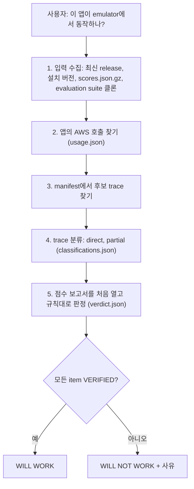

# 시나리오 5. AI agent가 emulator를 다루게 하기 (aws-emulator skill)

## 이 시나리오의 목표

| 항목 | 내용 |
|---|---|
| 기능 | AI coding agent에게 emulator 설치, 연결, 호환성 점검 절차를 가르치는 skill과, "내 앱이 emulator에서 동작하나"에 근거로 답하는 호환성 점검 |
| 쓰는 도구 | `aws agent-toolkit`(AWS CLI 2.35.0 이상), Claude Code, [app/order_flow.py](../app/order_flow.py) |
| 입력 | `aws-emulator` skill v1, 시나리오 2의 주문 앱, v1.0.322 점수, evaluation suite commit `4df2823b` |
| 작업 | 1 skill 내용 확인 2 설치 3 agent에게 호환성 점검 요청 4 판정 확인 5 실제 실행 결과와 비교 6 제거 |
| 달성할 것 | agent의 판정이 무엇을 근거로 나오고, 실제로 돌려 본 결과와 왜 다를 수 있는지 설명합니다 |

## skill은 코드가 아니라 절차 문서입니다

`aws-emulator` skill은 `SKILL.md`와 `references/*.md` 9개로 된 문서 묶음이고 스크립트가 없습니다. agent는 이 문서를 읽고 사용자의 셸에서 `docker`, `aws`, `gh`, `jq` 같은 명령을 직접 실행합니다. 문서가 정하는 것은 크게 세 가지입니다.

- 설치와 연결: OS에 맞는 설치 경로, 연결 환경 변수, 인증서와 서명 오류 해결.
- 안전 규칙: loopback에만 bind, TLS 검증을 끄지 않기, 실제 자격 증명 변수를 지우고 `000000000000`인지 확인, `sudo`와 셸 프로필 수정 전에는 사용자에게 묻기.
- 호환성 점검: 앱이 쓰는 AWS 호출을 찾아 fidelity test에 하나씩 대응시키고, release 점수로 판정합니다.

호환성 점검의 판정은 `WILL WORK`와 `WILL NOT WORK` 두 가지뿐입니다. 증거가 없는 호출이 하나라도 있으면 `WILL NOT WORK`입니다. "아마 될 것이다"를 허용하지 않도록 판정 단계(Step 5)는 agent의 판단 없이 규칙만 적용하게 되어 있습니다.

### 용어

| 용어 | 뜻 | 이 실습의 예 |
|---|---|---|
| item | 앱이 하는 AWS 호출 하나, 또는 환경에 기대는 가정 하나 | `sqs-receive`, `region-from-env` |
| trace | fidelity test 한 개 | `sqs/e2e-work-queue-pattern` |
| `direct` | trace가 그 item의 호출을 앱과 같은 설정으로 직접 검증함 | `MaxNumberOfMessages=10, WaitTimeSeconds=2`인 receive |
| `partial` | trace가 호출하긴 하지만 준비 단계이거나 다른 기능을 검증함 | 목록 조회 test 안의 `CreateBucket` |
| `VERIFIED` | `direct` trace가 이 release에서 통과함 | `sts-whoami` |
| `UNVERIFIED` | 통과한 `direct` trace가 없음 | `s3-put-object` |
| assumption | 코드에 없고 환경이 주는 값에 기대는 것 | 리전과 자격 증명을 환경 변수에서 읽음 |

## 시스템이 이 기능을 제공해야 하는 이유

agent에게 "emulator를 설치해 줘"라고만 하면 agent는 인터넷의 오래된 글이나 다른 emulator의 방법을 섞어 쓸 수 있습니다. TLS 검증을 끄거나(`--no-verify-ssl`), 포트를 모든 네트워크에 열거나, 실제 자격 증명이 남은 셸에서 테스트를 돌리는 실수가 대표적입니다. skill은 공식 절차와 금지 사항을 agent가 읽는 위치에 둡니다.

호환성 질문은 더 위험합니다. "S3 점수가 63%니까 아마 될 것"은 근거가 아닙니다. skill은 앱의 호출 하나하나를 공개된 trace와 대응시키고, 대응시킬 trace가 없으면 모른다고 답하게 합니다.

## 대안 비교

| 방식 | 근거 | 결과 |
|---|---|---|
| 직접 실행해 봄 | 이번 실행의 결과 | 이번 입력에서 됐다, 안 됐다 |
| 서비스 점수만 봄 | 서비스 전체 통과율 | 서비스 단위 추정 |
| `aws-emulator` skill 호환성 점검 | 내 앱의 호출별 trace와 release 결과 | 호출별 `VERIFIED`, `UNVERIFIED`, `FAILING`과 하나의 판정 |
| 수동 점검(공식 문서 절차) | `manifest.jsonl` 검색과 점수 확인 | skill과 같지만 사람이 함 |

## 컴포넌트 역할

| 컴포넌트 | 역할 |
|---|---|
| `aws agent-toolkit add-skill` | skill을 받아 감지한 agent의 skill 디렉터리에 설치합니다 |
| `SKILL.md` | 의도별로 읽을 reference를 고르는 라우팅 표와 안전 규칙 |
| `compatibility-check.md` | 점검 5단계와 판정 규칙 |
| `<app>/.aws-emulator/check/` | 점검 산출물(`usage.json`, `classifications.json`, `results.jsonl`, `verdict.json`). `.gitignore`가 `*`라 commit되지 않습니다 |

## 흐름



## 실습

명령은 workspace 루트(`aws/aws-emulator`)에서 실행합니다. agent-toolkit 명령은 AWS API를 부르므로 실제 AWS 자격 증명이 있는 셸에서 실행합니다.

### 1. 설치 전에 skill 파일 목록 확인

```bash
aws agent-toolkit get-skill-metadata --skill-name aws-emulator --region us-east-1 --query 'files[].path'
```

출력은 다음과 같습니다.

```text
[
    "SKILL.md",
    "references/compatibility-check.md",
    "references/compatibility-classify-traces.md",
    "references/compatibility-find-usage.md",
    "references/connect.md",
    "references/container.md",
    "references/linux-package.md",
    "references/rust-embedded.md",
    "references/troubleshooting.md"
]
```

`aws agent-toolkit get-skill-file --skill-name aws-emulator --file-path SKILL.md --region us-east-1`로 본문을 설치 없이 읽을 수 있습니다.

### 2. Claude Code에만 skill 설치

`--agent`를 빼면 감지한 모든 agent(Kiro, Cursor, Codex 등)에 전역으로 설치됩니다. 여기서는 Claude Code에만 설치합니다.

```bash
aws agent-toolkit add-skill --skill-name aws-emulator --agent claude-code --region us-east-1
aws agent-toolkit list-installed-skills --region us-east-1
```

출력은 다음과 같습니다. 경로의 홈 디렉터리는 가렸습니다.

```text
  Installed aws-emulator (v1) to Claude Code — ~/.claude/skills.
{
    "skills": [
        {
            "agent": "Claude Code",
            "name": "aws-emulator",
            "path": "<홈>/.claude/skills/aws-emulator/SKILL.md"
        }
    ]
}
```

이미 열려 있던 Claude Code 세션에도 skill 목록에 바로 `aws-emulator`가 나타났습니다.

### 3. agent에게 호환성 점검 요청

Claude Code에 다음과 같이 요청합니다. 점검 절차에 macOS에서는 GNU grep(`ggrep`), `jq`, `gh`가 필요합니다.

```text
Will my app in aws/aws-emulator/app (order_flow.py) work on AWS Emulator? Run the compatibility check.
```

agent는 skill에 따라 다음을 실행했습니다.

- 최신 release(`v1.0.322`)와 설치 버전(`1.0.322`, commit `7753983c`)이 같은지 확인
- `scores.json.gz`를 받아 sha256(`eca6d69b...`)을 기록
- evaluation suite를 임시 디렉터리에 depth 1로 클론(361MB, commit `4df2823b`), 점검이 끝난 뒤 삭제
- `order_flow.py`에서 호출 item 17개와 assumption 2개를 찾아 `usage.json`에 기록
- item마다 manifest에서 후보 trace를 찾아 25건을 분류
- 마지막에 점수 보고서를 열어 판정

### 4. 판정 결과 확인

```bash
jq -r '.verdict, (.reasons|join(",")), (.items[] | "\(.item) \(.status) \(.sub_reason // "")")' app/.aws-emulator/check/verdict.json
```

출력은 다음과 같습니다.

```text
WILL NOT WORK
UNVERIFIED
sts-whoami VERIFIED
s3-create-bucket UNVERIFIED no-direct
ddb-create-table UNVERIFIED no-direct
ddb-wait-active VERIFIED
sqs-create-queue UNVERIFIED no-direct
s3-put-object UNVERIFIED no-direct
ddb-put-item UNVERIFIED no-direct
sqs-send VERIFIED
s3-list-prefix UNVERIFIED downgraded
ddb-scan-count VERIFIED
sqs-receive VERIFIED
sqs-receive-empty VERIFIED
s3-list-all VERIFIED
s3-delete-object UNVERIFIED no-direct
s3-delete-bucket UNVERIFIED no-direct
ddb-delete-table UNVERIFIED no-direct
sqs-delete-queue VERIFIED
region-from-env UNVERIFIED unclassified
credentials-from-env UNVERIFIED unclassified
```

- 실패(`FAILING`)한 item은 없습니다. 호출 17개 중 8개가 `VERIFIED`입니다.
- `no-direct` 8개는 trace가 그 호출을 준비나 정리 단계에서만 쓰거나 다른 기능(테이블 클래스, GSI, 덮어쓰기)을 검증해서, 앱의 호출 그대로를 검증한 trace가 없었습니다.
- `s3-list-prefix`는 `Prefix`가 `photos/`인 trace를 `direct`로 골랐지만, 판정 단계가 앱의 값 `receipts/`가 trace에 없다는 이유로 기계적으로 강등했습니다.
- 리전과 자격 증명 assumption은 그것을 주제로 한 trace가 없어 `UNVERIFIED`입니다.

### 5. 판정과 실제 실행 결과 비교

같은 앱은 [2-endpoint-switch.md](2-endpoint-switch.md)에서 emulator로 네 번 실행해 네 번 모두 결과가 맞았습니다. 판정이 `WILL NOT WORK`인 이유는 앱이 실패해서가 아니라 "통과한다는 공개 증거가 없는 호출이 있어서"입니다.

| 질문 | 직접 실행 | 호환성 점검 |
|---|---|---|
| 이번 입력에서 동작했나 | 예, 4회 모두 | 답하지 않음 |
| 호출마다 실제 AWS와 같다는 근거가 있나 | 없음(실행 결과만) | 17개 중 8개 |
| 다음 release에서도 같은가 | 다시 실행해야 앎 | 같은 점검을 새 점수로 다시 돌림 |

### 6. skill 제거

```bash
aws agent-toolkit remove-skill --skill-name aws-emulator --agent claude-code --region us-east-1
aws agent-toolkit list-installed-skills --region us-east-1
```

출력은 다음과 같습니다.

```text
Removed aws-emulator from Claude Code — ~/.claude/skills.
{
    "skills": []
}
```

## 부록. 실무에서 얻는 것

- 판정 `WILL NOT WORK`를 "쓰면 안 된다"로 읽으면 안 됩니다. 이 skill의 판정은 안전 쪽으로 기울어 있고, `UNVERIFIED` 목록은 "실제 AWS 통합 테스트로 남겨 둘 호출 목록"으로 쓰는 것이 맞습니다.
- `CreateBucket`, `PutObject`, `DeleteObject`처럼 가장 흔한 호출이 오히려 `UNVERIFIED`였습니다. 흔한 호출일수록 다른 test의 준비 단계로만 등장하고, 그 호출 자체를 주제로 한 trace가 드물기 때문입니다.
- 점검 한 번에 evaluation suite 클론 361MB와 수십 번의 명령 실행이 들었습니다. CI에서 매번 돌리기보다, release를 올릴 때와 앱의 AWS 호출이 바뀔 때 돌리는 편이 맞습니다.
- skill 규칙 중 "최신 release만 쓰고 버전을 고정하지 말라"는 CI의 재현성과 부딪힙니다. emulator가 하루에 여러 번 바뀌는 대신 fidelity가 오르는 구조라서 생긴 trade-off입니다.
- skill 문서와 실제 동작이 어긋난 곳이 있었습니다. 문서는 버킷 정책을 평가하지 않는다고 하지만, v1.0.322는 명시적 Deny를 평가했습니다([4-limits.md](4-limits.md)).

## 참고 문서

1. [Getting started with an AI coding agent](https://docs.aws.amazon.com/emulator/latest/userguide/getting-started-agent.html)
2. [Checking whether your project works with AWS Emulator](https://docs.aws.amazon.com/emulator/latest/userguide/check-project.html)
3. [Managing skills with the AWS CLI](https://docs.aws.amazon.com/agent-toolkit/latest/userguide/aws-cli.html)
