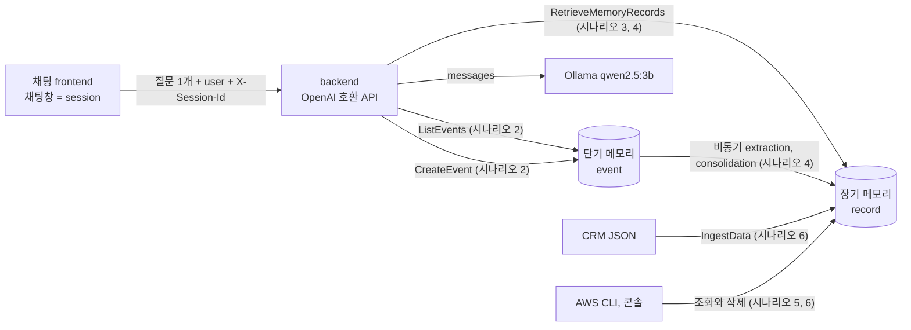

# 시나리오 1. AgentCore Memory 기능 지도

## 이 시나리오의 목표

| 항목 | 내용 |
|---|---|
| 기능 | agent의 대화 상태(단기 메모리)와 사용자 지식(장기 메모리)을 서버 쪽에 저장하고 검색하는 기능 |
| 쓰는 도구 | Amazon Bedrock AgentCore Memory, Ollama `qwen2.5:3b`, OpenAI 호환 backend, 채팅 frontend |
| 입력 | Memory `chat_memory_handson`, 내장 전략 4개(facts, preferences, summaries, episodes) |
| 작업 | 1. 기능 지도와 시나리오 순서 확인 2. 서울 리전 한도 확인 |
| 달성할 것 | ChatGPT처럼 채팅창이 여러 개인 서비스에서 "무엇을 어디에 기억하는지"를 한 장으로 설명할 수 있음 |

## AgentCore Memory가 하는 일

ChatGPT나 Claude를 쓰다 보면 두 가지 기억을 경험합니다. 하나는 같은 채팅창 안에서 방금 한 말을 기억하는 것이고, 다른 하나는 새 채팅창을 열어도 "저는 Go 개발자입니다"라고 한 번 말한 사실을 기억하는 것입니다. 앞의 것은 채팅창에 쌓인 대화 기록을 다시 모델에 넣어 주는 일이고, 뒤의 것은 여러 대화에서 지속 가치가 있는 사실만 뽑아 따로 저장해 두었다가 관련 질문이 오면 꺼내 주는 일입니다.

LLM은 호출과 호출 사이에 아무것도 기억하지 않는 stateless 함수라서, 이 두 기억은 모두 모델 밖의 애플리케이션이 만들어야 합니다. AgentCore Memory는 이 일을 관리형 서비스로 제공합니다. 대화 원문은 **단기 메모리(short-term memory)**에 event로 쌓고, 비동기 파이프라인이 그 event에서 사실, 선호, 요약, 작업 경험을 뽑아 **장기 메모리(long-term memory)**에 record로 저장합니다. 애플리케이션은 질문이 올 때 단기 메모리에서 최근 대화를, 장기 메모리에서 의미가 가까운 record를 꺼내 프롬프트를 조립합니다.

이 기능이 다루는 것과 다루지 않는 것을 먼저 구분해 둡니다.

- 다루는 것: 대화 event 저장과 조회, event에서 장기 기억 추출과 병합(consolidation), namespace 기반 격리, 의미 검색, record 삭제와 보존 기간.
- 다루지 않는 것: 모델 호출, 프롬프트 조립, 사용자 인증. 이 셋은 애플리케이션 몫입니다. 이 핸즈온에서는 backend가 Ollama를 호출하고 프롬프트를 조립하며, 인증은 생략하고 요청의 `user` 필드를 그대로 사용자 ID로 씁니다.

### 이름이 비슷한 Amazon MemoryDB와의 구분

"메모리 DB"라는 말 때문에 Amazon MemoryDB와 혼동하기 쉽습니다. 둘은 전혀 다른 서비스입니다.

| 구분 | Amazon Bedrock AgentCore Memory | Amazon MemoryDB |
|---|---|---|
| 정체 | agent 대화 상태와 장기 기억을 위한 관리형 API | Valkey, Redis OSS 호환 인메모리 데이터베이스 |
| 데이터 모델 | actor, session, event, memory record, namespace | key-value, 자료구조 |
| 장기 기억 추출 | 내장 LLM 파이프라인이 자동 수행 | 없음. 애플리케이션이 직접 구현 |
| 과금 | 사용량(GB, record 수, 검색 횟수) | 노드 시간 |
| 이 핸즈온 | 사용 | 사용하지 않음 |

### 용어

| 용어 | 뜻 | 이 실습의 예 |
|---|---|---|
| memory | 단기, 장기 메모리를 담는 최상위 리소스. 전략과 보존 기간을 가짐 | `chat_memory_handson-6zXYmhCh5n` |
| actor | 기억의 주인. 보통 최종 사용자 한 명 | `jiwoo`, `minho` |
| session | actor의 대화 묶음 하나. 채팅 서비스에서는 채팅창 하나 | `chat-1a3fe300260e` |
| event | session에 쌓이는 불변 기록 하나. 메시지 1~100개를 담음 | 질문 1개와 답변 1개를 담은 event |
| 단기 메모리 | event 원문 저장소. 보존 기간(7~365일)이 지나면 사라짐 | 7일 보존 |
| memory strategy | event에서 무엇을 뽑을지 정한 규칙. 메모리당 최대 6개 | `facts`(SEMANTIC), `preferences`(USER_PREFERENCE), `summaries`(SUMMARIZATION), `episodes`(EPISODIC) |
| memory record | 전략이 event에서 뽑아 저장한 장기 기억 하나 | "사용자는 결제팀 백엔드 개발자이다." |
| 장기 메모리 | memory record 저장소. 기본값은 만료 없음 | `/actor/jiwoo/facts/` 아래 record 7개 |
| namespace | record가 들어가는 경로. 전략마다 템플릿으로 정함 | `/actor/{actorId}/facts/` → `/actor/jiwoo/facts/` |
| extraction | event에서 record 후보를 뽑는 비동기 단계 | 마지막 event 뒤 약 80초 |
| consolidation | 새 후보를 기존 record와 비교해 추가, 교체, 무시를 정하는 단계 | "화요일" record가 "목요일" record로 교체됨 |
| reflection | episodic 전략이 여러 episode를 보고 만든 교훈 | "형식 규칙은 바로 다음 답변부터 적용하라" |

## 이 기능을 시스템이 제공해야 하는 이유

대화 기억을 직접 만들면 처음에는 쉬워 보입니다. 클라이언트가 지금까지의 messages를 모두 보내면 되기 때문입니다. 그러나 서비스가 커지면 세 가지 문제가 생깁니다.

첫째, 대화 기록이 클라이언트에 있으면 다른 기기에서 같은 채팅창을 이어 갈 수 없고, 대화가 길어질수록 매 요청의 입력 토큰이 늘어납니다. 서버 쪽에 기록을 두고 최근 N턴만 넣는 구조가 필요해집니다. 이 핸즈온의 frontend는 질문 하나만 보내고, backend가 단기 메모리에서 최근 10턴을 채웁니다.

둘째, 채팅창을 넘나드는 기억은 단순 저장으로 해결되지 않습니다. 사용자가 했던 말 중 무엇이 오래 기억할 가치가 있는지 판단하려면 LLM으로 추출해야 하고, "다음 주 화요일에 업그레이드한다"가 "목요일로 미뤘다"로 바뀌면 이전 기억을 고쳐야 합니다. 직접 만들면 추출 프롬프트, 병합 로직, 임베딩, 벡터 저장소를 모두 운영해야 합니다. [시나리오 4](./4-long-term-memory.md)에서 AgentCore가 이 교체를 자동으로 하는 것을 확인합니다.

셋째, 사용자 데이터 격리와 삭제 요구입니다. 기억은 개인정보라서 다른 사용자의 기억이 섞이면 안 되고, "제 기억을 지워 주세요" 요청에 대응할 수 있어야 합니다. AgentCore는 actor와 namespace로 경계를 만들고, namespace 경로 하나로 한 사용자의 record를 찾아 지울 수 있습니다([시나리오 6](./6-other-use-cases.md)).

## 대안 비교

| 방식 | 단기 메모리 | 장기 메모리 추출 | 운영 부담 | 맞는 상황 |
|---|---|---|---|---|
| 클라이언트가 전체 messages 전송 | 클라이언트 | 없음 | 없음 | 채팅창 하나, 기기 하나인 프로토타입 |
| Redis, DynamoDB에 대화 저장 | 직접 구현 | 없음 | 낮음 | 채팅창 안 기억만 필요할 때 |
| 벡터 DB와 추출 파이프라인 직접 구현 | 직접 구현 | 직접 구현 | 높음(프롬프트, 임베딩, 병합, 색인) | 추출 로직을 완전히 통제해야 할 때 |
| 오픈소스 메모리 라이브러리(mem0 등) | 라이브러리 | 라이브러리 | 중간(라이브러리와 저장소 운영) | 자체 인프라에서 돌려야 할 때 |
| AgentCore Memory | 관리형 | 관리형(내장 또는 프롬프트 override) | 낮음 | AWS 위에서 여러 agent, 여러 사용자의 기억을 운영할 때 |

## 컴포넌트 역할

| 컴포넌트 | 위치 | 역할 |
|---|---|---|
| frontend (nginx) | 로컬 컨테이너, 포트 8080 | 채팅창 목록, 대화, 메모리 패널을 그림. `/v1`, `/memory` 요청을 backend로 넘김 |
| backend (FastAPI) | 로컬 컨테이너, 포트 8000 | OpenAI Chat Completions 호환 API. 메모리 조회, 프롬프트 조립, 모델 호출, event 저장 |
| Ollama `qwen2.5:3b` | 맥북 호스트, 포트 11434 | 답변 생성. 메모리에 대해서는 아무것도 모름 |
| AgentCore Memory | AWS 서울 리전 | event 저장(단기), record 추출과 검색(장기) |
| 내장 전략 4개 | AgentCore 내부 | AWS가 관리하는 모델로 extraction, consolidation, reflection 수행 |

## 기능 지도

채팅 요청 하나가 단기 메모리와 장기 메모리를 거치는 흐름과, 각 기능을 다루는 시나리오 번호입니다.



| 시나리오 | 기능 | 쓰는 도구 |
|---|---|---|
| [2](./2-short-term-memory.md) | 채팅창 하나 안의 멀티턴. 단기 메모리 저장과 복원 | backend, `scripts/chat.py`, `list-events` |
| [3](./3-chat-windows.md) | 채팅창 여러 개와 사용자 여러 명. session과 actor의 경계 | frontend, `list-sessions`, `list-actors` |
| [4](./4-long-term-memory.md) | 장기 메모리 추출 시간, 전략별 record, 병합 | `list-memory-records`, `retrieve-memory-records` |
| [5](./5-query-memory.md) | SQL `SELECT`처럼 메모리 조회. CLI와 콘솔 | AWS CLI, AgentCore 콘솔 |
| [6](./6-other-use-cases.md) | 대화 밖 데이터 적재, 추출 제외, episode와 reflection, 사용자 기억 삭제 | `ingest-data`, `create-event --extraction-mode SKIP`, `scripts/forget_actor.sh` |
| [7](./7-cost.md) | 비용 계산과 정리 | 요금표, `terraform destroy` |

## 실습

### 1. 서울 리전 지원 여부와 한도 확인

2026-11-14 기준 AgentCore Memory는 서울 리전(ap-northeast-2)을 지원합니다. 같은 AgentCore 안에서도 기능마다 지원 리전이 달라서, Memory는 되지만 Runtime의 Instances 컴퓨트 타입, AgentCore payments, Web Search는 서울에서 쓸 수 없습니다. 이 핸즈온이 쓰는 Memory 기능은 모두 서울에서 동작했습니다.

Memory 한도는 계정과 리전 단위로 걸립니다. 실습에서 부딪힐 만한 값은 다음과 같습니다. 문서의 기본값과 실제 계정에 적용된 값이 다를 수 있어서, 리소스 개수 한도는 Service Quotas로 조회한 값을 함께 적었습니다.

| 한도 | 문서 기본값 | 실습 계정 적용값 | 조정 | 이 핸즈온에 미치는 영향 |
|---|---|---|---|---|
| 리전당 memory 리소스 | 150 | 20 | 가능 | 1개 사용 |
| memory당 전략 | 6 | 4 | 불가 | 4개 사용으로 상한에 닿음. 내장 타입은 종류별로 1개만 |
| 계정당 전략 | 900 | 80 | 가능 | 4개 사용 |

| 한도 | 값 | 조정 | 이 핸즈온에 미치는 영향 |
|---|---|---|---|
| event 보존 기간 | 7~365일 | 불가 | 최솟값 7일 |
| CreateEvent 메시지 수 | event당 100개 | 불가 | event당 2개(질문, 답변) |
| CreateEvent 메시지 크기 | 100KB | 불가 | 긴 붙여넣기는 잘라야 함 |
| CreateEvent 속도 | actor, session 하나당 초당 5회 | 불가 | 한 채팅창에서 사람이 넘을 일은 없음 |
| RetrieveMemoryRecords 속도 | 계정당 초당 30회 | 가능 | 요청마다 2회 호출하므로 초당 15턴이 상한 |
| 장기 메모리 추출 토큰 | 분당 150,000 | 가능 | 대량 IngestData나 부하 테스트 때 고려 |
| IngestData 요청 크기 | 100KB, 초당 10회 | 불가 | 대량 이관은 나누어 보내야 함 |

현재 계정에 적용된 값은 Service Quotas에서 조회합니다.

```bash
aws service-quotas list-service-quotas --service-code bedrock-agentcore \
  --query 'Quotas[?contains(QuotaName, `emor`)].[QuotaName, Value]' --output table
```

출력에서 `Memories`와 `Memory strategies per memory` 행을 봅니다. 실습 계정에서는 각각 20과 4가 나왔습니다(일부만 옮김).

```text
|  Memory strategies per memory                                            |  4.0      |
|  Memories                                                                |  20.0     |
|  Tokens per minute for long-term memory extraction                       |  150000.0 |
|  Rate of RetrieveMemoryRecords requests                                  |  30.0     |
```

같은 계정에서 us-east-1과 ap-northeast-1도 20과 4였고, `list-aws-default-service-quotas`가 돌려주는 AWS 기본값은 150과 6이었습니다. 서울 리전만의 제약이 아니라 계정에 적용된 값이 문서 기본값보다 낮은 경우입니다. memory당 전략 수는 조정할 수 없으므로 이 계정에서는 내장 전략 4개를 모두 켜면 custom 전략을 더 붙일 수 없습니다. 전략 구성을 정하기 전에 자기 계정의 값을 먼저 확인해야 합니다.

### 2. 2026년에 추가된 기능 확인

이 핸즈온은 2026-11-14 기준 최신 기능을 씁니다. 2025년 자료로 공부했다면 다음이 달라졌습니다.

| 시기 | 기능 | 이 핸즈온에서 |
|---|---|---|
| 2026-03 | episodic 전략과 reflection | 시나리오 6 |
| 2026-03 | 장기 메모리 변경을 Kinesis로 스트리밍 | 다루지 않음 |
| 2026-05, 06 | record metadata와 metadata 필터 | 시나리오 5에서 시스템 metadata(`recordType`)로 필터 |
| 2026-08 | IngestData로 event 없이 장기 메모리 직접 적재, JSON payload | 시나리오 6 |
| 2026 | `namespacePath`로 경로 아래 record 계층 조회 | 시나리오 4, 5 |
| 2026 | `extractionMode=SKIP`로 특정 event를 추출에서 제외 | 시나리오 6 |
| 2026 | summary 전략의 `FULL_SESSION` 요약 record | 시나리오 4 |
| 2026-10 | 장기 메모리 record TTL | 다루지 않음(기본은 만료 없음) |
| 2026 | 단기 메모리 과금이 event 수에서 GB 단위로 바뀜 | 시나리오 7 |

## 부록. 실무에서 얻는 것

- 메모리 설계의 첫 결정은 namespace입니다. 이 핸즈온은 모든 전략의 namespace를 `/actor/{actorId}/` 아래에 두어 경로 하나로 한 사용자의 기억을 모두 찾고 지울 수 있게 했습니다. 전략마다 `/strategy/{memoryStrategyId}/...` 같은 기본 템플릿을 쓰면 사용자 단위 삭제가 전략 수만큼의 호출로 늘어납니다.
- 모델은 메모리를 모릅니다. 어떤 기억을 넣을지는 backend가 정하며, 이 결정이 답변 품질을 좌우합니다. 작은 로컬 모델일수록 넣는 양을 줄여야 했습니다([시나리오 4](./4-long-term-memory.md)).
- 장기 메모리 추출에 쓰이는 모델은 AWS가 관리하며 그 비용은 record 저장 단가에 포함됩니다. 로컬 모델로 답하더라도 사용자 대화는 AWS의 추출 모델로 넘어간다는 점을 데이터 처리 정책에서 확인해야 합니다.

## 참고 문서

1. [Supported AWS Regions - Amazon Bedrock AgentCore](https://docs.aws.amazon.com/bedrock-agentcore/latest/devguide/agentcore-regions.html)
2. [Quotas for Amazon Bedrock AgentCore](https://docs.aws.amazon.com/bedrock-agentcore/latest/devguide/bedrock-agentcore-limits.html)
3. [Memory strategies - Amazon Bedrock AgentCore](https://docs.aws.amazon.com/bedrock-agentcore/latest/devguide/memory-strategies.html)
4. [Amazon Bedrock AgentCore Memory now supports direct ingestion to long-term memory](https://aws.amazon.com/about-aws/whats-new/2026/09/agentcore-memory-direct-ingest/)
5. [Amazon Bedrock AgentCore Memory now supports configurable time-to-live for long-term memory](https://aws.amazon.com/about-aws/whats-new/2026/10/agentcore-memory-long-term-memory-ttl/)
6. [Amazon Bedrock AgentCore Memory announces streaming notifications for long-term memory](https://aws.amazon.com/about-aws/whats-new/2026/03/agentcore-memory-streaming-ltm)
