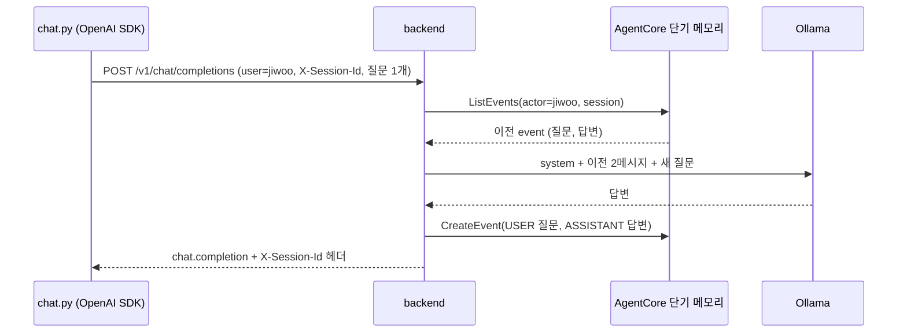

# 시나리오 2. 단기 메모리로 채팅창 하나의 멀티턴 대화 유지

## 이 시나리오의 목표

| 항목 | 내용 |
|---|---|
| 기능 | 단기 메모리(short-term memory). session 하나의 대화 원문을 서버에 저장하고 다음 턴에 복원 |
| 쓰는 도구 | backend `/v1/chat/completions`, `scripts/chat.py`(OpenAI 공식 SDK), `aws bedrock-agentcore list-events` |
| 입력 | actor `jiwoo`, 채팅창 하나, 질문 4개 |
| 작업 | 1. 새 채팅창에 자기소개 2. 같은 채팅창에서 이전 발언 묻기 3. 형식 요청과 일정 공유 4. CLI로 저장된 event 확인 |
| 달성할 것 | 클라이언트가 질문 하나만 보내도 모델이 이전 턴을 기억하고, 그 근거가 단기 메모리 event라는 것을 확인 |

## 단기 메모리는 채팅창의 대화 기록이다

ChatGPT 채팅창 하나를 떠올리면 단기 메모리가 무엇인지 바로 보입니다. 채팅창 안에서 "아까 내가 뭐라고 했지?"라고 물으면 모델이 답할 수 있는 것은, 서비스가 그 채팅창의 이전 메시지를 다시 모델 입력에 넣어 주기 때문입니다. AgentCore Memory에서는 이 기록을 event로 저장합니다. event는 `actorId`와 `sessionId` 아래에 시간순으로 쌓이는 불변 기록이며, 한 event에 대화 메시지를 1~100개 담을 수 있습니다.

이 핸즈온의 backend는 질문과 답변 한 쌍을 event 하나로 저장합니다. 다음 요청이 오면 같은 session의 event를 `ListEvents`로 읽어 최근 10개(20메시지)를 OpenAI messages 형식으로 되돌리고, 그 뒤에 새 질문을 붙여 모델에 보냅니다. frontend나 OpenAI SDK는 지금까지의 messages를 보내지 않고 새 질문 하나만 보냅니다. 대화 상태의 원본이 클라이언트가 아니라 서버에 있는 구조이며, OpenAI Responses API의 `previous_response_id`나 Conversations API가 하는 일과 같은 역할입니다.

단기 메모리가 다루지 않는 것도 분명히 해 둡니다. 단기 메모리는 다른 채팅창의 대화를 모르고, 사용자에 대한 사실을 정리해 두지도 않습니다. 그것은 [시나리오 3](./3-chat-windows.md)과 [시나리오 4](./4-long-term-memory.md)의 장기 메모리가 하는 일입니다. event는 memory를 만들 때 정한 보존 기간(이 실습은 7일)이 지나면 사라집니다.

### 용어

| 용어 | 뜻 | 이 실습의 예 |
|---|---|---|
| event | session에 쌓이는 불변 기록. 메시지 여러 개를 담음 | 질문 1개(`USER`)와 답변 1개(`ASSISTANT`)를 담은 event |
| payload | event 안의 메시지 하나. `conversational` 또는 `blob`, `json` | `{"conversational": {"role": "USER", "content": {"text": "..."}}}` |
| role | 메시지 발화자. `USER`, `ASSISTANT`, `TOOL`, `OTHER` | 이 시나리오는 `USER`, `ASSISTANT`만 사용 |
| eventId | 시간 기반 정렬 키가 붙은 event ID | `0000001794583989921#188eb459` |
| branch | 대화를 갈라 다른 흐름을 이어 가는 기능. 지정하지 않으면 `main` | `{"name": "main"}` |
| `X-Session-Id` | 이 backend가 채팅창을 구분하려고 쓰는 HTTP 헤더. OpenAI 표준이 아닌 확장 | `chat-1a3fe300260e` |

## 서버가 대화 기록을 가져야 하는 이유

LLM은 stateless라서 직전 턴도 기억하지 못합니다. 클라이언트가 전체 messages를 매번 보내는 방식은 가장 단순하지만, 다른 기기에서 같은 채팅창을 이어 쓸 수 없고 대화가 길수록 요청이 커지며, 어떤 기록을 몇 턴까지 넣을지 서버가 통제할 수 없습니다. 서버 쪽 기록이 있으면 "최근 10턴만 넣는다" 같은 정책을 서버에서 정하고, 채팅창을 다시 열 때 기록을 그대로 그릴 수 있습니다. 이 핸즈온의 frontend는 사이드바에서 채팅창을 클릭하면 `ListEvents` 결과로 대화를 다시 그립니다.

## 대안 비교

| 방식 | 대화 기록 위치 | 다른 기기에서 이어 쓰기 | 보존 기간 관리 | 장기 메모리로 연결 |
|---|---|---|---|---|
| 클라이언트가 전체 messages 전송 | 브라우저 | 불가 | 클라이언트 | 직접 구현 |
| Redis, DynamoDB에 직접 저장 | 자체 DB | 가능 | TTL 직접 설정 | 직접 구현 |
| OpenAI Conversations API | OpenAI | 가능 | OpenAI 정책 | OpenAI 모델에 묶임 |
| AgentCore 단기 메모리 | AgentCore | 가능 | memory의 `eventExpiryDuration` | 같은 event에서 자동 추출 |

## 컴포넌트 역할

| 컴포넌트 | 이 시나리오에서 하는 일 |
|---|---|
| `scripts/chat.py` | OpenAI 공식 SDK로 질문 하나와 `user`, `X-Session-Id`를 보냄 |
| backend | `ListEvents`로 이전 턴 복원, Ollama 호출, `CreateEvent`로 이번 턴 저장, 응답 헤더로 sessionId 반환 |
| Ollama | 복원된 messages만 보고 답함 |
| AgentCore 단기 메모리 | event 저장과 조회 |

## 흐름

같은 채팅창에서 두 번째 질문을 보냈을 때 backend가 단기 메모리를 읽고 쓰는 순서입니다.



## 실습

실습 환경은 [setup.md](./setup.md)로 준비합니다. 아래 명령은 모두 workspace 디렉터리에서 실행합니다.

```bash
cd aws/bedrock/agentcore-memory
set -a; source .runtime.env; set +a
export AWS_PAGER=""
```

### 1. 새 채팅창에 자기소개 보내기

`--session` 없이 보내면 backend가 새 sessionId를 만들고 응답 헤더 `X-Session-Id`로 돌려줍니다. `scripts/chat.py`는 OpenAI 공식 SDK(`openai==3.50.0`)를 쓰므로, 이 호출이 성공하면 backend가 SDK가 기대하는 Chat Completions 응답 형식을 지킨다는 뜻이기도 합니다.

```bash
uv run -q scripts/chat.py --user jiwoo "안녕, 나는 결제팀 백엔드 개발자 지우야. 주로 Go와 PostgreSQL을 써."
```

```text
session: chat-1a3fe300260e
answer : 안녕하세요 지우님. Go 언어와 PostgreSQL을 사용하여 백엔드를 개발하다니 놀라운 전공입니다. ...
memory : short_term_messages=0 long_term_records=0
```

`short_term_messages=0`은 이 채팅창에 이전 기록이 없어 모델에 넣은 과거 메시지가 0개라는 뜻입니다. sessionId는 실행마다 달라지므로, 이후 단계에서는 자기 출력의 값을 씁니다.

```bash
S=chat-1a3fe300260e   # 1단계 출력의 session 값으로 바꾼다
```

### 2. 같은 채팅창에서 이전 발언 묻기

이번 요청에도 질문 하나만 담깁니다. 모델이 답할 수 있다면 그 정보는 backend가 단기 메모리에서 채운 것입니다.

```bash
uv run -q scripts/chat.py --user jiwoo --session $S "내가 주로 쓰는 언어가 뭐라고 했지?"
```

```text
session: chat-1a3fe300260e
answer : 당신이 사용하시는 언어는 Go와 PostgreSQL입니다. ...
memory : short_term_messages=2 long_term_records=0
```

`short_term_messages=2`가 1단계의 질문과 답변 두 메시지입니다. 장기 메모리는 아직 비어 있으므로(`long_term_records=0`) 이 답의 근거는 단기 메모리뿐입니다.

### 3. 형식 요청과 일정 공유로 대화 이어 가기

시나리오 4에서 장기 메모리로 추출될 재료를 같은 채팅창에 두 턴 더 남깁니다.

```bash
uv run -q scripts/chat.py --user jiwoo --session $S "앞으로 답변은 세 줄 이내로 짧게 해줘. 코드 예시는 Go로 부탁해."
uv run -q scripts/chat.py --user jiwoo --session $S "다음 주 화요일에 결제 서비스 PostgreSQL을 16에서 17로 업그레이드할 계획이야."
```

```text
memory : short_term_messages=4 long_term_records=0
...
memory : short_term_messages=6 long_term_records=0
```

턴마다 모델에 들어가는 과거 메시지가 2개씩 늘어납니다. backend는 최근 10개 event(`SHORT_TERM_TURNS=10`)까지만 넣으므로 11번째 턴부터는 이 값이 20에서 더 늘지 않습니다. 3B 모델이라 "hiểu了"처럼 다른 언어가 섞인 답이 가끔 나오는데, 메모리 동작과는 관계없는 모델 품질 문제입니다.

### 4. CLI로 저장된 event 확인

backend가 저장한 기록을 AWS CLI로 직접 읽어, 모델이 본 과거 대화가 실제로 단기 메모리에 있는지 확인합니다.

```bash
aws bedrock-agentcore list-events --memory-id "$MEMORY_ID" --actor-id jiwoo --session-id $S \
  --query 'events[].{time: eventTimestamp, user: payload[0].conversational.content.text}' --output table
```

```text
+-----------------------------------+--------------------------------------------------------------------------------+
|               time                |                                     user                                       |
+-----------------------------------+--------------------------------------------------------------------------------+
|  2026-11-14T00:33:09.921000+09:00 |  다음 주 화요일에 결제 서비스 PostgreSQL을 16에서 17로 업그레이드할 계획이야.  |
|  2026-11-14T00:33:07.040000+09:00 |  앞으로 답변은 세 줄 이내로 짧게 해줘. 코드 예시는 Go로 부탁해.                |
|  2026-11-14T00:33:03.776000+09:00 |  내가 주로 쓰는 언어가 뭐라고 했지?                                            |
|  2026-11-14T00:33:01.202000+09:00 |  안녕, 나는 결제팀 백엔드 개발자 지우야. 주로 Go와 PostgreSQL을 써.            |
+-----------------------------------+--------------------------------------------------------------------------------+
```

event 4개가 보이며 최신 event가 맨 위에 옵니다. `ListEvents`는 최신순으로 돌려주므로 backend는 `eventTimestamp`로 다시 정렬해 오래된 순서로 모델에 넣습니다. 정렬을 빼면 모델이 대화를 거꾸로 읽게 됩니다.

event 하나의 전체 구조를 보면 질문과 답변이 한 event의 payload 두 개로 들어 있습니다.

```bash
aws bedrock-agentcore list-events --memory-id "$MEMORY_ID" --actor-id jiwoo --session-id $S --max-items 1 --output json
```

```text
{
    "events": [
        {
            "memoryId": "chat_memory_handson-6zXYmhCh5n",
            "actorId": "jiwoo",
            "sessionId": "chat-1a3fe300260e",
            "eventId": "0000001794583989921#188eb459",
            "eventTimestamp": "2026-11-14T00:33:09.921000+09:00",
            "payload": [
                {"conversational": {"content": {"text": "다음 주 화요일에 결제 서비스 PostgreSQL을 16에서 17로 업그레이드할 계획이야."}, "role": "USER"}},
                {"conversational": {"content": {"text": "알겠어요, 다음 주 화요일에 ..."}, "role": "ASSISTANT"}}
            ],
            "branch": {"name": "main"}
        }
    ]
}
```

### 5. 스트리밍 요청에서도 기록되는지 확인

OpenAI SDK의 `stream=True` 요청도 같은 방식으로 저장됩니다. backend는 Ollama의 SSE 청크를 그대로 흘려보내고, 스트림이 끝나면 모은 답변으로 event를 만듭니다.

```bash
uv run -q --with openai==3.50.0 python - <<'EOF'
from openai import OpenAI
client = OpenAI(base_url="http://localhost:8000/v1", api_key="unused")
chunks = [c.choices[0].delta.content for c in client.chat.completions.create(
  model="qwen2.5:3b", user="minho", stream=True, extra_headers={"X-Session-Id": "chat-stream-test"},
  messages=[{"role": "user", "content": "한 문장으로 인사해줘"}]) if c.choices and c.choices[0].delta.content]
print(len(chunks), "chunks:", "".join(chunks))
EOF
aws bedrock-agentcore list-events --memory-id "$MEMORY_ID" --actor-id minho --session-id chat-stream-test \
  --query 'events[].payload[].conversational.[role,content.text]' --output text
```

```text
24 chunks: 안녕하세요, TCK-1042 프로젝트와 관련하여 도움이 될까요?
USER	한 문장으로 인사해줘
ASSISTANT	안녕하세요, TCK-1042 프로젝트와 관련하여 도움이 될까요?
```

24개 청크로 나뉘어 도착한 답변이 event에는 한 문장으로 합쳐져 저장되었습니다. 인사에 티켓 번호 `TCK-1042`가 들어간 것은 [시나리오 6](./6-other-use-cases.md)에서 `minho`의 CRM 정보를 장기 메모리에 넣은 뒤에 실행했기 때문입니다. 시나리오 순서대로 따라 하면 이 시점의 `minho`에게는 장기 메모리가 없으므로 평범한 인사가 나옵니다. 청크 수는 실행마다 달라집니다.

## 부록. 실무에서 얻는 것

- 질문과 답변을 한 event에 묶으면 턴 하나가 API 호출 하나라서 `CreateEvent`의 session당 초당 5회 한도에 여유가 생깁니다. 반대로 질문을 먼저 저장하고 답변을 나중에 저장하면, 모델 호출이 실패했을 때도 질문이 남아 장애 분석에 쓸 수 있습니다. 이 핸즈온은 답변이 성공한 턴만 남기는 쪽을 택했습니다.
- 단기 메모리 과금은 event마다 최소 12KB로 계산됩니다([시나리오 7](./7-cost.md)). 짧은 메시지를 event 하나씩 따로 저장하면 실제 크기보다 훨씬 많이 과금되므로, 턴 단위로 묶는 설계가 비용에도 유리합니다.
- OpenAI 호환 API에 sessionId를 싣는 표준 필드는 없습니다. 이 핸즈온은 헤더(`X-Session-Id`)를 썼습니다. 일반 OpenAI 클라이언트는 이 헤더를 모르므로 매 요청이 새 채팅창이 되고, 클라이언트가 보낸 messages 중 마지막 user 메시지만 쓰입니다. 범용 클라이언트를 붙이려면 이 규칙을 문서로 알려야 합니다.

## 참고 문서

1. [CreateEvent - Amazon Bedrock AgentCore API Reference](https://docs.aws.amazon.com/bedrock-agentcore/latest/APIReference/API_CreateEvent.html)
2. [ListEvents - Amazon Bedrock AgentCore API Reference](https://docs.aws.amazon.com/bedrock-agentcore/latest/APIReference/API_ListEvents.html)
