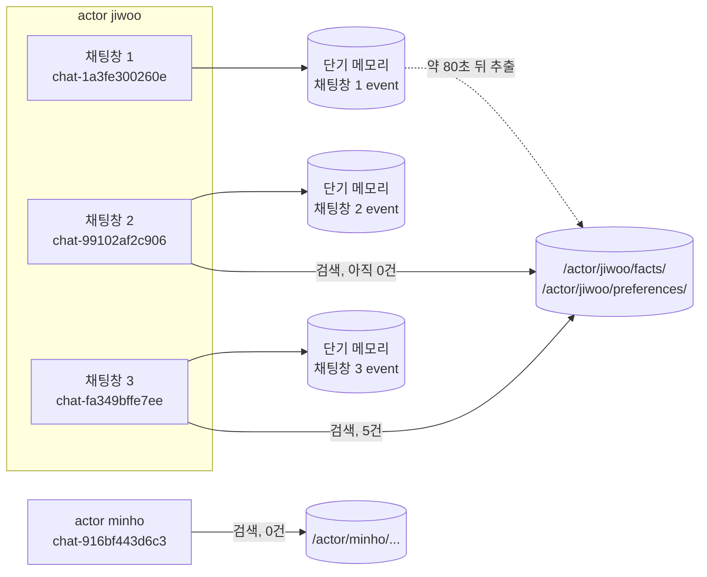
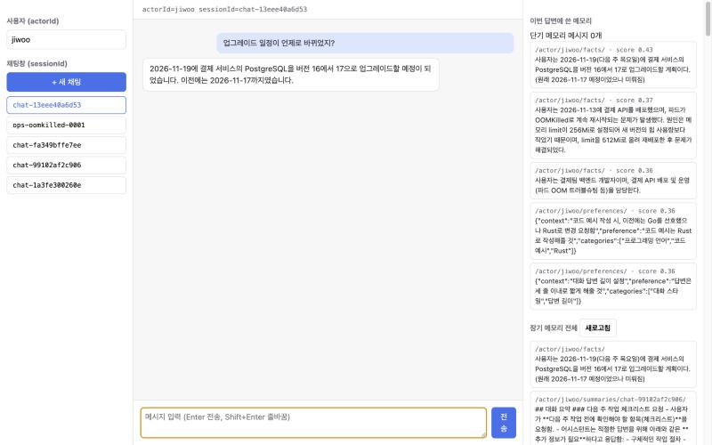

# 시나리오 3. 채팅창 여러 개와 사용자 여러 명이 메모리에 연결되는 방식

## 이 시나리오의 목표

| 항목 | 내용 |
|---|---|
| 기능 | actor와 session으로 기억의 경계 나누기. 채팅창끼리는 단기 메모리를 나누지 않고 장기 메모리를 공유 |
| 쓰는 도구 | 채팅 frontend(`http://localhost:8080`), `scripts/chat.py`, `list-sessions`, `list-actors` |
| 입력 | actor `jiwoo`의 채팅창 3개, actor `minho`의 채팅창 1개 |
| 작업 | 1. 추출 전에 새 채팅창 열기 2. 추출 완료 대기 3. 추출 후 새 채팅창 열기 4. 다른 사용자로 같은 질문 5. 채팅창과 사용자 목록 조회 6. 화면에서 확인 |
| 달성할 것 | "새 채팅창이 나를 기억하는 시점"과 "다른 사용자에게는 보이지 않는 경계"를 숫자로 확인 |

## 채팅창은 session, 사용자는 actor다

ChatGPT 왼쪽 사이드바의 채팅 목록을 AgentCore Memory로 옮기면 채팅창 하나가 session 하나이고, 로그인한 사람이 actor입니다. 이 핸즈온의 backend는 OpenAI 요청의 `user` 필드를 actorId로, `X-Session-Id` 헤더를 sessionId로 씁니다. frontend는 사이드바를 그릴 때 `ListSessions`로 그 actor의 session 목록을 가져오고, 채팅창을 클릭하면 `ListEvents`로 대화를 다시 그립니다.

두 메모리는 경계가 다릅니다. 단기 메모리는 `actorId + sessionId` 단위라서 채팅창 A의 대화는 채팅창 B에 보이지 않습니다. 장기 메모리는 namespace 단위인데, 이 핸즈온은 facts와 preferences의 namespace를 `/actor/{actorId}/facts/`처럼 session 없이 정했기 때문에 같은 사용자의 모든 채팅창이 이 record를 공유합니다. 반대로 summaries는 `/actor/{actorId}/summaries/{sessionId}/`라서 채팅창마다 따로 쌓입니다. 즉 "채팅창끼리 무엇을 공유할지"는 서비스가 아니라 namespace 템플릿이 정합니다.

중요한 점은 장기 메모리가 즉시 생기지 않는다는 것입니다. event가 저장된 뒤 비동기 추출이 끝나야 record가 생기므로, 대화 직후에 연 새 채팅창은 아직 사용자를 모릅니다. 이 시나리오에서 그 지연을 직접 잽니다.

### 용어

| 용어 | 뜻 | 이 실습의 예 |
|---|---|---|
| actor | 기억의 주인. 이 backend는 OpenAI 요청의 `user` 필드를 씀 | `jiwoo`, `minho` |
| session | actor 아래의 대화 묶음. 채팅창 하나 | `chat-1a3fe300260e`, `chat-99102af2c906`, `chat-fa349bffe7ee` |
| namespace 템플릿 | record 경로를 만드는 규칙. `{actorId}`, `{sessionId}`, `{memoryStrategyId}` 변수를 씀 | `/actor/{actorId}/facts/` |
| 공유 범위 | 같은 namespace를 읽는 채팅창의 범위 | facts, preferences는 사용자의 모든 채팅창, summaries는 그 채팅창만 |

## 경계를 시스템이 보장해야 하는 이유

사용자 여러 명이 같은 agent를 쓰면 기억이 섞이는 순간 개인정보 사고가 됩니다. 애플리케이션 코드에서 "이 사용자의 기록만 꺼낸다"는 조건을 매번 지키는 대신, 저장 구조 자체가 actor 단위로 나뉘어 있으면 조회 경로를 잘못 짜기 어렵습니다. AgentCore는 record 삭제 API가 namespace를 IAM 조건 키 판정에 쓴다고 명시할 만큼 namespace를 권한의 단위로도 다루므로, 경계를 코드와 IAM 정책 두 곳에서 걸 수 있습니다. 이 핸즈온은 IAM 정책 쪽 제한은 실습하지 않았습니다.

다만 경계는 actorId 문자열을 그대로 믿습니다. 이 핸즈온의 backend는 인증 없이 `user` 필드를 actorId로 쓰므로 누구나 다른 사람 이름으로 요청할 수 있습니다. 실서비스에서는 인증 토큰에서 actorId를 꺼내야 합니다. 또 actorId에는 `/`가 허용되므로 `jiwoo/facts` 같은 값을 받으면 namespace 경로가 다른 사용자의 하위 경로처럼 해석될 수 있습니다. backend는 actorId를 소문자, 숫자, `-`, `_`로 제한해 이 문제를 막습니다.

## 대안 비교

| 공유 설계 | namespace 예 | 새 채팅창이 아는 것 | 맞는 상황 |
|---|---|---|---|
| 채팅창마다 완전 분리 | `/actor/{actorId}/session/{sessionId}/` | 아무것도 모름 | 채팅창마다 맥락이 독립인 상담 |
| 사용자 단위 공유 (이 핸즈온) | `/actor/{actorId}/facts/` | 사용자 사실과 선호 | 개인 비서, ChatGPT의 메모리 기능 |
| 전략 단위 공유 | `/strategy/{memoryStrategyId}/` | 모든 사용자의 기록 | 팀 공용 지식. 개인정보가 섞이지 않는 데이터에 한함 |

## 컴포넌트 역할

| 컴포넌트 | 이 시나리오에서 하는 일 |
|---|---|
| frontend | 사이드바에 `ListSessions` 결과를 그리고, 오른쪽 패널에 이번 답변에 쓴 메모리를 보여 줌 |
| backend | 새 채팅창이면 sessionId 생성. 단기 메모리는 그 session만, 장기 메모리는 actor의 facts, preferences에서 검색 |
| AgentCore Memory | 같은 actor의 event에서 record를 추출해 actor 경로에 저장 |

## 흐름

한 사용자의 채팅창 세 개와 다른 사용자 한 명이 단기, 장기 메모리를 읽는 범위입니다.



## 실습

[시나리오 2](./2-short-term-memory.md)에서 채팅창 1에 대화 4턴을 남긴 직후에 이어서 실행합니다. 2단계의 대기는 시나리오 2의 마지막 질문을 보낸 시각부터 잽니다.

```bash
cd aws/bedrock/agentcore-memory
set -a; source .runtime.env; set +a
export AWS_PAGER=""
```

### 1. 추출이 끝나기 전에 새 채팅창 열기

시나리오 2의 마지막 질문 8초 뒤에 `--session` 없이 질문을 보내 채팅창 2를 엽니다.

```bash
uv run -q scripts/chat.py --user jiwoo "다음 주 작업 전에 체크할 것 알려줘"
```

```text
session: chat-99102af2c906
answer : 작업이 있다면 우선적으로 먼저 진행을 검토하는 것은 다음 주도 중요합니다. ... 필요한 작업의 절차나 간단한 시간 기준 등을 추가적으로 알려주실 수 있다면 더 도움이 될 것 같습니다.
memory : short_term_messages=0 long_term_records=0
```

새 채팅창이라 단기 메모리가 0이고, 장기 메모리도 아직 추출되지 않아 0입니다. 모델은 "다음 주 작업"이 PostgreSQL 업그레이드라는 것을 모르고 일반론으로 답합니다. 채팅창 1의 대화는 이 채팅창에 넘어오지 않습니다.

### 2. 장기 메모리 추출 완료 대기

facts namespace에 record가 생길 때까지 15초마다 개수를 셉니다.

```bash
until [ "$(aws bedrock-agentcore list-memory-records --memory-id "$MEMORY_ID" --namespace /actor/jiwoo/facts/ \
  --query 'length(memoryRecordSummaries)' --output text)" -gt 0 ]; do date -u +%T; sleep 15; done; date -u +%T
```

```text
15:33:21
15:33:37
15:33:53
15:34:10
15:34:26
```

시나리오 2의 마지막 event가 15:33:07(UTC)에 저장되었고 facts record는 15:34:26에 보였습니다. 이 실행에서는 약 80초가 걸렸습니다. 추출 시간은 실행마다 다르며, 같은 날 다른 실행에서는 1분 30초~3분이 걸렸습니다.

### 3. 추출 후 새 채팅창 열기

같은 질문으로 채팅창 3을 엽니다.

```bash
uv run -q scripts/chat.py --user jiwoo "다음 주 작업 전에 체크할 것 알려줘"
```

```text
session: chat-fa349bffe7ee
answer : 지우님의 다음 주 작업을 대비한 체크 리스트는 다음과 같습니다.

1. PostgreSQL 버전 16에서 17로 업그레이드 실시
2. 필요한 보안 측면 확인
3. 새로운 버전 기능 최대화 준비
memory : short_term_messages=0 long_term_records=5
  - [/actor/jiwoo/facts/] 사용자는 2026-11-17(다음 주 화요일)에 결제 서비스의 PostgreSQL을 버전 16에서 17로 업그레이드할 계획이다.
  - [/actor/jiwoo/facts/] 사용자는 답변을 세 줄 이내로 짧게 해달라고 요청했다.
  - [/actor/jiwoo/facts/] 사용자의 이름은 지우이다.
  - [/actor/jiwoo/preferences/] {"context":"대화 답변 길이 설정","preference":"답변은 세 줄 이내로 짧게 해줄 것","categories":["대화 스타일","답변 길이"]}
  - [/actor/jiwoo/preferences/] {"context":"코드 예시 작성","preference":"코드 예시는 Go로 작성해줄 것","categories":["프로그래밍 언어","코드 예시","Go"]}
```

단기 메모리는 여전히 0이지만 장기 메모리 record 5개가 들어가면서, 모델이 사용자 이름을 부르고 PostgreSQL 업그레이드를 첫 항목으로 꼽았습니다. 채팅창 3은 채팅창 1의 대화 원문을 한 번도 보지 않았습니다. 넘어온 것은 추출된 사실과 선호뿐입니다. "다음 주 화요일"이 `2026-11-17`이라는 절대 날짜로 바뀐 것도 볼 수 있는데, 추출 모델이 event 시각을 기준으로 상대 날짜를 풀어 쓴 결과입니다.

### 4. 다른 사용자로 같은 질문 보내기

actor만 `minho`로 바꿔 같은 질문을 보냅니다.

```bash
uv run -q scripts/chat.py --user minho "다음 주 작업 전에 체크할 것 알려줘"
```

```text
session: chat-916bf443d6c3
answer : 다음 주의 작업 검토 항목은 다음과 같습니다:

1. 다음 주 예정된 모든 업무와 일정 확인
2. 현재 진행 중인 프로젝트의 상태를 체크 (시간제한, 성과, 등)
...
memory : short_term_messages=0 long_term_records=0
```

`minho`의 장기 메모리 검색 결과는 0건이고 답도 일반론입니다. 검색 경로가 `/actor/minho/`이므로 `jiwoo`의 record는 후보에도 오르지 않습니다.

### 5. 채팅창과 사용자 목록 조회

사이드바가 쓰는 API를 CLI로 호출해 `jiwoo`의 채팅창 목록을 봅니다.

```bash
aws bedrock-agentcore list-sessions --memory-id "$MEMORY_ID" --actor-id jiwoo --output table
```

```text
|| actorId |             createdAt              |      sessionId      ||
|+---------+------------------------------------+---------------------+|
||  jiwoo  |  2026-11-14T00:33:01.366000+09:00  |  chat-1a3fe300260e  ||
||  jiwoo  |  2026-11-14T00:33:20.031000+09:00  |  chat-99102af2c906  ||
||  jiwoo  |  2026-11-14T00:34:50.146000+09:00  |  chat-fa349bffe7ee  ||
```

세 채팅창이 모두 보입니다. 목록 순서는 생성 시각과 일치하지 않을 수 있어 backend가 `createdAt` 기준 최신순으로 다시 정렬합니다. memory 전체의 사용자 목록은 `list-actors`로 봅니다.

```bash
aws bedrock-agentcore list-actors --memory-id "$MEMORY_ID" --query 'actorSummaries[].actorId' --output text
```

```text
alice bob jiwoo minho
```

`alice`와 `bob`은 문서를 쓰기 전 검증에 쓴 actor로, event를 모두 지운 뒤에도 목록에 남아 있습니다. event를 지워도 actor와 session 목록에서는 사라지지 않는다는 점은 [troubleshooting.md](./troubleshooting.md)에 정리했습니다. 처음 실습하는 독자에게는 `jiwoo`, `minho`만 보입니다.

### 6. 채팅 화면에서 확인

브라우저에서 `http://localhost:8080`을 열고 사용자 칸에 `jiwoo`를 입력한 뒤, **+ 새 채팅**을 누르고 "업그레이드 일정이 언제로 바뀌었지?"를 보냅니다. 아래는 [시나리오 4](./4-long-term-memory.md)에서 일정을 목요일로 바꾼 뒤에 찍은 화면입니다.



왼쪽 사이드바에 `jiwoo`의 채팅창 목록이, 오른쪽 **이번 답변에 쓴 메모리**에는 "단기 메모리 메시지 0개"와 facts, preferences record가 score와 함께 보입니다. 새 채팅창인데도 답이 맞는 근거가 오른쪽 패널의 장기 메모리라는 것을 화면에서 바로 읽을 수 있습니다.

## 부록. 실무에서 얻는 것

- "새 채팅창이 나를 기억한다"는 경험은 비동기 추출 때문에 1~3분 늦게 옵니다. 사용자가 방금 말한 내용을 다른 창에서 바로 물으면 모른다고 답하므로, 즉시 반영이 필요한 정보(예: 계정 설정)는 장기 메모리에 기대지 말고 애플리케이션 DB에 직접 저장해야 합니다.
- 채팅창 사이의 공유 범위는 namespace 템플릿으로 정해지고, 템플릿은 전략을 만든 뒤 바꾸기 어렵습니다. 처음 설계할 때 "사용자 단위로 공유할 것"과 "채팅창에만 남길 것"을 나누어 두어야 합니다.
- `ListSessions`는 빈 session도 계속 돌려줍니다. 사이드바에서 "삭제한 채팅창"을 숨기려면 애플리케이션이 삭제 표시를 따로 저장해야 합니다.

## 참고 문서

1. [ListSessions - Amazon Bedrock AgentCore API Reference](https://docs.aws.amazon.com/bedrock-agentcore/latest/APIReference/API_ListSessions.html)
2. [Specify namespaces - Amazon Bedrock AgentCore](https://docs.aws.amazon.com/bedrock-agentcore/latest/devguide/specify-long-term-memory-organization.html)
