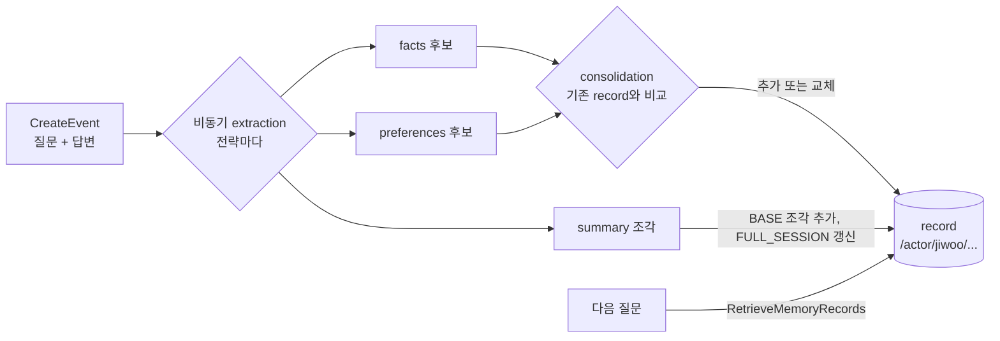

# 시나리오 4. 장기 메모리 추출, 전략별 record, 병합

## 이 시나리오의 목표

| 항목 | 내용 |
|---|---|
| 기능 | 장기 메모리(long-term memory). event에서 사실, 선호, 요약을 비동기로 뽑아 record로 저장하고, 바뀐 정보로 기존 record를 교체 |
| 쓰는 도구 | 내장 전략 SEMANTIC, USER_PREFERENCE, SUMMARIZATION, `list-memory-records`, `retrieve-memory-records`, `get-memory` |
| 입력 | 시나리오 2, 3에서 `jiwoo`가 남긴 event, 일정 변경 질문 1개 |
| 작업 | 1. 전략 구성 확인 2. 전략별 record 보기 3. 채팅창 전체 요약 찾기 4. 의미 검색 점수 보기 5. 바뀐 정보로 병합 확인 6. 프롬프트에 넣을 record 고르기 |
| 달성할 것 | 같은 대화가 전략마다 어떤 모양의 record가 되는지, 정보가 바뀌면 record가 쌓이는지 교체되는지 확인 |

## 장기 메모리는 대화에서 뽑은 노트다

회의가 끝나면 녹취록 전체를 다시 듣는 대신 회의록에 결정 사항만 적어 둡니다. 장기 메모리가 하는 일이 이것입니다. 단기 메모리 event가 녹취록이라면 장기 메모리 record는 그 녹취록에서 뽑은 노트이고, 무엇을 뽑을지는 memory strategy가 정합니다. 노트 작성은 비동기로 일어납니다. event가 저장되면 AgentCore가 백그라운드에서 추출(extraction) 모델을 돌려 후보를 만들고, 병합(consolidation) 단계에서 기존 record와 비교해 새로 추가할지, 기존 것을 교체할지, 버릴지를 정합니다.

내장 전략 네 가지는 같은 대화에서 서로 다른 노트를 만듭니다.

| 전략 | 뽑는 것 | record 모양 | 이 실습의 namespace | 추출까지 걸린 시간 |
|---|---|---|---|---|
| SEMANTIC (`facts`) | 사용자와 세계에 대한 사실 | 한 문장 | `/actor/{actorId}/facts/` | 약 80초~3분 |
| USER_PREFERENCE (`preferences`) | 선호와 그 맥락 | JSON(`context`, `preference`, `categories`) | `/actor/{actorId}/preferences/` | facts와 같은 시점 |
| SUMMARIZATION (`summaries`) | 채팅창 요약 | XML `<topic>` 조각(BASE)과 전체 요약(FULL_SESSION) | `/actor/{actorId}/summaries/{sessionId}/` | facts와 비슷하거나 몇 초 뒤 |
| EPISODIC (`episodes`) | 완결된 작업 흐름과 교훈 | JSON(situation, intent, assessment, turns) | `/actor/{actorId}/episodes/` | 10~15분([시나리오 6](./6-other-use-cases.md)) |

장기 메모리는 단기 메모리와 수명이 다릅니다. event는 7일 뒤 사라지지만 record는 기본적으로 만료되지 않습니다(2026-10부터 record TTL을 따로 설정할 수 있음). 원문은 지워져도 노트는 남는 구조입니다.

### 용어

| 용어 | 뜻 | 이 실습의 예 |
|---|---|---|
| memory record | 전략이 만든 장기 기억 하나. `memoryRecordId`는 `mem-`로 시작 | `mem-234380b965f1455995d0933d896b77ed8684` |
| extraction | event에서 record 후보를 뽑는 단계 | "사용자는 결제팀 백엔드 개발자이다." |
| consolidation | 후보와 기존 record를 비교해 추가, 교체, 무시를 정하는 단계 | 화요일 record가 목요일 record로 교체 |
| `recordType` | 시스템이 붙이는 record 종류 metadata | `BASE`, `FULL_SESSION`, `REFLECTION` |
| `ListMemoryRecords` | namespace 아래 record를 검색 없이 나열 | `--namespace-path /actor/jiwoo/` |
| `RetrieveMemoryRecords` | 질문과 의미가 가까운 record를 점수와 함께 검색 | `searchQuery: 데이터베이스 작업 일정` |
| `namespace` / `namespacePath` | 정확히 일치하는 경로 / 그 경로 아래 전체 | `/actor/jiwoo/facts/` / `/actor/jiwoo/` |

## 이 기능을 시스템이 제공해야 하는 이유

장기 메모리를 직접 만들면 "무엇을 저장할지"보다 "언제 고칠지"가 더 어렵습니다. 사용자가 "다음 주 화요일에 업그레이드한다"고 했다가 "목요일로 미뤘다"고 하면, 단순히 문장을 쌓는 구현은 두 사실을 모두 저장하고, 검색하면 둘 다 나와 모델이 어느 쪽을 믿을지 모르게 됩니다. 이 핸즈온의 5단계에서 AgentCore는 화요일 record를 지우고 목요일 record를 남겼습니다. 같은 일을 직접 하려면 새 사실마다 기존 record를 검색하고, LLM에게 충돌 여부를 판정시키고, 교체를 트랜잭션으로 처리해야 합니다.

## 대안 비교

| 방식 | 추출 | 충돌 처리 | 프롬프트 수정 | 저장 단가(1,000 record·월) |
|---|---|---|---|---|
| 내장 전략 (이 핸즈온) | AWS 관리 모델 | 내장 consolidation | 불가 | 0.75 USD |
| 내장 전략 override | 내 계정의 Bedrock 모델 | 내장 파이프라인 + 추가 프롬프트 | `appendToPrompt`로 추가 | 0.25 USD + 모델 호출 비용 |
| self-managed 전략 | 직접 구현 | 직접 구현 | 자유 | 0.25 USD |
| 벡터 DB 직접 구현 | 직접 구현 | 직접 구현 | 자유 | 벡터 DB 비용 |

## 컴포넌트 역할

| 컴포넌트 | 이 시나리오에서 하는 일 |
|---|---|
| 내장 전략 3개 | event에서 facts, preferences, summaries record 생성과 병합 |
| backend | 질문마다 facts, preferences namespace에서 각각 topK 3으로 의미 검색해 system 메시지에 넣음 |
| AWS CLI | record 나열, 검색, metadata 필터 |

## 흐름

event 하나가 저장된 뒤 전략별 record가 만들어지고, 다음 질문에서 검색되기까지의 흐름입니다.



## 실습

```bash
cd aws/bedrock/agentcore-memory
set -a; source .runtime.env; set +a
export AWS_PAGER=""
```

### 1. memory에 붙은 전략 구성 확인

Terraform으로 만든 전략 4개와 namespace 템플릿, 상태를 한 번에 봅니다.

```bash
aws bedrock-agentcore-control get-memory --memory-id "$MEMORY_ID" \
  --query 'memory.{status: status, expiry: eventExpiryDuration, strategies: strategies[].[name, type, namespaces[0], status]}' --output json
```

```text
{
    "status": "ACTIVE",
    "expiry": 7,
    "strategies": [
        ["episodes", "EPISODIC", "/actor/{actorId}/episodes/", "ACTIVE"],
        ["facts", "SEMANTIC", "/actor/{actorId}/facts/", "ACTIVE"],
        ["preferences", "USER_PREFERENCE", "/actor/{actorId}/preferences/", "ACTIVE"],
        ["summaries", "SUMMARIZATION", "/actor/{actorId}/summaries/{sessionId}/", "ACTIVE"]
    ]
}
```

네 전략이 모두 `ACTIVE`이고 namespace가 모두 `/actor/{actorId}/`로 시작합니다. 이 공통 접두사 덕분에 다음 단계에서 경로 하나로 한 사용자의 record를 모두 볼 수 있습니다.

### 2. 한 사용자의 장기 메모리를 전략별로 보기

`--namespace-path`는 그 경로 아래의 모든 namespace를 훑습니다. 시나리오 3까지 진행한 뒤 `jiwoo`의 record를 봅니다(요약 record는 길어서 앞부분만 옮김).

```bash
aws bedrock-agentcore list-memory-records --memory-id "$MEMORY_ID" --namespace-path /actor/jiwoo/ \
  --query 'memoryRecordSummaries[].[namespaces[0], content.text]' --output text
```

```text
/actor/jiwoo/facts/ 사용자는 답변을 세 줄 이내로 짧게 해달라고 요청했다.
/actor/jiwoo/facts/ 사용자는 주로 Go와 PostgreSQL을 사용한다.
/actor/jiwoo/facts/ 사용자는 코드 예시를 Go로 제공해달라고 요청했다.
/actor/jiwoo/facts/ 사용자는 2026-11-17(다음 주 화요일)에 결제 서비스의 PostgreSQL을 버전 16에서 17로 업그레이드할 계획이다.
/actor/jiwoo/facts/ 사용자는 결제팀 백엔드 개발자이다.
/actor/jiwoo/facts/ 사용자의 이름은 지우이다.
/actor/jiwoo/preferences/ {"context":"코드 예시 작성","preference":"코드 예시는 Go로 작성해줄 것","categories":["프로그래밍 언어","코드 예시","Go"]}
/actor/jiwoo/preferences/ {"context":"대화 답변 길이 설정","preference":"답변은 세 줄 이내로 짧게 해줄 것","categories":["대화 스타일","답변 길이"]}
/actor/jiwoo/summaries/chat-1a3fe300260e/ <topic name="사용자 기본 정보">
사용자 이름은 지우이며, 결제팀 백엔드 개발자로 주로 Go와 PostgreSQL을 사용한다.
</topic>
<topic name="응답 형식 요청">
...
/actor/jiwoo/summaries/chat-1a3fe300260e/ ## 사용자 기본 정보
- **이름**: 지우
- **직무**: 결제팀 백엔드 개발자
...
/actor/jiwoo/summaries/chat-99102af2c906/ ## 대화 요약
### 다음 주 작업 체크리스트 요청
...
```

같은 대화가 전략마다 다른 노트가 되었습니다. facts는 한 문장짜리 사실 6개로 쪼개졌고, preferences는 "언제 적용하는 선호인지"를 `context`에 함께 담은 JSON이 되었습니다. summaries는 채팅창마다 따로 쌓였고, 채팅창 1에는 `<topic>` 형식과 markdown 형식의 두 요약이 생겼습니다. 두 형식의 차이는 다음 단계에서 봅니다. 시나리오 2에서 모델이 받은 질문("내가 주로 쓰는 언어가 뭐라고 했지?")처럼 기억할 가치가 없는 문장은 facts에 들어가지 않았습니다.

### 3. 채팅창 전체 요약(FULL_SESSION) 찾기

summary 전략은 event 묶음마다 요약 조각(`BASE`)을 만들고, 그 조각들을 하나로 합친 채팅창 전체 요약(`FULL_SESSION`)을 따로 유지합니다. 시스템 metadata `x-amz-agentcore-memory-recordType`으로 전체 요약만 거릅니다.

```bash
aws bedrock-agentcore list-memory-records --memory-id "$MEMORY_ID" \
  --namespace /actor/jiwoo/summaries/chat-1a3fe300260e/ \
  --metadata-filters '[{"left":{"metadataKey":"x-amz-agentcore-memory-recordType"},"operator":"EQUALS_TO","right":{"metadataValue":{"stringValue":"FULL_SESSION"}}}]' \
  --query 'memoryRecordSummaries[].{id: memoryRecordId, created: createdAt, metadata: metadata}' --output json
```

```text
[
    {
        "id": "mem-234380b965f1455995d0933d896b77ed8684",
        "created": "2026-11-14T00:34:16.684000+09:00",
        "metadata": {
            "x-amz-agentcore-memory-recordType": {"stringValue": "FULL_SESSION"},
            "x-amz-agentcore-memory-strategyType": {"stringValue": "SUMMARIZATION"},
            "x-amz-agentcore-memory-createdAt": {"dateTimeValue": "2026-11-14T00:34:16.684000+09:00"},
            "x-amz-agentcore-memory-updatedAt": {"dateTimeValue": "2026-11-14T00:34:16.684000+09:00"}
        }
    }
]
```

필터를 빼면 같은 namespace에 `BASE` 1개와 `FULL_SESSION` 1개가 보입니다. `<topic>` 형식이 `BASE`, markdown 형식이 `FULL_SESSION`입니다. 채팅창 목록에 한 줄 설명을 붙이거나 오래된 채팅창을 이어 갈 때 모델에 넣을 요약은 `FULL_SESSION` 하나면 됩니다.

### 4. 질문과 가까운 record를 점수와 함께 검색

`ListMemoryRecords`가 목록이라면 `RetrieveMemoryRecords`는 검색입니다. 질문 문장에 "PostgreSQL"이나 "업그레이드"라는 단어가 없어도 의미가 가까운 record가 위에 옵니다.

```bash
aws bedrock-agentcore retrieve-memory-records --memory-id "$MEMORY_ID" --namespace /actor/jiwoo/facts/ \
  --search-criteria '{"searchQuery": "데이터베이스 작업 일정", "topK": 3}' \
  --query 'memoryRecordSummaries[].[score, content.text]' --output text
```

```text
0.37976499103963546 사용자는 2026-11-17(다음 주 화요일)에 결제 서비스의 PostgreSQL을 버전 16에서 17로 업그레이드할 계획이다.
0.35777811158882483 사용자는 코드 예시를 Go로 제공해달라고 요청했다.
0.35699742327654516 사용자는 답변을 세 줄 이내로 짧게 해달라고 요청했다.
```

업그레이드 일정 record가 1위입니다. 다만 1위와 2위의 점수 차이가 0.02로 작고, 관계없는 record도 topK를 채우려고 함께 나옵니다. 점수는 절대 기준이 아니라 상대 순위로 읽어야 하며, 임계값으로 자르려면 자기 데이터로 분포를 먼저 봐야 합니다.

### 5. 바뀐 정보로 기존 record가 교체되는지 확인

채팅창 3에서 일정과 선호를 동시에 바꿉니다.

```bash
uv run -q scripts/chat.py --user jiwoo --session chat-fa349bffe7ee "업그레이드 일정이 다음 주 목요일로 미뤄졌어. 그리고 이제부터 코드 예시는 Go 대신 Rust로 보여줘."
```

2분 뒤 요약을 제외한 record를 생성 시각과 함께 봅니다.

```bash
aws bedrock-agentcore list-memory-records --memory-id "$MEMORY_ID" --namespace-path /actor/jiwoo/ \
  --query 'memoryRecordSummaries[?!contains(namespaces[0], `summaries`)].[namespaces[0], createdAt, content.text]' --output text
```

```text
/actor/jiwoo/facts/ 2026-11-14T00:36:45.720000+09:00 사용자는 2026-11-19(다음 주 목요일)에 결제 서비스의 PostgreSQL을 버전 16에서 17로 업그레이드할 계획이다.
/actor/jiwoo/facts/ 2026-11-14T00:36:45.814000+09:00 사용자는 주로 Go와 PostgreSQL을 사용하며, Rust도 활용한다.
/actor/jiwoo/facts/ 2026-11-14T00:34:13.559000+09:00 사용자는 답변을 세 줄 이내로 짧게 해달라고 요청했다.
/actor/jiwoo/facts/ 2026-11-14T00:36:45.886000+09:00 사용자는 코드 예시를 Go 대신 Rust로 제공해달라고 요청했다.
/actor/jiwoo/preferences/ 2026-11-14T00:34:13.196000+09:00 {"context":"대화 답변 길이 설정","preference":"답변은 세 줄 이내로 짧게 해줄 것", ...}
/actor/jiwoo/facts/ 2026-11-14T00:34:13.559000+09:00 사용자는 결제팀 백엔드 개발자이다.
/actor/jiwoo/facts/ 2026-11-14T00:34:13.559000+09:00 사용자의 이름은 지우이다.
/actor/jiwoo/preferences/ 2026-11-14T00:36:45.579000+09:00 {"context":"코드 예시 작성 시, 이전에는 Go를 선호했으나 Rust로 변경 요청함","preference":"코드 예시는 Rust로 ...", ...}
```

2단계와 비교하면 세 가지가 바뀌었습니다. "화요일" record와 "코드 예시를 Go로" record가 목록에서 사라지고 00:36:45에 만든 "목요일", "Rust" record가 들어왔으며, facts 개수는 6개에서 7개가 아니라 6개 그대로입니다. preferences도 Go 선호가 사라지고 "이전에는 Go를 선호했으나 Rust로 변경"이라는 맥락을 담은 record로 바뀌었습니다. 병합은 기존 record를 고쳐 쓰지 않고, 옛 record를 지우고 새 ID의 record를 만드는 방식으로 동작했습니다. 그래서 record ID를 애플리케이션 DB에 외래 키처럼 저장해 두면 병합 뒤에 끊어집니다.

"주로 Go와 PostgreSQL을 사용하며, Rust도 활용한다"는 사용자가 말하지 않은 추론입니다. 추출 모델은 요청에서 사실을 유추하기도 하므로, 장기 메모리를 사실의 원천으로 쓰기 전에 이런 추론이 섞인다는 점을 감안해야 합니다.

### 6. 프롬프트에 넣을 record 고르기

backend는 처음에 `namespacePath=/actor/{actorId}/`로 모든 전략에서 topK 5를 검색했습니다. 이렇게 하니 길이가 긴 summaries record가 topK를 대부분 차지했고, markdown 요약 5개가 들어간 프롬프트를 받은 3B 모델이 중국어로 답했습니다. 지금은 facts와 preferences namespace에서 각각 topK 3으로 검색합니다(`backend/memory.py`의 `PROMPT_NAMESPACES`).

```python
PROMPT_NAMESPACES = ("facts", "preferences")

for kind in PROMPT_NAMESPACES:
  response = client.retrieve_memory_records(
    memoryId=MEMORY_ID,
    namespace=f"{actor_namespace(actor_id)}{kind}/",
    searchCriteria={"searchQuery": query[:10000], "topK": LONG_TERM_TOP_K},
  )
```

이 선택의 대가는 요청마다 `RetrieveMemoryRecords`를 두 번 부르는 것입니다. 검색은 1,000회당 0.50 USD로 과금되므로 검색 비용이 두 배가 됩니다([시나리오 7](./7-cost.md)). 큰 모델을 쓰거나 요약이 필요한 질문이 많다면 `namespacePath` 한 번으로 검색하고 topK를 늘리는 편이 낫습니다.

## 부록. 실무에서 얻는 것

- 장기 메모리 반영은 비동기라 즉시성이 없습니다. 이 실습에서 facts는 80초~3분, episodes는 10~15분 뒤에 생겼습니다. 사용자가 "방금 말했잖아"라고 할 수 있는 정보는 단기 메모리로 커버되는 같은 채팅창 안에서만 확실합니다.
- 병합은 옛 record를 지우고 새 record를 만드므로 record ID는 안정적인 식별자가 아닙니다. 외부 시스템과 연결하려면 metadata 키를 정의해 두고 그 값으로 찾는 편이 안전합니다.
- 추출 결과에는 추론과 상대 날짜의 절대화가 섞입니다. "다음 주 화요일"이 `2026-11-17`이 된 것은 편리하지만, event 시각이 잘못 들어가면 날짜도 틀어집니다. `CreateEvent`의 `eventTimestamp`는 실제 대화 시각으로 넣어야 합니다.
- 프롬프트에 넣을 기억의 양은 모델 크기에 맞춰야 합니다. 같은 record라도 3B 모델은 5개짜리 긴 요약에서 무너졌고, 짧은 사실 6개에서는 안정적으로 답했습니다.

## 참고 문서

1. [Built-in strategies - Amazon Bedrock AgentCore](https://docs.aws.amazon.com/bedrock-agentcore/latest/devguide/built-in-strategies.html)
2. [Summary strategy - Amazon Bedrock AgentCore](https://docs.aws.amazon.com/bedrock-agentcore/latest/devguide/summary-strategy.html)
3. [RetrieveMemoryRecords - Amazon Bedrock AgentCore API Reference](https://docs.aws.amazon.com/bedrock-agentcore/latest/APIReference/API_RetrieveMemoryRecords.html)
4. [Amazon Bedrock AgentCore pricing](https://aws.amazon.com/bedrock/agentcore/pricing/)
