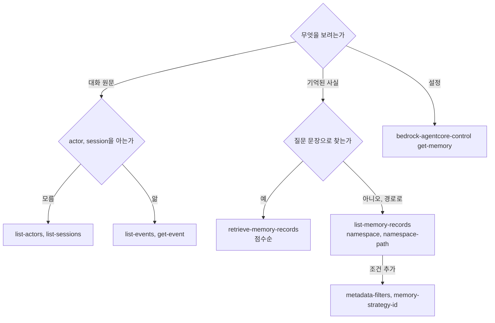

# 시나리오 5. SQL SELECT처럼 메모리 조회하기 (AWS CLI, 콘솔)

## 이 시나리오의 목표

| 항목 | 내용 |
|---|---|
| 기능 | 단기 메모리 event와 장기 메모리 record를 조건으로 조회, 집계, 단건 조회 |
| 쓰는 도구 | AWS CLI `bedrock-agentcore`(JMESPath `--query`), AgentCore 콘솔 |
| 입력 | 시나리오 2~4, 6에서 쌓인 `jiwoo`, `minho`의 event와 record |
| 작업 | 1. 사용자와 채팅창 목록 2. 채팅창 대화 최근 N개 3. namespace 조건 조회 4. GROUP BY 집계 5. 단건 조회 6. 의미 검색 7. 콘솔에서 확인 |
| 달성할 것 | "이 사용자에 대해 무엇을 기억하고 있나"라는 질문에 CLI 한두 줄로 답할 수 있음 |

## 메모리를 테이블 두 개로 보기

AgentCore Memory에는 SQL이 없지만, 데이터를 테이블 두 개로 생각하면 API가 어떤 `SELECT`에 해당하는지 바로 대응됩니다. 단기 메모리는 `events(actor_id, session_id, event_id, event_timestamp, payload)` 테이블이고, 장기 메모리는 `records(record_id, namespace, strategy_id, content, metadata, created_at)` 테이블입니다. 두 테이블 모두 인덱스가 정해져 있어서 아무 열로나 WHERE를 걸 수 없습니다. event는 반드시 actor와 session을 알아야 읽을 수 있고, record는 반드시 namespace(정확히 일치 또는 경로 접두사)를 알아야 읽을 수 있습니다.

| 하고 싶은 일 | SQL로 쓰면 | AgentCore API, CLI |
|---|---|---|
| 사용자 목록 | `SELECT DISTINCT actor_id FROM events` | `list-actors` |
| 사용자의 채팅창 목록 | `SELECT DISTINCT session_id FROM events WHERE actor_id = ?` | `list-sessions --actor-id` |
| 채팅창 대화 최근 N개 | `SELECT * FROM events WHERE actor_id = ? AND session_id = ? ORDER BY event_timestamp DESC LIMIT n` | `list-events --max-items n` |
| event 단건 | `SELECT * FROM events WHERE event_id = ?` | `get-event` |
| 경로가 정확히 같은 record | `SELECT * FROM records WHERE namespace = ?` | `list-memory-records --namespace` |
| 경로 아래 record 전체 | `SELECT * FROM records WHERE namespace LIKE '/actor/jiwoo/%'` | `list-memory-records --namespace-path` |
| metadata 조건 | `... AND metadata->>'recordType' = 'FULL_SESSION'` | `--metadata-filters` (최대 5개) |
| 전략 조건 | `... AND strategy_id = ?` | `--memory-strategy-id` |
| 의미가 가까운 순 | `ORDER BY similarity(content, ?) DESC LIMIT k` | `retrieve-memory-records --search-criteria` |
| record 단건 | `SELECT * FROM records WHERE record_id = ?` | `get-memory-record` |
| 개수, 집계 | `COUNT(*)`, `GROUP BY` | 없음. CLI `--query`의 `length()`나 셸의 `uniq -c` |
| 삭제 | `DELETE` | `delete-event`, `batch-delete-memory-records` |

`JOIN`과 `GROUP BY`는 API에 없습니다. 여러 사용자를 가로지르는 분석이 필요하면 Kinesis 스트리밍으로 record 변경을 받아 분석용 저장소에 따로 쌓는 것이 정석이고, 이 핸즈온의 규모에서는 CLI 출력을 셸로 집계하는 것으로 충분합니다.

### 용어

| 용어 | 뜻 | 이 실습의 예 |
|---|---|---|
| `--query` | AWS CLI가 응답 JSON에 적용하는 JMESPath 식. 서버가 아니라 클라이언트에서 거름 | `memoryRecordSummaries[].content.text` |
| `--metadata-filters` | 서버가 거르는 record metadata 조건 | `x-amz-agentcore-memory-recordType = FULL_SESSION` |
| 시스템 metadata | AgentCore가 모든 record에 붙이는 `x-amz-agentcore-memory-*` 키 | `recordType`, `strategyType`, `createdAt`, `updatedAt` |
| `--max-items` | CLI가 가져올 최대 개수. 넘으면 `NextToken`이 나옴 | `--max-items 1` |

## 직접 조회할 수 있어야 하는 이유

메모리를 쓰는 agent가 이상하게 답하면 원인은 대개 "무엇이 기억되어 있었나"입니다. 사용자가 "왜 제가 Rust 개발자라고 하나요?"라고 물으면 그 사용자의 facts를 열어 "주로 Go와 PostgreSQL을 사용하며, Rust도 활용한다"라는 추론 record를 찾아야 합니다([시나리오 4](./4-long-term-memory.md)). 개인정보 열람 요청에 응할 때도 같은 조회가 필요합니다. 애플리케이션 화면을 거치지 않고 CLI로 바로 볼 수 있어야 장애 대응과 감사가 빨라집니다.

`--query`는 클라이언트 쪽 필터라는 점도 알아 두어야 합니다. `--query`로 1건만 남겨도 API는 전체 페이지를 돌려주고 그만큼 조회 한도와 시간을 씁니다. 서버에서 거를 수 있는 조건(`--namespace`, `--metadata-filters`, `--memory-strategy-id`)을 먼저 쓰고, 출력 모양만 `--query`로 다듬습니다.

## 대안 비교

| 조회 수단 | 장점 | 한계 | 쓰는 시점 |
|---|---|---|---|
| AWS CLI (이 시나리오) | 모든 API, 스크립트화, JMESPath | 화면 없음 | 장애 분석, 정리 스크립트, 문서화 |
| AgentCore 콘솔 | 클릭으로 리소스와 전략 구성 확인 | 대량 조회와 집계에 불편 | 리소스 상태와 설정 확인 |
| 애플리케이션 API (`/memory/...`) | 사용자 화면에 맞춘 모양 | 만든 것만 볼 수 있음 | 사용자에게 "내 기억" 보여 주기 |
| Kinesis 스트리밍 + 분석 DB | SQL, JOIN, 대시보드 | 별도 파이프라인 운영 | 사용자 전체 통계, 장기 보관 분석 |

## 컴포넌트 역할

| 컴포넌트 | 이 시나리오에서 하는 일 |
|---|---|
| `bedrock-agentcore` (data plane) | event와 record 조회 |
| `bedrock-agentcore-control` (control plane) | memory와 전략 구성 조회 |
| AgentCore 콘솔 | memory 상태, 전략 구성 확인 |

## 흐름

조회 질문에 따라 어느 API로 가는지 정리한 흐름입니다.



## AWS CLI 예제

```bash
cd aws/bedrock/agentcore-memory
set -a; source .runtime.env; set +a
export AWS_PAGER=""
```

### 1. 사용자와 채팅창 목록 조회

`SELECT DISTINCT`에 해당하는 두 호출입니다. 출력은 시나리오 3의 5단계와 같습니다.

```bash
aws bedrock-agentcore list-actors --memory-id "$MEMORY_ID" --query 'actorSummaries[].actorId' --output text
aws bedrock-agentcore list-sessions --memory-id "$MEMORY_ID" --actor-id jiwoo --query 'sessionSummaries[].sessionId' --output text
```

### 2. 채팅창 대화 최근 N개와 개수 조회

`ORDER BY event_timestamp DESC LIMIT 1`은 `--max-items 1`입니다. `ListEvents`가 최신순으로 돌려주므로 정렬을 따로 지정하지 않습니다. 개수만 필요하면 payload를 빼고 `length()`로 셉니다.

```bash
aws bedrock-agentcore list-events --memory-id "$MEMORY_ID" --actor-id jiwoo --session-id chat-1a3fe300260e \
  --max-items 1 --query 'events[0].payload[0].conversational.content.text' --output text
aws bedrock-agentcore list-events --memory-id "$MEMORY_ID" --actor-id jiwoo --session-id chat-1a3fe300260e \
  --no-include-payloads --query 'length(events)'
```

```text
다음 주 화요일에 결제 서비스 PostgreSQL을 16에서 17로 업그레이드할 계획이야.
None
4
```

첫 명령 뒤의 `None`은 `--max-items`로 잘랐을 때 text 출력에 붙는 다음 페이지 토큰 자리입니다.

### 3. namespace 조건으로 record 조회

`WHERE namespace = ?`와 `WHERE namespace LIKE ?%`의 차이를 같은 사용자로 비교합니다. 정확히 일치는 facts만, 경로 접두사는 그 사용자의 모든 전략을 돌려줍니다.

```bash
aws bedrock-agentcore list-memory-records --memory-id "$MEMORY_ID" --namespace /actor/jiwoo/facts/ \
  --query 'length(memoryRecordSummaries)'
aws bedrock-agentcore list-memory-records --memory-id "$MEMORY_ID" --namespace-path /actor/jiwoo/ \
  --query 'length(memoryRecordSummaries)'
```

```text
7
28
```

facts 7건은 시나리오 4의 6건에 시나리오 6의 장애 대응 대화에서 뽑힌 사실 1건이 더해진 값입니다. 경로 접두사 조회의 28건에는 facts, preferences, summaries, episodes와 reflection이 모두 들어 있습니다. 숫자는 실습 진행 정도에 따라 달라집니다.

### 4. namespace별 record 수 집계

API에 `GROUP BY`가 없으므로 namespace 목록을 받아 셸에서 셉니다. sed로 `/actor/<사용자>/<전략>/` 까지만 남기면 채팅창별 summaries가 하나로 묶입니다.

```bash
aws bedrock-agentcore list-memory-records --memory-id "$MEMORY_ID" --namespace-path /actor/ \
  --query 'memoryRecordSummaries[].namespaces[0]' --output text \
  | tr '\t' '\n' | sed -E 's#(/actor/[^/]+/[^/]*/?).*#\1#' | sort | uniq -c
```

```text
   5 /actor/jiwoo/
   4 /actor/jiwoo/episodes/
   7 /actor/jiwoo/facts/
   2 /actor/jiwoo/preferences/
  10 /actor/jiwoo/summaries/
   2 /actor/minho/
   2 /actor/minho/episodes/
   5 /actor/minho/facts/
   1 /actor/minho/preferences/
   6 /actor/minho/summaries/
```

`/actor/jiwoo/` 바로 아래의 5건은 episodic 전략의 reflection입니다. reflection namespace를 episode보다 한 단계 위(`/actor/{actorId}/`)로 정했기 때문에 사용자 경로 바로 아래에 쌓입니다. 검증 중에 다른 actor를 썼다면 그 actor의 행도 함께 나옵니다.

### 5. record 단건 조회

`SELECT * WHERE record_id = ?`는 `get-memory-record`입니다. 목록 API보다 필드가 많아서 `timestamp`(근거 event의 시각)와 시스템 metadata를 함께 볼 수 있습니다.

```bash
ID=$(aws bedrock-agentcore list-memory-records --memory-id "$MEMORY_ID" --namespace /actor/jiwoo/facts/ \
  --query 'memoryRecordSummaries[0].memoryRecordId' --output text)
aws bedrock-agentcore get-memory-record --memory-id "$MEMORY_ID" --memory-record-id "$ID" --output json
```

```text
{
    "memoryRecord": {
        "memoryRecordId": "mem-b4315592-d419-48c4-928a-eb6de209c802",
        "content": {
            "text": "사용자는 2026-11-19(다음 주 목요일)에 결제 서비스의 PostgreSQL을 버전 16에서 17로 업그레이드할 계획이다. (원래 2026-11-17 예정이었으나 미뤄짐)"
        },
        "memoryStrategyId": "facts-NvvwAO7Tog",
        "namespaces": ["/actor/jiwoo/facts/"],
        "createdAt": "2026-11-14T00:36:45.720000+09:00",
        "timestamp": "2026-11-14T00:35:40.539000+09:00",
        "metadata": {
            "x-amz-agentcore-memory-recordType": {"stringValue": "BASE"},
            "x-amz-agentcore-memory-strategyType": {"stringValue": "SEMANTIC"},
            ...
        }
    }
}
```

`timestamp`(00:35:40)는 이 사실이 나온 대화 시각이고 `createdAt`(00:36:45)은 record가 만들어진 시각입니다. 둘의 차이 65초가 이 record의 추출 지연입니다. 본문 끝의 "(원래 2026-11-17 예정이었으나 미뤄짐)"은 시나리오 4의 5단계 직후에는 없던 문구로, 이후 대화가 이어지며 같은 record가 다시 병합된 결과입니다.

### 6. 질문 문장으로 의미 검색

`ORDER BY similarity`에 해당하는 검색은 시나리오 4의 4단계와 같습니다. metadata 필터를 함께 걸면 검색 범위를 좁힐 수 있습니다. 아래는 summaries 중 채팅창 전체 요약만 대상으로 검색합니다.

```bash
aws bedrock-agentcore retrieve-memory-records --memory-id "$MEMORY_ID" --namespace-path /actor/jiwoo/summaries/ \
  --search-criteria '{"searchQuery": "업그레이드 계획", "topK": 2,
    "metadataFilters": [{"left":{"metadataKey":"x-amz-agentcore-memory-recordType"},"operator":"EQUALS_TO","right":{"metadataValue":{"stringValue":"FULL_SESSION"}}}]}' \
  --query 'memoryRecordSummaries[].[score, namespaces[0]]' --output text
```

```text
0.43743694504666464	/actor/jiwoo/summaries/chat-13eee40a6d53/
0.4330194599955256	/actor/jiwoo/summaries/chat-fa349bffe7ee/
```

업그레이드 일정을 다룬 채팅창 두 곳의 전체 요약이 나왔습니다. `chat-13eee40a6d53`은 시나리오 3의 6단계에서 화면으로 연 채팅창입니다. 조각(`BASE`) 요약은 필터에 걸려 후보에서 빠졌습니다.

## AgentCore 콘솔 예제

콘솔은 대량 조회보다 리소스 구성을 확인하는 데 씁니다. 이 핸즈온을 검증한 환경에서는 콘솔 로그인 없이 진행했기 때문에 아래 단계는 화면에서 직접 확인하지 않았으며, 메뉴 이름은 콘솔 개편에 따라 달라질 수 있습니다. 화면에서 볼 값은 CLI 결과와 같으므로, 값이 다르면 CLI 결과를 기준으로 판단합니다.

### 1. memory 목록에서 상태 확인

1. AWS 콘솔 오른쪽 위 리전을 **아시아 태평양(서울) ap-northeast-2**로 바꿉니다.
2. 서비스 검색에서 **Amazon Bedrock AgentCore**를 열고 왼쪽 메뉴에서 **Memory**를 고릅니다.
3. 목록에서 `chat_memory_handson-`으로 시작하는 memory의 상태가 **Active**인지 봅니다. CLI의 `get-memory` 결과 `status: ACTIVE`와 같은 값입니다.

### 2. 전략과 namespace 확인

memory 이름을 눌러 상세 화면으로 들어가 전략 목록에서 `facts`, `preferences`, `summaries`, `episodes` 네 개와 각 namespace(`/actor/{actorId}/facts/` 등)를 확인합니다. 이벤트 보존 기간이 7일인지도 같은 화면에서 봅니다.

### 3. event와 record는 CLI로 조회

콘솔에서 event 원문과 record 목록을 actor, namespace 조건으로 살피는 기능은 이 핸즈온에서 확인하지 못했습니다. 사용자별 기억 열람, 집계, 삭제는 위의 CLI 예제나 `scripts/forget_actor.sh`로 합니다.

## 부록. 실무에서 얻는 것

- 조회 경로를 설계하는 것은 SQL의 인덱스를 설계하는 것과 같습니다. AgentCore에서 인덱스는 actor, session, namespace, 그리고 직접 정의한 metadata 키(최대 10개)뿐입니다. "지난주에 결제 관련 이야기를 한 사용자"처럼 namespace에 없는 기준으로 찾아야 한다면, 처음부터 metadata 키를 정의하거나 스트리밍으로 분석 DB에 쌓아야 합니다.
- `list-memory-records --namespace-path /`는 memory 전체를 훑습니다. 사용자가 늘면 페이지가 많아지고 조회 한도(초당 30회)를 쓰므로, 운영 스크립트는 항상 `/actor/<id>/`처럼 범위를 좁혀 부릅니다.
- record에는 근거 event를 가리키는 ID가 없고 `timestamp`만 있습니다. "이 기억이 어느 대화에서 나왔나"를 추적하려면 같은 actor의 session을 시각으로 찾아야 하며, event 보존 기간(7일)이 지나면 근거 원문은 사라집니다.

## 참고 문서

1. [ListMemoryRecords - Amazon Bedrock AgentCore API Reference](https://docs.aws.amazon.com/bedrock-agentcore/latest/APIReference/API_ListMemoryRecords.html)
2. [GetMemoryRecord - Amazon Bedrock AgentCore API Reference](https://docs.aws.amazon.com/bedrock-agentcore/latest/APIReference/API_GetMemoryRecord.html)
3. [AWS CLI bedrock-agentcore reference](https://docs.aws.amazon.com/cli/latest/reference/bedrock-agentcore/)
