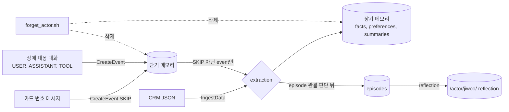

# 시나리오 6. 대화 밖 데이터 적재, 추출 제외, 작업 경험(episode), 사용자 기억 삭제

## 이 시나리오의 목표

| 항목 | 내용 |
|---|---|
| 기능 | 채팅 외의 메모리 활용 네 가지: IngestData로 외부 데이터 적재, `extractionMode=SKIP`으로 민감 event 추출 제외, episodic 전략의 episode와 reflection, actor 단위 삭제 |
| 쓰는 도구 | `ingest-data`, `create-event --extraction-mode SKIP`, `create-event`(TOOL role), `scripts/forget_actor.sh` |
| 입력 | CRM 고객 정보 JSON(`scripts/payloads/crm-profile.json`), 카드 번호가 든 메시지, 파드 OOMKilled 장애 대응 대화(`scripts/payloads/episode-oomkilled.json`) |
| 작업 | 1. CRM JSON 적재 2. 민감 event 추출 제외 3. 장애 대응 대화를 episode로 기록 4. reflection 확인 5. 사용자 기억 삭제 |
| 달성할 것 | 장기 메모리를 "대화 요약기"가 아니라 사용자 프로필 저장소, 경험 학습 저장소, 삭제 가능한 개인정보 저장소로 쓰는 방법과 그 지연을 확인 |

## 대화 말고도 기억할 것이 있다

[시나리오 4](./4-long-term-memory.md)까지의 장기 메모리는 사용자가 채팅창에 말한 것만 재료로 삼았습니다. 실제 서비스의 agent는 대화 밖에서도 사용자를 압니다. 상담 agent라면 CRM의 계약 정보와 열린 티켓을, 운영 agent라면 지난 장애 대응 기록을 알아야 첫 마디부터 맥락 있는 답을 합니다. 반대로 대화에 나왔더라도 기억하면 안 되는 것(카드 번호, 비밀번호)이 있고, 사용자가 요청하면 기억 전체를 지워야 합니다. 이 시나리오는 이 네 가지를 각각 하나의 API로 확인합니다.

| 활용 | 필요한 상황 | API |
|---|---|---|
| 외부 데이터 적재 | 대화 전에 사용자 프로필, CRM, 과거 상담 이력을 장기 메모리에 넣기 | `IngestData` (2026-08 추가) |
| 추출 제외 | 이번 대화에서만 쓰고 장기 기억으로 남기지 않을 정보 | `CreateEvent`의 `extractionMode=SKIP` |
| 작업 경험 학습 | 도구를 써서 문제를 푼 과정과 성패를 다음 작업에 참고 | EPISODIC 전략과 reflection (2026-03 추가) |
| 기억 삭제 | 개인정보 삭제 요청, 탈퇴 | `BatchDeleteMemoryRecords`, `DeleteEvent` |

### 용어

| 용어 | 뜻 | 이 실습의 예 |
|---|---|---|
| IngestData | event 없이 내용을 바로 장기 메모리 추출 파이프라인에 넣는 API. 대화형 또는 JSON payload | CRM 고객 정보 JSON 1건 |
| `extractionMode=SKIP` | event를 단기 메모리에만 저장하고 장기 메모리 추출에서 뺌 | 테스트 카드 번호가 든 메시지 |
| episode | 하나의 작업 흐름을 상황, 의도, 행동, 성패로 정리한 record. 완결되었다고 판단되어야 생성 | 파드 재시작 원인 찾기와 해결 |
| reflection | 여러 episode를 보고 만든 일반화된 교훈 | "Kubernetes Pod Restart Diagnosis: OOMKilled Pattern" |
| `TOOL` role | 도구 실행 결과를 담는 메시지 역할. episode 품질을 높임 | `kubectl describe pod` 출력 |

## 이 기능들을 시스템이 제공해야 하는 이유

외부 데이터를 장기 메모리에 넣으려면 예전에는 가짜 대화 event를 만들어야 했고, 그러면 단기 메모리와 채팅창 목록이 오염되었습니다. IngestData는 단기 메모리를 거치지 않으므로 채팅 기록에 흔적이 남지 않습니다. 이 실습에서도 `minho`의 CRM 적재는 `list-sessions`에 나타나지 않았습니다.

민감 정보는 추출 모델이 판단해서 걸러 주기를 기대하면 안 됩니다. 추출 모델은 "기억할 가치가 있는 사실"을 뽑도록 만들어졌고, 카드 번호를 결제 테스트에 쓰라는 문장은 그 기준에 맞을 수 있습니다. 애플리케이션이 민감하다고 아는 event는 명시적으로 추출에서 빼야 합니다.

삭제는 개인정보 규정 때문에 반드시 필요합니다. namespace를 actor 아래로 모아 두었다면 경로 하나로 그 사용자의 record를 모두 찾을 수 있지만, event는 session마다 하나씩 지워야 하므로 스크립트가 필요합니다.

## 대안 비교

| 활용 | 직접 구현 | AgentCore |
|---|---|---|
| 외부 데이터 적재 | 프로필을 별도 DB에 두고 프롬프트에 직접 삽입 | IngestData가 facts, preferences, summaries로 쪼개 저장. 대화에서 나온 기억과 같은 검색 경로로 꺼냄 |
| 추출 제외 | 저장 전에 마스킹 | event 단위 `SKIP`. 단기 메모리에는 원문이 남음 |
| 작업 경험 | 실행 로그를 사람이 읽고 runbook 작성 | episode와 reflection 자동 생성. 10~15분 지연 |
| 기억 삭제 | 저장소마다 삭제 로직 | namespace 경로로 record 찾기 + session별 event 삭제 |

## 컴포넌트 역할

| 컴포넌트 | 이 시나리오에서 하는 일 |
|---|---|
| AWS CLI | IngestData, CreateEvent 호출 |
| 내장 전략 4개 | IngestData 내용과 장애 대응 대화에서 record 생성 |
| EPISODIC 전략 | 완결된 작업을 episode로, episode 묶음을 reflection으로 정리 |
| `scripts/forget_actor.sh` | 한 actor의 record와 event 삭제 |

## 흐름

네 가지 활용이 단기, 장기 메모리 중 어디를 거치는지 나타낸 흐름입니다.



## 실습

```bash
cd aws/bedrock/agentcore-memory
set -a; source .runtime.env; set +a
export AWS_PAGER=""
```

### 1. CRM 고객 정보를 IngestData로 장기 메모리에 적재

`scripts/payloads/crm-profile.json`은 고객 `minho`의 플랜, 계약 갱신일, 선호 연락 수단, 열린 티켓을 담은 JSON입니다. 채팅 없이 이 JSON을 바로 장기 메모리 파이프라인에 넣습니다.

```bash
aws bedrock-agentcore ingest-data --memory-id "$MEMORY_ID" --actor-id minho \
  --content-timestamp "$(date -u +%FT%TZ)" --source file://scripts/payloads/crm-profile.json
```

```text
{
    "sessionId": "3c428063-f356-4478-aa9a-d6726ffb0f6b"
}
```

sessionId를 넘기지 않으면 AgentCore가 UUID를 만들어 돌려주며, 값은 실행마다 다릅니다. 이 sessionId는 summaries namespace에만 쓰이고 단기 메모리 event는 생기지 않습니다. 약 80초 뒤 `minho`의 record를 봅니다.

```bash
aws bedrock-agentcore list-memory-records --memory-id "$MEMORY_ID" --namespace-path /actor/minho/ \
  --query 'memoryRecordSummaries[?!contains(namespaces[0], `summaries`)].[namespaces[0], content.text]' --output text
```

```text
/actor/minho/facts/ 사용자(minho)의 클라우드 서비스 리전은 ap-northeast-2이다.
/actor/minho/facts/ 사용자(minho)는 현재 오픈된 티켓으로 'RDS 스토리지 자동 확장 문의'(TCK-1042)가 있다.
/actor/minho/facts/ 사용자(minho)의 선호 연락 방법은 슬랙 DM이며, 이메일은 확인이 늦다.
/actor/minho/facts/ 사용자(minho)의 계약 갱신일은 2027-03-31이다.
/actor/minho/facts/ 사용자(minho)는 Enterprise 플랜을 사용 중이다.
/actor/minho/preferences/ {"context":"Customer contact routing","preference":"Prefers to be contacted via Slack DM; email responses are slow","categories":["contact method","communication","Slack"]}
```

JSON 필드 하나하나가 문장형 사실로 바뀌었고, 연락 수단은 선호로도 분류되었습니다. 대화로 말한 기억과 같은 namespace에 들어가므로 backend는 코드를 바꾸지 않고도 이 정보를 씁니다. 실제로 이 적재 뒤에 `minho`가 "한 문장으로 인사해줘"라고 하자 모델이 "TCK-1042 프로젝트와 관련하여 도움이 될까요?"라고 답했습니다([시나리오 2](./2-short-term-memory.md)의 5단계). preferences record가 한국어 JSON에서 영어로 만들어진 점은 추출 모델의 출력 언어가 고정되지 않는다는 뜻이며, 화면에 그대로 보여 줄 서비스라면 감안해야 합니다.

### 2. 민감한 event를 장기 메모리 추출에서 제외

테스트 카드 번호가 든 메시지를 `--extraction-mode SKIP`으로 저장합니다. 카드 번호는 결제사 공개 테스트 번호입니다.

```bash
aws bedrock-agentcore create-event --memory-id "$MEMORY_ID" --actor-id jiwoo --session-id chat-fa349bffe7ee \
  --event-timestamp "$(date -u +%FT%TZ)" --extraction-mode SKIP \
  --payload '[{"conversational":{"role":"USER","content":{"text":"테스트용 법인카드 번호는 4111-1111-1111-1111이고 유효기간은 12/29야. 결제 연동 테스트에 써."}}}]' \
  --query 'event.eventId' --output text
```

몇 분 뒤 단기 메모리와 장기 메모리를 각각 확인합니다. 장기 메모리 쪽은 `jiwoo`의 모든 record에서 카드 번호 문자열을 셉니다.

```bash
aws bedrock-agentcore list-events --memory-id "$MEMORY_ID" --actor-id jiwoo --session-id chat-fa349bffe7ee \
  --max-items 1 --query 'events[0].payload[0].conversational.content.text' --output text
aws bedrock-agentcore list-memory-records --memory-id "$MEMORY_ID" --namespace-path /actor/jiwoo/ \
  --query 'memoryRecordSummaries[].content.text' --output text | grep -c 4111
```

```text
테스트용 법인카드 번호는 4111-1111-1111-1111이고 유효기간은 12/29야. 결제 연동 테스트에 써.
None
0
```

단기 메모리에는 원문이 그대로 있고, 장기 메모리에는 카드 번호가 들어간 record가 0건입니다. `SKIP`은 장기 기억으로 번지는 것을 막을 뿐 원문을 지우지 않으므로, 이 event는 보존 기간(7일) 동안 `ListEvents`로 누구든 권한만 있으면 읽을 수 있습니다. 원문까지 남기면 안 되는 값은 저장 전에 마스킹하거나 `delete-event`로 지워야 합니다.

### 3. 장애 대응 대화를 episode로 기록

episodic 전략은 "무엇을 하려 했고, 어떤 도구를 썼고, 결과가 어땠나"를 기록합니다. 도구 실행 결과를 `TOOL` role로 넣으면 episode 품질이 좋아지므로, `scripts/payloads/episode-oomkilled.json`에는 `kubectl describe pod` 결과와 limit 변경 결과를 TOOL 메시지로 넣고, 마지막에 사용자가 "이 건은 종료하자"라고 끝을 알리게 했습니다.

```bash
aws bedrock-agentcore create-event --memory-id "$MEMORY_ID" --actor-id jiwoo --session-id ops-oomkilled-0001 \
  --event-timestamp "$(date -u +%FT%TZ)" --payload file://scripts/payloads/episode-oomkilled.json \
  --query 'event.eventId' --output text
```

episode는 다른 전략보다 훨씬 늦게 생깁니다. AgentCore가 대화가 더 이어질지 기다렸다가 완결을 판단하기 때문입니다. 1분마다 episode 수를 셉니다.

```bash
until aws bedrock-agentcore list-memory-records --memory-id "$MEMORY_ID" --namespace /actor/jiwoo/episodes/ \
  --query 'memoryRecordSummaries[].content.text' --output text | grep -q OOMKilled; do date -u +%T; sleep 60; done; date -u +%T
```

이 실습에서는 event를 15:37:59(UTC)에 저장했고 OOMKilled episode는 15:53:19에 생겼습니다. 약 15분이 걸렸으며, 같은 시간대의 다른 facts record는 1~2분 만에 생겼습니다. 생성된 episode의 앞부분은 다음과 같습니다.

```bash
aws bedrock-agentcore list-memory-records --memory-id "$MEMORY_ID" --namespace /actor/jiwoo/episodes/ \
  --query 'memoryRecordSummaries[].content.text' --output text | grep OOMKilled | cut -c1-900
```

```text
{"situation":"사용자가 결제 API를 Kubernetes에 배포했으나 파드가 계속 재시작되는 문제가 발생하여 원인 파악 및 해결을 요청한 상황이다.","intent":"파드 재시작의 근본 원인을 파악하고 문제를 해결하여 안정적인 운영 상태를 복구하는 것이다.","assessment":"Yes","justification":"kubectl describe pod 명령으로 OOMKilled(Exit Code 137) 원인을 파악하고, 메모리 limit을 256Mi에서 512Mi로 상향 조정한 후 재배포한 결과 rollout이 성공했으며 10분간 재시작이 0건으로 확인되었다. 사용자가 '해결됐네, 고마워. 이 건은 종료하자.'라고 명시적으로 종료를 선언하며 성공을 확인했다.","reflection":"진단→원인 특정→조치→검증의 단계적 접근이 효과적이었다. ...
```

episode는 상황(`situation`), 의도(`intent`), 성공 여부(`assessment: Yes`)와 그 근거, 그리고 턴별 행동(`turns`)으로 구성됩니다. 성공 판단의 근거로 TOOL 메시지의 "restarts=0 after 10m"과 사용자의 종료 선언을 함께 들었습니다.

같은 시점에 `jiwoo`의 일반 채팅창 두 개도 episode가 되었는데, 이쪽은 `assessment: No`였습니다. 판단 근거에 "세 줄 이내 답변 형식 요청을 준수하지 못했고 혼합 언어 사용('hiểu了')이라는 품질 문제가 발생했다"가 적혀 있었습니다. 3B 로컬 모델의 품질 문제를 메모리 서비스가 episode 평가로 잡아낸 셈입니다.

### 4. 여러 episode에서 만든 reflection 확인

reflection namespace를 `/actor/{actorId}/`로 정했으므로 `jiwoo` 경로 바로 아래에 reflection이 쌓입니다. 정확히 일치하는 `--namespace`로 그 위치만 봅니다.

```bash
aws bedrock-agentcore list-memory-records --memory-id "$MEMORY_ID" --namespace /actor/jiwoo/ \
  --query 'memoryRecordSummaries[].[createdAt, content.text]' --output text | cut -c1-200
```

```text
2026-11-14T00:48:35.741000+09:00 {"title":"Handling Ambiguous Requests with Partial Fulfillment","use_cases":"Triggered when a user request lacks sufficient context ...
2026-11-14T00:48:40.575000+09:00 {"title":"Handling Ambiguous Requests with Partial Answers","use_cases":"Applies when a user request lacks sufficient context ...
2026-11-14T00:48:40.485000+09:00 {"title":"Maintaining Context and Language Consistency in Technical Conversations", ...
2026-11-14T00:51:00.636000+09:00 {"title":"Immediate and Complete Application of User-Specified Format Rules", ...
2026-11-14T00:53:24.276000+09:00 {"title":"Kubernetes Pod Restart Diagnosis: OOMKilled Pattern","use_cases":"Applies when a user reports Kubernetes pods repeatedly restarting ...
```

reflection은 개별 episode가 아니라 "다음에 비슷한 일이 오면 이렇게 하라"는 지침입니다. OOMKilled episode가 생긴 5초 뒤 OOMKilled 진단 패턴 reflection이 만들어졌고, 일반 채팅의 실패 episode에서는 "모호한 요청에도 일반적인 답을 먼저 주라", "형식 규칙은 바로 다음 답변부터 적용하라"는 지침이 나왔습니다. reflection에는 `confidence` 값(0.7~0.8)이 붙고 비슷한 제목의 reflection이 중복으로 생기기도 했으므로, 이것을 그대로 system 프롬프트에 넣기보다는 사람이 검토해 agent 프롬프트나 runbook에 반영하는 용도가 맞습니다. reflection이 영어로 생성된 점도 실제 출력 그대로입니다.

### 5. 사용자 기억 전부 삭제

`scripts/forget_actor.sh`는 `/actor/<id>/` 경로 아래 record를 100개씩 지우고, 모든 session의 event를 하나씩 지웁니다. `minho`의 기억을 지웁니다.

```bash
aws bedrock-agentcore list-memory-records --memory-id "$MEMORY_ID" --namespace-path /actor/minho/ --query 'length(memoryRecordSummaries)'
scripts/forget_actor.sh minho
aws bedrock-agentcore list-memory-records --memory-id "$MEMORY_ID" --namespace-path /actor/minho/ --query 'length(memoryRecordSummaries)'
```

```text
16
16 0
deleted events in chat-916bf443d6c3
deleted events in chat-stream-test
0
```

record 16건이 실패 없이 지워졌고(`16 0`은 성공, 실패 건수), event가 있던 session 두 곳이 정리되었습니다. IngestData는 event를 만들지 않으므로 그 session은 목록에 없습니다. 스크립트는 약 38초 걸렸는데, 목록 반영이 늦는 record를 놓치지 않으려고 빈 목록이 두 번 연속 나올 때까지 10초 간격으로 다시 확인하기 때문입니다([troubleshooting.md](./troubleshooting.md)). 새 채팅창에서 계약 갱신일을 물으면 더 이상 답하지 못합니다.

```bash
uv run -q scripts/chat.py --user minho "내 계약 갱신일이 언제였지?"
```

```text
session: chat-76c0987c3c2b
answer : 죄송합니다. 현재 나의 정보에는 그에 관한 내용이 없네요. 다시 주시면 확인해보겠습니다.
memory : short_term_messages=0 long_term_records=0
```

삭제 뒤에도 `list-actors`와 `list-sessions`에는 `minho`와 빈 session 이름이 남습니다. 이름 자체가 개인정보가 될 수 있다면 actorId를 처음부터 내부 식별자(UUID)로 쓰는 편이 안전합니다.

## 부록. 실무에서 얻는 것

- IngestData는 대화 전에 사용자를 아는 agent를 만드는 가장 짧은 길입니다. 다만 같은 사실이 CRM과 대화 양쪽에서 들어오면 병합이 어느 쪽을 남길지 통제할 수 없으므로, 원천 데이터는 애플리케이션 DB에 두고 장기 메모리는 검색용 사본으로 보는 편이 안전합니다.
- `SKIP`은 추출만 막고 원문은 남깁니다. 민감 정보 정책은 "단기 메모리에 7일 남아도 되는가"부터 정해야 합니다.
- episode는 10~15분 늦게, 대화가 끝났다고 판단될 때만 생깁니다. 실시간 피드백이 아니라 사후 학습 데이터로 써야 하며, 이번 실습처럼 사용자가 명시적으로 끝을 알리면 판단이 쉬워집니다.
- episodic 전략은 일반 채팅도 평가합니다. 모델 교체 전후의 `assessment` 비율을 보면 답변 품질 변화를 거칠게나마 추적할 수 있습니다.

## 참고 문서

1. [Amazon Bedrock AgentCore Memory now supports direct ingestion to long-term memory](https://aws.amazon.com/about-aws/whats-new/2026/09/agentcore-memory-direct-ingest/)
2. [Amazon Bedrock AgentCore Memory now supports extracting memories from non-conversational JSON payloads](https://aws.amazon.com/about-aws/whats-new/2026/08/agentcore-memory-json-payloads/)
3. [Episodic memory strategy - Amazon Bedrock AgentCore](https://docs.aws.amazon.com/bedrock-agentcore/latest/devguide/episodic-memory-strategy.html)
4. [BatchDeleteMemoryRecords - Amazon Bedrock AgentCore API Reference](https://docs.aws.amazon.com/bedrock-agentcore/latest/APIReference/API_BatchDeleteMemoryRecords.html)
