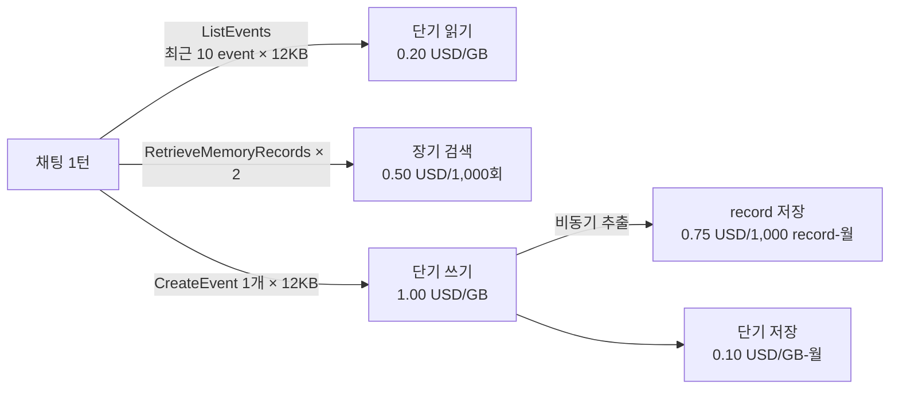

# 시나리오 7. 비용 계산과 정리

## 이 시나리오의 목표

| 항목 | 내용 |
|---|---|
| 기능 | AgentCore Memory 과금 구조 이해, 이 핸즈온 비용과 서비스 규모 비용 추정, 리소스 정리 |
| 쓰는 도구 | AgentCore 요금표(2026-11-14 확인), `terraform destroy`, `docker compose down`, `docker builder prune` |
| 입력 | 이 핸즈온에서 만든 event, record, 검색 횟수 |
| 작업 | 1. 과금 항목 확인 2. 이 핸즈온 비용 계산 3. 서비스 규모 비용 추정 4. 정리와 확인 |
| 달성할 것 | 어떤 설계 선택이 비용을 키우는지 숫자로 설명하고, 실습 뒤 과금 대상이 남지 않게 정리 |

## AgentCore Memory 과금 구조

AgentCore Memory는 리소스를 켜 둔 시간이 아니라 사용량으로 과금합니다. memory를 만들어 두기만 하면 비용이 없고, event를 쓰고 읽고 record를 저장하고 검색할 때 비용이 생깁니다. 2026년에 단기 메모리 과금이 "event 1,000개당 정액"에서 "GB 단위 사용량"으로 바뀌었으므로, 예전 자료의 계산식은 맞지 않습니다.

| 항목 | 단가 | 과금 단위의 함정 |
|---|---|---|
| 단기 메모리 쓰기(ingestion) | 1.00 USD / GB | event마다 최소 12KB, 최대 64KB로 계산 |
| 단기 메모리 읽기(retrieval) | 0.20 USD / GB | 돌려받은 event마다 최소 12KB, 최대 64KB로 계산 |
| 단기 메모리 저장 | 0.10 USD / GB-월 | 실제 크기로 보존 기간 동안 시간 단위 비례 |
| 장기 메모리 저장, 내장 전략 | 0.75 USD / 1,000 record-월 | 시간 단위 비례. record는 기본적으로 만료되지 않아 누적됨 |
| 장기 메모리 저장, override, self-managed | 0.25 USD / 1,000 record-월 | override는 내 계정의 Bedrock 모델 호출 비용이 따로 나옴 |
| 장기 메모리 검색 | 0.50 USD / 1,000 회 | `RetrieveMemoryRecords` 호출 수 |

이 표에서 두 가지를 기억하면 대부분의 계산이 끝납니다. 첫째, 단기 메모리는 event 크기가 1KB여도 12KB로 계산되므로 사실상 "event 수 × 12KB"입니다. 둘째, 장기 메모리 추출에 쓰이는 모델 비용은 내장 전략의 record 저장 단가에 포함되어 있어 따로 나오지 않습니다.

### 용어

| 용어 | 뜻 | 이 실습의 예 |
|---|---|---|
| 최소 과금 크기 | 작은 event도 12KB로 계산하는 규칙 | 질문과 답변이 1KB인 event도 12KB |
| record-월 | record 1개를 한 달 저장하는 단위. 시간 단위로 나눠 계산 | record 60개를 3시간 저장 |
| 검색 1회 | `RetrieveMemoryRecords` 호출 1번. topK와 무관 | 채팅 1턴에 2회(facts, preferences) |

## 비용을 미리 계산해야 하는 이유

메모리 비용은 모델 비용보다 작아 보여서 놓치기 쉽지만, 설계 선택 하나가 비용 구조를 바꿉니다. 이 핸즈온의 backend는 [시나리오 4](./4-long-term-memory.md)에서 답변 품질 때문에 검색을 턴당 2회로 늘렸는데, 아래 계산에서 보듯 서비스 규모에서는 이 선택이 가장 큰 비용 항목을 두 배로 만듭니다. 또 장기 메모리 record는 만료되지 않으므로 사용자가 늘지 않아도 저장 비용이 매달 쌓입니다.

## 대안 비교

같은 기능을 다른 방식으로 만들 때의 비용 성격 비교입니다.

| 방식 | 고정비 | 변동비 | 운영 인력 |
|---|---|---|---|
| AgentCore Memory | 없음 | event, record, 검색 수에 비례 | 낮음 |
| DynamoDB(대화) + 벡터 DB(장기 기억) 직접 구현 | 벡터 DB 인스턴스 또는 최소 요금 | 읽기, 쓰기, 임베딩, 추출 LLM 호출 | 높음 |
| Amazon MemoryDB(Valkey)에 대화 저장 | 노드 시간(최소 1노드 상시) | 거의 없음 | 중간. 장기 기억 추출은 별도 |

## 컴포넌트 역할

| 컴포넌트 | 과금 여부 |
|---|---|
| AgentCore Memory | 위 표대로 과금 |
| 내장 전략의 추출 모델 | record 저장 단가에 포함 |
| Ollama `qwen2.5:3b` | 로컬 실행, AWS 비용 없음. Bedrock 모델로 바꾸면 토큰 비용 추가 |
| backend, frontend 컨테이너 | 로컬 실행, AWS 비용 없음 |

## 흐름

채팅 1턴이 만드는 과금 이벤트입니다.



## 실습

### 1. 이 핸즈온 비용 계산

검증할 때 실제로 만든 양을 기준으로 계산합니다. 채팅 턴과 CLI 호출 수는 검증 로그에서 센 근삿값입니다.

| 항목 | 사용량 | 계산 | 비용(USD) |
|---|---|---|---|
| 단기 쓰기 | event 약 40개 | 40 × 12KB = 0.00048GB × 1.00 | 0.0005 |
| 단기 읽기 | 채팅 약 30턴 × 최대 10 event, CLI 조회 | 약 300 × 12KB = 0.0036GB × 0.20 | 0.0007 |
| 단기 저장 | event 약 40개 × 1KB, 최대 7일 | 0.00004GB × 0.23월 × 0.10 | 0.0000 |
| 장기 저장 | record 약 90개 × 약 3시간 | 90 × 0.00075 × 3 / 730 | 0.0003 |
| 장기 검색 | 채팅 약 30턴 × 2회 + CLI 약 10회 | 70 × 0.0005 | 0.035 |
| 합계 | | | 약 0.04 |

실습 하나가 4센트 정도이고, 그중 대부분이 장기 메모리 검색입니다. 정리하지 않고 한 달을 두면 record 저장 비용이 0.07 USD(90 × 0.00075) 늘어나는데, 금액보다 개인정보가 담긴 record가 남는다는 점이 더 문제이므로 실습이 끝나면 바로 지웁니다.

### 2. 서비스 규모 비용 추정

같은 backend 설계로 사용자 1,000명이 하루 20턴씩 30일 대화한다고 가정합니다. 월 60만 턴입니다. 사용자 1명이 한 달에 사실과 선호 30개, 채팅창 20개(요약 record 2개씩)를 남긴다고 보면 월말 record는 70,000개입니다.

| 항목 | 계산 | 월 비용(USD) | 비중 |
|---|---|---|---|
| 단기 쓰기 | 600,000 event × 12KB = 7.2GB × 1.00 | 7.2 | 1% |
| 단기 읽기 | 600,000턴 × 10 event × 12KB = 72GB × 0.20 | 14.4 | 2% |
| 단기 저장 | 600,000 × 2KB × (7/30) = 0.28GB-월 × 0.10 | 0.03 | 0% |
| 장기 저장 | 70,000 record × 0.00075 (월말 기준 상한) | 52.5 | 8% |
| 장기 검색 | 600,000턴 × 2회 = 1,200,000 × 0.0005 | 600 | 89% |
| 합계 | | 약 674 | |

비용의 89%가 장기 메모리 검색입니다. 검색을 `namespacePath` 한 번으로 줄이면 검색 비용이 300 USD로 내려가 합계가 약 374 USD가 되고, 매 턴이 아니라 채팅창의 첫 턴에만 검색하면 더 내려갑니다. 단기 읽기도 최소 과금 때문에 쓰기보다 두 배 비쌉니다. 턴마다 최근 10 event를 다시 읽는 대신 backend가 채팅창 기록을 잠시 캐시하면 줄일 수 있습니다. 장기 저장은 record가 만료되지 않아 사용자가 그대로여도 다음 달에 더 커지므로, record TTL을 쓰거나 오래된 summaries를 정리하는 정책이 필요합니다.

### 3. 컨테이너, 로컬 이미지, 빌드 캐시 정리

로컬에서 빌드한 이미지와 캐시는 디스크를 차지하므로 함께 지웁니다.

```bash
cd aws/bedrock/agentcore-memory
docker compose down --rmi local -v
docker builder prune -f
docker images --filter reference='agentcore-memory-*'
```

```text
 Container agentcore-memory-frontend-1 Removed
 Container agentcore-memory-backend-1 Removed
 Image agentcore-memory-backend:local Removed
 Image agentcore-memory-frontend:local Removed
 Network agentcore-memory_default Removed
Total: 84.41MB
IMAGE   ID             DISK USAGE   CONTENT SIZE   EXTRA
```

마지막 `docker images` 출력에 행이 없으면 이 핸즈온이 만든 이미지가 모두 지워진 것입니다. builder prune이 회수한 용량(`Total`)은 실행 환경마다 다릅니다.

### 4. AgentCore Memory 삭제와 확인

memory를 지우면 event와 record가 함께 지워지므로 과금 대상이 모두 사라집니다.

```bash
terraform -chdir=terraform destroy
aws bedrock-agentcore-control list-memories --query 'memories[?starts_with(id, `chat_memory_handson`)].[id,status]' --output text
```

```text
Destroy complete! Resources: 5 destroyed.
```

destroy도 apply처럼 전략을 하나씩 지우므로 약 12분이 걸렸습니다(2026-11-14 측정). 이어서 실행한 `list-memories` 출력은 비어 있었으며, 이것으로 이 핸즈온이 만든 과금 대상이 모두 사라진 것을 확인합니다.

## 부록. 실무에서 얻는 것

- AgentCore Memory의 비용은 "얼마나 저장하나"보다 "얼마나 자주 검색하나"가 좌우합니다. 프롬프트 품질을 위해 검색을 늘리는 결정은 곧 비용 결정이므로 둘을 함께 측정해야 합니다.
- 12KB 최소 과금 때문에 작은 메시지를 event 하나씩 나눠 저장하는 설계는 비쌉니다. 턴 단위로 묶어 저장하고, 읽을 때도 필요한 만큼만 읽습니다.
- 장기 메모리는 만료되지 않는 것이 기본값이라 비용과 개인정보 위험이 함께 누적됩니다. 서비스를 열기 전에 record TTL이나 정리 배치를 정해 둡니다.

## 참고 문서

1. [Amazon Bedrock AgentCore pricing](https://aws.amazon.com/bedrock/agentcore/pricing/)
