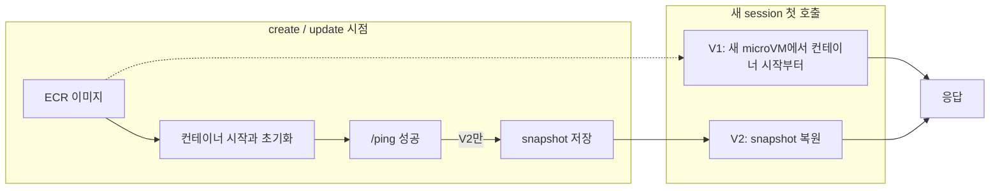
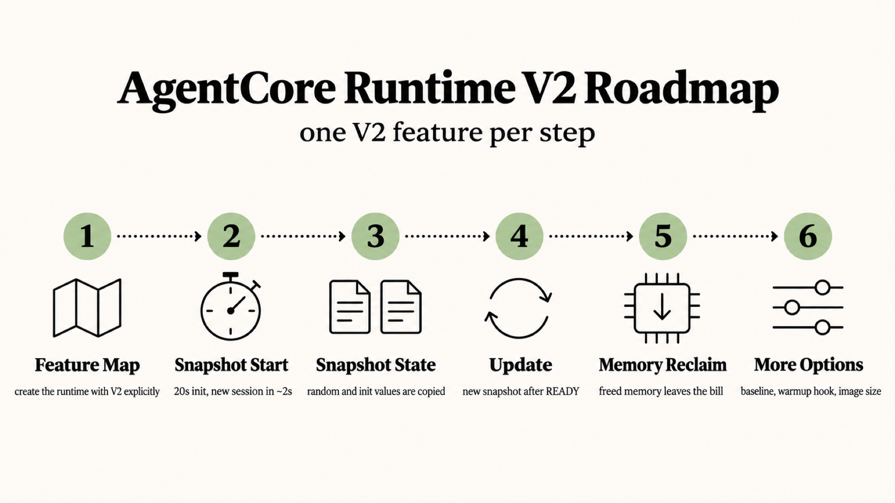

# 시나리오 1. AgentCore Runtime V2 기능 지도와 기본값 확인

## 이 시나리오의 목표

| 항목 | 내용 |
|---|---|
| 기능 | AgentCore Runtime의 platform version(V1, V2)과 그 기본값 |
| 쓰는 도구 | Terraform `aws_bedrockagentcore_agent_runtime`, `GetAgentRuntime` API |
| 입력 | `platform_version = "V2"`로 만든 runtime `rtv2_v2` |
| 작업 | 1. `platformVersion` 조회 |
| 달성할 것 | V2가 바꾸는 것 4가지를 지도로 보고, runtime이 V2로 만들어졌는지 확인 |

## Runtime V2는 agent를 띄우는 방식을 바꾼다

AgentCore Runtime은 agent 컨테이너를 session마다 독립된 Firecracker microVM에서 실행하는 서비스입니다. 사용자가 새 `runtimeSessionId`로 처음 호출하면 microVM 하나가 그 session에 붙고, session이 15분간 idle이거나 8시간을 채우면 microVM이 사라집니다.

V1은 새 session마다 컨테이너를 시작하고 agent 초기화가 끝나 `/ping`이 성공할 때까지 기다립니다. agent가 import와 모델 로딩에 20초를 쓰면 첫 호출도 20초 이상 걸립니다. V2는 runtime을 만들거나 고칠 때 초기화를 한 번만 하고 그 시점의 microVM 메모리를 snapshot으로 찍어 둡니다. 새 session은 이 snapshot을 복원해서 시작하므로 초기화 코드를 다시 실행하지 않습니다. Lambda SnapStart가 함수 실행 환경에 하는 일을 agent session에 하는 것과 같습니다.

V2가 다루는 것과 다루지 않는 것은 다음과 같습니다.

- 다루는 것: session 시작 방식(snapshot 복원), session당 자원 상한(최대 8 vCPU, 32GB), 이미지 크기 상한(2GB에서 10GB), 메모리 과금 방식(사용한 만큼).
- 다루지 않는 것: session 격리 모델, 호출 API(`InvokeAgentRuntime`), 15분 idle과 8시간 수명 규칙. 이 셋은 V1과 같습니다.

platform version은 runtime **버전**(`agentRuntimeVersion`)과 다른 개념입니다. runtime 버전은 이미지나 설정을 바꿀 때마다 1, 2, 3으로 올라가는 설정 이력이고, platform version은 그 runtime을 어떤 방식으로 띄울지 고르는 값입니다. 둘 다 "V1"이라는 표기를 써서 헷갈리기 쉽습니다.

### 용어

| 용어 | 뜻 | 이 실습의 예 |
|---|---|---|
| platform version | runtime을 띄우는 방식. `platformVersion` 필드, 값은 `V1` 또는 `V2` | `rtv2_v2`의 `platformVersion: V2` |
| runtime 버전 | 설정을 바꿀 때마다 늘어나는 불변 설정 이력 | 시나리오 4에서 환경 변수를 바꾼 뒤 `agentRuntimeVersion: 2` |
| session | `runtimeSessionId` 하나에 붙는 microVM 하나 | `s-813da3578f3444558acda9e252092e9e` |
| snapshot | V2가 초기화를 마친 microVM 메모리를 찍어 둔 이미지. runtime 버전마다 하나 | `init_uuid`가 `89c4bc89`로 같은 session들 |
| cold start | 새 session의 첫 호출이 응답받기까지 걸리는 시간 | V2 약 2초, V1(pool 소진) 23.5초 |
| warm pool | V1이 미리 초기화해 멈춰 둔 microVM 묶음. 문서에 이름이 없는 동작이라 이 핸즈온에서 붙인 이름 | V1 순차 호출 10개까지 0.4초 |
| USAGE_LOGS | session별 vCPU, 메모리 사용량을 1초 단위로 남기는 vended log | `/aws/vendedlogs/bedrock-agentcore/agentcore-runtime-v2/usage` |

## V2가 필요한 이유: 무거운 agent일수록 cold start와 idle 메모리가 커진다

agent 컨테이너는 점점 무거워집니다. 프레임워크 import, 로컬 모델 가중치, headless browser, 큰 파이썬 패키지가 들어가면 이미지는 몇 GB가 되고 초기화는 수십 초가 됩니다. V1에서 이 비용은 새 session마다 반복됩니다. 이 핸즈온의 agent는 초기화에 20초를 쓰는데, 2026-11-13에 V1 runtime으로 재 보니 warm pool이 바닥나자 새 session 첫 호출이 23.5초 걸렸고 동시 40개 burst에서는 P75가 27.85초였습니다. 같은 agent가 V2에서는 2초 안팎에 시작했습니다([시나리오 2](./2-snapshot-cold-start.md)). 발표문이 말한 2GB 이미지 P75 29.7초와 같은 수준입니다.

두 번째 문제는 메모리 과금입니다. multi-turn agent는 사용자 입력을 기다리며 대부분의 시간을 idle로 보내지만, 한 번 커진 메모리를 session이 끝날 때까지 쥐고 있으면 그 시간도 과금 대상이 됩니다. V2는 agent가 해제한 메모리를 회수해 사용한 만큼만 청구합니다([시나리오 5](./5-memory-reclaim.md)).

## 대안 비교

| 방식 | cold start | 대가 |
|---|---|---|
| V1 그대로 | warm pool이 있으면 0.4초, 바닥나면 초기화 시간 전체 | pool 크기는 사용자가 정할 수 없음. burst에서 지연이 두 갈래로 나뉨 |
| V1 + 클라이언트가 session 재사용 | 두 번째 호출부터 0.15초 | session을 사용자 간에 공유하면 격리가 깨짐. 15분 idle이면 사라짐 |
| V1 + 초기화 경량화(lazy import) | 줄어듦 | 첫 요청이 늦어지는 것으로 옮겨갈 뿐 |
| V2 | 동시성과 무관하게 2~5초 | create, update가 몇 분. 초기화 때 만든 값을 모든 session이 공유([시나리오 3](./3-snapshot-state.md)) |

## 컴포넌트 역할

| 컴포넌트 | 역할 |
|---|---|
| [agent/app.py](../agent/app.py) | `GET /ping`, `POST /invocations`만 있는 stdlib HTTP 서버. 시작할 때 20초 대기와 512MB 적재로 무거운 초기화를 흉내 냄 |
| ECR | agent 이미지(arm64) |
| AgentCore Runtime `rtv2_v2` | `platform_version = "V2"` |
| CloudWatch Logs | runtime 로그와 USAGE_LOGS |
| [scripts/runtime.py](../scripts/runtime.py) | `GetAgentRuntime`, `InvokeAgentRuntime`, `StopRuntimeSession`을 호출하고 시간을 잼 |

## 흐름

아래 그림은 이 시나리오에서 요청과 상태가 흘러가는 순서입니다.



## 기능 지도

아래 로드맵은 시나리오 순서대로 V2 기능을 하나씩 다룹니다.



아래 표는 기능마다 확인 방법과 시나리오를 잇습니다.

| 기능 | 확인 방법 | 시나리오 |
|---|---|---|
| V2로 만든 runtime | `GetAgentRuntime`의 `platformVersion` | 1 (이 문서) |
| snapshot 기반 시작 | 새 session cold start 지연, 동시 burst | [2](./2-snapshot-cold-start.md) |
| snapshot에 담기는 상태 | 초기화 때 만든 UUID, 난수, 시계 | [3](./3-snapshot-state.md) |
| runtime 업데이트와 snapshot 교체 | 환경 변수 변경 중 기존 session과 새 session | [4](./4-update-snapshot.md) |
| 사용한 만큼 메모리 과금 | USAGE_LOGS의 1초 단위 메모리 사용량 | [5](./5-memory-reclaim.md) |
| committed baseline, lifecycle hook, 이미지 크기 | 실측하지 않고 개발자 가이드로 정리 | [6](./6-more-v2-options.md) |

## 실습

환경은 [setup.md](./setup.md)로 준비합니다.

### 1. platformVersion 조회

`scripts/runtime.py status`는 `GetAgentRuntime`을 호출해 `platformVersion`, `status`, `agentRuntimeVersion`을 출력합니다.

```bash
cd aws/bedrock/agentcore-runtime-v2
uv run --env-file .runtime.env scripts/runtime.py status
```

2026-11-13 서울 리전에서 실행한 결과입니다.

```text
runtime  platformVersion  status     version
v2       V2               READY      1
```

- `platform_version = "V2"`로 만든 runtime이 V2입니다.
- 같은 날 `platform_version`을 생략해 만든 runtime은 **V1**이었습니다. 그래서 이 핸즈온은 V2를 명시합니다.
- AWS CLI로도 같은 값을 볼 수 있습니다. `aws bedrock-agentcore-control get-agent-runtime --agent-runtime-id <ID> --query platformVersion`

## 부록. 실무에서 얻는 것

- **"서울 신규 runtime은 V2가 기본"은 API로 만들 때 해당하지 않았습니다.** 발표문은 신규 runtime에 V2가 기본 적용된다고 쓰지만, 개발자 가이드와 Terraform provider 문서는 "생략하면 V1"이라고 쓰고, 2026-11-13 실측도 V1이었습니다. 콘솔의 생성 화면이 V2를 기본으로 고르는지는 확인하지 못했습니다(`확인 필요`). Terraform, CloudFormation, SDK로 만드는 runtime은 `platform_version`을 명시해야 의도한 버전이 됩니다. 개발자 가이드의 콘솔 절차도 생성 화면에서 **Platform version**을 V2로 직접 고르게 안내합니다.
- **V2 생성은 4분, V1은 30초입니다.** `terraform apply`에서 V2 runtime은 3분 53초~4분 13초, 같은 날 만든 V1 runtime은 29~30초 만에 끝났습니다. snapshot 준비 시간입니다. CI/CD 파이프라인의 배포 대기 시간과 timeout을 이 값에 맞춰야 합니다.

## 참고 문서

1. [AWS What's New: AgentCore Runtime의 새 기본값 (2026-11-12)](https://aws.amazon.com/ko/about-aws/whats-new/2026/11/new-agentcore-runtime-default/)
2. [AgentCore 개발자 가이드: How it works, Platform versions](https://docs.aws.amazon.com/bedrock-agentcore/latest/devguide/runtime-how-it-works.html#runtime-platform-versions)
3. [Terraform aws_bedrockagentcore_agent_runtime](https://registry.terraform.io/providers/hashicorp/aws/latest/docs/resources/bedrockagentcore_agent_runtime)
