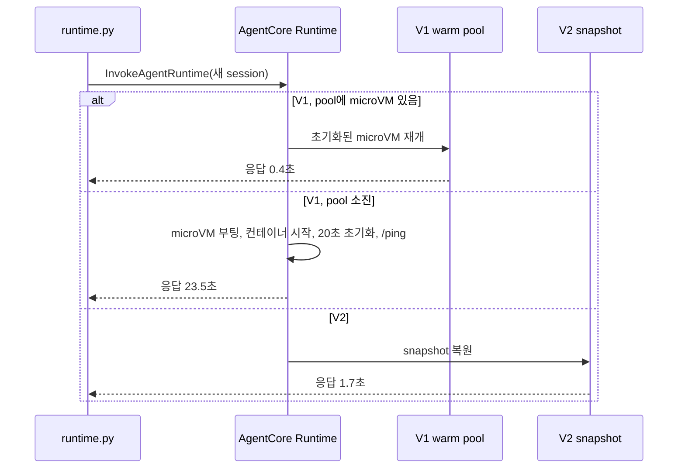

# 시나리오 2. snapshot 복원으로 cold start를 일정하게 만들기

## 이 시나리오의 목표

| 항목 | 내용 |
|---|---|
| 기능 | V2의 snapshot 기반 session 시작 |
| 쓰는 도구 | `InvokeAgentRuntime` API(`scripts/runtime.py cold`, `warm`, `burst`) |
| 입력 | 초기화에 20초를 쓰는 agent를 올린 V1 runtime(`rtv2_legacy`)과 V2 runtime(`rtv2_v2`) |
| 작업 | 1. 순차 cold start 2. warm 호출 3. warm pool 소진 4. 동시 burst |
| 달성할 것 | V1은 warm pool이 바닥나면 초기화 시간 전체를 기다리고, V2는 동시성과 무관하게 몇 초로 일정한 것을 숫자로 확인 |

## cold start는 "새 session의 첫 호출"이 내는 비용이다

AgentCore Runtime에서 cold start는 새 `runtimeSessionId`로 처음 호출할 때만 생깁니다. 같은 session의 두 번째 호출부터는 이미 떠 있는 microVM이 응답하므로 V1이든 V2든 0.15초 정도입니다. 그래서 cold start가 문제가 되는 것은 session을 자주 새로 여는 워크로드입니다. 사용자마다 대화를 새로 시작하는 챗봇, 이벤트 하나에 session 하나를 쓰는 agentic workflow, 트래픽이 몰릴 때 session이 한꺼번에 열리는 burst가 여기에 해당합니다.

V1의 cold start는 microVM 부팅, 이미지 로딩, agent 초기화, `/ping` 성공까지를 모두 포함합니다. 이 실습에서 측정해 보니 V1은 이 비용을 숨기는 warm pool을 갖고 있었습니다. AgentCore가 미리 초기화해 멈춰 둔 microVM을 새 session에 붙이는 동작입니다. pool에 남은 microVM이 있으면 V1 cold start는 0.4초로 V2보다 빠르지만, pool이 바닥나면 초기화 시간 20초에 부팅 시간이 더해져 23~28초가 됩니다. pool의 크기와 보충 속도는 사용자가 정할 수 없고 문서에도 없습니다.

V2는 초기화가 끝난 메모리를 snapshot에서 복원하므로 초기화 시간이 cold start에서 빠집니다. 대신 snapshot 복원 자체에 1.7초 정도가 들고, 동시에 40개를 열면 5초까지 늘어납니다. 발표문의 "2초 미만"은 단일 session 기준 수치와 맞습니다.

### 용어

| 용어 | 뜻 | 이 실습의 예 |
|---|---|---|
| `init_uuid` | agent가 초기화 때 한 번 만든 UUID. 같으면 같은 초기화 결과를 쓴 것 | V2 session 15개 중 14개가 `89c4bc89` |
| `wall_since_init` | 초기화가 끝난 시각부터 지금까지의 벽시계 시간 | V1 pool session 228초 |
| `monotonic_since_init` | 같은 구간을 `time.monotonic()`으로 잰 값. microVM이 멈춰 있던 시간은 세지 않음 | V1 pool session 4.2초 |
| burst | 새 session 여러 개를 동시에 여는 호출 | `burst --count 40` |

## 왜 시스템이 이것을 제공해야 하는가

agent 쪽에서 cold start를 줄이는 방법은 초기화를 가볍게 하거나 session을 재사용하는 것뿐입니다. 초기화를 가볍게 하면 그 비용이 첫 요청으로 옮겨갈 뿐이고, session 재사용은 사용자 간 격리를 깨거나 15분 idle 규칙에 걸립니다. V1 warm pool은 플랫폼이 이 문제를 풀려는 시도지만, 위 측정처럼 pool 크기를 넘는 순간 지연이 0.4초와 27초 두 갈래로 갈립니다. 지연이 예측 가능해야 timeout과 사용자 경험을 설계할 수 있으므로, 초기화 비용 자체를 session 시작에서 빼는 방법이 플랫폼에 있어야 합니다.

## 대안 비교

| 상황 | V1 | V2 |
|---|---|---|
| 순차로 새 session, pool 여유 있음 | 0.36~0.6초 | 1.46~2.3초 |
| 순차로 새 session, pool 소진 | 23.5초 | 1.46~2.3초 |
| 같은 session 반복 호출 | 0.15초 | 0.17~0.19초 |
| 동시 20개 | 2.04~2.16초(전부 pool) | 3.54~4.61초 |
| 동시 40개 | pool 20개 3.0~4.4초, 나머지 20개 27.0~27.5초 | 3.67~6.12초 |

## 컴포넌트 역할

| 컴포넌트 | 역할 |
|---|---|
| `rtv2_legacy` | `platform_version = "V1"`. warm pool과 pool 소진 후 cold start를 보여 줌 |
| `rtv2_v2` | `platform_version = "V2"`. snapshot 복원 시간을 보여 줌 |
| `runtime.py cold` | 매번 새 `runtimeSessionId`로 순차 호출 |
| `runtime.py warm` | 같은 session으로 반복 호출 |
| `runtime.py burst` | 새 session N개를 스레드로 동시에 호출하고 p50, p75, max 출력 |

## 흐름



## 실습

환경은 [setup.md](./setup.md)로 준비합니다. 출력 열은 순서대로 지연(초), `init_uuid` 앞 8자, 요청마다 만든 UUID 앞 8자, 초기화 때 뽑은 난수, `wall_since_init`, `monotonic_since_init`, hostname, PID, session 안 호출 횟수, RSS(MB)입니다. UUID와 지연 값은 실행할 때마다 달라집니다.

### 1. 새 session 5개 순차 호출로 V1, V2 cold start 측정

```bash
cd aws/bedrock/agentcore-runtime-v2
uv run --env-file .runtime.env scripts/runtime.py cold --runtime legacy --count 5
uv run --env-file .runtime.env scripts/runtime.py cold --runtime v2 --count 5
```

```text
== legacy cold
#   seconds init_id   req_id    init_rnd wall_init mono_init hostname   pid  turns rss_mb
1      0.54 07c86e13  d4140626  0.9503    228.39     4.21 localhost  1    1     533
2      0.46 8f736daa  5bdd23ac  0.7995     228.8     4.18 localhost  1    1     533
3      0.45 c0d69424  6e0f7528  0.6750    229.32     4.17 localhost  1    1     533
== v2 cold
1       2.3 89c4bc89  132657df  0.7393    155.76    80.53 localhost  1    1     533
2      1.92 89c4bc89  e193f015  0.7393     157.7    80.27 localhost  1    1     533
3       2.0 89c4bc89  8b9f5ec0  0.7393    159.7    80.23 localhost  1    1     533
```

- V1이 0.5초로 V2보다 빠릅니다. 초기화에 20초를 쓰는 agent인데도 그렇습니다.
- V1 session은 `init_uuid`가 매번 다르므로 각자 초기화를 했습니다. 그런데 `wall_since_init`이 228초인데 `monotonic_since_init`은 4.2초입니다. 초기화를 마친 microVM이 약 224초 동안 멈춰 있다가 이 session에 붙었다는 뜻입니다. 이것이 V1 warm pool입니다.
- V2 session은 `init_uuid`와 `init_rnd`가 모두 같습니다. 같은 snapshot을 복원했습니다.

### 2. 같은 session 반복 호출로 warm 지연 확인

```bash
uv run --env-file .runtime.env scripts/runtime.py warm --runtime legacy --count 3
uv run --env-file .runtime.env scripts/runtime.py warm --runtime v2 --count 3
```

```text
== legacy warm
1       0.7 06757540  2d7e56a1  0.9532    231.16     4.11 localhost  1    1     533
2      0.15 06757540  eccf9c17  0.9532    231.31     4.26 localhost  1    2     533
3      0.15 06757540  c5a60aa7  0.9532    231.46     4.41 localhost  1    3     533
== v2 warm
1      1.98 89c4bc89  39b67685  0.7393    165.68    80.23 localhost  1    1     533
2      0.17 89c4bc89  cbc74abe  0.7393    165.91    80.46 localhost  1    2     533
3      0.19 89c4bc89  f7cb50ae  0.7393     166.1    80.65 localhost  1    3     533
```

- 두 번째 호출부터는 V1, V2 모두 0.15~0.19초입니다. `turns`가 1, 2, 3으로 늘어나 session 메모리가 유지되는 것도 보입니다.

### 3. 순차 호출 12개로 V1 warm pool 소진

```bash
uv run --env-file .runtime.env scripts/runtime.py cold --runtime legacy --count 12
```

```text
9       0.41 d5442e37  8194a62a  0.5604     14.94     3.97 localhost  1    1     533
10      0.42 91d4c3a8  b4fff4af  0.3915     14.62     4.03 localhost  1    1     533
11     23.57 99210a68  188774b3  0.3371      0.87     0.87 localhost  1    1     533
12     23.53 55755214  b8b8af84  0.4842       0.8      0.8 localhost  1    1     533
```

- 1단계부터 쌓인 호출로 pool이 바닥나자 11번째부터 23.5초가 걸렸습니다. 이때는 `wall_since_init`과 `monotonic_since_init`이 같습니다. 멈춘 적 없는 진짜 cold start입니다.
- pool이 언제 바닥나는지는 직전 호출 이력에 따라 달라집니다.

### 4. 같은 V2 runtime에 순차 호출 15개

```bash
uv run --env-file .runtime.env scripts/runtime.py cold --runtime v2 --count 15
```

```text
1      2.18 e630b9ac  39737428  0.2631    241.45    70.01 localhost  1    1     533
2       1.8 89c4bc89  2ab4f9d4  0.7393    243.85    80.19 localhost  1    1     533
...
14     1.66 89c4bc89  c4deb0da  0.7393    264.06    80.02 localhost  1    1     533
15     1.75 89c4bc89  c734584a  0.7393    265.81    80.15 localhost  1    1     533
```

- 15개 모두 1.46~2.18초입니다. V1처럼 바닥나는 지점이 없습니다.
- 1번 session만 `init_uuid`가 `e630b9ac`입니다. 같은 runtime 버전에 대해 snapshot 사본이 둘 이상 있는 것으로 보입니다. 문서는 "runtime 버전마다 snapshot 하나"라고 쓰므로, 사본은 같은 snapshot을 따로 준비한 복제본으로 추정합니다(`확인 필요`).

### 5. 동시 burst 20개, 40개

`burst`는 새 session N개를 스레드로 동시에 호출합니다. boto3 client 하나를 모든 스레드가 공유합니다.

```bash
uv run --env-file .runtime.env scripts/runtime.py burst --runtime legacy --count 40
uv run --env-file .runtime.env scripts/runtime.py burst --runtime v2 --count 40
```

```text
runtime=v2 sessions=40
p50=5.02 p75=5.22 max=6.12
runtime=legacy sessions=40
p50=4.4 p75=27.38 max=27.54
all: [3.02, 3.44, ... 4.31, 4.4, 27.04, 27.04, ... 27.51, 27.54]
```

- V1은 정확히 20개가 pool에서 3~4.4초, 나머지 20개가 27초로 갈렸습니다. 바로 전에 같은 runtime에 `--count 20`을 보냈을 때는 20개 모두 2.04~2.16초였습니다.
- pool이 이미 비어 있던 첫 40개 burst에서는 V1의 p50이 27.68초, p75가 27.85초였습니다.
- V2는 p75가 5.22초입니다. 단일 session(1.7초)보다 느리지만 전 구간이 한 덩어리입니다.

## 부록. 실무에서 얻는 것

- **V2가 언제나 빠른 것은 아닙니다.** pool이 넉넉한 V1은 0.4초, V2는 1.7초였습니다. 초기화가 가볍고 트래픽이 완만한 agent라면 V1이 체감상 더 빠를 수 있습니다. V2가 사 주는 것은 평균 속도가 아니라 꼬리 지연의 상한입니다.
- **V1의 꼬리 지연은 agent의 초기화 시간과 같습니다.** pool이 바닥난 V1 cold start는 23.5초로, 초기화 20초에 부팅 3.5초가 더해진 값입니다. 클라이언트 timeout과 API Gateway 같은 앞단 timeout(기본 29초)을 정할 때 이 값이 기준이 됩니다.
- **burst 테스트는 직전 이력에 영향을 받습니다.** 같은 명령이 2초가 나오기도 하고 27초가 나오기도 했습니다. V1 부하 테스트 결과를 비교하려면 pool 상태를 맞추거나 충분히 큰 burst를 써야 합니다.
- **이미지 크기 효과는 재지 않았습니다.** 이 agent 이미지는 python slim 기반이라 작습니다. 발표문의 "2GB 이미지 29.7초"는 이미지 로딩까지 포함한 수치이고, 여기서는 초기화 시간만으로 비슷한 크기의 지연을 재현했습니다.

## 참고 문서

1. [AgentCore 개발자 가이드: Platform versions, What to expect](https://docs.aws.amazon.com/bedrock-agentcore/latest/devguide/runtime-how-it-works.html#runtime-v2-what-to-expect)
2. [AWS What's New: AgentCore Runtime의 새 기본값 (2026-11-12)](https://aws.amazon.com/ko/about-aws/whats-new/2026/11/new-agentcore-runtime-default/)
