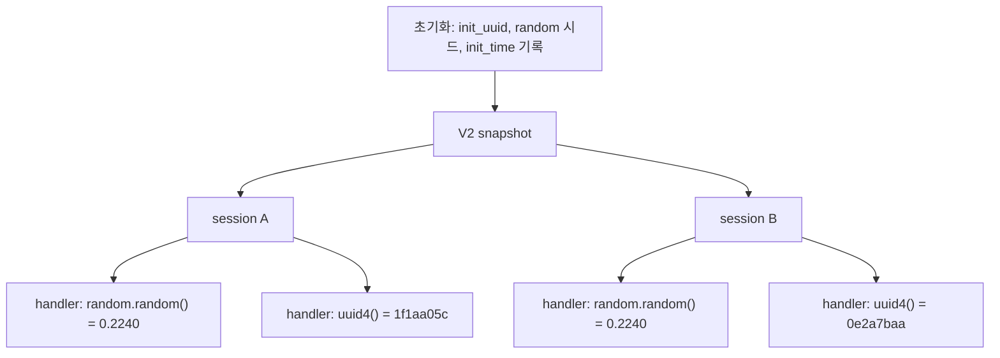

# 시나리오 3. snapshot에 담기는 상태와 session마다 새로 만들어야 하는 값

## 이 시나리오의 목표

| 항목 | 내용 |
|---|---|
| 기능 | V2 snapshot이 초기화 결과를 모든 session에 복제하는 동작 |
| 쓰는 도구 | `InvokeAgentRuntime` API(`scripts/runtime.py call`) |
| 입력 | 초기화 때 UUID, 난수, 시각을 기록하고 요청마다 같은 값을 다시 만드는 agent |
| 작업 | 1. V2 새 session 3개 비교 2. V1 새 session 3개 비교 |
| 달성할 것 | 초기화 때 만든 값은 물론, 요청마다 호출한 `random.random()`까지 V2 session끼리 같아지는 것을 확인 |

## snapshot은 초기화 결과를 복제한다

V2 snapshot은 초기화를 마친 프로세스의 메모리 전체입니다. 모델 가중치와 import된 모듈만 담기는 것이 아니라, 초기화 도중 만든 UUID, 난수 생성기의 내부 상태, 그 시점의 시각까지 그대로 담깁니다. 새 session은 이 메모리를 복원하므로 모든 session이 "같은 순간에 막 초기화를 끝낸 같은 프로세스"로 시작합니다.

V1에서는 session마다 초기화를 새로 하므로 이런 값이 자연히 session마다 달랐습니다. V2로 옮기면 이 전제가 깨집니다. 공식 문서의 기준은 한 줄입니다. 그 runtime 버전이 사는 동안 바뀌지 않는 값은 초기화 때 만들고, 요청마다 달라야 하거나 만료되는 값은 handler에서 만듭니다.

이 실습에서 확인한 것은 그보다 한 단계 더 나갑니다. 파이썬 `random` 모듈은 초기화 때 시드가 정해지므로, handler 안에서 `random.random()`을 호출해도 복원된 session들이 같은 순서로 같은 값을 냅니다. 요청마다 다른 값이 필요하면 handler에서 운영체제 엔트로피를 직접 읽어야 합니다(`os.urandom`, `secrets`, `uuid.uuid4()`).

### 용어

| 용어 | 뜻 | 이 실습의 예 |
|---|---|---|
| 초기화 값 | agent가 `/ping` 전에 만든 값. snapshot에 담김 | `init_uuid`, `init_random`, `init_time` |
| 요청 값 | `/invocations` handler가 호출마다 만든 값 | `request_uuid`(`uuid.uuid4()`), `request_random`(`random.random()`) |
| `time.monotonic()` | 프로세스가 실행 중인 시간만 세는 시계. snapshot 복원 사이의 시간은 세지 않음 | `monotonic_since_init` 80초 |

## 왜 알아야 하는가

snapshot 복제로 생기는 버그는 오류를 내지 않습니다. 요청 ID가 겹치거나, 재시도 jitter가 모든 session에서 같은 값이 되어 동시에 몰리거나, `time.monotonic()`으로 잰 경과 시간이 실제보다 짧게 나와 token 만료를 놓칩니다. 로그를 hostname이나 PID로 나눠 왔다면 모든 session이 `localhost`, PID `1`이라 한데 섞입니다. 하나하나는 정상처럼 보이므로, V1에서 V2로 옮기기 전에 어떤 값이 복제되는지 알아야 코드를 고칠 수 있습니다.

## 값별 판단

| 값 | 초기화 때 만들어도 되는가 | 이 실습 결과 |
|---|---|---|
| 모델, 설정, import | 된다. 이것이 snapshot의 목적 | 512MB `MODEL_WEIGHTS`가 모든 session에 `rss_mb=533`으로 들어 있음 |
| UUID, token, 키 | 안 된다 | `init_uuid` 모든 session 동일 |
| `random` 모듈 난수 | handler에서 호출해도 안 된다 | `request_random`까지 모든 session 동일 |
| `uuid.uuid4()`, `os.urandom` | handler에서 호출하면 된다 | `request_uuid` session마다 다름 |
| 현재 시각 `time.time()` | handler에서 읽는다 | 복원 뒤 벽시계는 맞게 흐름(`wall_since_init` 1215초) |
| 경과 시간 `time.monotonic()` | 기준점을 handler에서 잡는다 | 복원 사이 시간을 세지 않음(`monotonic_since_init` 80초) |
| hostname, PID | ID로 쓰면 안 된다 | V1, V2 모두 `localhost`, `1` |
| AWS 자격 증명, DB 연결 | client 객체는 초기화 때, 자격 증명 갱신과 재연결은 요청 때 | 이 실습에서 재지 않음 |

## 컴포넌트 역할

| 컴포넌트 | 역할 |
|---|---|
| [agent/app.py](../agent/app.py) `initialize()` | `uuid.uuid4()`, `random.random()`, `time.time()`, `time.monotonic()`을 한 번 기록 |
| [agent/app.py](../agent/app.py) `info()` | 같은 함수를 요청마다 다시 호출해 초기화 값과 나란히 돌려줌 |

## 흐름



## 실습

환경은 [setup.md](./setup.md)로 준비합니다. 값은 실행할 때마다 달라지지만, 같은 runtime 버전의 V2 session끼리는 서로 같습니다.

### 1. V2 runtime에 새 session 3개 호출

```bash
cd aws/bedrock/agentcore-runtime-v2
for i in 1 2 3; do
  uv run --env-file .runtime.env scripts/runtime.py call --runtime v2 |
    jq -c '{init_uuid:.init_uuid[:8],init_random,request_uuid:.request_uuid[:8],request_random,wall_since_init,monotonic_since_init,hostname,pid}'
done
```

```text
{"init_uuid":"89c4bc89","init_random":0.7393339038388318,"request_uuid":"1f1aa05c","request_random":0.22408205029316564,"wall_since_init":1215.78,"monotonic_since_init":80.09,"hostname":"localhost","pid":1}
{"init_uuid":"89c4bc89","init_random":0.7393339038388318,"request_uuid":"0e2a7baa","request_random":0.22408205029316564,"wall_since_init":1217.68,"monotonic_since_init":79.94,"hostname":"localhost","pid":1}
{"init_uuid":"89c4bc89","init_random":0.7393339038388318,"request_uuid":"0bd40702","request_random":0.22408205029316564,"wall_since_init":1219.49,"monotonic_since_init":79.87,"hostname":"localhost","pid":1}
```

- `init_uuid`, `init_random`이 같습니다. 초기화 값이 복제되었습니다.
- handler에서 호출한 `request_random`도 세 session 모두 `0.22408205029316564`입니다.
- `request_uuid`는 다릅니다. `uuid.uuid4()`는 호출할 때마다 `os.urandom`을 읽기 때문입니다.
- `wall_since_init`은 snapshot을 찍은 뒤 흐른 실제 시간(약 20분)이고, `monotonic_since_init`은 80초에 머뭅니다.

### 2. V1 runtime에 새 session 3개 호출

```bash
for i in 1 2 3; do
  uv run --env-file .runtime.env scripts/runtime.py call --runtime default |
    jq -c '{init_uuid:.init_uuid[:8],init_random,request_random,monotonic_since_init,hostname,pid}'
done
```

```text
{"init_uuid":"99a8f973","init_random":0.07851607982202058,"request_random":0.9192774517345583,"monotonic_since_init":4.11,"hostname":"localhost","pid":1}
{"init_uuid":"e40bc3b0","init_random":0.6823978849495971,"request_random":0.00468774777232972,"monotonic_since_init":4.15,"hostname":"localhost","pid":1}
{"init_uuid":"a9db364f","init_random":0.6567094270741511,"request_random":0.09727327161580579,"monotonic_since_init":4.16,"hostname":"localhost","pid":1}
```

- V1은 session마다 초기화를 따로 하므로 모든 값이 다릅니다.
- hostname과 PID는 V1에서도 `localhost`, `1`입니다. 이 둘을 ID로 쓰는 코드는 V1에서도 이미 틀린 코드입니다.

## 부록. 실무에서 얻는 것

- **`random` 모듈은 handler 안에서도 안전하지 않습니다.** 공식 문서는 "random 모듈은 시작 시 시드되므로 복원된 instance가 같은 순서를 반복한다"고 쓰는데, 이 문장을 "초기화 때 뽑은 값만 문제"로 읽기 쉽습니다. 실측은 handler에서 처음 호출한 값도 같았습니다. 재시도 jitter, 샘플링, A/B 분기를 `random`으로 하던 코드는 V2에서 모든 session이 같은 선택을 합니다. 요청 시작 때 `random.seed(os.urandom(16))`으로 다시 시드하거나 `secrets`를 씁니다.
- **Node.js는 handler 안의 `crypto.randomUUID()`도 겹칠 수 있다고 문서가 경고합니다.** OpenSSL 난수 상태가 snapshot에 복제되기 때문입니다. 이 실습은 파이썬만 확인했습니다.
- **초기화에 넣으면 안 되는 "느리지만 바뀌는 값"이 있습니다.** AgentCore Gateway의 tool 목록처럼 로딩이 느린 값을 초기화 때 캐시하면, 그 runtime 버전이 사는 동안 tool 목록이 snapshot 시점에 고정됩니다.
- **V1 warm pool에도 비슷한 흔적이 있습니다.** V1 pool session은 `monotonic_since_init` 4초, `wall_since_init` 228초였습니다. 초기화 후 멈춰 있다가 재개되었으므로, `time.monotonic()` 기준 경과 시간은 V1에서도 이미 믿을 수 없었습니다.

## 참고 문서

1. [AgentCore 개발자 가이드: Optimize your agent for AgentCore Runtime V2](https://docs.aws.amazon.com/bedrock-agentcore/latest/devguide/runtime-v2-optimize.html)
