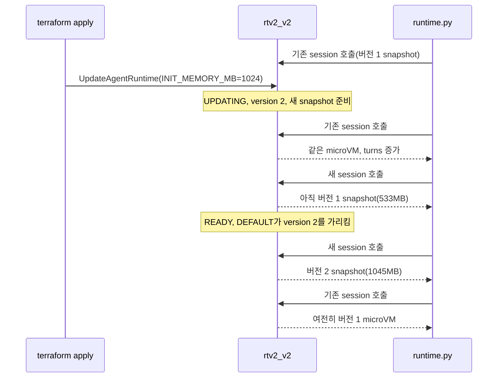

# 시나리오 4. V2 runtime 업데이트와 snapshot 교체

## 이 시나리오의 목표

| 항목 | 내용 |
|---|---|
| 기능 | V2 runtime을 업데이트할 때 새 버전의 snapshot이 준비되고 교체되는 과정 |
| 쓰는 도구 | Terraform(`UpdateAgentRuntime`), `GetAgentRuntime`, `InvokeAgentRuntime` |
| 입력 | V2 runtime `rtv2_v2`, 업데이트 전에 열어 둔 session 하나, `INIT_MEMORY_MB`를 512에서 1024로 바꾼 설정 |
| 작업 | 1. 업데이트 전 session 열기 2. 설정 변경 적용 중 호출 3. 업데이트 후 기존 session과 새 session 비교 |
| 달성할 것 | 업데이트가 몇 분 걸리고, 그동안 새 session은 이전 snapshot에서 시작하며, 진행 중 session은 끝날 때까지 이전 버전에 남는 것을 확인 |

## 업데이트는 새 runtime 버전과 새 snapshot을 만든다

V2 runtime의 이미지나 환경 변수를 바꾸면 runtime 버전이 하나 올라갑니다. V2는 버전마다 snapshot을 따로 쓰므로, 새 버전으로 컨테이너를 다시 시작하고 초기화를 마친 뒤 snapshot을 찍어야 합니다. 그래서 V1에서 몇 초면 끝나는 업데이트가 V2에서는 몇 분 걸립니다.

개발자 가이드는 snapshot 수명 주기를 이렇게 설명합니다. DEFAULT endpoint는 새 버전의 snapshot이 준비된 뒤에 새 버전을 가리킵니다. 이전 버전의 snapshot은 삭제 대상이 되지만, 그 snapshot으로 이미 돌고 있는 session이 끝날 때까지 남습니다. 이 실습은 그 설명을 session 단위로 확인합니다. 어느 버전이 응답했는지는 `rss_mb`로 구분합니다. 이전 버전은 초기화 때 512MB를 적재해 533MB, 새 버전은 1024MB를 적재해 1045MB입니다.

기존 V1 runtime을 V2로 옮기는 것도 같은 업데이트입니다. `platformVersion: V2`를 넣어 업데이트하면 새 버전이 V2로 만들어집니다. 이 핸즈온은 runtime을 처음부터 V2로 만들지만, 2026-11-13에 V1 runtime을 V2로 바꿨을 때도 같은 흐름이었습니다. 업데이트에 3분 35초가 걸렸고 실패한 호출은 없었으며, 전환 전에 연 session은 끝날 때까지 V1 microVM에 남았습니다. `platformVersion`을 빼고 업데이트하면 현재 platform version을 유지하므로, Terraform에서 `platform_version`을 지워도 V1로 돌아가지 않습니다.

### 용어

| 용어 | 뜻 | 이 실습의 예 |
|---|---|---|
| runtime 버전 | 설정을 바꿀 때마다 늘어나는 불변 설정 이력. V2는 버전마다 snapshot이 하나 | 업데이트 뒤 `version 2` |
| `UPDATING` | 새 버전과 그 snapshot을 준비하는 상태 | 3분 36초 |
| DEFAULT endpoint | 생성 시 자동으로 만들어지고 최신 버전을 가리키는 endpoint | `qualifier="DEFAULT"` |
| 기존 session | 업데이트 전에 연 session | `s-813da3578f3444558acda9e252092e9e` |

## 왜 이 동작을 확인해야 하는가

운영 중인 runtime을 업데이트할 때 묻는 것은 3가지입니다. 업데이트하는 동안 요청이 실패하는가, 진행 중인 대화가 끊기는가, 끝난 뒤 새 session이 정말 새 설정으로 도는가. `GetAgentRuntime`의 버전 번호는 업데이트를 시작하자마자 `2`로 바뀌므로 이 값만 보면 배포가 끝난 것으로 착각합니다. 실제 트래픽이 어느 버전에서 처리되는지는 응답으로 확인해야 합니다.

## 배포 방법 비교

| 방법 | 장점 | 주의 |
|---|---|---|
| 같은 runtime을 업데이트(DEFAULT endpoint) | ARN 유지, 클라이언트 변경 없음 | 몇 분간 새 session도 이전 버전. `READY` 뒤부터 새 버전 |
| custom endpoint를 만들어 버전별로 분리 | ARN 유지, 트래픽을 나눠 검증하고 되돌릴 수 있음 | endpoint마다 snapshot이 따로 생김 |
| 새 runtime을 만들고 클라이언트를 옮김 | 두 runtime을 나란히 비교 가능 | ARN이 바뀜. 권한 정책과 클라이언트 설정 수정 |

## 컴포넌트 역할

| 컴포넌트 | 역할 |
|---|---|
| `var.init_memory_mb` | runtime 환경 변수 `INIT_MEMORY_MB`. 바꾸면 runtime 새 버전이 생김 |
| `runtime.py call --session` | 같은 session으로 다시 호출해 `init_uuid`와 `turns`가 유지되는지 확인 |
| `runtime.py status` | `platformVersion`, `status`, 버전 확인 |

## 흐름

아래 그림은 이 시나리오에서 요청과 상태가 흘러가는 순서입니다.



## 실습

환경은 [setup.md](./setup.md)로 준비합니다. session ID와 UUID는 실행할 때마다 달라집니다.

### 1. 업데이트 전 session 열기

`rtv2_v2`에 session 하나를 열고 응답을 파일로 남깁니다. 3, 4단계가 이 파일에서 session ID를 읽습니다.

```bash
cd aws/bedrock/agentcore-runtime-v2
uv run --env-file .runtime.env scripts/runtime.py call | tee /tmp/before.json |
  jq -c '{session,seconds,init_uuid,turns,rss_mb}'
```

실행 결과입니다.

```text
{"session":"s-813da3578f3444558acda9e252092e9e","seconds":1.83,"init_uuid":"31713372-4a47-4931-ad3f-e25e133bd9c2","turns":1,"rss_mb":533}
```

### 2. INIT_MEMORY_MB를 바꿔 적용

`terraform plan`에서 바뀌는 인자는 `environment_variables`의 `INIT_MEMORY_MB` 하나입니다(`"512" -> "1024"`, update in-place).

```bash
terraform -chdir=terraform apply -var init_memory_mb=1024
```

`apply`가 끝날 때 출력되는 줄입니다.

```text
aws_bedrockagentcore_agent_runtime.agent: Modifications complete after 3m36s
```

### 3. 업데이트 중 기존 session과 새 session 호출

다른 터미널을 열고, `apply`가 도는 동안 30초 간격으로 상태, 기존 session, 새 session을 호출합니다. `apply`가 끝나면 Ctrl+C로 멈춥니다.

```bash
cd aws/bedrock/agentcore-runtime-v2
export AWS_PROFILE=<로컬 profile>
S=$(jq -r .session /tmp/before.json)
while true; do
  date +%T
  uv run --env-file .runtime.env scripts/runtime.py status | grep v2
  uv run --env-file .runtime.env scripts/runtime.py call --session "$S" | jq -c '{seconds,init:.init_uuid[:8],turns,rss_mb}'
  uv run --env-file .runtime.env scripts/runtime.py call | jq -c '{seconds,init:.init_uuid[:8],rss_mb}'
  sleep 30
done
```

실행 결과입니다. 중간 반복은 생략했습니다.

```text
22:22:39
v2       V2               UPDATING   2
{"seconds":0.2,"init":"31713372","turns":3,"rss_mb":533}
{"seconds":2.17,"init":"31713372","rss_mb":533}
...
22:24:53
v2       V2               UPDATING   2
{"seconds":0.27,"init":"31713372","turns":7,"rss_mb":533}
{"seconds":1.86,"init":"31713372","rss_mb":533}
22:25:27
v2       V2               READY      2
{"seconds":0.22,"init":"31713372","turns":8,"rss_mb":533}
{"seconds":2.16,"init":"0862ad43","rss_mb":1045}
```

- 업데이트 시작 직후부터 버전은 `2`로 보입니다.
- `UPDATING` 동안 새 session은 기존 session과 같은 `init_uuid`(`31713372`)와 533MB로 시작합니다. 버전 1 snapshot에서 복원되었습니다. 실패한 호출은 없었습니다.
- `READY`가 되자 새 session은 `init_uuid` `0862ad43`, 1045MB로 시작합니다. 버전 2 snapshot입니다.
- 기존 session은 `turns`가 3에서 8까지 늘었습니다. 같은 microVM이 계속 응답합니다.

### 4. 업데이트 후 기존 session과 새 session 비교

`status`가 `READY`가 되면 기존 session과 새 session을 다시 호출합니다. 어느 터미널에서 실행해도 되도록 session ID를 다시 읽습니다.

```bash
S=$(jq -r .session /tmp/before.json)
uv run --env-file .runtime.env scripts/runtime.py status
uv run --env-file .runtime.env scripts/runtime.py call --session "$S" | jq -c '{seconds,init:.init_uuid[:8],turns,rss_mb}'
uv run --env-file .runtime.env scripts/runtime.py cold --count 5
```

실행 결과입니다. `cold` 출력의 3, 4번 줄은 생략했습니다.

```text
runtime  platformVersion  status     version
v2       V2               READY      2
{"seconds":0.19,"init":"31713372","turns":9,"rss_mb":533}
#   seconds init_id   req_id    init_rnd wall_init mono_init hostname   pid  turns rss_mb
1      1.95 0862ad43  f28f4f38  0.3318    143.15    70.04 localhost  1    1     1045
2      1.89 0862ad43  3928a469  0.3318    145.03    69.98 localhost  1    1     1045
5      2.15 0862ad43  38719c40  0.3318    151.45    70.17 localhost  1    1     1045
```

- 기존 session은 `READY` 뒤에도 버전 1 microVM(`31713372`, 533MB, `turns` 9)에서 돕니다.
- 새 session은 모두 버전 2 snapshot(`0862ad43`, 1045MB)에서 1.9~2.2초 만에 시작합니다.
- [시나리오 5](./5-memory-reclaim.md)의 출력은 `INIT_MEMORY_MB=512` 기준입니다. 시나리오 5로 넘어가기 전에 `-var` 없이 다시 `apply`해 기본값으로 되돌립니다. 이것도 3~4분 걸리는 업데이트입니다.

## 부록. 실무에서 얻는 것

- **버전 번호는 배포 완료 신호가 아닙니다.** 업데이트를 거는 순간 버전이 올라가고, 실제로 새 버전이 새 session을 받는 것은 `status`가 `READY`가 된 뒤부터입니다. 배포 파이프라인은 `READY`를 기다려야 하고, V2 update는 3~4분이 걸리므로 timeout을 늘려야 합니다.
- **업데이트 중에도 새 session은 빠르게 시작합니다.** `UPDATING` 3분 36초 동안 새 session은 이전 snapshot에서 1.7~2.3초 만에 시작했습니다. 업데이트가 cold start를 늦추지 않습니다.
- **진행 중 대화는 끊기지 않지만 이전 버전에 남습니다.** 기존 session은 15분 idle이 되거나 8시간 수명을 채울 때까지 이전 버전을 씁니다. 이전 snapshot 삭제가 최대 8시간 걸린다는 문서 설명과 같은 이유입니다. 새 설정의 효과를 확인하려면 새 session만 봐야 합니다.
- **V1에서 옮길 때는 [시나리오 3](./3-snapshot-state.md)의 코드 점검이 먼저입니다.** 전환 자체는 무중단이지만, 초기화 때 만든 ID나 `random` 사용처는 전환 직후 모든 새 session에서 겹칩니다.

## 참고 문서

1. [AgentCore 개발자 가이드: Enable V2, Snapshot lifecycle](https://docs.aws.amazon.com/bedrock-agentcore/latest/devguide/runtime-how-it-works.html#runtime-v2-snapshot-lifecycle)
2. [AWS What's New: AgentCore Runtime의 새 기본값 (2026-11-12)](https://aws.amazon.com/ko/about-aws/whats-new/2026/11/new-agentcore-runtime-default/)
