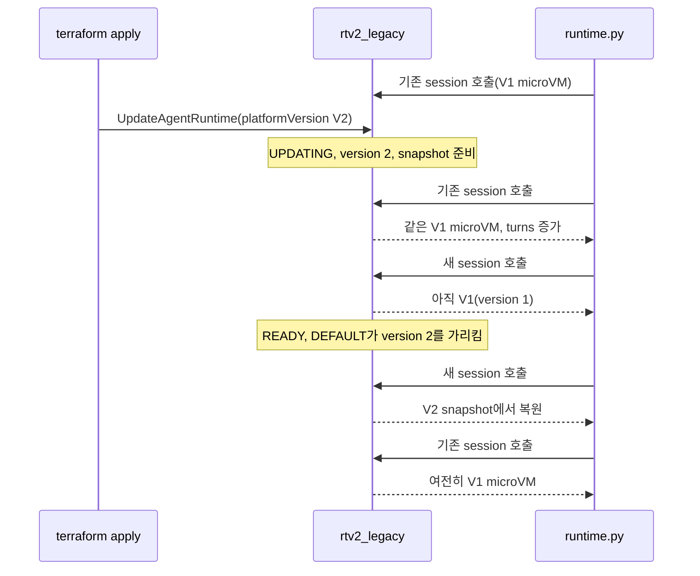

# 시나리오 4. 기존 V1 runtime을 V2로 전환

## 이 시나리오의 목표

| 항목 | 내용 |
|---|---|
| 기능 | `platformVersion` 변경으로 기존 runtime을 V2로 전환 |
| 쓰는 도구 | Terraform `platform_version`(`UpdateAgentRuntime`), `GetAgentRuntime`, `InvokeAgentRuntime` |
| 입력 | V1로 만든 `rtv2_legacy`와 전환 전에 열어 둔 session 하나 |
| 작업 | 1. 전환 전 session 열기 2. `platform_version = "V2"` 적용 중 호출 3. 전환 후 기존 session과 새 session 비교 |
| 달성할 것 | 전환이 몇 분 걸리고, 그동안 서비스가 끊기지 않으며, 진행 중 session은 V1 microVM에 남는 것을 확인 |

## 전환은 runtime 설정 변경이고, 새 runtime 버전을 만든다

서울 리전의 기존 runtime은 자동으로 V2가 되지 않습니다. `UpdateAgentRuntime`에 `platformVersion: V2`를 넣어야 하고, 이 호출도 다른 설정 변경처럼 runtime 버전을 하나 올립니다. V2로 바뀐 새 버전은 snapshot을 준비해야 하므로 업데이트가 몇 분 걸립니다. 반대로 `platformVersion`을 빼고 업데이트하면 현재 platform version을 유지합니다. Terraform에서 `platform_version`을 지우는 것은 V1로 되돌리는 동작이 아닙니다.

전환 도중과 직후의 동작은 문서가 snapshot 수명 주기로 설명합니다. DEFAULT endpoint는 새 버전의 snapshot이 준비된 뒤에 새 버전을 가리키고, 이전 버전은 이미 돌고 있는 session이 끝날 때까지 남습니다. 이 실습은 그 설명을 session 단위로 확인합니다.

### 용어

| 용어 | 뜻 | 이 실습의 예 |
|---|---|---|
| `UPDATING` | 새 runtime 버전과 snapshot을 준비하는 상태 | 3분 35초 |
| DEFAULT endpoint | 생성 시 자동으로 만들어지고 최신 버전을 가리키는 endpoint | `qualifier="DEFAULT"` |
| 기존 session | 전환 전에 연 session | `s-1a3da66af05d4e17ba455956714fa7c5` |

## 왜 이 동작을 확인해야 하는가

운영 중인 runtime을 바꿀 때 묻는 것은 세 가지입니다. 전환하는 동안 요청이 실패하는가, 진행 중인 대화가 끊기는가, 끝난 뒤 정말 V2로 도는가. `GetAgentRuntime`의 `platformVersion`은 업데이트를 시작하자마자 `V2`로 바뀌므로 이 값만 보면 전환이 끝난 것으로 착각합니다. 실제 트래픽이 어느 쪽에서 처리되는지는 응답으로 확인해야 합니다.

## 전환 방법 비교

| 방법 | 장점 | 주의 |
|---|---|---|
| 같은 runtime에 `platformVersion: V2` 업데이트 | ARN 유지, 클라이언트 변경 없음 | 전환 중 몇 분간 새 session은 V1, 이후 V2 |
| 새 V2 runtime을 만들고 클라이언트를 옮김 | 두 버전을 나란히 비교 가능 | ARN이 바뀜. 권한 정책과 클라이언트 설정 수정 |
| 같은 runtime에 custom endpoint를 추가해 버전별로 분리 | ARN 유지, 트래픽 분할 가능 | endpoint마다 snapshot이 따로 생김 |

## 컴포넌트 역할

| 컴포넌트 | 역할 |
|---|---|
| `var.legacy_platform_version` | `rtv2_legacy`의 `platform_version`. 기본 `V1` |
| `runtime.py call --session` | 같은 session으로 다시 호출해 `init_uuid`와 `turns`가 유지되는지 확인 |
| `runtime.py status` | `platformVersion`, `status`, 버전 확인 |

## 흐름

아래 그림은 이 시나리오에서 요청과 상태가 흘러가는 순서입니다.



## 실습

환경은 [setup.md](./setup.md)로 준비합니다. session ID와 UUID는 실행할 때마다 달라집니다.

### 1. 전환 전 V1 session 열기

V1 상태의 `rtv2_legacy`에 session 하나를 열고 응답을 파일로 남깁니다. 3, 4단계가 이 파일에서 session ID를 읽습니다.

```bash
cd aws/bedrock/agentcore-runtime-v2
uv run --env-file .runtime.env scripts/runtime.py call --runtime legacy | tee /tmp/before.json |
  jq -c '{session,seconds,init_uuid,turns}'
```

실행 결과입니다.

```text
{"session":"s-1a3da66af05d4e17ba455956714fa7c5","seconds":0.51,"init_uuid":"94128f84-065c-405d-88f5-2f14536cf218","turns":1}
```

### 2. platform_version을 V2로 바꿔 적용

`terraform plan`에서 바뀌는 인자는 `platform_version` 하나입니다(`"V1" -> "V2"`, update in-place).

```bash
terraform -chdir=terraform apply -var legacy_platform_version=V2
```

`apply`가 끝날 때 출력되는 줄입니다.

```text
aws_bedrockagentcore_agent_runtime.agent["legacy"]: Modifications complete after 3m35s
```

### 3. 전환 중 기존 session과 새 session 호출

다른 터미널을 열고, `apply`가 도는 동안 30초 간격으로 상태, 기존 session, 새 session을 호출합니다. `apply`가 끝나면 Ctrl+C로 멈춥니다.

```bash
cd aws/bedrock/agentcore-runtime-v2
export AWS_PROFILE=<로컬 profile>
S=$(jq -r .session /tmp/before.json)
while true; do
  date +%T
  uv run --env-file .runtime.env scripts/runtime.py status | grep legacy
  uv run --env-file .runtime.env scripts/runtime.py call --runtime legacy --session "$S" | jq -c '{seconds,init:.init_uuid[:8],turns}'
  uv run --env-file .runtime.env scripts/runtime.py call --runtime legacy | jq -c '{seconds,init:.init_uuid[:8],mono:.monotonic_since_init}'
  sleep 30
done
```

실행 결과입니다. 중간 반복은 생략했습니다.

```text
18:20:30
legacy   V2               UPDATING   2
{"seconds":0.26,"init":"94128f84","turns":2}
{"seconds":0.47,"init":"e59a73f1","mono":4.19}
...
18:23:11
legacy   V2               UPDATING   2
{"seconds":0.19,"init":"94128f84","turns":7}
{"seconds":0.44,"init":"33be3adc","mono":4.32}
```

- 업데이트 시작 직후부터 `platformVersion`은 `V2`, 버전은 `2`로 보입니다.
- 그동안 새 session은 매번 다른 `init_uuid`와 `mono` 4초를 냅니다. 아직 V1 버전과 warm pool이 처리합니다. 실패한 호출은 없었습니다.
- 기존 session은 `turns`가 2에서 7까지 늘었습니다. 메모리 상태가 유지됩니다.

### 4. 전환 후 기존 session과 새 session 비교

`status`가 `READY`가 되면 기존 session과 새 session을 다시 호출합니다. 어느 터미널에서 실행해도 되도록 session ID를 다시 읽습니다.

```bash
S=$(jq -r .session /tmp/before.json)
uv run --env-file .runtime.env scripts/runtime.py status
uv run --env-file .runtime.env scripts/runtime.py call --runtime legacy --session "$S" | jq -c '{seconds,init:.init_uuid[:8],turns}'
uv run --env-file .runtime.env scripts/runtime.py cold --runtime legacy --count 5
```

실행 결과입니다. `cold` 출력의 3, 4번 줄은 생략했습니다.

```text
runtime  platformVersion  status     version
legacy   V2               READY      2
{"seconds":0.3,"init":"94128f84","turns":8}
#   seconds init_id   req_id    init_rnd wall_init mono_init hostname   pid  turns rss_mb
1      2.01 aa7a6b28  9ca50812  0.4268     128.0    70.28 localhost  1    1     533
2      1.81 aa7a6b28  17ad1f50  0.4268    129.76    70.17 localhost  1    1     533
5      1.62 aa7a6b28  3a90c779  0.4268    134.77    70.04 localhost  1    1     533
```

- 기존 session은 `READY` 뒤에도 같은 V1 microVM(`94128f84`, `turns` 8)에서 돌았습니다.
- 새 session은 모두 같은 `init_uuid`(`aa7a6b28`)와 1.6~2초 지연을 냅니다. V2 snapshot에서 시작했습니다.

## 부록. 실무에서 얻는 것

- **`platformVersion` 값은 전환 완료 신호가 아닙니다.** 업데이트를 거는 순간 `V2`가 되고, 실제 V2 처리는 `status`가 `READY`가 된 뒤부터입니다. 배포 파이프라인은 `READY`를 기다려야 하고, V2 runtime의 update는 3~4분이 걸리므로 timeout을 늘려야 합니다.
- **진행 중 대화는 끊기지 않지만 V1에 남습니다.** 기존 session은 15분 idle이나 8시간 수명이 될 때까지 V1 microVM을 씁니다. 이전 버전의 snapshot이나 microVM 정리가 최대 8시간 걸린다는 문서 설명과 같은 이유입니다. V2 효과를 측정하려면 새 session만 봐야 합니다.
- **전환 전에 [시나리오 3](./3-snapshot-state.md)의 코드 점검이 먼저입니다.** 전환 자체는 무중단이지만, 초기화 때 만든 ID나 `random` 사용처는 전환 직후 모든 새 session에서 겹칩니다.

## 참고 문서

1. [AgentCore 개발자 가이드: Enable V2, Snapshot lifecycle](https://docs.aws.amazon.com/bedrock-agentcore/latest/devguide/runtime-how-it-works.html#runtime-enable-v2)
2. [AWS What's New: AgentCore Runtime의 새 기본값 (2026-11-12)](https://aws.amazon.com/ko/about-aws/whats-new/2026/11/new-agentcore-runtime-default/)
