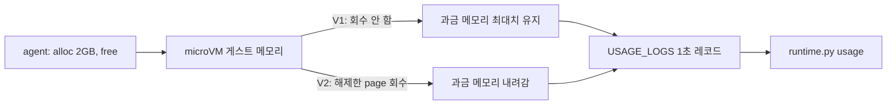

# 시나리오 5. 해제한 메모리를 회수해 사용한 만큼만 과금

## 이 시나리오의 목표

| 항목 | 내용 |
|---|---|
| 기능 | V2의 메모리 회수와 사용량 기반 메모리 과금 |
| 쓰는 도구 | `InvokeAgentRuntime`, `StopRuntimeSession`, USAGE_LOGS(CloudWatch Logs `FilterLogEvents`) |
| 입력 | V1 runtime(`rtv2_default`)과 V2 runtime(`rtv2_v2`)에 같은 타임라인을 실행하는 session 하나씩 |
| 작업 | 1. 대기 2분, 2GB 확보 2분, 해제 후 대기 2분, session 종료 2. USAGE_LOGS를 30초 단위로 집계 |
| 달성할 것 | V1은 해제한 뒤에도 최대 메모리로 과금되고, V2는 1분 안에 내려가는 것을 1초 단위 사용량으로 확인 |

## 과금되는 메모리는 agent가 쥔 메모리가 아니라 microVM이 받은 메모리다

AgentCore Runtime은 session의 vCPU와 메모리를 초 단위로 과금합니다. vCPU는 실제로 일한 만큼만 셉니다. 메모리는 microVM이 그 순간 차지하고 있는 양으로 셉니다. 그래서 agent 프로세스가 메모리를 해제해도, 게스트 OS가 그 page를 호스트에 돌려주지 않으면 과금량은 내려가지 않습니다.

V1은 한 번 커진 microVM 메모리를 session이 끝날 때까지 회수하지 않습니다. 큰 파일을 한 번 처리한 multi-turn agent는 그 뒤 사용자를 기다리는 idle 시간 내내 최대 메모리로 과금됩니다. V2는 agent가 해제한 메모리를 몇 분 안에 회수합니다. 발표문의 "multi-turn agent에서 session당 청구 메모리 최대 68% 감소"가 이 차이에서 나옵니다. 감소 폭은 session에서 최대 메모리를 쓰는 구간이 얼마나 짧은지에 따라 달라집니다.

V2에는 또 하나의 과금 방식이 있습니다. `resourceConfigurations`로 메모리 baseline을 정하면 baseline까지는 늘 과금되는 대신 단가가 낮고, baseline의 4배까지 burst할 수 있습니다. 이 실습은 기본값인 사용량 기반 과금만 측정합니다. Terraform provider가 아직 이 인자를 지원하지 않습니다.

### 용어

| 용어 | 뜻 | 이 실습의 예 |
|---|---|---|
| USAGE_LOGS | session별 사용량을 1초마다 남기는 vended log. `agent.runtime.memory.gb_hours.used`, `agent.runtime.vcpu.hours.used` 필드 | `/aws/vendedlogs/bedrock-agentcore/agentcore-runtime-v2/usage` |
| 평균 GB | 30초 구간의 `gb_hours.used` 합 × 3600 ÷ 레코드 수. 그 구간에 과금된 평균 메모리 | V1 idle 1.66GB |
| RSS | agent 프로세스가 실제로 쥔 메모리. agent가 `/proc/self/status`에서 읽음 | 533MB, 확보 후 2578MB |
| `StopRuntimeSession` | idle 15분을 기다리지 않고 session을 끝내는 API | 6분 뒤 호출 |

## 왜 시스템이 제공해야 하는가

agent 코드는 메모리를 해제하는 것까지만 할 수 있습니다. 파이썬이 큰 `bytearray`를 해제하면 RSS는 바로 내려가지만(2578MB → 530MB), 그 page가 microVM 밖으로 돌아가 과금에서 빠지는 것은 플랫폼만 할 수 있습니다. 이 회수가 없으면 비용을 줄이는 유일한 방법은 session을 빨리 끝내는 것뿐이고, 그러면 multi-turn 대화의 문맥을 session 밖 저장소로 옮겨야 합니다.

## 대안 비교

| 방식 | idle 구간 과금 메모리 | 대가 |
|---|---|---|
| V1 | session 최대 메모리 그대로 | 없음. 기본 동작 |
| V1 + 큰 작업마다 session 분리 | 작음 | 문맥을 AgentCore Memory 등으로 옮겨야 함 |
| V1 + idle timeout 단축(`idle_runtime_session_timeout`) | session이 끝나면 0 | 사용자가 돌아오면 cold start |
| V2 사용량 기반 | 해제한 뒤 1분 안에 내려감 | idle vCPU가 V1보다 약간 높음(아래 측정) |
| V2 committed baseline | baseline까지 늘 과금, 낮은 단가 | 사용량이 baseline보다 작으면 손해 |

## 컴포넌트 역할

| 컴포넌트 | 역할 |
|---|---|
| [agent/app.py](../agent/app.py) `alloc`, `free` | 지정한 MB만큼 메모리를 잡아 모든 page에 쓰고, 해제 |
| `runtime.py memory` | info → 120초 → alloc 2048MB → 120초 → free → 120초 → info → `StopRuntimeSession` |
| `runtime.py usage` | USAGE_LOGS를 session ID로 찾아 30초 단위 평균 GB, vCPU와 합계 출력 |
| [terraform/usage_logs.tf](../terraform/usage_logs.tf) | runtime마다 USAGE_LOGS delivery source를 만들어 log group 하나로 보냄 |

## 흐름

아래 그림은 이 시나리오에서 요청과 상태가 흘러가는 순서입니다.



## 실습

환경은 [setup.md](./setup.md)로 준비합니다. session ID와 시각은 실행할 때마다 달라집니다.

### 1. V1, V2에 같은 메모리 타임라인 실행

두 명령을 다른 터미널에서 동시에 실행합니다. 하나에 약 6분 걸립니다.

```bash
cd aws/bedrock/agentcore-runtime-v2
uv run --env-file .runtime.env scripts/runtime.py memory --runtime default
uv run --env-file .runtime.env scripts/runtime.py memory --runtime v2
```

두 터미널의 실행 결과입니다.

```text
runtime=default session=s-2fb382f906f243789d2853bb89279d3e
09:24:58Z info  rss_mb=533 then wait 120s
09:26:58Z alloc rss_mb=2581 then wait 120s
09:28:58Z free  rss_mb=533 then wait 120s
09:30:58Z info  rss_mb=533 then wait 0s
09:30:59Z StopRuntimeSession
runtime=v2 session=s-ea2dbb47ef70488ea48e6c21ed309c79
09:24:59Z info  rss_mb=533 then wait 120s
09:27:00Z alloc rss_mb=2578 then wait 120s
09:29:00Z free  rss_mb=530 then wait 120s
09:31:00Z info  rss_mb=530 then wait 0s
09:31:00Z StopRuntimeSession
```

- 두 runtime 모두 agent 안에서는 RSS가 2.5GB까지 올랐다가 530MB로 돌아왔습니다.

### 2. 30~60분 뒤 USAGE_LOGS 집계

사용량 로그는 최대 60분 늦게 도착합니다. 이 실습에서는 session이 끝나고 약 30분 뒤에 다 모였습니다.

```bash
uv run --env-file .runtime.env scripts/runtime.py usage --session s-2fb382f906f243789d2853bb89279d3e
uv run --env-file .runtime.env scripts/runtime.py usage --session s-ea2dbb47ef70488ea48e6c21ed309c79
```

V1(`rtv2_default`) 결과입니다.

```text
start(UTC)  sec  avg_GB avg_vCPU
09:11:30     15   1.100    0.285
09:12:00     12   1.364    0.049
09:25:00     30   1.656    0.010
09:26:30     30   1.795    0.025
09:27:00     30   3.658    0.009
09:29:00     30   3.660    0.009
09:30:30     30   3.654    0.010
09:31:30     30   3.653    0.014
09:32:00      6   2.455    0.011
records=455 memory_gb_hours=0.37538 vcpu_hours=0.00286
```

V2(`rtv2_v2`) 결과입니다.

```text
start(UTC)  sec  avg_GB avg_vCPU
09:25:00     30   2.100    0.089
09:25:30     30   1.980    0.023
09:27:00     30   3.965    0.047
09:28:30     30   3.594    0.029
09:29:00     30   2.015    0.028
09:29:30     30   1.527    0.024
09:30:30     30   1.505    0.023
09:31:00     15   1.365    0.047
records=376 memory_gb_hours=0.25283 vcpu_hours=0.00391
```

- V1은 09:29에 해제한 뒤에도 session이 끝날 때까지 3.66GB로 과금됩니다.
- V2는 해제 직후 30초 구간에 2.0GB, 그다음 구간부터 1.5GB입니다. 1분 안에 회수되었고, 확보 전 idle(1.98GB)보다도 낮아졌습니다.
- 메모리 합계는 V1 0.375 GB-hours, V2 0.253 GB-hours로 V2가 33% 적습니다.
- vCPU 합계는 V2가 더 큽니다(0.00391 대 0.00286). idle 구간 vCPU가 V1 0.010, V2 0.023입니다.

## 부록. 실무에서 얻는 것

- **과금 메모리는 RSS보다 큽니다.** agent RSS가 533MB일 때 과금 메모리는 V1 1.66GB, V2 1.98GB였습니다. 게스트 커널, 페이지 캐시, 런타임 프로세스가 더해진 값입니다. 비용 추정을 agent RSS로 하면 3배가량 작게 잡습니다.
- **V2 절감 폭은 idle 비율이 정합니다.** 이 타임라인은 6분 중 2분을 최대 메모리로 썼고 33%가 줄었습니다. 최대 메모리 구간이 짧고 사용자 응답을 기다리는 idle이 긴 multi-turn agent일수록 발표문의 68%에 가까워집니다. 반대로 session 내내 큰 메모리를 쥐는 agent(메모리 index, 로컬 모델)는 절감이 없고, 그 경우는 committed baseline이 맞습니다.
- **V1은 session을 끝낸 뒤에도 1분가량 과금됩니다.** `StopRuntimeSession`(09:30:59) 뒤에도 V1 레코드가 09:32:06까지 이어졌고, V2는 09:31:15에 끝났습니다.
- **V1 warm pool의 준비 시간이 session에 붙어 나옵니다.** V1 session에는 runtime을 만든 09:11에 찍힌 레코드 27개(초기화 구간)가 같은 session ID로 들어 있었습니다. pool microVM의 초기화 사용량이 나중에 그 microVM을 받은 session에 귀속되는 것으로 보입니다(`확인 필요`).
- **USAGE_LOGS는 켜 두어야 남습니다.** vended log는 delivery를 만든 뒤의 session만 기록합니다. 비용을 session 단위로 추적하려면 runtime을 만들 때 delivery도 함께 만듭니다.

## 참고 문서

1. [AgentCore 개발자 가이드: Resource configurations, How billing works](https://docs.aws.amazon.com/bedrock-agentcore/latest/devguide/runtime-how-it-works.html#runtime-v2-resource-configurations)
2. [AgentCore 개발자 가이드: Resource usage metrics and logs](https://docs.aws.amazon.com/bedrock-agentcore/latest/devguide/observability-runtime-metrics.html#observability-runtime-resource-usage-metrics-logs)
3. [AWS What's New: AgentCore Runtime의 새 기본값 (2026-11-12)](https://aws.amazon.com/ko/about-aws/whats-new/2026/11/new-agentcore-runtime-default/)
