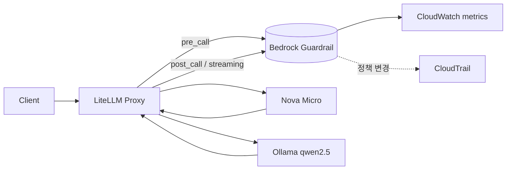
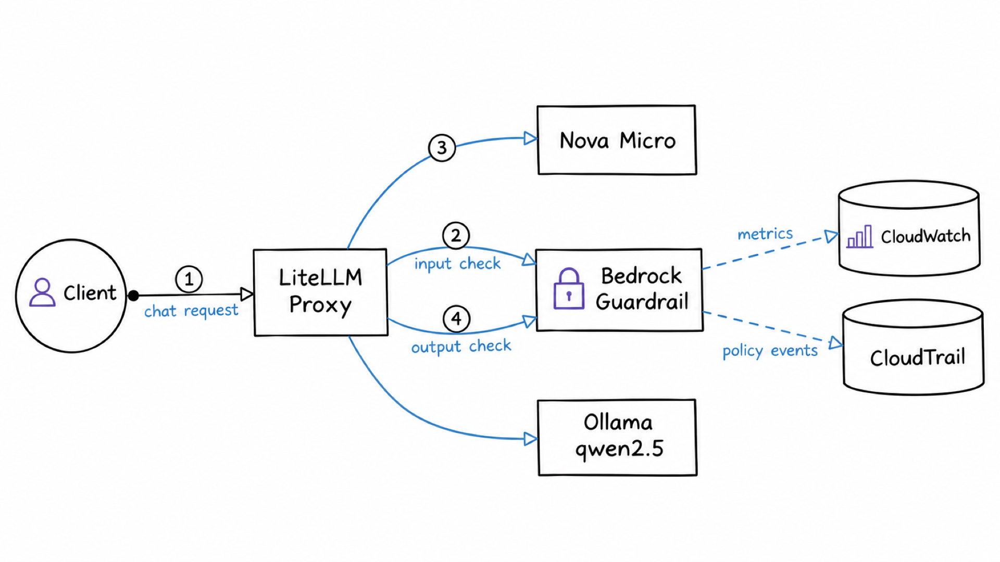

# 시나리오 1. LLM 가드레일 기능 지도

## 이 시나리오의 목표

| 항목 | 내용 |
|---|---|
| 기능 | 모델 앞뒤에서 입력과 출력을 정책으로 검사하고 차단하거나 가리는 가드레일 |
| 쓰는 도구 | Amazon Bedrock Guardrails, LiteLLM Proxy 1.108.2, Nova Micro, Ollama qwen2.5 |
| 입력 | [guardrail.tf](../terraform/guardrail.tf)에 정의한 정책 5종 |
| 작업 | 기능과 시나리오 번호를 잇는 지도 작성 |
| 달성할 것 | 다음 시나리오에서 무엇을 확인하는지, 어느 도구가 어느 기능을 맡는지 구분 |

## 가드레일은 모델 밖에 둔 정책 검사기입니다

가드레일은 웹 애플리케이션 앞의 WAF와 비슷한 자리에 있습니다. WAF가 HTTP 요청을 규칙으로 검사해 막듯이 가드레일은 사용자 프롬프트와 모델 응답을 정책으로 검사해 막거나 일부를 가립니다. 다만 검사 대상이 자연어라서 대부분의 정책은 규칙이 아니라 분류 모델의 확률 판정으로 동작합니다.

가드레일이 다루는 것은 유해 표현, 프롬프트 공격, 금지 주제, 금지 단어, 개인정보, 근거 문서와 어긋난 답변입니다. 사용자 인증과 권한, 요청량 제한, 모델이 tool을 호출해서 생기는 부작용은 다루지 않으며, 이것들은 gateway와 애플리케이션이 맡습니다.

모델의 내장 안전 필터와도 다릅니다. Nova Micro는 가드레일 없이도 가짜 카드번호 생성을 스스로 거절했지만([시나리오 3](./3-litellm-guardrail-modes.md)의 E5), 내장 필터는 모델마다 기준이 다르고 조정할 수도 없습니다. 가드레일은 모델과 관계없이 같은 정책을 겁니다.

### 용어

| 용어 | 뜻 | 이 실습의 예 |
|---|---|---|
| guardrail | 정책 묶음 하나. 리전 리소스이고 ID와 ARN이 있음 | `guardrails-handson` |
| guardrail version | 정책 묶음의 불변 스냅숏. 편집은 `DRAFT`에만 가능 | `1`, `2`, `DRAFT` |
| policy | guardrail 안의 검사 종류 | content, topic, word, sensitive information, contextual grounding |
| filter strength | 분류 결과 confidence가 어느 수준부터 차단할지 정하는 값 | `HIGH`는 LOW 이상 confidence를 모두 차단 |
| text unit | 과금과 메트릭의 단위. 최대 1,000자 | 1,001자는 2 unit |
| tier | 분류 모델 세대. Standard는 다국어를 지원하고 cross-region 추론이 필요 | `STANDARD` + `apac.guardrail.v1:0` |
| ApplyGuardrail | 모델 호출 없이 텍스트만 guardrail로 평가하는 API | LiteLLM이 사용하는 API |
| InvokeGuardrailChecks | guardrail 리소스 없이 요청에 검사 항목을 직접 적는 API. 탐지만 하고 마스킹하지 않음 | 서울 리전 AccessDenied. 실습하지 않음 |
| LiteLLM guardrail | LiteLLM config에 등록한 호출 설정. Bedrock guardrail을 가리키고 검사 시점(`mode`)과 스트리밍 방식을 정함. 여러 개가 같은 Bedrock guardrail을 가리킬 수 있음 | `guardrails-handson`, `guardrails-input`, `guardrails-input-latest`, `guardrails-input-incremental`, `guardrails-output`, `guardrails-output-release` |

## 가드레일을 gateway가 제공해야 하는 이유

애플리케이션마다 검사를 넣으면 세 가지 문제가 생깁니다.

- 모델을 바꾸면 안전 기준도 바뀝니다. 모델 내장 필터는 모델마다 달라서 OpenAI 모델과 Bedrock 모델은 같은 문장을 다르게 거절합니다.
- 개인정보가 외부 모델로 나갑니다. 마스킹은 모델을 호출하기 전에 해야 의미가 있는데, output guardrail만 있는 구성에서는 사용자가 입력한 이메일이 이미 모델 제공자에게 넘어간 뒤입니다([시나리오 3](./3-litellm-guardrail-modes.md)의 E6).
- 정책 변경과 차단 이력을 한곳에서 볼 수 없습니다.

LiteLLM 같은 gateway에 Bedrock guardrail을 붙이면 모든 모델 호출이 같은 정책을 거치고 같은 메트릭에 남습니다. 대신 요청마다 ApplyGuardrail 왕복이 붙어 지연과 비용이 늘어나는데, 이 핸즈온은 그 대가를 숫자로 확인합니다.

## 대안 비교

| 방식 | 다국어 | 모델 무관 | PII 마스킹 | 운영 부담 | 비용 |
|---|---|---|---|---|---|
| 모델 내장 안전 필터 | 모델마다 다름 | 아님 | 없음 | 없음 | 없음 |
| Bedrock Guardrails (ApplyGuardrail) | Standard tier | 맞음 | 입력과 출력 | 관리형 | text unit 과금 |
| Bedrock InvokeGuardrailChecks | 맞음 | 맞음 | 탐지만 | 리소스도 없음 | text unit 과금, 리전 제한 |
| 자체 호스팅 분류 모델(Llama Guard 등) | 모델마다 다름 | 맞음 | 별도 구현 | GPU 서빙 직접 운영 | 인프라 비용 |
| 정규식과 금지어만 직접 구현 | 맞음 | 맞음 | 정규식 범위 | 낮음 | 없음 |

정규식과 금지어만으로 충분한 요구라면 Bedrock의 word filter와 regex도 무료로 쓸 수 있습니다. 분류 모델이 값을 하는 곳은 유해 표현, 프롬프트 공격, 금지 주제처럼 문맥을 봐야 하는 정책입니다.

## 컴포넌트 역할

| 컴포넌트 | 역할 |
|---|---|
| Bedrock guardrail `guardrails-handson` | 정책 정의와 판정. 버전으로 고정 |
| LiteLLM Proxy | 요청을 받아 guardrail을 언제, 무엇에, 몇 번 적용할지 결정 |
| Nova Micro | Bedrock 경로 모델. Converse API로 호출 |
| Ollama qwen2.5:1.5b | 비Bedrock 경로 모델. 가드레일이 모델과 무관하게 동작하는지 확인 |
| CloudWatch `AWS/Bedrock/Guardrails` | 호출 수, 개입 수, text unit, 지연 |
| CloudTrail | guardrail 정책 변경 이력 |

## 기능 지도

LiteLLM이 모델 호출 앞뒤의 어느 시점에 guardrail을 부르는지, 판정과 정책 변경이 어디에 남는지를 그리면 다음과 같습니다.

같은 구조를 그림으로 옮기면 다음과 같습니다.

| 기능 | 도구 | 시나리오 |
|---|---|---|
| 정책 5종의 판정과 한국어 탐지 품질, 버전 고정 | Bedrock ApplyGuardrail | [2](./2-policy-filters.md) |
| 검사 시점(pre, post), 마스킹, 실패 동작 | LiteLLM + Bedrock | [3](./3-litellm-guardrail-modes.md) |
| 요청 파라미터와 `default_on`으로 guardrail 적용 | LiteLLM | [4](./4-litellm-guardrail-apply.md) |
| input guardrail이 더하는 지연과 차단 시간 | LiteLLM + Bedrock | [5](./5-latency-input-guardrail.md) |
| 멀티턴 대화의 검사 범위와 늘어나는 unit, 시간 | LiteLLM + Bedrock | [6](./6-multiturn-guardrail.md) |
| output guardrail이 더하는 지연과 차단 시간, 비Bedrock 경로 | LiteLLM + Bedrock | [7](./7-latency-output-guardrail.md) |
| 스트리밍 요청의 input guardrail | LiteLLM + Bedrock | [8](./8-streaming-input-guardrail.md) |
| 스트리밍 응답의 output guardrail 방식과 유출량 | LiteLLM + Bedrock | [9](./9-streaming-output-guardrail.md) |
| text unit 비용 계산, 메트릭, 감사 | CloudWatch, CloudTrail | [10](./10-cost-and-monitoring.md) |
| LiteLLM guardrail별 판정 모니터링, 본문 없는 spend log | LiteLLM 콘솔, Postgres | [11](./11-litellm-console-monitoring.md) |
| 고객 문의로 차단 시각과 근거 찾기 | LiteLLM virtual key, 콘솔 Logs, `/spend/logs/ui` | [12](./12-find-customer-blocked-request.md) |

## 적용 경로 세 가지

Bedrock guardrail을 호출하는 방법은 세 가지입니다.

| 경로 | 쓰는 곳 | 특징 |
|---|---|---|
| `guardrailConfig` (Converse, InvokeModel, ConverseStream) | Bedrock 모델을 직접 호출할 때 | 모델 호출과 한 번에 처리. Bedrock 모델 전용 |
| ApplyGuardrail | 모델과 무관하게 텍스트만 평가 | LiteLLM의 기본 경로. 비Bedrock 모델에도 적용 |
| InvokeGuardrailChecks | guardrail 리소스 없이 즉석 검사 | 탐지 전용. 서울 리전은 AccessDenied |

이 핸즈온은 gateway 관점에서 보므로 ApplyGuardrail과 InvokeGuardrailChecks를 다룹니다.

## 실습은 콘솔, API, LiteLLM 순서로 진행합니다

같은 guardrail 버전을 세 경로로 차례로 호출하면서 판정이 어떻게 보이는지 확인합니다.

| 순서 | 경로 | 호출하는 것 | 확인하는 것 | 시나리오 |
|---|---|---|---|---|
| 1 | Bedrock 콘솔 테스트 창 | 모델 호출 + guardrail | 차단과 마스킹이 최종 응답에 어떻게 보이는지 | [2](./2-policy-filters.md#aws-콘솔-예제) |
| 2 | `aws bedrock-runtime apply-guardrail` | ApplyGuardrail API | 응답 필드(`action`, `outputs`, `assessments`, `usage`)와 정책별 판정 | [2](./2-policy-filters.md#api-예제) |
| 3 | LiteLLM `POST /v1/chat/completions` | LiteLLM이 내부에서 ApplyGuardrail 호출 | 검사 시점, 적용 방법, 지연, 스트리밍, 실패 동작 | [3](./3-litellm-guardrail-modes.md)~[9](./9-streaming-output-guardrail.md) |

앞 단계에서 판정을 확정해 두면, 뒤 단계에서 결과가 달라졌을 때 원인을 추가된 계층 하나로 좁힐 수 있습니다.

## 부록: 실무 시사점 및 운영 팁

- 가드레일에서는 정책 내용보다 적용 위치를 정하는 일이 더 중요했습니다. 같은 guardrail이라도 LiteLLM 모드에 따라 지연은 0초에서 13초까지, 비용은 1배에서 30배까지 달라졌습니다.
- 운영 guardrail은 번호 버전으로 고정합니다. `DRAFT`를 가리키면 콘솔에서 편집한 내용이 그 즉시 운영에 반영되기 때문입니다.

## 참고 문서

1. [Amazon Bedrock Guardrails 사용자 가이드](https://docs.aws.amazon.com/bedrock/latest/userguide/guardrails.html)
2. [Amazon Bedrock 요금](https://aws.amazon.com/bedrock/pricing/)
3. [LiteLLM Bedrock Guardrails 문서](https://docs.litellm.ai/docs/proxy/guardrails/bedrock)
