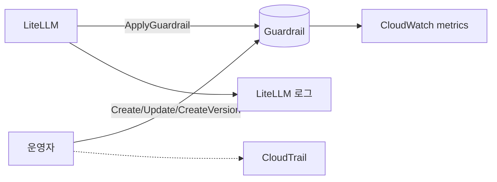
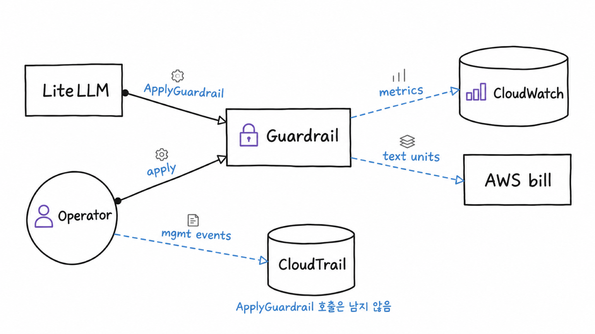

# 시나리오 10. text unit 비용 계산과 메트릭, 감사 로그

## 이 시나리오의 목표

| 항목 | 내용 |
|---|---|
| 기능 | guardrail 비용을 계산하고, 동작과 정책 변경에 대한 모니터링 및 Observability를 확보하는 것 |
| 쓰는 도구 | CloudWatch `AWS/Bedrock/Guardrails`, CloudTrail event history, AWS Pricing API |
| 입력 | 시나리오 2~9에서 발생한 guardrail 호출 |
| 작업 | 1. text unit 경계 확인 2. 메트릭 조회와 비용 계산 3. CloudTrail 이벤트 확인 |
| 달성할 것 | 이 핸즈온 전체 비용을 메트릭으로 역산하고, 감사에 어떤 기록이 남고 남지 않는지 구분 |

## guardrail 비용은 문자 수 × 유료 정책 수입니다

text unit 하나는 최대 1,000자이고, ApplyGuardrail 한 번에 들어간 텍스트를 1,000자 단위로 올림한 값이 정책마다 따로 과금됩니다. 기준이 토큰이 아니라 문자 수이므로 같은 의미라도 프롬프트가 길면 비용이 늘고, 모델 가격과는 무관합니다.

이 실습 guardrail의 유료 정책은 content, topic, PII, grounding이며, 1 unit 텍스트 하나를 검사하면 content 0.00015 + topic 0.00015 + PII 0.0001 = 0.0004 USD가 듭니다. word filter와 regex는 unit이 집계되지만 무료입니다. grounding은 정책으로 걸려 있지만, ApplyGuardrail 요청에 참고 문서(grounding source)와 질문이 함께 올 때만 평가됩니다. LiteLLM의 `contextual_grounding_from_messages`를 켜지 않아 grounding source를 보내지 않으므로 계산식에서 빠집니다. 콘솔에서는 guardrail 상세의 **Contextual grounding check**에서 threshold(grounding 0.7, relevance 0.5)를 볼 수 있습니다.

### 용어

| 용어 | 뜻 | 이 실습의 예 |
|---|---|---|
| `TextUnitCount`(버전 차원) | 모든 정책의 unit 합계. 무료 정책 포함 | 1 unit 텍스트 한 번에 5 |
| `TextUnitCount`(정책 차원) | 정책 하나의 unit. 비용 계산의 기준 | `ContentPolicy` 143 |
| `InvocationsIntervened` | 개입(차단 또는 마스킹)한 호출 수 | 버전 2에서 44 |
| `sensitiveInformationPolicyFreeUnits` | PII 정책 중 무료인 regex 부분의 unit | 유료 unit과 같은 수로 함께 집계 |

## 비용과 감사를 따로 봐야 하는 이유

LiteLLM 1.108.2는 Bedrock guardrail 응답의 `usage`에 정책별 단가를 곱해 guardrail 비용을 spend에 더합니다. 그래도 실제 청구는 AWS에서 나오므로, LiteLLM spend는 추정치이고 CloudWatch의 unit과 Cost Explorer로 대사합니다. 시나리오 9의 sampled 모드처럼 한 요청이 30회 호출을 만들면 guardrail 비용이 모델 비용보다 커질 수도 있습니다. 또 정책이 바뀌면 차단 기준도 바뀌므로, 누가 언제 바꿨는지가 기록으로 남아야 합니다.

## 대안 비교

| 모니터링 및 Observability 수단 | 볼 수 있는 것 | 볼 수 없는 것 |
|---|---|---|
| CloudWatch 메트릭 | 호출 수, 개입 수, 정책별 unit, 지연 | 어떤 요청이 막혔는지 |
| CloudTrail event history | guardrail 생성, 수정, 버전 발행, Converse 호출(관리 이벤트) | ApplyGuardrail 개별 호출(데이터 이벤트) |
| CloudTrail trail의 데이터 이벤트(`AWS::Bedrock::Guardrail`) | ApplyGuardrail 호출마다 `source`, `action`, `assessments`, 호출한 IAM 주체 | 최종 사용자. LiteLLM이 같은 IAM 주체로 대신 호출하므로 모두 같은 주체로 남음 |
| Bedrock model invocation logging | Bedrock 모델 직접 호출의 guardrail trace | 비Bedrock 모델 경로 |
| LiteLLM 로그와 callback | 요청별 판정 근거(assessments) | 계정 단위 집계 |

## 컴포넌트 역할

| 컴포넌트 | 역할 |
|---|---|
| [metrics.sh](../scripts/metrics.sh) | 버전별, 방향과 정책별 메트릭 합계 출력 |
| CloudTrail | event history에 관리 이벤트 90일 보관. ApplyGuardrail은 trail에 데이터 이벤트를 켜야 기록 |

## 흐름

LiteLLM이 guardrail을 호출하면 그 결과가 CloudWatch 메트릭으로 쌓이고, 운영자의 정책 변경은 CloudTrail에 남습니다.



같은 구조를 그림으로 옮기면 다음과 같습니다.



## 실습

[setup.md](./setup.md)의 4단계까지 준비한 상태에서 시작합니다.

### 1. text unit 경계 확인(A2)

999자, 1,000자, 1,001자, 3,500자 텍스트로 ApplyGuardrail API(`aws bedrock-runtime apply-guardrail`)를 호출하고, 응답의 `usage`에서 정책별 unit을 봅니다. `aws_apply`는 시나리오 2의 API 예제 1단계에서 본 호출을 감싼 함수이고, `.units`가 `usage` 필드입니다.

```bash
for n in 999 1000 1001 3500; do
  echo -n "$n chars: "; aws_apply "$(python3 -c "print('가'*$n,end='')")" | jq -c .units
done
```

글자 수별 출력 결과입니다.

```text
999 chars: {"topicPolicyUnits":1,"contentPolicyUnits":1,"wordPolicyUnits":1,"sensitiveInformationPolicyUnits":1,"sensitiveInformationPolicyFreeUnits":1}
1000 chars: {"topicPolicyUnits":1,"contentPolicyUnits":1,"wordPolicyUnits":1,"sensitiveInformationPolicyUnits":1,"sensitiveInformationPolicyFreeUnits":1}
1001 chars: {"topicPolicyUnits":2,"contentPolicyUnits":2,"wordPolicyUnits":2,"sensitiveInformationPolicyUnits":2,"sensitiveInformationPolicyFreeUnits":2}
3500 chars: {"topicPolicyUnits":4,"contentPolicyUnits":4,"wordPolicyUnits":4,"sensitiveInformationPolicyUnits":4,"sensitiveInformationPolicyFreeUnits":4}
```

한글도 한 글자를 1자로 세며, 1,001자부터 2 unit이 됩니다.

### 2. 메트릭 조회와 비용 계산(G2)

CloudWatch API(`aws cloudwatch get-metric-statistics`)로 `AWS/Bedrock/Guardrails` 네임스페이스의 메트릭을 버전별, 방향과 정책별로 합산합니다. 차원 조합마다 이 호출을 반복하는 일은 [metrics.sh](../scripts/metrics.sh)가 맡습니다.

```bash
./scripts/metrics.sh 5
```

시나리오 2~9를 모두 실행한 뒤의 결과입니다. 메트릭은 수 분 늦게 집계되므로 직전 호출은 빠졌을 수 있습니다.

```text
| 버전 | Invocations | InvocationsIntervened | TextUnitCount | 평균 InvocationLatency(ms) |
| 1 | 50.0 | 30.0 | 250.0 | 369.26 |
| 2 | 165.0 | 44.0 | 884.0 | 375.24 |
| DRAFT | 2.0 | 2.0 | 10.0 | 386.5 |

| 방향 | 정책(계정 전체) | TextUnitCount | InvocationsIntervened |
| Input | ContentPolicy | 143.0 | 32.0 |
| Input | TopicPolicy | 143.0 | 10.0 |
| Input | WordPolicy | 143.0 | 4.0 |
| Input | SensitiveInformationPolicy | 286.0 | 20.0 |
| Output | ContentPolicy | 84.0 | 0.0 |
| Output | TopicPolicy | 84.0 | 0.0 |
| Output | WordPolicy | 84.0 | 4.0 |
| Output | SensitiveInformationPolicy | 168.0 | 8.0 |
| Output | ContextualGroundingPolicy | 9.0 | 4.0 |
```

버전 차원(Dimension)의 `TextUnitCount`는 1 unit 호출 한 번을 5로 세기 때문에(content, topic, word, PII 유료, PII 무료) 비용은 정책 차원의 값으로 계산합니다. 다만 PII 행은 유료와 무료 unit을 합친 값이라 절반만 유료입니다.

| 정책 | 유료 unit(Input + Output) | 단가(USD / 1,000) | 비용(USD) |
|---|---|---|---|
| Content | 227 | 0.15 | 0.0341 |
| Topic | 227 | 0.15 | 0.0341 |
| PII | 227 | 0.10 | 0.0227 |
| Contextual grounding | 9 | 0.10 | 0.0009 |
| Word, regex | - | 무료 | 0 |
| 합계 | | | 0.0917 |

us-east-1에서 실행한 InvokeGuardrailChecks 호출 10여 건은 이 메트릭에 포함되지 않습니다. InvokeGuardrailChecks의 단가는 `확인 필요`입니다.

같은 정책 구성으로 입력 2,000자와 출력 3,000자를 검사하면 요청 하나에 5 unit × 0.0004 = 0.002 USD이고, 월 100만 건이면 2,000 USD입니다. 시나리오 9의 sampled 모드처럼 output guardrail을 반복 호출하면 이 값에 호출 횟수가 그대로 곱해집니다.

### 3. CloudTrail 이벤트 확인

CloudTrail API(`aws cloudtrail lookup-events`)로 event history에서 최근 3시간 동안의 이벤트를 이름별로 셉니다. macOS 셸에서도 동작하도록 `date -d` 대신 python으로 시각을 만듭니다.

```bash
st=$(python3 -c "import datetime as d;print((d.datetime.now(d.timezone.utc)-d.timedelta(hours=3)).strftime('%FT%TZ'))")
for e in CreateGuardrail UpdateGuardrail CreateGuardrailVersion ApplyGuardrail Converse; do
  echo "$e: $(aws cloudtrail lookup-events --region "$AWS_REGION" --lookup-attributes AttributeKey=EventName,AttributeValue=$e --start-time $st --query 'length(Events)' --output text)"
done
```

이벤트 이름별 개수입니다.

```text
CreateGuardrail: 1
UpdateGuardrail: 1
CreateGuardrailVersion: 2
ApplyGuardrail: 0
Converse: 43
```

정책 변경 이벤트와 Converse는 남았지만, ApplyGuardrail은 200회 넘게 호출했는데도 0건입니다. AWS가 기록하지 못하는 것이 아니라 기록하는 자리가 다릅니다. CloudTrail은 Converse와 InvokeModel을 관리 이벤트로, ApplyGuardrail을 데이터 이벤트로 분류하고, event history는 관리 이벤트만 보여 줍니다. ApplyGuardrail을 남기려면 trail을 만들고 advanced event selector로 `AWS::Bedrock::Guardrail` 리소스 유형의 데이터 이벤트를 켜야 하며, 데이터 이벤트는 추가 요금이 붙습니다. [cloudtrail.tf](../terraform/cloudtrail.tf)의 `enable_guardrail_data_events`를 `true`로 바꾸면 이 trail을 만들 수 있지만, 기본값은 `false`입니다. 데이터 이벤트의 `responseElements.assessments`에 판정 근거가 들어가므로, 로그 보관 규정이 있는 환경에서는 켜기 전에 S3에 무엇이 남는지 확인해야 합니다. 요청별 차단 근거는 원문을 가린 채 LiteLLM spend log에도 남습니다([시나리오 11](./11-litellm-console-monitoring.md#차단-근거는-본문-없이-error_information에-남습니다)). 호출 수와 개입 수 같은 집계는 2단계의 CloudWatch 메트릭에 이미 모두 잡혀 있습니다. `UpdateGuardrail`과 `DeleteGuardrail`은 EventBridge 규칙으로 알림을 걸어 둘 대상입니다.

## 알람 후보

| 메트릭 | 조건 | 의미 |
|---|---|---|
| `InvocationsIntervened` / `Invocations` | 평소 비율보다 급증 | 공격 시도 또는 정책 오설정 |
| `InvocationLatency` p99 | 1,000ms 초과 | 이 실습의 평균은 약 370ms |
| `InvocationClientErrors`, `InvocationServerErrors` | 0 초과 | fail-closed이므로 곧 서비스 장애 |
| `InvocationThrottles` | 0 초과 | guardrail 할당량에 걸림. fail-closed이므로 요청이 실패함 |
| 정책 차원 `TextUnitCount` 일 합계 | 예산 초과 | 비용 급증 |

이 알람은 [시나리오 4](./4-litellm-guardrail-apply.md)의 `default_on`으로 모든 요청에 guardrail을 걸 때 가장 잘 맞습니다. 메트릭의 분모가 전체 트래픽이 되기 때문입니다. 요청마다 guardrail을 고르게 두면 클라이언트가 `guardrails` 필드를 빼는 순간 메트릭에서 사라지므로, `Invocations`가 줄어든 것이 트래픽 감소인지 우회인지 메트릭만으로는 구분할 수 없습니다.

- 어느 정책이 막았는지는 `InvocationsIntervened`를 `Operation`, `GuardrailContentSource`, `GuardrailPolicyType` 세 차원으로 조회하면 원문 없이 건수로 나옵니다. 시나리오 2~11을 실행한 뒤 3시간 동안 Input은 ContentPolicy 15, SensitiveInformationPolicy 6, WordPolicy 3, Output은 WordPolicy 19였습니다. 마스킹도 SensitiveInformationPolicy 개입으로 셉니다.
- 개입 비율은 `GuardrailContentSource` 차원으로 나눠 봅니다. Input 쪽 급증은 공격 시도, Output 쪽 급증은 모델 출력 문제에 가깝습니다.
- 이 실습의 LiteLLM guardrail 다섯 개는 같은 Bedrock guardrail을 가리키므로, CloudWatch 메트릭에서는 하나로 합쳐 보입니다. LiteLLM guardrail별 요청 수와 차단율은 LiteLLM 콘솔의 guardrail 모니터에서 나눠 봅니다([시나리오 11](./11-litellm-console-monitoring.md)).

## 부록: 실무 시사점 및 운영 팁

- 비용 대시보드를 버전 차원의 `TextUnitCount`로 만들면 과대 계상되므로, 정책 차원으로 나누고 무료 정책을 뺍니다.
- LiteLLM spend에는 guardrail 비용 추정치가 들어갑니다. 차단된 요청도 모델 비용 없이 guardrail 비용만으로 spend가 남습니다. Cost Explorer와 대사할 때 모델 비용과 guardrail 비용을 나눠 봅니다.
- 감사 요구가 "무엇을 막았는가"라면 CloudTrail 데이터 이벤트로 호출마다 판정(`action`, `assessments`)을 남길 수 있습니다. 다만 "누가"는 LiteLLM의 IAM 주체 하나로만 남으므로, 최종 사용자나 LiteLLM 키 단위로 추적하려면 LiteLLM의 로그 callback이나 DB 저장을 함께 설계합니다.
- release 방식은 요청 하나가 ApplyGuardrail을 수십 번 부르므로, 데이터 이벤트를 켜면 CloudTrail 이벤트 수와 요금도 그만큼 늘어납니다.
- Bedrock model invocation logging은 계정 단위 설정이라 이 실습에서는 켜지 않았습니다. 켜더라도 비Bedrock 모델 경로의 판정은 남지 않습니다.
- CloudWatch guardrail 메트릭은 ApplyGuardrail 호출 기준이라, LiteLLM이 Ollama나 OpenAI 모델 앞에서 부른 guardrail도 집계됩니다. 다만 모델 차원이 없어 어느 모델 경로에서 막혔는지는 나뉘지 않습니다. 모델별 구분은 LiteLLM spend log의 `model`로 합니다([시나리오 12](./12-find-customer-blocked-request.md)).

## 참고 문서

1. [Bedrock Guardrails CloudWatch 메트릭](https://docs.aws.amazon.com/bedrock/latest/userguide/monitoring-guardrails-cw-metrics.html)
2. [Amazon Bedrock 요금](https://aws.amazon.com/bedrock/pricing/)
3. [CloudTrail event history](https://docs.aws.amazon.com/awscloudtrail/latest/userguide/view-cloudtrail-events.html)
4. [Monitor Amazon Bedrock API calls using CloudTrail(데이터 이벤트와 관리 이벤트 분류)](https://docs.aws.amazon.com/bedrock/latest/userguide/logging-using-cloudtrail.html)
