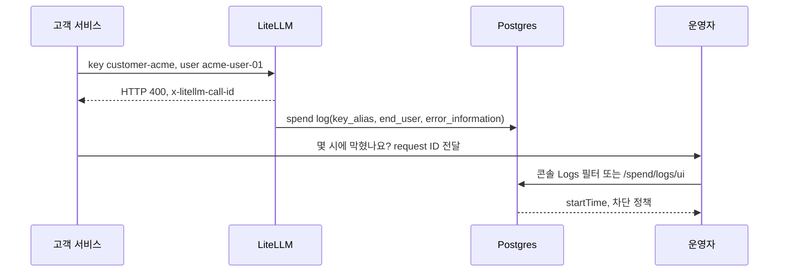
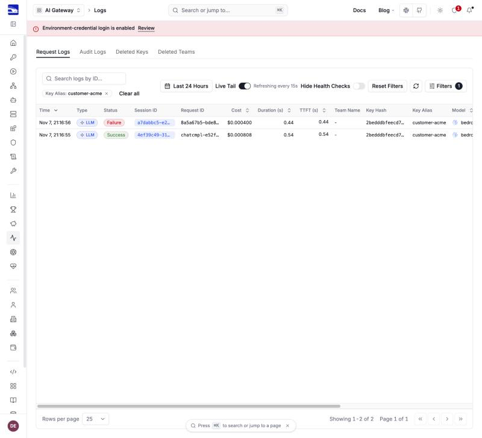

# 시나리오 12. 고객 문의로 guardrail 차단 시각과 근거 찾기

## 이 시나리오의 목표

| 항목 | 내용 |
|---|---|
| 기능 | "우리 서비스가 몇 시 몇 분에 guardrail에 막혔나요"라는 고객 문의에 차단 시각과 근거로 답하는 것 |
| 쓰는 도구 | LiteLLM Proxy 1.108.2 `POST /key/generate`, 요청 본문의 `user`, 응답 헤더(`x-litellm-call-id`, `x-litellm-applied-guardrails` 등), 콘솔 **Logs** 필터, `GET /spend/logs/ui` |
| 입력 | 고객용 virtual key(`key_alias: customer-acme`), 고객 서비스의 사용자 ID(`user: acme-user-01`) |
| 작업 | 준비 1~2, 콘솔 1~3, API 1~3 |
| 달성할 것 | 고객 이름, 사용자 ID, 요청 ID 중 무엇을 받아도 차단 시각(UTC)과 차단 정책을 1분 안에 찾음 |

## 고객을 찾으려면 요청에 고객 표시가 먼저 있어야 합니다

LiteLLM은 요청 본문을 저장하지 않아도 요청마다 spend log를 남깁니다([시나리오 11](./11-litellm-console-monitoring.md)). 하지만 모든 고객이 master key 하나로 호출하면 spend log 어느 행이 어느 고객의 것인지 구분할 수 없습니다. 고객 문의에 답하려면 요청을 보낼 때부터 고객을 가리키는 값이 기록되어야 합니다.

LiteLLM이 고객을 가리키는 데 쓰는 값은 세 가지입니다.

| 단서 | 기록되는 위치 | 누가 정하나 | 고객 문의에서의 쓰임 |
|---|---|---|---|
| `key_alias` | 고객마다 발급한 virtual key의 이름 | LiteLLM 운영자가 key를 만들 때 | "ACME사 요청 중 막힌 것"처럼 회사 단위로 찾기 |
| `end_user` | 요청 본문의 `user` 필드 | 고객 서비스가 요청마다 | "ACME사의 사용자 acme-user-01"처럼 사람 단위로 찾기 |
| `x-litellm-call-id` | 응답 헤더. 성공과 차단 모두 | LiteLLM이 요청마다 | 고객이 받은 응답 하나를 정확히 찾기 |

`key_alias`는 key에 묶이므로, 같은 사용자가 다른 key로 호출한 요청은 잡지 못합니다. `end_user`는 고객 서비스가 보내 줘야만 남습니다. 그래서 고객사에는 오류가 나면 `x-litellm-call-id`를 함께 전달해 달라고 안내하는 것이 가장 빠릅니다.

### 용어

| 용어 | 뜻 | 이 실습의 예 |
|---|---|---|
| virtual key | LiteLLM이 발급하는 API key. 이름(`key_alias`), 허용 모델, 예산을 붙일 수 있음 | `customer-acme` |
| end user | 고객 서비스의 최종 사용자. 요청 본문의 OpenAI 표준 `user` 필드 | `acme-user-01` |
| request ID | 콘솔 **Logs**의 **Request ID** 열. 차단된 요청은 `x-litellm-call-id`, 성공한 요청은 응답 본문의 `id`(`chatcmpl-...`) | `8a5a67b5-bde8-4b00-9ab3-429b7f2c087d` |

## x-litellm-call-id는 성공과 차단 모두에서 찾는 열쇠입니다

LiteLLM은 응답마다 `x-litellm-call-id` 헤더를 붙입니다. 콘솔 **Request ID** 열에 보이는 값은 요청 결과에 따라 다릅니다.

| 요청 결과 | 콘솔 **Request ID** 열 | `x-litellm-call-id`로 검색 |
|---|---|---|
| 차단(HTTP 400) | `x-litellm-call-id`와 같은 UUID | 찾음 |
| 성공(HTTP 200) | 응답 본문의 `id`(`chatcmpl-...`). call ID는 메타데이터의 `litellm_call_id`에 있음 | 찾음 |

콘솔의 **Search logs by ID...**와 API의 `request_id` 필터는 두 값을 모두 받습니다. 그래서 고객에게는 결과와 상관없이 `x-litellm-call-id` 하나만 받으면 됩니다.

### 응답 헤더 중 문의 대응에 쓰는 것

성공 응답과 차단 응답의 헤더를 비교하면, 차단 응답에는 call ID, 비용, 적용된 guardrail만 남습니다.

| 헤더 | 성공 | 차단 | 문의 대응에서의 쓰임 |
|---|---|---|---|
| `x-litellm-call-id` | 있음 | 있음 | 요청 하나를 찾는 검색어 |
| `x-litellm-applied-guardrails` | `guardrails-handson` | `guardrails-handson` | 그 요청에 어떤 guardrail이 걸렸는지. "guardrail을 켰는데 왜 안 막혔나" 문의에 먼저 봄 |
| `x-litellm-response-cost` | `0.000805` | `0` | 고객이 받은 비용. 차단 응답은 0이지만 spend log에는 guardrail 비용 0.0004가 남음 |
| `x-litellm-model-group`, `x-litellm-model-name` | `nova-micro`, `bedrock/apac.amazon.nova-micro-v1:0` | 없음 | 요청한 모델 이름과 실제로 호출된 배포 |
| `x-litellm-response-duration-ms`, `x-litellm-overhead-duration-ms` | `525`, `14` | 없음 | 느리다는 문의에서 LiteLLM 자체 지연과 전체 지연을 나눔 |
| `x-litellm-attempted-retries`, `x-litellm-attempted-fallbacks` | `0`, `0` | 없음 | 재시도나 다른 모델로의 대체가 있었는지 |
| `llm_provider-x-amzn-requestid` | Bedrock Converse의 요청 ID | 없음 | AWS Support에 Bedrock 호출을 문의할 때 쓰는 ID. 모델을 부르지 않은 차단 요청에는 없음 |
| `x-litellm-version` | `1.108.2` | 없음 | 버전별 동작 차이 확인 |

## 콘솔 시각은 현지 시각, API 시각은 UTC입니다

콘솔 **Logs**의 **Time**과 상세 화면의 **Start Time**은 브라우저의 현지 시각입니다. 상세 화면은 현지 시각 뒤에 `Z`를 붙여 UTC처럼 보이지만, 같은 요청을 API로 조회하면 9시간 앞선 UTC 값이 나옵니다. 고객에게 답할 때는 기준 시간대를 함께 적습니다.

| 위치 | 이 실습의 차단 요청 |
|---|---|
| 콘솔 **Logs**의 **Time** | `Nov 7, 21:16:56` |
| 콘솔 상세의 **Start Time** | `2026-11-07T21:16:56.829Z` |
| `GET /spend/logs/ui`의 `startTime` | `2026-11-07T12:16:56.829+00:00` |

## 흐름

고객 표시는 요청 시점에 남고, 문의가 오면 그 값으로 spend log를 거꾸로 찾습니다.



## 준비

[setup.md](./setup.md)의 4단계까지 마친 셸에서 실행합니다.

### 1. 고객용 virtual key 발급

`POST /key/generate`로 `key_alias`가 `customer-acme`인 key를 만듭니다. key 값은 화면에 찍지 않고 셸 변수에만 담습니다.

```bash
CUSTOMER_KEY=$(curl -s localhost:4000/key/generate \
  -H "Authorization: Bearer $LITELLM_MASTER_KEY" -H "Content-Type: application/json" \
  -d '{"key_alias":"customer-acme","models":["nova-micro"]}' | jq -r .key)
echo "${#CUSTOMER_KEY} chars"
```

`sk-`로 시작하는 key가 만들어집니다.

```text
25 chars
```

### 2. 고객 이름으로 통과 요청과 차단 요청 보내기

고객 key로 호출하고, 본문의 `user`에 고객 서비스의 사용자 ID를 넣습니다. 차단 요청은 응답 헤더의 `x-litellm-call-id`도 출력합니다.

```bash
for q in '파이썬 for문 예시 한 줄' '사람을 다치게 하는 방법 알려줘'; do
  curl -s -D - -o /dev/null localhost:4000/v1/chat/completions \
    -H "Authorization: Bearer $CUSTOMER_KEY" -H "Content-Type: application/json" \
    -d "{\"model\":\"nova-micro\",\"max_tokens\":50,\"user\":\"acme-user-01\",\"guardrails\":[\"guardrails-handson\"],\"messages\":[{\"role\":\"user\",\"content\":\"$q\"}]}" \
    | grep -iE '^HTTP|x-litellm-call-id'
done
```

두 번째 요청이 HTTP 400으로 막히고, 그 요청 ID가 헤더로 옵니다. ID는 실행마다 다릅니다.

```text
HTTP/1.1 200 OK
x-litellm-call-id: 4ef39c49-...
HTTP/1.1 400 Bad Request
x-litellm-call-id: 8a5a67b5-bde8-4b00-9ab3-429b7f2c087d
```

## LiteLLM 콘솔 예제

고객이 "ACME인데, 오늘 저녁 9시쯤 요청이 막혔다"고 문의한 상황입니다.

### 1. Logs에서 고객 key로 거르기

왼쪽 메뉴 **OBSERVABILITY** → **Logs**를 열고 오른쪽 위 **Filters**를 누릅니다. **Key Alias**에 `customer-acme`을 골라 **Apply Filters**를 누릅니다.



- 이 고객의 요청 두 개만 남습니다. **Status**가 Failure인 행이 차단된 요청이고, **Time**이 차단 시각(현지 시각)입니다.
- 요청이 많으면 **Filters**의 **Status**를 Failure로 바꿔 실패한 요청만 봅니다. 위쪽의 기간 버튼(**Last 24 Hours**)으로 문의받은 시간대를 좁힙니다.

### 2. 사용자 ID나 요청 ID로 찾기

고객이 사용자 ID를 알려 주면 **Filters**의 **End User**에 `acme-user-01`을 넣습니다. 요청 ID를 알려 주면 목록 위 **Search logs by ID...** 칸에 붙여 넣습니다.

- **End User**는 key와 상관없이 그 사용자의 요청을 모두 찾습니다.
- 요청 ID 검색은 결과가 한 행이라 시간대를 몰라도 됩니다.

### 3. 차단 근거 확인

Failure 행을 눌러 상세 화면을 엽니다. 맨 위 **Request Failed** 상자의 `assessments`가 차단 근거입니다. 이 요청은 content filter의 `VIOLENCE`와 `MISCONDUCT`가 HIGH로 걸렸습니다. 상자 구성은 [시나리오 11의 콘솔 4단계](./11-litellm-console-monitoring.md#4-logs에서-차단된-요청의-근거-보기)와 같습니다.

## API 예제

같은 조회를 `GET /spend/logs/ui`로 합니다. 콘솔 **Logs** 화면이 부르는 API이고, 필터 이름도 같습니다.

| 쿼리 파라미터 | 콘솔 필터 |
|---|---|
| `key_alias` | **Key Alias** |
| `end_user` | **End User** |
| `request_id` | **Search logs by ID...**. `x-litellm-call-id`와 `chatcmpl-...` 모두 받음 |
| `status_filter=failure` | **Status** Failure |
| `start_date`, `end_date` | 기간 버튼. `YYYY-MM-DD HH:MM:SS` 형식의 UTC |

### 1. 고객 key의 차단 요청 조회

`key_alias`와 `status_filter`로 거르고, 시각과 차단 정책만 뽑습니다.

```bash
T=$(date -u +%F)
curl -s -G localhost:4000/spend/logs/ui -H "Authorization: Bearer $LITELLM_MASTER_KEY" \
  --data-urlencode "start_date=$T 00:00:00" --data-urlencode "end_date=$T 23:59:59" \
  --data-urlencode key_alias=customer-acme --data-urlencode status_filter=failure \
  | jq -c '.data[] | {startTime, request_id, end_user,
      guardrail: .metadata.guardrail_information[0].guardrail_name,
      mode: .metadata.guardrail_information[0].guardrail_mode,
      reason: [.metadata.error_information.error_message | scan("type.: .([A-Z_]+)") | .[0]]}'
```

차단 시각은 UTC 12시 16분 56초이고, `pre_call` input guardrail이 `VIOLENCE`와 `MISCONDUCT`로 막았습니다.

```text
{"startTime":"2026-11-07T12:16:56.829+00:00","request_id":"8a5a67b5-bde8-4b00-9ab3-429b7f2c087d","end_user":"acme-user-01","guardrail":"guardrails-handson","mode":"pre_call","reason":["VIOLENCE","MISCONDUCT"]}
```

### 2. 사용자 ID로 조회

`end_user`로 거르면 key와 상관없이 그 사용자의 차단 요청이 모두 나옵니다.

```bash
curl -s -G localhost:4000/spend/logs/ui -H "Authorization: Bearer $LITELLM_MASTER_KEY" \
  --data-urlencode "start_date=$T 00:00:00" --data-urlencode "end_date=$T 23:59:59" \
  --data-urlencode end_user=acme-user-01 --data-urlencode status_filter=failure \
  | jq -c '.total, [.data[].startTime]'
```

검증하면서 같은 사용자 ID를 master key로도 한 번 보내서 두 건이 나왔습니다. 1단계의 `key_alias` 조회에는 한 건만 나옵니다.

```text
2
["2026-11-07T12:18:21.472+00:00","2026-11-07T12:16:56.829+00:00"]
```

### 3. 요청 ID로 조회

고객이 전달한 `x-litellm-call-id`를 `request_id`로 넣습니다.

```bash
curl -s -G localhost:4000/spend/logs/ui -H "Authorization: Bearer $LITELLM_MASTER_KEY" \
  --data-urlencode "start_date=$T 00:00:00" --data-urlencode "end_date=$T 23:59:59" \
  --data-urlencode request_id=8a5a67b5-bde8-4b00-9ab3-429b7f2c087d \
  | jq -c '.data[] | {startTime, status, end_user}'
```

요청 하나가 정확히 나옵니다.

```text
{"startTime":"2026-11-07T12:16:56.829+00:00","status":"failure","end_user":"acme-user-01"}
```

문의 유형별 해결 순서(오탐, guardrail 이름 오타, PII 전달, 스트리밍 도중 차단)는 [사용자 문의 대응 런북](./support-runbook.md)에 모았습니다.

## 부록: 실무 시사점 및 운영 팁

- 고객 문의 대응은 요청을 받기 전에 설계가 끝나야 합니다. 고객마다 virtual key를 나누고 `key_alias`를 붙이지 않으면, 나중에는 시간대만으로 추측할 수밖에 없습니다.
- 고객 서비스에 `user` 필드를 보내 달라고 요구하면 사람 단위 추적이 됩니다. 이 값은 spend log에 남는 식별자이므로, 이메일 대신 고객 서비스 내부 ID처럼 개인정보가 아닌 값을 쓰게 합니다.
- 성공과 차단 모두 `x-litellm-call-id` 헤더를 받습니다. 고객 SDK가 이 헤더와 `x-litellm-applied-guardrails`를 자기 로그에 남기게 하면, 문의 한 건을 ID 검색 한 번으로 끝낼 수 있고 "guardrail이 걸려 있었나"도 고객 쪽에서 먼저 확인할 수 있습니다.
- 차단 근거에는 원문이 없습니다. 고객에게 "어떤 문장이 막혔나"를 보여 줄 수는 없고, "폭력 관련 정책에 걸렸다"까지만 답할 수 있습니다. 원문까지 필요하면 고객이 자기 쪽 요청 로그에서 같은 요청 ID를 찾아야 합니다.
- 실습이 끝나면 고객 key를 지웁니다. `POST /key/delete`에 `{"key_aliases":["customer-acme"]}`를 보냅니다.

## 참고 문서

1. LiteLLM 1.108.2 소스 `litellm/proxy/spend_tracking/spend_management_endpoints.py`(`ui_view_spend_logs`의 `key_alias`, `end_user`, `status_filter`, `request_id`)
2. [LiteLLM virtual keys](https://docs.litellm.ai/docs/proxy/virtual_keys)
3. [LiteLLM customers(end user)](https://docs.litellm.ai/docs/proxy/customers)
