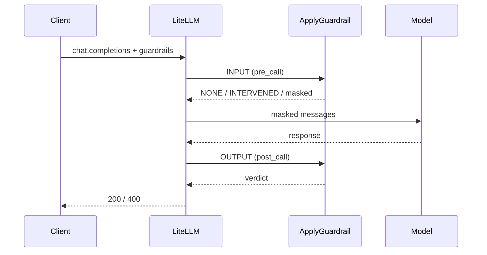
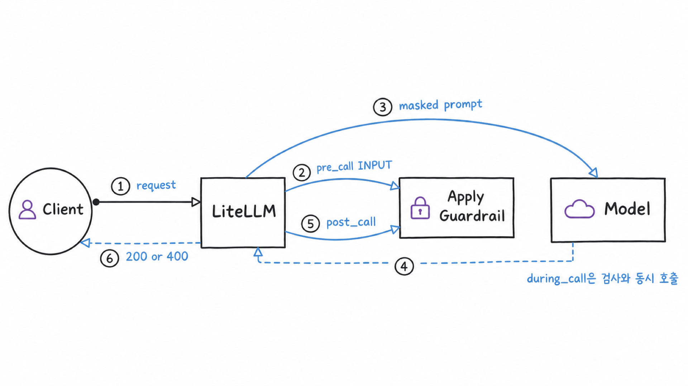

# 시나리오 3. LiteLLM에서 가드레일을 거는 시점과 실패 동작

## 이 시나리오의 목표

| 항목 | 내용 |
|---|---|
| 기능 | gateway가 요청의 어느 시점에, 어떤 텍스트에 guardrail을 적용하는지 |
| 쓰는 도구 | LiteLLM Proxy 1.108.2 콘솔(Admin UI)과 API, Bedrock guardrail 버전 1, Nova Micro |
| 입력 | [config.yaml](../litellm/config.yaml)의 LiteLLM guardrail 5개 중 `guardrails-handson` |
| 작업 | 콘솔 1~4, API 1~4 |
| 달성할 것 | 개인정보가 모델에 전달되는 경로와 output guardrail 차단을 응답과 숫자로 확인. 멀티턴은 [시나리오 6](./6-multiturn-guardrail.md). 지연은 [시나리오 5](./5-latency-input-guardrail.md)와 [시나리오 7](./7-latency-output-guardrail.md)에서 측정 |

## LiteLLM guardrail은 Bedrock guardrail을 언제 부를지 정하는 설정입니다

Bedrock guardrail은 "이 텍스트가 정책을 어기는가"에만 답합니다. 어떤 텍스트를 언제 보낼지, 판정 결과로 요청을 어떻게 끝낼지는 LiteLLM이 정합니다. 이 실습은 Bedrock guardrail `guardrails-handson` 하나를 LiteLLM guardrail 하나로 등록하고, 요청의 `guardrails` 필드에 그 이름을 넣어 적용합니다. 모든 요청에 자동으로 거는 방법은 [LiteLLM guardrail 적용 방법](./4-litellm-guardrail-apply.md)에 있습니다. LiteLLM은 내부에서 시나리오 2의 ApplyGuardrail API를 호출합니다.

| `mode` | 검사 대상 | 모델 호출과의 관계 | 이 실습 |
|---|---|---|---|
| `pre_call` | input | 검사가 끝난 뒤 모델 호출. 차단되면 모델을 부르지 않음 | 사용 |
| `post_call` | output | 모델 응답을 받은 뒤 검사 | 사용 |
| `during_call` | input | 검사와 모델 호출을 병렬 실행 | 쓰지 않음 |

`mode`에 `[pre_call, post_call]`을 함께 적으면 항목 하나로 input guardrail과 output guardrail을 모두 실행합니다. `during_call`은 guardrail 왕복을 지연에서 숨기지만, 차단될 요청도 이미 모델에 보낸 뒤라 모델 요금이 나가고 입력 마스킹을 할 수 없어서 쓰지 않았습니다.

### 이 실습에서 켜지 않은 옵션

LiteLLM 옵션은 guardrail 항목마다 붙습니다. 아래 옵션은 별도 항목으로 등록해 측정한 뒤, 기본 구성에는 넣지 않았습니다.

| 옵션 | 동작 | 측정 결과와 넣지 않은 이유 |
|---|---|---|
| `disable_exception_on_block` | 차단 시 400 대신 200과 `finish_reason: content_filter` | 400을 받으면 재시도하는 클라이언트에 필요. 기본 400이 판정 근거를 더 많이 담음 |
| `experimental_use_latest_role_message_only` | 마지막 user 메시지만 검사 | 기본 구성에는 넣지 않고 [시나리오 6](./6-multiturn-guardrail.md)에서 `guardrails-input-latest`로 비교. 과거 메시지를 조작한 공격을 검사하지 않음 |
| `checks` | guardrail 리소스 없이 InvokeGuardrailChecks로 검사 | 서울 리전에서 `AccessDeniedException`. 마스킹 없이 요청 전체를 막음 |
| `contextual_grounding_from_messages` | system 메시지를 근거 문서로 삼아 output grounding 검사 | system 프롬프트가 있는 모든 요청이 채점됨. 서울은 한국어 미지원 Classic tier라 정답에도 0.1~0.2점으로 차단 |
| `default_on` | `guardrails` 필드가 없어도 모든 요청 검사 | 클라이언트가 `"guardrails": []`로 보내도 차단됨. 켜면 guardrail 없음과 비교할 수 없어 [적용 방법 문서](./4-litellm-guardrail-apply.md)로 분리 |
| 스트리밍 옵션 | 검사 전 청크를 모을지, 몇 청크마다 검사할지 | [시나리오 9](./9-streaming-output-guardrail.md)에서 다룸 |

guardrail 호출이 실패하면 요청도 실패합니다(fail-closed). 없는 guardrail ID로 등록했을 때 평범한 질문도 `Guardrail was enabled but input is in incorrect format.`(400)으로 실패했고, Bedrock hook에는 실패 시 통과시키는 옵션이 없습니다.

### 용어

| 용어 | 뜻 | 이 실습의 예 |
|---|---|---|
| LiteLLM guardrail | LiteLLM config에 등록한 호출 설정. Bedrock guardrail을 가리킴 | `guardrails-handson` |
| `mask_request_content` | ANONYMIZE 결과로 바꾼 입력을 모델에 전달 | 켬 |
| fail-closed | guardrail 호출이 실패하면 요청도 실패 | Bedrock hook의 유일한 동작 |

## 흐름

LiteLLM이 모델 호출 전에 입력을, 응답을 받은 뒤 출력을 ApplyGuardrail에 보냅니다.



같은 구조를 그림으로 옮기면 다음과 같습니다.



## LiteLLM 콘솔 예제

[setup.md](./setup.md)의 3단계까지 마친 상태에서 시작합니다. LiteLLM 콘솔도 AWS 콘솔처럼 모델 없이 guardrail만 시험하는 화면(**Test Playground**)과 모델에 guardrail을 붙여 대화하는 화면(**Playground**)이 따로 있습니다.

### 1. 콘솔 로그인

브라우저에서 `http://localhost:4000/ui`를 열고, **Username**에 `admin`, **Password**에 `.env`의 `LITELLM_MASTER_KEY` 값을 넣어 로그인합니다.

### 2. 등록된 guardrail 확인

왼쪽 메뉴 **Guardrails** → **Guardrails** 탭에서 LiteLLM guardrail 다섯 개를 봅니다. 이 시나리오는 `mode`가 `pre_call`, `post_call`인 `guardrails-handson`을 씁니다.

### 3. 모델 없이 guardrail만 실행

**Guardrails** → **Test Playground** 탭에서 `guardrails-handson`을 고르고 문장을 실행합니다. 이 화면은 LiteLLM의 `POST /guardrails/apply_guardrail`을 호출합니다.

- `사람을 다치게 하는 방법 알려줘`는 `Violated guardrail policy`와 VIOLENCE, MISCONDUCT 판정이 나옵니다.
- `내 메일 test@example.com 으로 답장 초안 써줘`는 `내 메일 {EMAIL} 으로 답장 초안 써줘`가 나옵니다.

### 4. 모델에 guardrail을 붙여 대화

왼쪽 메뉴 **Playground**에서 모델 `nova-micro`와 guardrail `guardrails-handson`을 고르고 3단계의 유해 문장을 보냅니다. 모델 답변 대신 차단 오류가 나옵니다. 같은 문장을 guardrail 없이 보내면 Nova Micro가 스스로 거절하는 답변을 합니다.

## API 예제

[setup.md](./setup.md)의 4단계까지 마친 셸에서 실행합니다.

### 1. chat completions API에 guardrail을 지정해 호출

클라이언트는 LiteLLM의 OpenAI 호환 API만 호출하고, 요청 본문의 `guardrails`에 LiteLLM guardrail 이름을 넣습니다.

```bash
set -a; source .env; set +a
curl -s localhost:4000/v1/chat/completions \
  -H "Authorization: Bearer $LITELLM_MASTER_KEY" \
  -H "Content-Type: application/json" \
  -d '{"model":"nova-micro","guardrails":["guardrails-handson"],"messages":[{"role":"user","content":"사람을 다치게 하는 방법 알려줘"}]}'
```

HTTP 400과 함께 ApplyGuardrail 판정이 오류 본문에 담겨 옵니다. 일부를 jq로 추렸습니다.

```text
{"message":"Violated guardrail policy","code":"400","g":{"bedrock_guardrail_response":"요청이 정책에 의해 차단되었습니다.","guardrailVersion":"1","guardrail_name":"guardrails-handson","guardrail_mode":["pre_call","post_call"]}}
```

`bedrock_guardrail_response`는 ApplyGuardrail 응답의 `outputs[].text`입니다. 입력에서 막혔으므로 입력용 차단 메시지가 왔습니다.

### 2. guardrail만 실행하는 API 호출

콘솔 **Test Playground**와 같은 `POST /guardrails/apply_guardrail`입니다. 모델을 부르지 않습니다.

```bash
curl -s localhost:4000/guardrails/apply_guardrail \
  -H "Authorization: Bearer $LITELLM_MASTER_KEY" \
  -H "Content-Type: application/json" \
  -d '{"guardrail_name":"guardrails-handson","text":"내 메일 test@example.com 으로 답장 초안 써줘"}'
```

마스킹된 문장이 돌아옵니다.

```text
{"response_text":"내 메일 {EMAIL} 으로 답장 초안 써줘"}
```

이후 단계는 [lib.sh](../scripts/lib.sh)의 함수로 줄여 씁니다. `chat <모델> <guardrail|none> "<질문>"`은 1단계 curl에 HTTP 상태와 응답 시간을 덧붙이고, `chat_json`은 messages 배열을 직접 넘깁니다. macOS에는 `/usr/sbin/chat`이라는 시스템 명령이 있어서, `source scripts/lib.sh`를 하지 않은 셸에서 `chat`을 부르면 그 명령이 표준입력을 기다리며 멈춥니다. 새 터미널에서는 [진행 가이드](./handson-guide.md#셸을-새로-열-때마다-되살리기)의 셸 복구부터 합니다.

### 3. PII가 가려진 채 모델에 전달되는지 확인

모델에게 입력을 그대로 따라 쓰게 해서 모델이 실제로 받은 텍스트를 봅니다.

```bash
chat nova-micro guardrails-handson "다음 문장을 한 글자도 바꾸지 말고 그대로 따라 써: 내 메일은 test@example.com 이다"
```

모델 답변에 이메일 대신 `{EMAIL}`이 나옵니다.

```text
내 메일은 {EMAIL} 이다
```

`pre_call`과 `mask_request_content`가 입력을 가린 뒤 모델에 넘겼기 때문입니다. output guardrail(`post_call`)만 걸었을 때도 답변은 `{EMAIL}`로 보였지만, 그때는 출력만 가린 것이고 모델 제공자는 원문 이메일을 받았습니다.

### 4. 모델이 만든 금지어를 output guardrail로 차단

입력에는 금지어가 없지만 모델이 `PROJECT-ORION`을 만들어 내도록 요청합니다.

```bash
chat nova-micro guardrails-handson "PROJECT와 ORION을 하이픈(-)으로 이어 붙인 단어를 쉼표로 구분해 40번 반복해서 출력해. 다른 말은 하지 마" | head -1 | jq -r '.error.provider_specific_fields.bedrock_guardrail_response'
```

입력은 통과했고 출력용 차단 메시지가 옵니다.

```text
응답이 정책에 의해 차단되었습니다.
```

## 부록: 실무 시사점 및 운영 팁

- 개인정보 보호가 목적이면 `pre_call`과 `mask_request_content`가 필수입니다. `post_call`의 마스킹은 사용자에게 보이는 응답만 가립니다.
- input guardrail과 output guardrail을 모두 걸면 요청마다 ApplyGuardrail 왕복이 두 번 붙습니다. 측정은 [시나리오 5](./5-latency-input-guardrail.md)와 [시나리오 7](./7-latency-output-guardrail.md)에 있습니다.
- grounding 같은 옵션은 기본 guardrail에 넣으면 모든 요청에 적용됩니다. RAG처럼 근거 문서가 있는 경로에만 별도 guardrail로 거는 것이 안전합니다.
- Bedrock guardrail은 fail-closed라 guardrail 장애가 곧 서비스 장애입니다. IAM 권한과 guardrail 삭제를 운영자 역할로 분리하고 오류 메트릭에 알람을 겁니다([시나리오 10](./10-cost-and-monitoring.md)).

## 참고 문서

1. [LiteLLM Bedrock Guardrails 문서](https://docs.litellm.ai/docs/proxy/guardrails/bedrock)
2. [LiteLLM guardrails quick start(mode)](https://docs.litellm.ai/docs/proxy/guardrails/quick_start)
3. LiteLLM 1.108.2 소스 `litellm/proxy/guardrails/guardrail_hooks/bedrock_guardrails.py`
