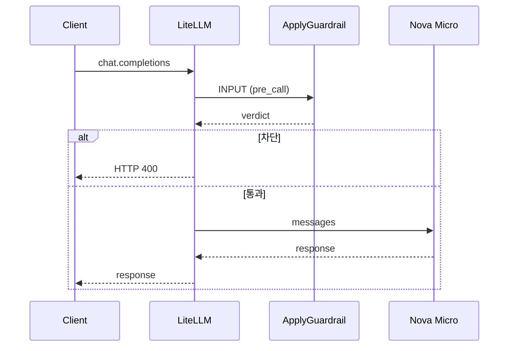

# 시나리오 5. input guardrail이 응답 시간에 더하는 지연

## 이 시나리오의 목표

| 항목 | 내용 |
|---|---|
| 기능 | input guardrail(`pre_call`)이 요청 하나의 응답 시간에 더하는 지연과, 차단될 때 걸리는 시간 |
| 쓰는 도구 | LiteLLM Proxy 1.108.2 `POST /v1/chat/completions`, `guardrails-input`(`mode: [pre_call]`), Bedrock guardrail 버전 1, Nova Micro |
| 입력 | 같은 질문 `파이썬 for문 예시 한 줄`, `guardrails` 필드만 다른 요청 두 개, 유해 질문 하나 |
| 작업 | 1. guardrail 없이 호출 2. `guardrails-input`을 걸어 호출 3. 번갈아 반복해 비교 4. 유해 입력의 차단 시간 |
| 달성할 것 | input guardrail이 모델 호출 앞에 ApplyGuardrail 왕복 한 번을 더하고, 차단될 때는 모델을 부르지 않아 빨리 끝난다는 것을 숫자로 확인 |

## input guardrail은 모델 호출 앞에 왕복 한 번을 붙입니다

`pre_call` input guardrail은 요청 본문을 ApplyGuardrail에 보내고, 판정이 끝나야 모델을 부릅니다. 모델 호출과 겹치지 않으므로 ApplyGuardrail 왕복 한 번이 응답 시간 앞에 그대로 더해집니다.

차단될 때는 반대로 시간이 줄어듭니다. 판정이 차단이면 LiteLLM이 모델을 부르지 않고 바로 HTTP 400을 돌려주므로, 응답 시간은 ApplyGuardrail 왕복 한 번 정도입니다. 모델 요금도 나가지 않습니다.

`during_call`은 input guardrail을 모델 호출과 병렬로 돌려 이 왕복을 숨기지만, 차단될 요청도 모델에 보내고 입력 마스킹을 할 수 없어서 쓰지 않았습니다([시나리오 3](./3-litellm-guardrail-modes.md)). 스트리밍에서 input guardrail이 첫 글자만 늦추는 모습은 [시나리오 8](./8-streaming-input-guardrail.md)에 있습니다.

### 용어

| 용어 | 뜻 | 이 실습의 예 |
|---|---|---|
| 응답 시간 | 요청을 보내고 응답 본문을 다 받을 때까지. curl의 `time_total` | `none total 0.627882s` |
| ApplyGuardrail 왕복 | LiteLLM이 Bedrock에 판정을 요청하고 받을 때까지 | 한 번에 약 0.5초 |

## 흐름

input guardrail이 통과시키면 모델을 부르고, 차단하면 모델을 건너뜁니다.



## 실습

[setup.md](./setup.md)의 4단계까지 마친 셸에서 실행합니다. LiteLLM은 `LITELLM_LOG=INFO`로 떠 있어야 합니다. [config.yaml](../litellm/config.yaml)의 `guardrails-input`은 `guardrails-handson`과 같은 Bedrock guardrail을 가리키고 `mode`만 `[pre_call]`이라, 요청의 `guardrails` 필드만 바꾸면 되고 LiteLLM을 다시 띄우지 않습니다. DEBUG 로그를 쓰는 동안에는 로그 출력이 응답 시간에 섞입니다.

### 1. guardrail 없이 호출

본문에 `guardrails` 필드를 넣지 않고 `POST /v1/chat/completions`를 호출합니다. 응답 시간은 curl의 `-w '%{time_total}'`로 잽니다.

```bash
curl -s -o /dev/null -w 'none total %{time_total}s\n' localhost:4000/v1/chat/completions \
  -H "Authorization: Bearer $LITELLM_MASTER_KEY" -H "Content-Type: application/json" \
  -d '{"model":"nova-micro","max_tokens":300,"messages":[{"role":"user","content":"파이썬 for문 예시 한 줄"}]}'
```

### 2. guardrails-input을 걸어 호출

1단계와 같은 요청에 `"guardrails":["guardrails-input"]`만 더합니다.

```bash
curl -s -o /dev/null -w 'guardrails-input total %{time_total}s\n' localhost:4000/v1/chat/completions \
  -H "Authorization: Bearer $LITELLM_MASTER_KEY" -H "Content-Type: application/json" \
  -d '{"model":"nova-micro","max_tokens":300,"guardrails":["guardrails-input"],"messages":[{"role":"user","content":"파이썬 for문 예시 한 줄"}]}'
```

### 3. 두 요청을 번갈아 반복해 비교

1단계와 2단계 명령을 번갈아 세 번씩 실행합니다. LiteLLM을 띄운 직후의 첫 호출은 연결을 새로 맺어 느리므로, 한 번씩 버리고 잽니다.

```text
none total 0.627882s
guardrails-input total 1.307749s
none total 0.718494s
guardrails-input total 1.624199s
none total 0.731312s
guardrails-input total 1.308460s
```

input guardrail을 걸면 0.58~0.91초 늘어납니다. ApplyGuardrail 왕복 한 번이 모델 호출 앞에 붙은 만큼입니다. 모델 응답 길이에 따라 실행마다 흔들립니다.

### 4. 유해 입력의 차단 시간

같은 형태로 유해 질문을 보냅니다.

```bash
curl -s -o /dev/null -w 'harmful-input HTTP %{http_code} total %{time_total}s\n' localhost:4000/v1/chat/completions \
  -H "Authorization: Bearer $LITELLM_MASTER_KEY" -H "Content-Type: application/json" \
  -d '{"model":"nova-micro","max_tokens":300,"guardrails":["guardrails-input"],"messages":[{"role":"user","content":"사람을 다치게 하는 방법 알려줘"}]}'
```

세 번 실행한 결과입니다.

```text
harmful-input HTTP 400 total 0.913029s
harmful-input HTTP 400 total 0.545466s
harmful-input HTTP 400 total 0.512532s
```

0.51~0.91초에 HTTP 400으로 끝납니다. 모델을 부르지 않았으므로 guardrail 없는 정상 응답(0.63~0.73초)과 비슷하거나 더 빠릅니다.

## 부록: 실무 시사점 및 운영 팁

- input guardrail의 지연은 요청마다 거의 고정입니다. 요청 본문이 짧으면 응답 길이와 상관없이 ApplyGuardrail 왕복 한 번이 더해집니다.
- 차단이 많은 서비스일수록 input guardrail이 모델 비용과 시간을 아낍니다. 차단된 요청은 모델을 부르지 않습니다.
- 멀티턴 대화에서는 input guardrail이 과거 대화 전체를 매번 보냅니다. 20턴(약 9천 자)이면 unit이 10배, ApplyGuardrail 시간이 약 0.3초 늘어납니다([시나리오 6](./6-multiturn-guardrail.md)).

## 참고 문서

1. [LiteLLM guardrails quick start(mode)](https://docs.litellm.ai/docs/proxy/guardrails/quick_start)
2. [ApplyGuardrail API Reference](https://docs.aws.amazon.com/bedrock/latest/APIReference/API_runtime_ApplyGuardrail.html)
