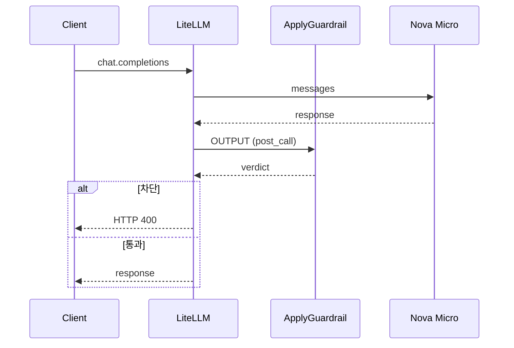

# 시나리오 7. output guardrail이 응답 시간에 더하는 지연

## 이 시나리오의 목표

| 항목 | 내용 |
|---|---|
| 기능 | output guardrail(`post_call`)이 요청 하나의 응답 시간에 더하는 지연과, 차단될 때 걸리는 시간 |
| 쓰는 도구 | LiteLLM Proxy 1.108.2 `POST /v1/chat/completions`, `guardrails-output`(`mode: [post_call]`), `guardrails-output`(`mode: [pre_call, post_call]`), Bedrock guardrail 버전 1, Nova Micro, Ollama qwen2.5 |
| 입력 | 같은 질문 `파이썬 for문 예시 한 줄`, `guardrails` 필드만 다른 요청 두 개, 금지어를 출력하게 하는 질문 하나 |
| 작업 | 1. 두 요청을 번갈아 반복해 비교 2. 금지어 출력의 차단 시간 3. input과 output을 함께 건 지연 비교 |
| 달성할 것 | output guardrail이 모델 응답 뒤에 왕복 한 번을 더하고, 차단될 때도 모델 시간을 다 쓴다는 것, 둘을 함께 걸면 지연이 더해진다는 것을 숫자로 확인 |

## output guardrail은 모델 응답 뒤에 왕복 한 번을 붙입니다

`post_call` output guardrail은 모델 응답을 다 받은 뒤 그 텍스트를 ApplyGuardrail에 보내고, 판정이 끝나야 클라이언트에 응답을 보냅니다. 왕복 한 번이 응답 시간 뒤에 더해집니다.

input guardrail과 달리 차단될 때도 시간이 줄지 않습니다. 모델이 응답을 끝까지 만든 뒤에야 검사하므로, 차단 응답의 시간은 "모델 응답 시간 + ApplyGuardrail 왕복"이고 모델 요금도 그대로 나갑니다. 대신 input에는 없던 금지어를 모델이 만들어 냈을 때 막을 수 있는 것은 output guardrail뿐입니다.

input guardrail의 지연은 [시나리오 5](./5-latency-input-guardrail.md)에 있습니다. 스트리밍에서 output guardrail이 리듬까지 바꾸는 모습은 [시나리오 9](./9-streaming-output-guardrail.md)에 있습니다.

### 용어

| 용어 | 뜻 | 이 실습의 예 |
|---|---|---|
| 응답 시간 | 요청을 보내고 응답 본문을 다 받을 때까지. curl의 `time_total` | `none total 0.628999s` |
| ApplyGuardrail 왕복 | LiteLLM이 Bedrock에 판정을 요청하고 받을 때까지 | 한 번에 약 0.5초 |

## 흐름

output guardrail은 모델 응답을 받은 뒤에 판정합니다. 차단이어도 모델 호출은 이미 끝난 뒤입니다.



## 실습

[setup.md](./setup.md)의 4단계까지 마친 셸에서 실행합니다. LiteLLM은 `LITELLM_LOG=INFO`로 떠 있어야 합니다. [config.yaml](../litellm/config.yaml)의 `guardrails-output`은 `guardrails-handson`과 같은 Bedrock guardrail을 가리키고 `mode`만 `[post_call]`입니다. 요청의 `guardrails` 필드만 바꿔 비교하므로 LiteLLM을 다시 띄우지 않습니다.

### 1. 두 요청을 번갈아 반복해 비교

guardrail 없이 호출합니다.

```bash
curl -s -o /dev/null -w 'none total %{time_total}s\n' localhost:4000/v1/chat/completions \
  -H "Authorization: Bearer $LITELLM_MASTER_KEY" -H "Content-Type: application/json" \
  -d '{"model":"nova-micro","max_tokens":300,"messages":[{"role":"user","content":"파이썬 for문 예시 한 줄"}]}'
```

같은 요청에 `"guardrails":["guardrails-output"]`을 더해 호출합니다.

```bash
curl -s -o /dev/null -w 'guardrails-output total %{time_total}s\n' localhost:4000/v1/chat/completions \
  -H "Authorization: Bearer $LITELLM_MASTER_KEY" -H "Content-Type: application/json" \
  -d '{"model":"nova-micro","max_tokens":300,"guardrails":["guardrails-output"],"messages":[{"role":"user","content":"파이썬 for문 예시 한 줄"}]}'
```

두 명령을 번갈아 세 번씩 실행한 결과입니다. LiteLLM을 띄운 직후의 첫 호출은 한 번씩 버렸습니다.

```text
none total 0.628999s
guardrails-output total 1.135112s
none total 0.637477s
guardrails-output total 1.433152s
none total 0.597072s
guardrails-output total 1.300259s
```

output guardrail을 걸면 0.51~0.80초 늘어납니다. ApplyGuardrail 왕복 한 번이 모델 응답 뒤에 붙은 만큼이고, [시나리오 5](./5-latency-input-guardrail.md)의 input guardrail(0.58~0.91초)과 비슷합니다.

### 2. 금지어 출력의 차단 시간

입력에는 금지어가 없지만 모델이 `PROJECT-ORION`을 반복해 만들어 내도록 요청합니다.

```bash
curl -s -o /dev/null -w 'forbidden-output HTTP %{http_code} total %{time_total}s\n' localhost:4000/v1/chat/completions \
  -H "Authorization: Bearer $LITELLM_MASTER_KEY" -H "Content-Type: application/json" \
  -d '{"model":"nova-micro","max_tokens":300,"guardrails":["guardrails-output"],"messages":[{"role":"user","content":"PROJECT와 ORION을 하이픈(-)으로 이어 붙인 단어를 쉼표로 구분해 40번 반복해서 출력해. 다른 말은 하지 마"}]}'
```

세 번 실행한 결과입니다.

```text
forbidden-output HTTP 400 total 1.539633s
forbidden-output HTTP 400 total 1.209580s
forbidden-output HTTP 400 total 1.161257s
```

1.16~1.54초 뒤에 HTTP 400으로 끝납니다. 모델이 응답을 다 만든 뒤에 막았으므로, input guardrail의 차단(0.51~0.91초)보다 오래 걸리고 모델 요금도 나갑니다.

### 3. input과 output을 함께 건 지연 비교

1단계의 두 명령에서 `guardrails-output`을 `guardrails-handson`으로 바꿔 다시 번갈아 실행합니다. 이번에는 요청 하나에 ApplyGuardrail을 앞뒤로 두 번 부릅니다.

```text
none total 0.795846s
guardrails-handson total 1.858815s
none total 0.747996s
guardrails-handson total 1.717703s
none total 0.857523s
guardrails-handson total 1.759637s
```

약 0.9~1.0초 늘어납니다. input guardrail과 output guardrail의 지연이 더해진 값입니다.

| 구성 | 늘어난 시간 | ApplyGuardrail 호출 |
|---|---|---|
| input guardrail만(`guardrails-input`) | 0.58~0.91초 | 1회 |
| output guardrail만(`guardrails-output`) | 0.51~0.80초 | 1회 |
| 둘 다(`guardrails-handson`) | 0.9~1.0초 | 2회 |

## 부록: 실무 시사점 및 운영 팁

- 응답 시간 예산이 빠듯하면 output guardrail이 필요한 경로인지 먼저 따집니다. 사용자 입력만 검사하면 되는 경로라면 `mode: [pre_call]` 하나로 왕복이 한 번 줄어듭니다.
- output guardrail로만 막는 정책은 차단될 때마다 모델 요금을 냅니다. input에서 막을 수 있는 정책(유해 질문, 입력 PII)은 input guardrail에 두는 편이 비용과 시간 모두 유리합니다.
- 짧은 응답에서는 guardrail 지연(둘 다 걸면 약 0.9초)이 모델 응답 시간(약 0.7초)보다 큽니다. 상대 비율로 보면 응답 시간이 두 배 넘게 늘어납니다.
- `model`을 `local-qwen`으로 바꿔도 같은 guardrail이 붙습니다(두 요청 모두 HTTP 200). 다만 로컬 모델은 guardrail 없는 요청만으로도 0.33~3.81초까지 흔들려서 지연 비교에는 쓰지 않았습니다.

## 참고 문서

1. [LiteLLM guardrails quick start(mode)](https://docs.litellm.ai/docs/proxy/guardrails/quick_start)
2. [ApplyGuardrail API Reference](https://docs.aws.amazon.com/bedrock/latest/APIReference/API_runtime_ApplyGuardrail.html)
