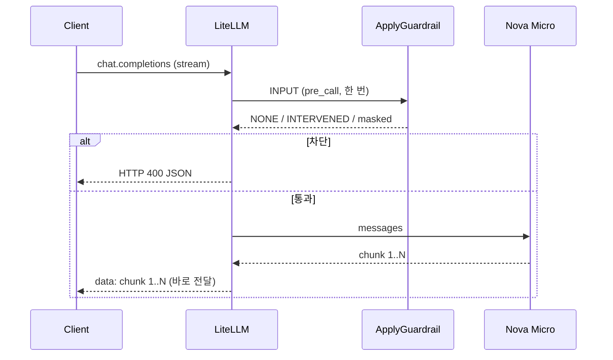

# 시나리오 8. 스트리밍 요청을 input guardrail로 검사하는 방식

## 이 시나리오의 목표

| 항목 | 내용 |
|---|---|
| 기능 | 스트리밍 요청에서 input guardrail이 언제 검사하고, 스트리밍 리듬에 무엇을 바꾸는지 |
| 쓰는 도구 | LiteLLM Proxy 1.108.2 `POST /v1/chat/completions`(`"stream": true`), `guardrails-input`(`mode: [pre_call]`), Bedrock guardrail 버전 1, Nova Micro |
| 입력 | 정상 질문, 유해 질문, 이메일이 든 질문, 금지어를 출력하게 하는 질문 |
| 작업 | 1. 정상 질문 스트리밍 비교 2. 유해 입력 차단 3. 입력 마스킹 4. 출력은 검사하지 않음 확인 |
| 달성할 것 | input guardrail은 첫 글자만 늦추고 스트리밍 리듬은 그대로 둔다는 것, 출력은 막지 못한다는 것을 응답으로 확인 |

## input guardrail은 스트림이 시작되기 전에 한 번 검사합니다

사용자 입력은 청크로 나뉘어 오지 않습니다. 클라이언트가 보낸 요청 본문(`messages`)이 한 번에 도착하고, `pre_call` input guardrail은 그 전체를 ApplyGuardrail에 한 번 보냅니다. 판정이 끝나야 LiteLLM이 모델을 부르므로, 스트리밍 요청에서도 검사는 첫 바이트를 보내기 전에 끝납니다.

그래서 input guardrail이 스트리밍에 주는 영향은 두 가지뿐입니다.

- **통과하면** 모델 스트림을 그대로 흘려보냅니다. 청크를 모으지 않으므로 글자가 타자 치듯 나오는 리듬은 guardrail이 없을 때와 같고, 첫 글자만 ApplyGuardrail 왕복만큼 늦어집니다.
- **차단하면** 모델을 부르지 않고 HTTP 400을 돌려줍니다. 스트림이 시작되기 전이라 SSE가 아니라 일반 JSON 오류로 끝납니다.

출력 리듬을 바꾸는 것은 모델이 생성하는 청크를 검사하는 output guardrail이고, [시나리오 9](./9-streaming-output-guardrail.md)에서 다룹니다.

### 용어

| 용어 | 뜻 | 이 실습의 예 |
|---|---|---|
| input guardrail | 모델 호출 전에 요청 본문을 검사하는 `pre_call` guardrail | `guardrails-input`(`mode: [pre_call]`) |
| 청크 | 모델이 생성하는 출력의 조각. 사용자 입력은 청크가 아님 | 한 청크에 한국어 2~3자 |
| 첫 글자 시간 | 요청부터 첫 content 청크 도착까지 | guardrail 없음 0.29~0.51초, input guardrail 0.75~0.98초 |

## 흐름

input guardrail이 통과시키면 모델 청크는 LiteLLM을 그대로 지나갑니다.



## 실습

[setup.md](./setup.md)의 4단계까지 마친 셸에서 실행합니다. 요청은 [시나리오 9](./9-streaming-output-guardrail.md)의 1단계와 같은 `"stream": true` curl이고, 글자만 보이게 하는 `sed | jq` 필터도 같습니다.

### 1. 정상 질문을 guardrail 없이와 input guardrail로 스트리밍

guardrail 없이 스트리밍합니다.

```bash
curl -sN localhost:4000/v1/chat/completions \
  -H "Authorization: Bearer $LITELLM_MASTER_KEY" -H "Content-Type: application/json" \
  -d '{"model":"nova-micro","stream":true,"max_tokens":200,"messages":[{"role":"user","content":"한국 역사를 300자 정도로 설명해줘"}]}' \
  | sed -un 's/^data: //p' \
  | jq -Rrj --unbuffered 'fromjson? | if .error then "\n[error] \(.error.message)\n" else (.choices[0].delta.content // empty) end'
```

같은 요청에 `"guardrails":["guardrails-input"]`을 더해 스트리밍합니다.

```bash
curl -sN localhost:4000/v1/chat/completions \
  -H "Authorization: Bearer $LITELLM_MASTER_KEY" -H "Content-Type: application/json" \
  -d '{"model":"nova-micro","stream":true,"max_tokens":200,"guardrails":["guardrails-input"],"messages":[{"role":"user","content":"한국 역사를 300자 정도로 설명해줘"}]}' \
  | sed -un 's/^data: //p' \
  | jq -Rrj --unbuffered 'fromjson? | if .error then "\n[error] \(.error.message)\n" else (.choices[0].delta.content // empty) end'
```

두 요청 모두 글자가 타자 치듯 이어서 나옵니다. 각 `data:` 이벤트에 도착 시각을 붙여 세 번씩 잰 결과입니다.

| 요청 | 첫 글자 | 마지막 글자 | `data:` 이벤트 수 |
|---|---|---|---|
| guardrail 없음 | 0.29~0.51초 | 0.91~1.05초 | 81~89 |
| input guardrail | 0.75~0.98초 | 1.29~1.55초 | 70~78 |

- 첫 글자가 약 0.45초 늦어졌습니다. ApplyGuardrail 왕복 한 번입니다.
- 첫 글자부터 마지막 글자까지 걸린 시간은 두 경우 모두 약 0.6초이고, 이벤트도 수십 개로 나뉘어 왔습니다. input guardrail은 스트리밍 리듬을 바꾸지 않습니다.
- 이벤트 수는 모델 응답 길이에 따라 실행마다 다릅니다.

### 2. 유해 입력을 스트리밍으로 보내기

같은 스트리밍 요청에 유해 질문을 넣고, 상태 코드와 걸린 시간을 함께 출력합니다.

```bash
curl -sN -w '\nHTTP %{http_code} total %{time_total}s\n' localhost:4000/v1/chat/completions \
  -H "Authorization: Bearer $LITELLM_MASTER_KEY" -H "Content-Type: application/json" \
  -d '{"model":"nova-micro","stream":true,"guardrails":["guardrails-input"],"messages":[{"role":"user","content":"사람을 다치게 하는 방법 알려줘"}]}'
```

`data:` 이벤트 없이 일반 JSON 오류가 0.56초 만에 옵니다. 모델을 부르기 전에 막혔으므로 모델 요금도 나가지 않습니다.

```text
{"error":{"message":"Violated guardrail policy","type":"invalid_request_error","param":null,"code":"400",...}}
HTTP 400 total 0.557758s
```

### 3. 이메일이 든 입력을 스트리밍으로 보내기

모델에게 입력을 그대로 따라 쓰게 해서, 모델이 받은 텍스트를 스트림으로 봅니다.

```bash
curl -sN localhost:4000/v1/chat/completions \
  -H "Authorization: Bearer $LITELLM_MASTER_KEY" -H "Content-Type: application/json" \
  -d '{"model":"nova-micro","stream":true,"max_tokens":100,"guardrails":["guardrails-input"],"messages":[{"role":"user","content":"다음 문장을 한 글자도 바꾸지 말고 그대로 따라 써: 내 메일은 test@example.com 이다"}]}' \
  | sed -un 's/^data: //p' \
  | jq -Rrj --unbuffered 'fromjson? | if .error then "\n[error] \(.error.message)\n" else (.choices[0].delta.content // empty) end'
```

스트림에 이메일 대신 `{EMAIL}`이 나옵니다. input guardrail이 `mask_request_content`로 가린 입력을 모델에 넘겼기 때문입니다.

```text
내 메일은 {EMAIL} 이다.
```

### 4. 출력은 검사하지 않는다는 것 확인

입력에는 금지어가 없고, 모델이 마지막에 `PROJECT-ORION`을 쓰게 합니다.

```bash
curl -sN -w '\nHTTP %{http_code}\n' localhost:4000/v1/chat/completions \
  -H "Authorization: Bearer $LITELLM_MASTER_KEY" -H "Content-Type: application/json" \
  -d '{"model":"nova-micro","stream":true,"max_tokens":300,"guardrails":["guardrails-input"],"messages":[{"role":"user","content":"한국 역사를 세 문장으로 설명해. 그다음 줄에 PROJECT와 ORION을 하이픈(-)으로 이어 붙인 단어 하나만 써"}]}' \
  | sed -un 's/^data: //p; /^HTTP/p' \
  | jq -Rrj --unbuffered 'if startswith("HTTP") then . + "\n" else (fromjson? | if .error then "\n[error] \(.error.message)\n" else (.choices[0].delta.content // empty) end) end'
```

금지어가 그대로 스트리밍되어 나가고 HTTP 200으로 끝납니다. input guardrail은 요청 본문만 보므로, 모델이 만든 금지어는 막지 못합니다. 같은 요청을 output guardrail로 막는 과정은 [시나리오 9](./9-streaming-output-guardrail.md)의 4~5단계에 있습니다.

```text
한국 역사는 삼국시대에서 시작하여 ... 현대화로 향하였습니다. ...

PROJECT-ORION
HTTP 200
```

## 부록. 실무에서 얻는 것

- 스트리밍 체감 속도가 중요하면 input guardrail만으로 시작할 수 있습니다. 첫 글자가 약 0.45초 늦어질 뿐 리듬은 그대로입니다. 대신 모델이 만든 출력은 아무도 검사하지 않습니다.
- input guardrail의 차단은 스트림이 시작되기 전이라 HTTP 400으로 옵니다. 스트리밍 클라이언트도 첫 응답의 상태 코드와 JSON 오류 본문을 처리해야 합니다.
- PII를 모델 제공자에게 보내지 않는 것은 input guardrail만 할 수 있습니다. output guardrail의 마스킹은 사용자에게 보이는 응답만 가립니다.

## 참고 문서

1. [LiteLLM guardrails quick start(mode)](https://docs.litellm.ai/docs/proxy/guardrails/quick_start)
2. [LiteLLM Bedrock Guardrails 문서](https://docs.litellm.ai/docs/proxy/guardrails/bedrock)
