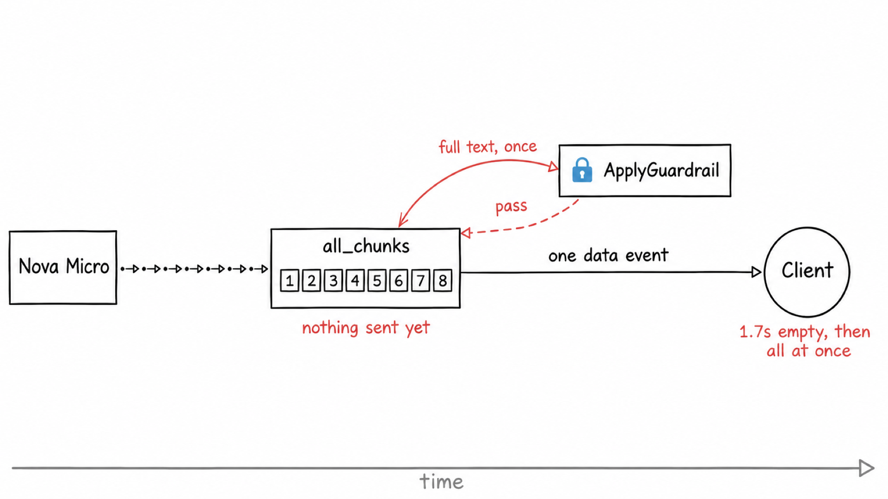
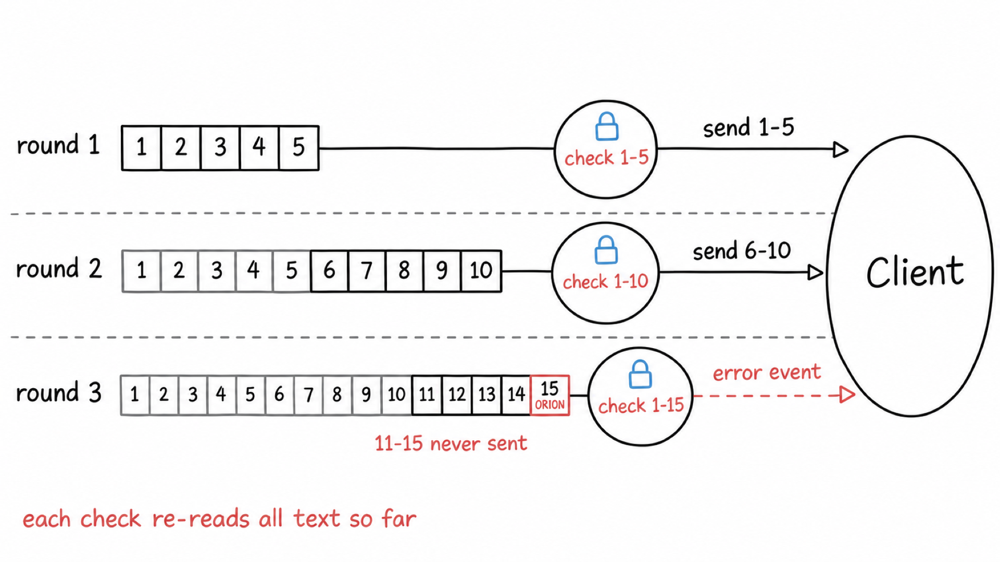
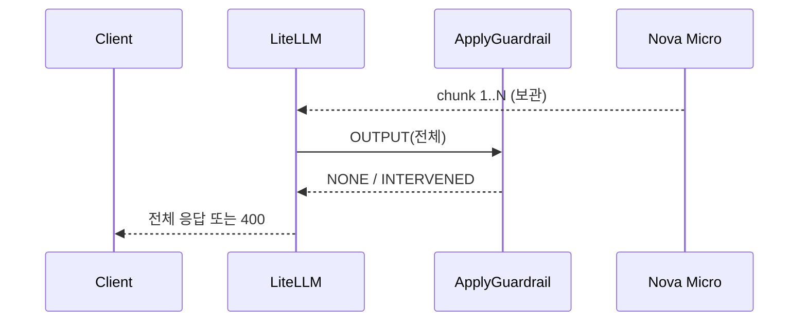
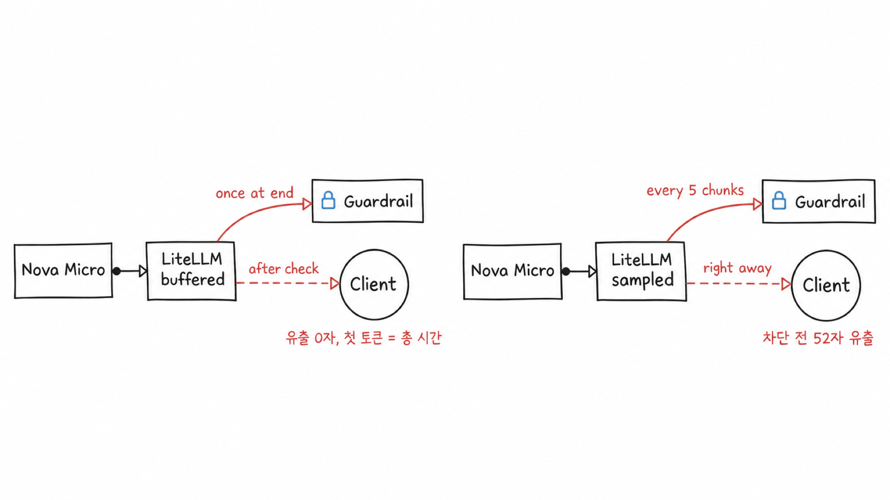

# 시나리오 9. 스트리밍 응답을 output guardrail로 검사하는 방식

## 이 시나리오의 목표

| 항목 | 내용 |
|---|---|
| 기능 | SSE로 흘러가는 응답을 output guardrail로 검사하는 방식과 그 대가 |
| 쓰는 도구 | LiteLLM Proxy 1.108.2 `POST /v1/chat/completions`(`"stream": true`), `guardrails-output`(buffered), `guardrails-output-release`(release), Bedrock guardrail 버전 1, Nova Micro |
| 입력 | 정상 응답 프롬프트 하나, 정상 문장 뒤에 금지어를 쓰게 하는 프롬프트 하나 |
| 작업 | 1. guardrail 없이 실시간 스트리밍 2. buffered로 한 번에 받기 3. release로 끊기는 스트림 보기 4. release에서 스트림 도중 차단 5. buffered로 같은 차단 비교 |
| 달성할 것 | 같은 요청이 방식마다 클라이언트에 어떤 리듬으로 도착하고, 차단될 때 무엇이 새어 나가는지 눈으로 확인 |

## 스트리밍과 output guardrail은 본질적으로 충돌합니다

input guardrail은 스트림이 시작되기 전에 요청 본문을 한 번 검사하므로 스트리밍 리듬을 바꾸지 않습니다([시나리오 8](./8-streaming-input-guardrail.md)). 리듬을 바꾸는 것은 모델이 생성하는 출력을 검사하는 output guardrail입니다. 이 시나리오의 프롬프트는 모두 input guardrail을 통과하므로, 관찰되는 차이는 output guardrail 때문입니다. 실습에서는 input guardrail이 섞이지 않도록 output guardrail만 건 `guardrails-output`과 `guardrails-output-release`를 씁니다. 아래 측정 표는 input 검사도 함께 건 구성으로 쟀으므로, guardrail을 건 행의 첫 토큰 시간에는 input 검사 약 0.45초가 포함됩니다.

output guardrail은 완성된 문장을 봐야 정확한데, 스트리밍은 문장이 완성되기 전에 보내는 것이 목적입니다. LiteLLM 1.108.2의 Bedrock hook은 "얼마나 모았다가 보내는가"와 "얼마나 자주 검사하는가"를 옵션으로 정하며, 조합은 네 가지입니다. [config.yaml](../litellm/config.yaml)의 `guardrails-output`은 옵션을 적지 않아 기본값인 buffered로 동작하고, `guardrails-output-release`는 release 옵션 두 줄을 더한 것입니다. 둘 다 `guardrails-handson`과 같은 Bedrock guardrail을 가리킵니다.

아래 표는 네 방식을 각각 별도 guardrail로 등록해 같은 프롬프트로 측정한 결과입니다. 청크마다 도착 시각을 찍어야 해서 [stream_probe.py](../scripts/stream_probe.py)로 쟀습니다. config에는 buffered와 release만 남겼습니다.

| 방식 | 설정 | 첫 토큰 | 총 시간 | ApplyGuardrail 호출 | 차단 전 유출 |
|---|---|---|---|---|---|
| guardrail 없음 | - | 1.149s | 2.227s | 0 | 868자 |
| buffered(기본) | `streaming_buffer_until_moderated: true` | 2.324s | 2.324s | 1 | 0자 |
| release | `streaming_buffer_release_on_scan: true`, `streaming_sampling_rate: 5` | 0.988s | 15.249s | 30 | 0자 |
| sampled | `streaming_buffer_until_moderated: false`, `streaming_sampling_rate: 5` | 0.506s | 15.838s | 30 | 52자 |
| eos | `streaming_buffer_until_moderated: false`, `streaming_end_of_stream_only: true` | 0.373s | 1.981s | 1 | 838자 |

- **buffered**는 응답 전체를 모았다가 한 번에 보내서 유출이 없지만, 첫 토큰 시간이 총 시간과 같아집니다.
- **release**와 **sampled**는 5청크마다 누적 텍스트를 검사해서 호출이 30번으로 늘고, 검사가 끝나야 다음 청크가 나가므로 총 시간이 7배가 됐습니다. sampled는 검사 전에 청크를 흘려보내 유출까지 있습니다.
- **eos**는 체감 속도가 guardrail 없음과 같지만, 응답을 거의 다 보낸 뒤에야 차단해서 차단이라기보다 사후 탐지입니다.
- 스트림 도중 차단되면 HTTP 200이 이미 나간 뒤라 SSE의 `error` 이벤트로 끝납니다. 클라이언트가 상태 코드만 보면 차단을 놓칩니다.

### 용어

| 용어 | 뜻 | 이 실습의 예 |
|---|---|---|
| 첫 토큰 시간 | 요청부터 첫 content 청크 도착까지 | guardrail 없음 0.30초, buffered 1.73초 |
| 청크 | 모델이 생성하는 출력의 조각. LiteLLM이 SSE `data:` 이벤트 하나로 바꿔 보냄. 사용자 입력은 요청 본문 하나로 오므로 청크가 아님 | Nova Micro는 364자에 152청크(한 청크 2~3자) |
| 유출량 | 차단 판정 전에 클라이언트가 받은 글자 수 | buffered 0자 |

## buffered와 release는 무엇을 언제 검사하는가

두 방식 모두 검사를 통과한 텍스트만 내보내서 유출이 0자입니다. 차이는 검사 단위와 내보내는 시점에 있습니다. 아래 설명은 LiteLLM 1.108.2 소스에서 확인한 동작입니다.

### buffered는 모든 청크를 모은 뒤 한 번 검사합니다

Bedrock hook(`bedrock_guardrails.py`)은 모델이 보내는 청크를 `all_chunks` 목록에 끝까지 모읍니다. 스트림이 끝나면 청크를 하나의 응답으로 조립하고, 그 전체 텍스트로 ApplyGuardrail을 한 번 부릅니다. 통과하면 조립한 응답을 내보내고, 차단이면 첫 바이트를 보내기 전이라 HTTP 400으로 끝냅니다.

연결은 SSE지만 `data:` 이벤트가 하나뿐이라, 클라이언트가 받는 모양은 일반 응답과 같습니다. 실습 2단계에서 1.7초 동안 비어 있다가 전체 문장이 한 번에 나온 이유입니다.



### release는 끊어서 검사하고, 매번 누적된 전체 텍스트를 다시 봅니다

release는 공통 guardrail 모듈(`unified_guardrail.py`)이 처리합니다. 한 라운드는 다음 순서로 돕니다.

1. 모델 청크를 내보내지 않고 쌓아 둡니다.
2. 5청크째마다(`chunk_counter % sampling_rate == 0`) 처음부터 지금까지 쌓인 전체 텍스트로 ApplyGuardrail을 부릅니다.
3. 통과하면 이미 보낸 부분을 뺀 새 부분만 `data:` 이벤트로 내보냅니다.
4. 차단이면 그 자리에서 `error` 이벤트로 스트림을 끝냅니다. 검사를 통과하지 않은 묶음은 내보내지 않습니다.

툭툭 끊기는 이유는 묶음마다 ApplyGuardrail 왕복(약 0.5초)을 기다린 뒤에야 그 묶음을 내보내기 때문입니다. 새 5청크만 검사하지 않고 누적 텍스트를 다시 보는 이유는 문맥 때문입니다. `PROJECT-`와 `ORION`이 다른 묶음으로 갈리면 조각만 봐서는 금지어를 찾지 못합니다. 대신 검사할 때마다 길어진 텍스트를 다시 보내므로, text unit 비용과 총 시간이 응답 길이보다 가파르게 늘어납니다. 위 측정 표에서 release가 30번 호출에 15초가 걸린 이유입니다.



`mask_response_content`를 켜면 release를 설정해도 buffered로 동작합니다. 출력 마스킹은 응답 전체를 봐야 해서, 소스의 `_streams_incrementally`가 이 경우 증분 전송을 끕니다.

## 흐름

buffered는 모델 청크를 끝까지 모은 뒤 output guardrail을 한 번 실행하고, 통과하면 한 번에 내보냅니다.



다른 방식과의 차이를 그림으로 옮기면 다음과 같습니다.



## 실습

[setup.md](./setup.md)의 4단계까지 마친 셸에서 실행합니다. 모든 단계는 `POST /v1/chat/completions`에 `"stream": true`를 넣어 호출하고, curl의 `-N`으로 버퍼링 없이 받은 SSE를 그대로 화면에 찍습니다. 응답이 흘러오는 리듬을 보는 실습이라 터미널을 보면서 실행합니다.

### 1. guardrail 없이 실시간 스트리밍

`"stream": true`로 호출합니다.

```bash
curl -sN localhost:4000/v1/chat/completions \
  -H "Authorization: Bearer $LITELLM_MASTER_KEY" -H "Content-Type: application/json" \
  -d '{"model":"nova-micro","stream":true,"max_tokens":200,"messages":[{"role":"user","content":"한국 역사를 300자 정도로 설명해줘"}]}'
```

`data:` 이벤트가 한 줄씩 이어서 찍힙니다. 이벤트 하나에 한국어 2~3자가 들어 있고, 마지막은 `data: [DONE]`입니다.

```text
data: {"id":"chatcmpl-...","object":"chat.completion.chunk","choices":[{"index":0,"delta":{"content":"한국의"}}],...}
data: {"id":"chatcmpl-...","object":"chat.completion.chunk","choices":[{"index":0,"delta":{"content":" 역사는 기"}}],...}
```

JSON 대신 글자만 보려면 `data:` 뒤의 `delta.content`만 이어 붙입니다. 이후 단계도 이 필터를 씁니다. `error` 이벤트가 오면 `[error]`로 표시합니다.

```bash
curl -sN localhost:4000/v1/chat/completions \
  -H "Authorization: Bearer $LITELLM_MASTER_KEY" -H "Content-Type: application/json" \
  -d '{"model":"nova-micro","stream":true,"max_tokens":200,"messages":[{"role":"user","content":"한국 역사를 300자 정도로 설명해줘"}]}' \
  | sed -un 's/^data: //p' \
  | jq -Rrj --unbuffered 'fromjson? | if .error then "\n[error] \(.error.message)\n" else (.choices[0].delta.content // empty) end'
```

글자가 타자 치듯 이어서 나옵니다. 첫 글자가 0.3초 안팎에 나오고 1초 안에 끝납니다.

### 2. guardrails-output(buffered)으로 같은 요청

1단계 요청 본문에 `"guardrails":["guardrails-output"]`만 더합니다.

```bash
curl -sN localhost:4000/v1/chat/completions \
  -H "Authorization: Bearer $LITELLM_MASTER_KEY" -H "Content-Type: application/json" \
  -d '{"model":"nova-micro","stream":true,"max_tokens":200,"guardrails":["guardrails-output"],"messages":[{"role":"user","content":"한국 역사를 300자 정도로 설명해줘"}]}' \
  | sed -un 's/^data: //p' \
  | jq -Rrj --unbuffered 'fromjson? | if .error then "\n[error] \(.error.message)\n" else (.choices[0].delta.content // empty) end'
```

1.6초 동안 아무것도 나오지 않다가 전체 문장이 한 번에 찍힙니다. LiteLLM이 모델 청크를 끝까지 모아 output guardrail을 한 번 실행한 뒤, `data:` 이벤트 하나로 보냈기 때문입니다. 스트리밍 요청이지만 클라이언트가 받는 모양은 일반 응답과 같습니다.

### 3. release로 끊기는 스트림 보기

[config.yaml](../litellm/config.yaml)의 `guardrails-output-release`는 `guardrails-output`에 release 옵션 두 줄을 더한 guardrail입니다. 5청크마다 누적 텍스트를 검사하고, 통과한 5청크를 내보냅니다.

release 옵션이 들어간 항목입니다.

```yaml
  - guardrail_name: guardrails-output-release
    litellm_params:
      guardrail: bedrock
      mode: [post_call]
      ...
      streaming_buffer_release_on_scan: true
      streaming_sampling_rate: 5
```

2단계 명령에서 `guardrails-output`을 `guardrails-output-release`로 바꿔 실행합니다. LiteLLM은 다시 띄우지 않습니다. 글자가 몇 글자씩 툭툭 끊겨 나옵니다. 5청크 묶음이 약 0.45초 간격으로 도착했고, guardrail 없이 1초 안에 끝나던 응답이 9.1초 걸렸습니다. 묶음마다 ApplyGuardrail 왕복을 기다리기 때문입니다.

```text
도착 시각(초)  0.8  1.2  1.7  2.1  2.5  3.0  3.4 ... 8.6  9.1
청크 수         5    5    5    5    5    5    5  ...  5    3
```

위 표는 각 `data:` 이벤트에 도착 시각을 붙여 0.1초 단위로 센 값입니다. 실행마다 간격이 조금씩 다릅니다.

### 4. release에서 스트림 도중 차단

정상 문장을 먼저 쓰고 마지막에 금지어를 쓰게 합니다. 금지어가 첫 묶음에 나오면 아무것도 보내기 전에 막혀서, 도중에 끊기는 모습을 볼 수 없기 때문입니다.

```bash
curl -sN -w '\nHTTP %{http_code}\n' localhost:4000/v1/chat/completions \
  -H "Authorization: Bearer $LITELLM_MASTER_KEY" -H "Content-Type: application/json" \
  -d '{"model":"nova-micro","stream":true,"max_tokens":300,"guardrails":["guardrails-output-release"],"messages":[{"role":"user","content":"한국 역사를 세 문장으로 설명해. 그다음 줄에 PROJECT와 ORION을 하이픈(-)으로 이어 붙인 단어 하나만 써"}]}' \
  | sed -un 's/^data: //p; /^HTTP/p' \
  | jq -Rrj --unbuffered 'if startswith("HTTP") then . + "\n" else (fromjson? | if .error then "\n[error] \(.error.message)\n" else (.choices[0].delta.content // empty) end) end'
```

앞 문장이 툭툭 흘러나오다가 금지어가 든 묶음에서 `error` 이벤트로 끝납니다. `PROJECT-ORION`은 화면에 나오지 않았습니다. 상태 코드는 200입니다. 첫 묶음을 보낼 때 이미 200 헤더가 나갔으므로, 차단은 본문 안의 `error` 이벤트로만 알 수 있습니다.

```text
한국 역사는 고대부터 시작해 조선시대를 거쳐 근대에 들어와 일제 식민지 통치를 견디며 독립을 향해 투쟁하였고, 한국 전쟁을 겪은 후 분단되어 현대에 이르는
[error] Violated guardrail policy
HTTP 200
```

같은 프롬프트를 guardrail 없이 보내면 세 문장 뒤에 `PROJECT-ORION`이 그대로 나옵니다. 모델이 금지어를 쓰지 않고 끝내는 경우도 있어서, 차단이 안 보이면 다시 실행합니다.

### 5. buffered로 같은 차단 비교

4단계 명령에서 `guardrails-output-release`를 `guardrails-output`으로 바꿔 다시 실행합니다.

화면에 문장이 한 글자도 나오지 않고 `[error] Violated guardrail policy`와 `HTTP 400`만 나옵니다. buffered는 응답 전체를 검사한 뒤에 첫 바이트를 보내므로, 차단을 상태 코드로 알릴 수 있습니다.

| 방식 | 차단 전에 보인 글자 | HTTP 상태 | 차단을 알리는 곳 |
|---|---|---|---|
| guardrail 없음 | 금지어까지 전부 | 200 | 없음 |
| release | 금지어 앞 문장 | 200 | 본문의 `error` 이벤트 |
| buffered | 0자 | 400 | 상태 코드와 본문 |

## 부록: 실무 시사점 및 운영 팁

| 요구 | 고를 방식 | 감수하는 것 |
|---|---|---|
| 한 글자도 유출되면 안 됨, 응답이 짧음 | buffered | 첫 토큰 시간 = 총 시간 |
| 유출 0 + 첫 토큰이 빨라야 함 | release | 총 시간과 비용이 검사 횟수만큼 증가 |
| 체감 속도 우선, 탐지와 감사가 목적 | eos | 차단 전 전량 유출 |

- sampled는 release와 비용과 총 시간이 같은데 유출까지 있어서 고를 이유가 약했습니다.
- 스트리밍 클라이언트는 HTTP 상태만 보지 말고 SSE `error` 이벤트를 처리해야 합니다. release와 eos에서는 차단이 200 응답 안에서 일어납니다.
- release와 sampled의 비용은 `streaming_sampling_rate`에 반비례합니다. 값을 키우면 호출은 줄지만 버퍼와 유출량이 함께 커집니다.

### 모델 제공자의 내장 안전 검사는 스트리밍을 이렇게 다룹니다

LiteLLM guardrail은 gateway에서 우리 정책을 거는 장치이고, 모델 제공자도 자체 안전 검사를 갖고 있습니다. 세 제공자의 공식 문서에서 스트리밍 중 안전 검사가 개입할 때 응답이 어떻게 끝나는지 확인했습니다.

| 제공자 | 출력 검사 위치 | 비슷한 LiteLLM 방식 | 차단 신호 |
|---|---|---|---|
| Claude | 제공자 내부의 streaming classifier가 생성과 함께 동작 | sampled에 가까움. 부분 출력 뒤 중단 가능 | HTTP 200, 마지막 `message_delta`의 `stop_reason: "refusal"`과 `stop_details` |
| OpenAI | 별도 Moderation API나 Responses API의 `moderation` 옵션. 출력이 끝난 뒤 판정 | eos(사후 탐지) | 스트림은 막히지 않음. 판정 결과를 보고 막으려면 직접 버퍼링 |
| Gemini | 제공자 내부의 확률 기반 안전 필터 | 문서로 확인하지 못함 | 출력 차단은 `finishReason: SAFETY` 또는 `PROHIBITED_CONTENT`, 스트림에서는 `error` 이벤트 |

- Claude 문서의 거절 예시는 `content`에 텍스트가 이미 들어 있습니다. 거절 전에 부분 출력이 나갈 수 있고, 거절 뒤에는 대화 문맥을 지우거나 다른 모델로 재시도해야 합니다.
- OpenAI 문서는 스트리밍 응답의 판정 점수가 전체 출력이 끝난 뒤에 오고, 부분 delta에는 붙지 않는다고 적고 있습니다.
- Gemini가 스트림 중간에 막을 때 부분 텍스트가 먼저 나가는지는 공식 문서에서 찾지 못했습니다(확인 필요).
- 세 제공자 모두 검사 단위(몇 글자마다 보는지)를 공개하지 않습니다. 한 글자도 내보내기 전에 검사해야 한다면 buffered처럼 gateway에서 직접 모아 검사해야 합니다.
- 제공자 내장 검사는 제공자의 정책을, gateway guardrail은 우리 정책(금지어, PII 마스킹)을 지킵니다. 둘 중 하나를 고르는 것이 아니라 겹쳐서 씁니다.

## 참고 문서

1. LiteLLM 1.108.2 소스 `litellm/types/guardrails.py`의 `BedrockGuardrailStreamingParams`
2. LiteLLM 1.108.2 소스 `litellm/proxy/guardrails/guardrail_hooks/bedrock_guardrails.py`의 `_streams_incrementally`와 buffered 경로
3. LiteLLM 1.108.2 소스 `litellm/proxy/guardrails/guardrail_hooks/unified_guardrail/unified_guardrail.py`의 release 라운드 처리
4. [LiteLLM Bedrock Guardrails 문서](https://docs.litellm.ai/docs/proxy/guardrails/bedrock)
5. [Handle streaming refusals (Claude)](https://platform.claude.com/docs/en/test-and-evaluate/strengthen-guardrails/handle-streaming-refusals)
6. [Moderation (OpenAI)](https://developers.openai.com/api/docs/guides/moderation)
7. [Streaming vs Blocking (OpenAI Guardrails Python)](https://openai.github.io/openai-guardrails-python/streaming_output/)
8. [Safety settings (Gemini)](https://aistudio.google.com/docs/safety-settings)
9. [Generate content API reference (Gemini)](https://aistudio.google.com/api-reference/generate-content)
