# 실습 진행 가이드

시나리오 문서를 순서대로 따라 할 때 필요한 셸 상태, 단계마다 확인할 값, 시나리오 사이에 바꿔야 할 설정을 한곳에 모은 문서입니다. 명령 본문은 각 시나리오 문서의 실습 절에 있고, 이 문서는 그 단계로 연결합니다.

## 전체 흐름

guardrail을 Terraform으로 만든 뒤에는 요청의 `guardrails` 필드로 LiteLLM guardrail을 골라 시나리오를 오갑니다. LiteLLM을 다시 띄우는 곳은 `default_on`을 켜는 시나리오 4뿐입니다. 마지막에 한꺼번에 정리합니다.

```mermaid
flowchart LR
  S0["0. setup<br/>terraform apply<br/>LiteLLM 기동"] --> S2["2. 정책 판정<br/>콘솔 테스트 후<br/>ApplyGuardrail API"]
  S2 --> S3["3. 검사 시점<br/>콘솔, API 1~4단계"]
  S3 --> S4["4. 적용 방법<br/>default_on 켰다 끄기"]
  S4 --> S5["5. input 지연<br/>guardrails-input"]
  S5 --> S6["6. 멀티턴<br/>guardrails-input, -latest, -incremental"]
  S6 --> S7["7. output 지연<br/>guardrails-output"]
  S7 --> S8["8. 스트리밍 input<br/>guardrails-input"]
  S8 --> S9["9. 스트리밍 output<br/>guardrails-output, -release"]
  S9 --> S10["10. 비용과 감사<br/>수 분 뒤 메트릭 조회"]
  S10 --> S11["11. LiteLLM 콘솔<br/>Guardrails Monitor"]
  S11 --> S12["12. 고객 문의<br/>차단 시각 찾기"]
  S12 --> C["정리<br/>terraform destroy"]
```



| 순서 | 문서 | 필요한 상태 | 걸리는 시간 | 비용(USD) |
|---|---|---|---|---|
| 0 | [setup.md](./setup.md) | `AWS_PROFILE` 지정 | 10분 | 0 |
| 1 | [1-feature-map.md](./1-feature-map.md) | 읽기만 함 | 10분 | 0 |
| 2 | [2-policy-filters.md](./2-policy-filters.md) | guardrail, AWS 콘솔 로그인 | 25분 | 0.02 미만 |
| 3 | [3-litellm-guardrail-modes.md](./3-litellm-guardrail-modes.md) | LiteLLM 기동, 헬퍼 로드 | 20분 | 0.05 미만 |
| 4 | [4-litellm-guardrail-apply.md](./4-litellm-guardrail-apply.md) | `LITELLM_LOG=INFO` | 10분 | 0.01 미만 |
| 5 | [5-latency-input-guardrail.md](./5-latency-input-guardrail.md) | `LITELLM_LOG=INFO` | 5분 | 0.01 미만 |
| 6 | [6-multiturn-guardrail.md](./6-multiturn-guardrail.md) | `LITELLM_LOG=INFO` | 10분 | 0.05 미만 |
| 7 | [7-latency-output-guardrail.md](./7-latency-output-guardrail.md) | `LITELLM_LOG=INFO` | 5분 | 0.01 미만 |
| 8 | [8-streaming-input-guardrail.md](./8-streaming-input-guardrail.md) | `LITELLM_LOG=INFO` | 10분 | 0.01 미만 |
| 9 | [9-streaming-output-guardrail.md](./9-streaming-output-guardrail.md) | `LITELLM_LOG=INFO` | 15분 | 0.02 미만 |
| 10 | [10-cost-and-monitoring.md](./10-cost-and-monitoring.md) | 시나리오 2~9를 끝낸 뒤 5분 이상 | 10분 | 0 |
| 11 | [11-litellm-console-monitoring.md](./11-litellm-console-monitoring.md) | LiteLLM 콘솔 로그인 | 10분 | 0.01 미만 |
| 12 | [12-find-customer-blocked-request.md](./12-find-customer-blocked-request.md) | LiteLLM 콘솔 로그인 | 10분 | 0.01 미만 |

비용은 이 핸즈온 전체를 실행했을 때 guardrail 메트릭으로 역산한 약 0.09 USD를 나눈 값이고, Nova Micro 토큰 비용은 따로 듭니다. 걸리는 시간은 문서를 읽는 시간을 뺀 대략치입니다.

## 셸을 새로 열 때마다 되살리기

터미널을 닫거나 다른 탭에서 이어 하면 환경 변수와 함수가 사라집니다. AWS 쪽 guardrail과 Docker 컨테이너는 남아 있습니다.

| 항목 | 셸을 닫으면 | 되살리는 방법 |
|---|---|---|
| guardrail, 버전 1 | 남음 | 없음 |
| `.runtime.env`, `.env` 파일 | 남음 | 없음 |
| LiteLLM 컨테이너 | 남음(장비를 재부팅하면 멈춤) | `docker compose up -d --wait` |
| `AWS_PROFILE`, `GUARDRAIL_ID` 같은 환경 변수 | 사라짐 | 아래 명령 |
| `chat`, `aws_apply` 같은 함수 | 사라짐 | 아래 명령 |

workspace 루트에서 아래 명령을 실행하면 시나리오 2~5의 어느 단계에서든 이어 할 수 있습니다.

```bash
cd aws/bedrock/guardrails
export AWS_PROFILE=<로컬 profile>
set -a; source .env; source .runtime.env; set +a
source scripts/lib.sh
```

`aws_apply "주식이 뭔지 설명해줘" | jq -r .action`이 `NONE`을 출력하면 AWS 쪽 준비가 끝난 것입니다.

## 0. setup

[setup.md](./setup.md)를 위에서부터 진행합니다.

| 단계 | 확인할 것 |
|---|---|
| [LiteLLM 버전](./setup.md#litellm-버전) | `1.108.2`, `no startup hook` |
| [1. guardrail 생성](./setup.md#1-guardrail-생성) | apply가 리소스 2개를 추가하고, `.runtime.env`에 `GUARDRAIL_VERSION=1`이 있음 |
| [2. 로컬 모델 준비](./setup.md#2-로컬-모델-준비) | `ollama list`에 `qwen2.5:1.5b`가 보임 |
| [3. LiteLLM 기동](./setup.md#3-litellm-기동) | `guardrails-handson` 1개가 출력됨 |
| [4. 호출 헬퍼 로드](./setup.md#4-호출-헬퍼-로드) | `type chat`이 함수 정의를 출력함 |

`terraform apply`를 다시 실행해 guardrail ID가 바뀌었다면 `.runtime.env`를 다시 만들고 `docker compose up -d --wait --force-recreate`로 LiteLLM을 다시 띄웁니다. LiteLLM은 컨테이너를 만들 때만 `.runtime.env`를 읽기 때문입니다.

## 1. 기능 지도

실행할 명령은 없습니다. [실습 순서](./1-feature-map.md#실습은-콘솔-api-litellm-순서로-진행합니다) 표를 보고, 같은 guardrail을 콘솔 → ApplyGuardrail API → LiteLLM 순서로 호출한다는 흐름을 잡고 넘어갑니다.

## 2. 정책 판정과 버전 고정

LiteLLM 없이 guardrail만 확인합니다. 콘솔 테스트 창에서 먼저 눈으로 본 뒤, 같은 판정을 ApplyGuardrail API(`aws bedrock-runtime apply-guardrail`)로 받습니다.

| 경로 | 단계 | 확인할 것 | 끝나고 할 일 |
|---|---|---|---|
| 콘솔 | [1~2. 테스트 창 열기, Version 1 선택](./2-policy-filters.md#1-guardrail-테스트-창-열기) | **Version 1** 선택 | 없음 |
| 콘솔 | [3. 모델 없이 ApplyGuardrail로 판정](./2-policy-filters.md#3-모델-없이-applyguardrail로-유해-입력-판정) | 차단 메시지, trace에 VIOLENCE | 없음 |
| 콘솔 | [4. Input과 Output 마스킹](./2-policy-filters.md#4-input과-output으로-개인정보-마스킹-판정) | 두 방향 모두 `{EMAIL}` | 없음 |
| 콘솔 | [5. 모델을 붙여 최종 응답 확인](./2-policy-filters.md#5-모델을-붙여-최종-응답-확인) | **Final response**가 차단 메시지 | 없음 |
| 콘솔 | [6. Working draft로 실행](./2-policy-filters.md#6-working-draft로-바꿔-같은-문장-실행) | Version 1과 결과가 같음 | 없음 |
| API | [1. ApplyGuardrail API 직접 호출](./2-policy-filters.md#1-applyguardrail-api를-직접-호출해-응답-구조-확인) | `action: GUARDRAIL_INTERVENED`, `outputs`가 차단 메시지 | 없음 |
| API | [2. 정책 판정 표 생성](./2-policy-filters.md#2-문장-25개를-applyguardrail에-보내-정책-판정-표-생성) | C2는 차단, D2와 D2b는 통과, E1과 E2는 `{EMAIL}`, `{PHONE}`으로 마스킹 | 없음 |
| API | [3. PII 마스킹 방향 차이](./2-policy-filters.md#3-input과-output-방향으로-호출해-pii-마스킹-차이-확인) | 비교용 guardrail의 INPUT만 `NONE` | 변수 없이 `terraform -chdir=terraform apply`로 비교용 guardrail 삭제 |
| API | [4. 버전 고정](./2-policy-filters.md#4-버전-1과-draft에-applyguardrail을-호출해-버전-고정-확인) | 버전 1은 `NONE`, `DRAFT`는 `WORD:PROJECT-APOLLO`. 콘솔 Working draft에서만 차단 | 변수 없이 `terraform -chdir=terraform apply`로 금지어 원복 |

API 3단계와 4단계는 Terraform 변수로 guardrail을 잠시 바꾸므로, 각 단계 끝의 원복 apply를 빠뜨리면 시나리오 3의 결과가 문서와 달라집니다.

원복 apply 뒤 `terraform -chdir=terraform plan`이 `No changes`를 출력하면 시나리오 3으로 넘어갑니다. 판정 표의 confidence(예: B2의 MEDIUM과 HIGH)는 실행마다 달라질 수 있고, 판정 결과만 같으면 정상입니다.

## 3. LiteLLM 검사 시점

여기서부터는 LiteLLM이 ApplyGuardrail을 대신 부릅니다. 콘솔(`http://localhost:4000/ui`)에서 먼저 보고, 같은 동작을 API로 확인합니다. 콘솔 로그인에는 compose에 함께 뜨는 Postgres가 필요합니다.

| 경로 | 단계 | 확인할 것 |
|---|---|---|
| 콘솔 | [1~2. 로그인, guardrail 목록](./3-litellm-guardrail-modes.md#1-콘솔-로그인) | **Guardrails** 탭에 LiteLLM guardrail 6개 |
| 콘솔 | [3. 모델 없이 guardrail만 실행](./3-litellm-guardrail-modes.md#3-모델-없이-guardrail만-실행) | **Test Playground**에서 유해 문장 차단, 이메일 `{EMAIL}` |
| 콘솔 | [4. 모델에 guardrail을 붙여 대화](./3-litellm-guardrail-modes.md#4-모델에-guardrail을-붙여-대화) | **Playground**에서 차단 오류 |
| API | [1. chat completions 호출](./3-litellm-guardrail-modes.md#1-chat-completions-api에-guardrail을-지정해-호출) | HTTP 400과 입력용 차단 메시지 |
| API | [2. guardrail만 실행](./3-litellm-guardrail-modes.md#2-guardrail만-실행하는-api-호출) | `{"response_text":"내 메일 {EMAIL} ..."}` |
| API | [3. PII 전달](./3-litellm-guardrail-modes.md#3-pii가-가려진-채-모델에-전달되는지-확인) | 모델 답변에 `{EMAIL}` |
| API | [4. output guardrail 차단](./3-litellm-guardrail-modes.md#4-모델이-만든-금지어를-output-guardrail로-차단) | `응답이 정책에 의해 차단되었습니다.` |

## 4. LiteLLM guardrail 적용 방법

config에 `default_on: true`를 잠시 더해 LiteLLM을 재기동하고, 끝나면 빼고 다시 재기동합니다. 테스트 key도 지웁니다.

| 단계 | 확인할 것 |
|---|---|
| [방법 1. 요청 파라미터로 지정](./4-litellm-guardrail-apply.md#방법-1-요청-파라미터에-guardrail-이름-지정) | `guardrails` 필드가 있을 때만 HTTP 400 |
| [방법 2. default_on](./4-litellm-guardrail-apply.md#방법-2-guardrail-옵션-default_on으로-모든-요청-검사) | 필드가 없거나 `"guardrails": []`여도 HTTP 400 |
| [특정 key만 제외](./4-litellm-guardrail-apply.md#특정-key만-guardrail에서-제외) | metadata로 제외한 key는 HTTP 200 |

## 5. input guardrail 지연

`default_on`을 뺀 config로 INFO에서 측정합니다. 요청의 `guardrails` 필드에 `guardrails-input`을 넣을 뿐 config는 바꾸지 않습니다.

| 단계 | 확인할 것 |
|---|---|
| [3. 번갈아 반복해 비교](./5-latency-input-guardrail.md#3-두-요청을-번갈아-반복해-비교) | 0.58~0.91초 늘어남(ApplyGuardrail 1회) |
| [4. 유해 입력의 차단 시간](./5-latency-input-guardrail.md#4-유해-입력의-차단-시간) | 0.51~0.91초에 HTTP 400. 모델을 부르지 않음 |

## 6. 멀티턴 대화

config는 바꾸지 않습니다. `guardrails-input`, `guardrails-input-latest`, `guardrails-input-incremental`을 같은 대화로 부릅니다.

| 단계 | 확인할 것 |
|---|---|
| [2. 두 guardrail로 호출](./6-multiturn-guardrail.md#2-전체-대화-검사와-마지막-메시지-검사로-호출) | 20턴에서 `guardrails-input`만 1.3초대로 느려짐 |
| [3. unit과 ApplyGuardrail 시간](./6-multiturn-guardrail.md#3-spend-log에서-unit과-applyguardrail-시간-확인) | 20턴 `guardrails-input`은 10 unit, 약 0.7~0.8초. `-latest`는 1 unit |
| [4. 조작된 과거 대화](./6-multiturn-guardrail.md#4-과거-메시지를-조작한-요청-비교) | `guardrails-input` 400(guardrail이 막음), `guardrails-input-latest` 200(guardrail 판정 `NONE`, 모델이 스스로 거절) |
| [5. 증분 검사로 20턴](./6-multiturn-guardrail.md#5-증분-검사로-20턴-대화-이어-가기) | 20턴 내내 1 unit. session ID 없이 보내면 10 unit |
| [6. 증분 검사와 조작된 대화](./6-multiturn-guardrail.md#6-증분-검사에-조작된-과거-대화-보내기) | 1 unit만 검사하고 400. 다시 보내도 400 |

## 7. output guardrail 지연

`guardrails-output`으로 재고, 3단계에서 `guardrails-handson`으로 바꿔 함께 건 지연을 잽니다.

| 단계 | 확인할 것 |
|---|---|
| [1. 번갈아 반복해 비교](./7-latency-output-guardrail.md#1-두-요청을-번갈아-반복해-비교) | 0.51~0.80초 늘어남(ApplyGuardrail 1회) |
| [2. 금지어 출력의 차단 시간](./7-latency-output-guardrail.md#2-금지어-출력의-차단-시간) | 1.16~1.54초에 HTTP 400. 모델 시간을 다 씀 |
| [3. 함께 건 지연](./7-latency-output-guardrail.md#3-input과-output을-함께-건-지연-비교) | 0.9~1.0초 늘어남(ApplyGuardrail 2회) |

## 8. 스트리밍과 input guardrail

모든 단계에서 `guardrails-input`을 씁니다.

| 단계 | 확인할 것 |
|---|---|
| [1. 정상 질문 스트리밍](./8-streaming-input-guardrail.md#1-정상-질문을-guardrail-없이와-input-guardrail로-스트리밍) | 두 요청 모두 타자 치듯 나옴. input guardrail은 첫 글자만 약 0.45초 늦음 |
| [2. 유해 입력](./8-streaming-input-guardrail.md#2-유해-입력을-스트리밍으로-보내기) | `data:` 없이 JSON 오류, HTTP 400 |
| [3. 이메일 입력](./8-streaming-input-guardrail.md#3-이메일이-든-입력을-스트리밍으로-보내기) | 스트림에 `{EMAIL}` |
| [4. 출력 미검사](./8-streaming-input-guardrail.md#4-출력은-검사하지-않는다는-것-확인) | `PROJECT-ORION`이 그대로 나오고 HTTP 200 |

## 9. 스트리밍과 output guardrail

buffered는 `guardrails-output`, release는 `guardrails-output-release`로 고릅니다. config는 바꾸지 않습니다.

| 단계 | 확인할 것 |
|---|---|
| [1. guardrail 없이 실시간 스트리밍](./9-streaming-output-guardrail.md#1-guardrail-없이-실시간-스트리밍) | 글자가 타자 치듯 이어서 나오고 1초 안에 끝남 |
| [2. buffered로 같은 요청](./9-streaming-output-guardrail.md#2-guardrails-outputbuffered으로-같은-요청) | 1.6초 동안 비어 있다가 전체가 한 번에 나옴 |
| [3. release로 끊기는 스트림](./9-streaming-output-guardrail.md#3-release로-끊기는-스트림-보기) | 몇 글자씩 툭툭 끊겨 나오고 9초 안팎 걸림 |
| [4. release에서 도중 차단](./9-streaming-output-guardrail.md#4-release에서-스트림-도중-차단) | 앞 문장만 나오고 `[error]`, HTTP 200 |
| [5. buffered로 비교](./9-streaming-output-guardrail.md#5-buffered로-같은-차단-비교) | 글자 없이 `[error]`, HTTP 400 |

## 10. 비용과 감사

CloudWatch 메트릭은 수 분 늦게 집계되므로, 시나리오 9를 끝내고 5분 이상 지난 뒤 2단계를 실행합니다.

| 단계 | 확인할 것 |
|---|---|
| [1. text unit 경계 확인](./10-cost-and-monitoring.md#1-text-unit-경계-확인a2) | 1,000자는 1 unit, 1,001자는 2 unit |
| [2. 메트릭 조회와 비용 계산](./10-cost-and-monitoring.md#2-메트릭-조회와-비용-계산g2) | 버전 1 행이 생기고, 정책 차원 `TextUnitCount`로 계산한 합계가 0.1 USD 안팎 |
| [3. CloudTrail 이벤트 확인](./10-cost-and-monitoring.md#3-cloudtrail-이벤트-확인) | `CreateGuardrail`, `CreateGuardrailVersion`은 1 이상이고 `ApplyGuardrail`은 0 |

문서의 메트릭 표에는 버전 2와 `DRAFT` 행이 있는데, 이 수치는 이전에 같은 정책으로 만든 guardrail에서 측정한 값입니다. Terraform으로 만든 guardrail에서는 버전 1과 `DRAFT` 행만 보입니다. CloudTrail의 `UpdateGuardrail` 개수는 시나리오 2에서 실행한 apply 횟수만큼 늘어납니다.

## 11. LiteLLM 콘솔 모니터링

config는 바꾸지 않습니다. `store_prompts_in_spend_logs: false`가 이미 들어 있습니다.

| 단계 | 확인할 것 |
|---|---|
| [콘솔 2. Guardrails Monitor](./11-litellm-console-monitoring.md#2-guardrails-monitor에서-guardrail별-차단율-보기) | LiteLLM guardrail 이름마다 평가 건수, fail rate, 비용 |
| [콘솔 3. 실행 로그](./11-litellm-console-monitoring.md#3-guardrail-상세에서-실행-로그-보기) | Passed, Blocked, Passed. 마스킹도 Passed |
| [콘솔 4. 차단 근거](./11-litellm-console-monitoring.md#4-logs에서-차단된-요청의-근거-보기) | **Request Failed** 상자에 `VIOLENCE`, `MISCONDUCT`. 본문은 "No response data available" |
| [API 3. DB 확인](./11-litellm-console-monitoring.md#3-db에-본문이-없는지-확인) | `messages`, `response`, `proxy_server_request`가 모두 `{}` |

## 12. 고객 문의로 차단 시각 찾기

준비 1단계에서 고객 key를 만들고, 끝나면 부록의 `POST /key/delete`로 지웁니다.

| 단계 | 확인할 것 |
|---|---|
| [준비 2. 고객 이름으로 요청](./12-find-customer-blocked-request.md#2-고객-이름으로-통과-요청과-차단-요청-보내기) | 두 번째 요청이 HTTP 400이고 `x-litellm-call-id` 헤더가 옴 |
| [콘솔 1. Key Alias 필터](./12-find-customer-blocked-request.md#1-logs에서-고객-key로-거르기) | 고객 요청 두 개만 남고 Failure 행의 **Time**이 현지 시각 |
| [API 1. 고객 key의 차단 요청](./12-find-customer-blocked-request.md#1-고객-key의-차단-요청-조회) | UTC `startTime`과 `reason: ["VIOLENCE","MISCONDUCT"]` |

문의 유형별 해결 순서는 [support-runbook.md](./support-runbook.md)에 있습니다. 시나리오 12까지 마친 뒤 같은 셸에서 사례를 하나씩 재현합니다.

## 정리

[setup.md의 정리](./setup.md#정리) 명령으로 컨테이너와 guardrail을 지웁니다. `terraform destroy`가 끝난 뒤 아래 명령이 빈 줄을 출력하면 guardrail이 남지 않은 것입니다.

```bash
aws bedrock list-guardrails --region ap-northeast-2 --query "guardrails[?name=='guardrails-handson'].id" --output text
```

CloudWatch 메트릭과 CloudTrail 이벤트는 삭제 대상이 아니며, 각 서비스의 보존 기간이 지나면 사라집니다.
