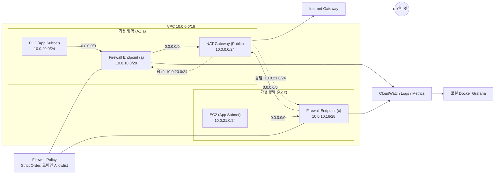

# AWS Network Firewall Egress Filtering 핸즈온

VPC 내부의 Private Subnet에서 NAT Gateway를 통해 인터넷으로 통신하는 인프라 환경에 AWS Network Firewall을 무중단으로 배치하여, 워크로드의 아웃바운드(Egress) 도메인 통신을 전수 감사(Audit)하고 도메인 허용 목록(Allowlist) 기반의 차단 정책을 운영하는 실무 핸즈온입니다.

VPC, 서브넷, 단일 NAT Gateway, 테스트용 EC2 인스턴스는 Terraform으로 프로비저닝하며, 방화벽 리소스 생성, Strict Order 정책 구성, 룰 그룹 바인딩, 단계별 라우팅 컷오버(Cutover)는 운영 서비스에 적용하는 실무 절차를 직접 경험할 수 있도록 AWS 콘솔에서 수행합니다. 처리 메트릭과 상세 감사 로그는 로컬 Docker 기반 Grafana 대시보드를 통해 실시간으로 관측합니다.

## 아키텍처

애플리케이션 서브넷의 아웃바운드 트래픽은 동일 가용 영역(AZ)의 방화벽 엔드포인트(GWLB-E)를 거쳐 NAT Gateway로 전달되며, 응답 트래픽은 Public Route Table에 정의된 App CIDR 라우팅을 따라 정확히 동일한 방화벽 엔드포인트로 회귀(대칭 라우팅)합니다. 단일 NAT Gateway(AZ a) 환경이더라도 가용 영역별 방화벽 엔드포인트를 각각 배치하여 대칭성을 보장합니다.

## 문서 구성

| 문서 | 핵심 주제 및 주요 내용 |
| --- | --- |
| [docs/setup.md](./docs/setup.md) | **실습 환경 구축 및 정리**: Terraform 인프라 배포, Docker Grafana 기동, 콘솔 리소스 및 인프라 완전 삭제 절차 |
| [docs/1-feature-map.md](./docs/1-feature-map.md) | **시나리오 1. 기능 지도**: Egress 필터링 필요성, 5단계 시나리오 로드맵 및 전체 아키텍처 개요 |
| [docs/2-traffic-inspection.md](./docs/2-traffic-inspection.md) | **시나리오 2. 트래픽 유도 및 감사 모드**: 방화벽 엔드포인트 프로비저닝, 대칭 라우팅 원리, 무중단 라우팅 컷오버 및 Audit 로깅 검증 |
| [docs/3-domain-allowlist.md](./docs/3-domain-allowlist.md) | **시나리오 3. 도메인 허용 목록(Allowlist) 통제**: Strict Order 정책, Domain List Rule Group 생성, Application Drop Established 기반 미인가 도메인 차단 |
| [docs/4-monitoring.md](./docs/4-monitoring.md) | **시나리오 4. 실시간 모니터링 및 관측**: CloudWatch 지표 및 Logs Insights 쿼리 분석, 로컬 Grafana 대시보드 연동 |
| [docs/5-production-rollout.md](./docs/5-production-rollout.md) | **시나리오 5. 프로덕션 환경 무중단 적용 가이드**: 실무 5단계 롤아웃 플레이북, 비대칭 라우팅 예방 및 상시 알람 체계 |
| [docs/architecture-decision.md](./docs/architecture-decision.md) | **아키텍처 의사결정**: NAT Gateway 앞 vs 뒤 배치 비교, 단일 VPC 분산 vs Transit Gateway 중앙 집중형 아키텍처 및 비용 손익분기 분석 |
| [docs/cost.md](./docs/cost.md) | **비용 산정 및 최적화**: 서울 리전 세부 단가표, NAT Gateway 요금 면제 혜택, 실습 비용 및 운영 환경 비용 절감 전략 |
| [docs/troubleshooting.md](./docs/troubleshooting.md) | **문제 해결 가이드**: Terraform 배포 에러, CLI 로깅 등록 제약, Docker 권한 문제 등 트러블슈팅 사례 |
