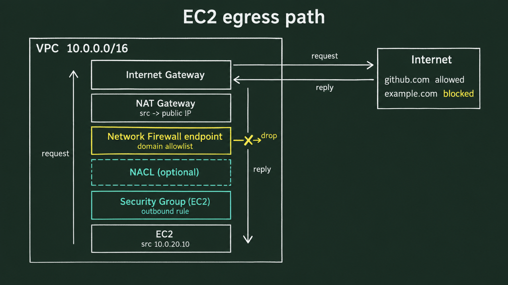
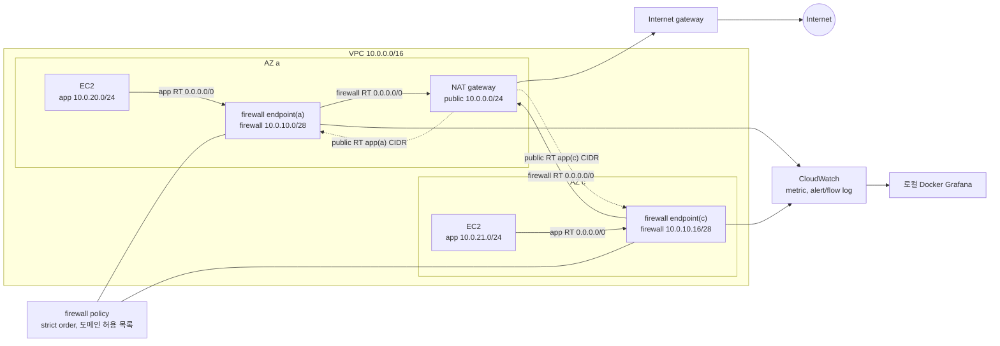

# AWS Network Firewall egress filtering

private subnet의 EC2가 NAT gateway로 인터넷에 나가는 VPC에 AWS Network Firewall을 끼워 넣어, 어느 서버가 어느 도메인과 통신하는지 audit하고 그 결과로 도메인 차단·허용 정책을 관리하는 핸즈온입니다. VPC와 EC2는 Terraform으로 만들고, firewall, policy, rule group, route 변경은 운영 서비스에 적용하는 순서대로 콘솔에서 합니다. firewall metric과 alert 로그는 로컬 Docker Grafana로 봅니다.

## 아키텍처

app subnet의 트래픽은 같은 AZ의 firewall endpoint를 지나 NAT로 나가고, 응답은 public route table의 app CIDR route를 따라 같은 endpoint로 돌아옵니다. NAT는 AZ a에 하나뿐이지만 endpoint는 AZ마다 하나씩 둡니다.

## 문서

| 문서 | 내용 |
| --- | --- |
| [docs/setup.md](./docs/setup.md) | 환경 생성과 삭제, 콘솔 리소스 정리 |
| [docs/1-feature-map.md](./docs/1-feature-map.md) | 시나리오 1. 기능 지도, 전체 구조, 비용 |
| [docs/2-traffic-inspection.md](./docs/2-traffic-inspection.md) | 시나리오 2. firewall endpoint와 대칭 라우팅, firewall 자리 확인, policy와 firewall 생성, 설정 확인, route 전환 |
| [docs/3-domain-allowlist.md](./docs/3-domain-allowlist.md) | 시나리오 3. strict order와 default action, 도메인 허용 목록과 drop |
| [docs/4-monitoring.md](./docs/4-monitoring.md) | 시나리오 4. CloudWatch metric과 alert 로그를 로컬 Grafana로 보기 |
| [docs/5-production-rollout.md](./docs/5-production-rollout.md) | 시나리오 5. 운영 중인 서비스에 적용하는 순서 |
| [docs/architecture-decision.md](./docs/architecture-decision.md) | firewall 배치 의사결정. NAT 앞 배치, VPC별 분산과 Transit Gateway 중앙 구성 비교, 비용 손익분기 |
| [docs/cost.md](./docs/cost.md) | 단가, 실습 비용, 운영 비용을 정하는 것 |
| [docs/troubleshooting.md](./docs/troubleshooting.md) | 실습 중 겪은 문제와 해결방법 |
