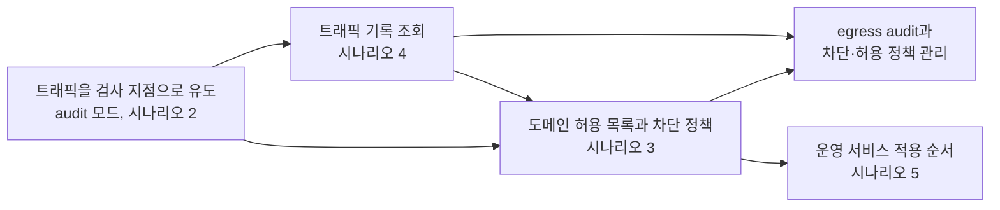
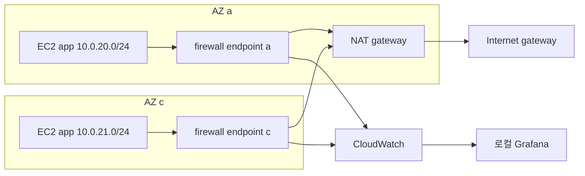

# 시나리오 1. 기능 지도: egress 트래픽 audit과 차단·허용 정책 관리

## 이 시나리오의 목표

| 항목 | 내용 |
| --- | --- |
| 기능 | egress 트래픽 audit과 도메인 기반 차단·허용 정책 관리에 필요한 기능 전체 |
| 쓰는 도구 | AWS Network Firewall, VPC route table, CloudWatch, Grafana |
| 입력 | NAT gateway로 인터넷에 나가는 private subnet의 EC2 2대 |
| 작업 | 시나리오 2~5의 순서와 각 시나리오가 맡는 기능 확인 |
| 달성할 것 | 이 핸즈온이 끝났을 때 무엇이 달라지는지와 그러려면 어떤 기능이 필요한지 한 장으로 설명 |

## 최종 목표는 egress 트래픽 audit과 차단·허용 정책 관리다

이 핸즈온의 최종 목표는 두 가지입니다. 첫째는 audit으로, VPC 안의 어느 서버가 어느 외부 도메인과 통신하는지를 빠짐없이 기록하고 조회할 수 있어야 합니다. 둘째는 정책 관리로, audit 결과를 근거로 허용할 도메인과 차단할 도메인을 정하고 그 정책을 운영 중인 서비스에 안전하게 적용·변경할 수 있어야 합니다.

두 목표는 순서가 있습니다. 무엇이 나가는지 모르는 상태에서 차단 정책을 넣으면 정상 트래픽까지 막아 장애로 이어지므로, 먼저 아무것도 막지 않는 audit 모드로 트래픽을 기록하고, 그 기록에서 허용 목록을 도출한 뒤 차단을 켭니다. 이 실습에서는 private subnet의 EC2가 `.amazonaws.com`과 `.github.com`만 허용되고 `www.google.com` 같은 나머지 도메인은 차단되며, 허용·차단 여부와 무관하게 출발지 서버 IP와 목적지 도메인이 로그와 대시보드에 남습니다.

Security group과 NACL은 IP와 포트만을 기준으로 판단하고 도메인 단위의 기록을 남기지 않습니다. CDN 뒤의 도메인은 IP가 계속 바뀌므로 IP 목록으로는 audit도 정책 관리도 유지할 수 없습니다. AWS Network Firewall은 TLS SNI와 HTTP Host 헤더를 읽어 도메인 단위로 기록하고 판단합니다.

## 목표에서 거슬러 올라가면 기능 네 개가 필요하다

audit을 하려면 먼저 모든 egress 트래픽이 검사 지점을 거쳐야 하고, 거친 트래픽의 기록을 조회할 수 있어야 합니다. 정책 관리는 그 기록 위에서 도메인 허용 목록과 default action으로 차단·허용을 정하는 일이며, 이 모든 변경을 운영 서비스에 끊김 없이 적용하는 순서가 필요합니다.

| 기능 | 쓰는 도구 | 시나리오 |
| --- | --- | --- |
| 트래픽을 검사 지점으로 유도하고 alert 전용 policy로 전체 기록(audit 모드) | firewall endpoint(Gateway Load Balancer endpoint), VPC route table, alert established | [2-traffic-inspection.md](./2-traffic-inspection.md) |
| 도메인 허용 목록과 default action으로 차단·허용 정책 관리 | firewall policy, stateful domain list rule group, default action | [3-domain-allowlist.md](./3-domain-allowlist.md) |
| 허용·차단된 트래픽 기록 조회 | CloudWatch metric, alert와 flow 로그, 로컬 Docker Grafana | [4-monitoring.md](./4-monitoring.md) |
| 운영 서비스 적용 순서 | audit에서 허용 목록 도출, 차단 전환까지를 되돌릴 수 있는 단계로 나눈 절차 | [5-production-rollout.md](./5-production-rollout.md) |

시나리오 2~4는 실습이 이어집니다. 시나리오 2에서 만든 firewall에 시나리오 3이 규칙을 넣고, 시나리오 4가 그 결과를 봅니다. 환경 생성과 삭제는 [setup.md](./setup.md), 실습 중 겪은 문제는 [troubleshooting.md](./troubleshooting.md), VPC가 여러 개일 때의 firewall 배치 판단은 [architecture-decision.md](./architecture-decision.md)에 있습니다.

## 전체 구조

패킷이 지나는 층을 Linux network stack처럼 쌓아 그리면 아래 두 장입니다. security group과 firewall endpoint가 기본이고, NACL은 쓰지 않아도 되는 선택 층이라 점선으로 그렸습니다.

클라이언트 요청은 Internet Gateway, ELB, security group, firewall endpoint, security group 순서로 내려가 EC2에 닿고, 응답은 같은 층을 거꾸로 올라가 Internet Gateway에서 클라이언트로 돌아갑니다. firewall endpoint는 요청과 응답을 모두 봐야 흐름을 압니다.

EC2가 먼저 시작하는 외부 호출은 security group, firewall endpoint, NAT gateway, Internet Gateway 순서로 올라가고, 응답은 같은 길로 내려옵니다. 허용 목록에 없는 도메인은 firewall endpoint에서 버려집니다. 이 핸즈온의 실습은 이 두 번째 그림을 다룹니다.

Terraform이 VPC, NAT gateway 1개, AZ a와 c의 EC2를 만들고, firewall은 실습에서 콘솔로 만듭니다. app subnet의 트래픽은 같은 AZ의 firewall endpoint를 지나 NAT로 나가고, 응답은 같은 endpoint로 돌아옵니다.

## 비용

firewall을 켠 동안은 시간당 약 $0.886, 실습 전체는 $1~2 수준입니다. 단가와 계산은 [cost.md](./cost.md)에 있습니다.

## 참고 문서

1. AWS Network Firewall Developer Guide, <https://docs.aws.amazon.com/network-firewall/latest/developerguide/>
