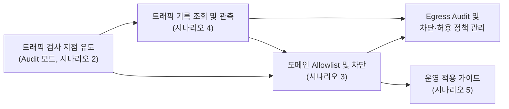
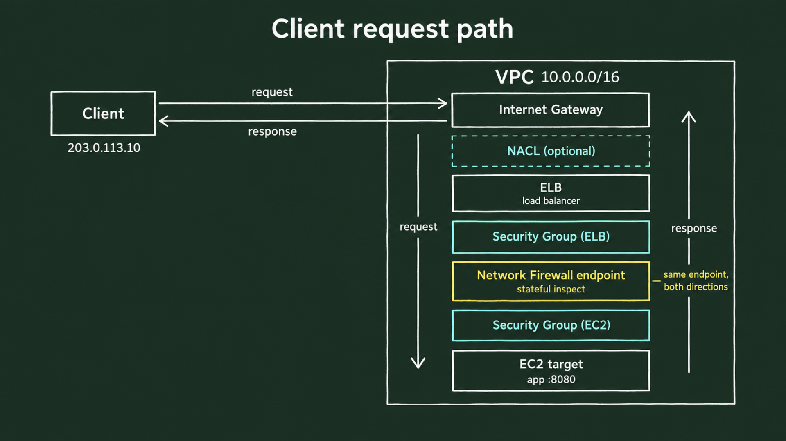
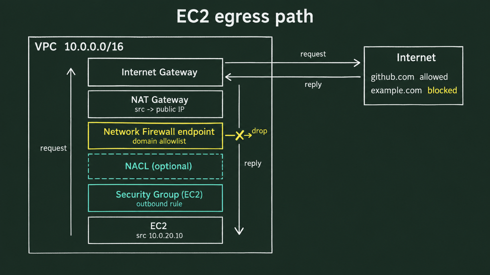
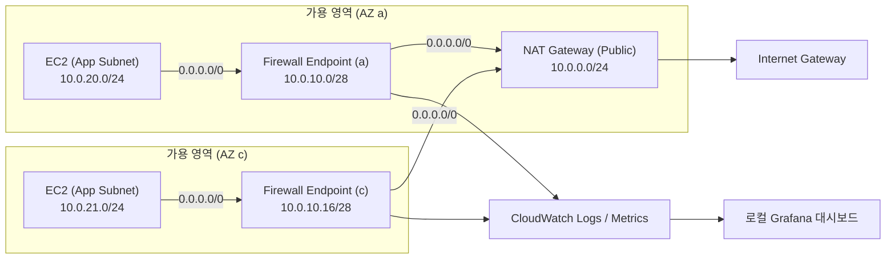

# 시나리오 1. 기능 지도: Egress 트래픽 감사(Audit)와 도메인 정책 관리

## 시나리오 개요 및 목표

VPC 내부의 워크로드가 외부 인터넷으로 나가는 아웃바운드(Egress) 트래픽을 통제하는 것은 침해 사고 시 C&C(Command and Control) 서버와의 통신을 차단하고 데이터 유출을 방지하기 위한 핵심 보안 요구사항입니다. 하지만 전통적인 Security Group이나 Network ACL(NACL)은 IP와 포트 기반으로만 동작하므로, 클라우드 환경에서 수시로 IP가 바뀌는 CDN이나 SaaS 도메인(예: AWS API, GitHub)을 효과적으로 통제하기 어렵습니다.

AWS Network Firewall은 L7 계층에서 TLS SNI(Server Name Indication) 및 HTTP Host 헤더를 검사하여 도메인 기반 필터링과 정밀한 감사(Audit) 로그를 제공합니다.

본 핸즈온은 총 5개의 시나리오로 구성되어 있으며, 이번 시나리오에서는 **전체 아키텍처의 구조와 Egress 필터링을 완성하기 위해 필요한 핵심 기능 지도(Feature Map)**를 파악합니다.

| 구분 | 주요 내용 |
| --- | --- |
| **실습 목표** | Egress 트래픽 감사 및 도메인 기반 정책 수립에 필요한 전체 아키텍처와 시나리오별 기능 흐름 이해 |
| **핵심 도구** | AWS Network Firewall, VPC Route Table, Amazon CloudWatch, Grafana |
| **사전 상태** | NAT Gateway를 통해 인터넷으로 통신하는 Private Subnet 기반 EC2 인스턴스 2대 ([setup.md](./setup.md) 배포 상태) |
| **최종 결과** | 무중단 방화벽 라우팅 구성부터 도메인 Allowlist 적용, 실시간 관측까지의 전체 로드맵 정립 |

---

## Egress 필터링의 핵심 목표: 감사(Audit)와 정책 관리

핸즈온이 지향하는 최종 목표는 두 가지입니다.

1. **전수 감사(Audit)**: VPC 내부의 어떤 서버(출발지 Private IP)가 외부의 어떤 도메인(TLS SNI/HTTP Host)과 통신하는지 빠짐없이 기록하고 검색할 수 있어야 합니다.
2. **안전한 정책 관리**: 감사 로그를 바탕으로 서비스에 필요한 도메인 허용 목록(Allowlist)을 도출하고, 인가되지 않은 외부 도메인 접근을 차단(Drop)하면서도 운영 서비스의 단절이 없어야 합니다.

이 두 작업은 반드시 **감사(Audit) 선행 후 차단(Block) 적용** 순서로 진행되어야 합니다. 실제 트래픽 패턴을 모르는 상태에서 선제적으로 차단 정책을 적용하면 예상치 못한 외부 API나 패키지 저장소 연결이 끊겨 서비스 장애로 직결되기 때문입니다.

따라서 먼저 트래픽을 차단하지 않는 **감사 모드(Alert-only)**로 방화벽을 경유시키고, 수집된 로그를 분석해 허용 목록을 확정한 뒤 차단 모드로 안전하게 전환합니다.

---

## 핸즈온 진행 로드맵

Egress 트래픽 감사 및 정책 관리를 완성하기 위해 본 실습은 아래와 같이 4단계의 실무 구현 흐름으로 이어집니다.

| 단계 / 시나리오 | 핵심 기능 및 구현 내용 | 주요 기술 요소 | 상세 문서 |
| --- | --- | --- | --- |
| **시나리오 2** | **트래픽 인스펙션 및 감사 모드**: 무중단 대칭 라우팅 구성 및 전수 Egress 감사 로그 확보 | Firewall Endpoint (GWLB-E), VPC Route Table, Alert Established | [2-traffic-inspection.md](./2-traffic-inspection.md) |
| **시나리오 3** | **도메인 기반 정책 통제**: Strict Order 정책 및 도메인 Allowlist 기반 미인가 Egress 차단 | Stateful Rule Group (Domain List), Application Drop Established | [3-domain-allowlist.md](./3-domain-allowlist.md) |
| **시나리오 4** | **실시간 모니터링 및 관측**: 방화벽 메트릭과 차단 로그를 대시보드에서 통합 분석 | CloudWatch Metric, CloudWatch Logs Insights, 로컬 Docker Grafana | [4-monitoring.md](./4-monitoring.md) |
| **시나리오 5** | **운영 환경 적용 전략**: 운영 중인 서비스에 단계별 무중단 배포 및 롤백 절차 | 단계별 컷오버 플레이북, 비대칭 라우팅 예방, 장애 대응 | [5-production-rollout.md](./5-production-rollout.md) |

> [!NOTE]
> 시나리오 2부터 4까지는 하나의 연결된 실습 환경에서 순차적으로 진행됩니다. 시나리오 2에서 생성한 방화벽에 시나리오 3에서 룰을 적용하고, 시나리오 4에서 그 결과를 시각화합니다.
>
> - 환경 구축 및 제거: [setup.md](./setup.md)
> - 문제 해결 가이드: [troubleshooting.md](./troubleshooting.md)
> - 단일 VPC 분산 vs 중앙 집중형 아키텍처 비교: [architecture-decision.md](./architecture-decision.md)

---

## 전체 아키텍처 및 트래픽 흐름

네트워크 방화벽이 VPC 내부에서 트래픽을 처리하는 위치와 흐름은 인바운드와 아웃바운드에 따라 구분됩니다.

### 인바운드(Inbound) 클라이언트 요청 흐름

외부 클라이언트가 내부 서비스에 접근할 때는 Internet Gateway, ELB, Security Group, 방화벽 엔드포인트를 거쳐 EC2 인스턴스에 도달합니다.

### 아웃바운드(Egress) 워크로드 요청 흐름 (본 핸즈온 실습 대상)

EC2 인스턴스가 외부 API나 인터넷과 통신할 때는 Security Group을 거쳐 **방화벽 엔드포인트(Firewall Endpoint)**로 인입되고, 방화벽의 상태 검사(Stateful Inspection)를 통과한 패킷만 NAT Gateway와 Internet Gateway를 통해 외부로 전달됩니다.

Terraform 코드는 기본 VPC, 단일 NAT Gateway(AZ a), 그리고 AZ a와 c에 위치한 EC2 인스턴스를 프로비저닝합니다. 방화벽 본체와 정책, 라우팅 테이블 변경은 실제 운영 환경 적용 절차를 직접 경험할 수 있도록 AWS 콘솔에서 단계별로 구성합니다.

---

## 비용 안내

AWS Network Firewall은 생성 즉시 가용 영역(AZ)당 엔드포인트 시간 요금이 발생합니다.

- 서울 리전 기준 엔드포인트 2개 운영 시 시간당 약 \$0.886 (NAT Gateway 요금 일부 면제 반영)
- 실습 전체 진행(약 1~2시간) 시 총비용은 약 \$1 ~ \$2 내외입니다.
- 자세한 요금 체계 및 계산 근거는 [cost.md](./cost.md)를 참고하시기 바랍니다.

---

## 참고 문서

1. [AWS Network Firewall Developer Guide](https://docs.aws.amazon.com/network-firewall/latest/developerguide/)
