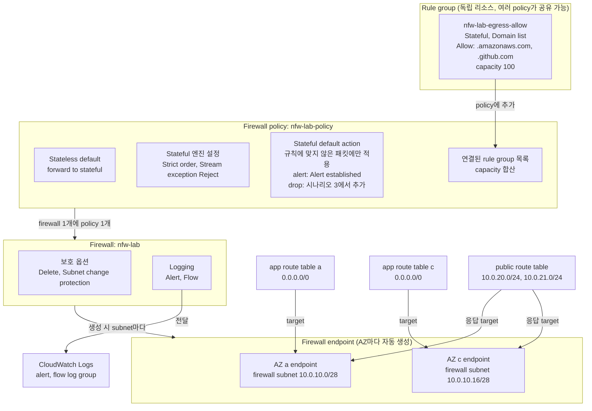
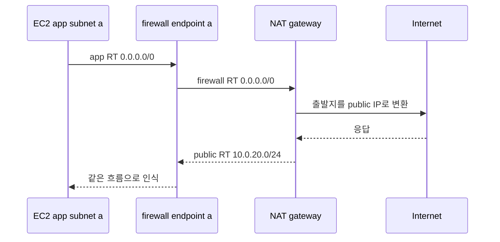

# 시나리오 2. 트래픽을 firewall endpoint로 보내기

## 이 시나리오의 목표

| 항목 | 내용 |
| --- | --- |
| 기능 | VPC의 트래픽을 검사 지점에 끼워 넣기 |
| 쓰는 도구 | Network Firewall의 firewall endpoint, VPC route table |
| 입력 | NAT로 나가는 EC2 2대(AZ a, c), 아무것도 막지 않는 firewall policy |
| 작업 | 실습 1~8단계: firewall 자리 확인, probe, policy와 firewall 생성, 로깅과 monitoring dashboard, 설정 확인, route 전환, 롤백 |
| 달성할 것 | 서비스가 끊기지 않은 채 양방향 트래픽이 firewall을 지나고, alert 로그에 서버 private IP와 도메인이 남음 |

## firewall은 서버 앞이 아니라 route table에 끼워 넣는 장비다

Security group은 ENI에 붙어서 붙이는 순간 동작합니다. Network Firewall은 다릅니다. firewall을 만들면 지정한 subnet마다 `vpce-`로 시작하는 firewall endpoint가 생기고, route table의 target으로 이 endpoint를 지정해야 트래픽이 firewall을 지납니다. firewall을 만들기만 하면 아무 트래픽도 검사하지 않습니다.

이 기능이 다루는 것은 "어느 트래픽이 검사 지점을 지나는가"입니다. 무엇을 막을지는 시나리오 3의 policy가 정합니다.

### 용어

| 용어 | 뜻 | 이 실습의 예 |
| --- | --- | --- |
| Firewall | VPC의 AZ마다 endpoint를 만들고 policy 1개를 연결하는 리소스 | `nfw-lab` |
| Firewall policy | rule group 묶음, 평가 순서, default action. firewall과 따로 만들고 공유할 수 있음 | `nfw-lab-policy` |
| Firewall endpoint | firewall이 subnet마다 자동으로 만드는 Gateway Load Balancer endpoint. route의 target으로 쓰는 검사 지점 | AZ a, c에 하나씩 `vpce-...` |
| Firewall subnet | endpoint만 두는 전용 subnet | `nfw-lab-firewall-ap-northeast-2a`, `-2c` |
| 대칭 라우팅 | 나가는 패킷과 돌아오는 패킷이 같은 endpoint를 지나는 구성 | public route table의 `10.0.20.0/24 → vpce(a)` |
| Stream exception policy | firewall이 상태를 모르는 패킷(흐름 중간부터 도착한 패킷)의 처리 | **Reject** |

## rule group, policy, firewall, route table의 연관관계

Network Firewall은 리소스 네 종류가 이어져 동작합니다. 무엇을 막고 기록할지는 policy가, endpoint를 어느 subnet에 둘지는 firewall이, 어떤 트래픽이 검사를 받을지는 route table이 정합니다.



| 관계 | 의미 |
| --- | --- |
| rule group → policy | rule group은 policy에 추가해야 적용되고, policy는 연결된 rule group의 capacity 합계를 예약합니다. 같은 rule group을 여러 policy가 공유할 수 있습니다 |
| policy → firewall | firewall 하나에는 policy 하나만 연결되고, policy 하나는 여러 firewall이 공유할 수 있습니다. policy를 수정하면 firewall에 반영되기까지 약 1분이 걸립니다 |
| firewall → endpoint | firewall을 만들 때 지정한 firewall subnet마다 endpoint가 하나씩 자동으로 생성됩니다. firewall 자체에는 보호 옵션과 로깅 설정만 있습니다 |
| route table → endpoint | route table이 endpoint를 target으로 가리켜야 그 subnet의 트래픽이 검사를 받습니다. firewall을 만들기만 하면 아무 트래픽도 검사하지 않습니다 |

strict order에서 default action은 rule group의 어떤 규칙에도 맞지 않은 패킷에만 적용됩니다. 허용 목록의 Allow 규칙에 맞은 트래픽은 default action의 alert나 drop을 거치지 않고 통과합니다.

## firewall endpoint는 직접 만드는 Gateway Load Balancer가 아니다

Network Firewall은 내부적으로 Gateway Load Balancer(GWLB) 위에서 동작합니다. 그래서 firewall endpoint의 정체는 GWLB endpoint이고, route table에서 target 종류를 고를 때도 **Gateway Load Balancer Endpoint**로 보입니다. 하지만 사용자가 GWLB를 설치하지는 않습니다.

| 구성 요소 | 누가 만드나 | 이 실습에서 할 일 |
| --- | --- | --- |
| GWLB, target group, 검사 엔진 | AWS가 관리. 계정에 보이지 않음 | 없음 |
| firewall endpoint(GWLB endpoint) | firewall을 만들 때 Network Firewall이 firewall subnet마다 자동 생성 | route의 target으로 지정 |
| firewall subnet, route table | 사용자 | Terraform이 준비 |

endpoint 요금은 firewall endpoint 시간 요금($0.395/시간)에 들어 있고 GWLB 요금이 따로 나오지 않습니다. GWLB를 직접 만드는 경우는 서드파티 방화벽 appliance를 EC2로 운영할 때이고, Network Firewall과는 다른 선택지입니다.

VPC에 firewall을 붙이는 방식(**Attachment type: VPC**)에서는 AZ마다 endpoint가 반드시 있어야 합니다. 트래픽을 firewall로 보낼 입구가 endpoint뿐이기 때문입니다. 다른 방식도 있습니다.

| 방식 | endpoint 위치 | 맞는 상황 |
| --- | --- | --- |
| VPC attachment (이 실습) | 내 VPC의 firewall subnet | VPC 하나를 검사 |
| Transit Gateway attachment | 내 VPC에 없음. firewall이 Transit Gateway에 직접 붙음 | 여러 VPC 트래픽을 Transit Gateway에서 한곳에 모아 검사 |
| secondary endpoint | 다른 VPC에 같은 firewall의 endpoint를 추가 | firewall 하나를 여러 VPC가 나눠 씀 |

## 검사 지점을 route로 강제해야 하는 이유

서버에 프록시를 설정하는 방식은 서버가 설정을 따를 때만 동작합니다. 프록시 환경변수를 무시하는 프로세스나 직접 소켓을 여는 코드는 그대로 인터넷에 나갑니다. route table은 서버가 바꿀 수 없으므로, 그 subnet의 모든 트래픽이 검사 지점을 지나게 강제할 수 있습니다.

대신 route로 강제하는 만큼 route를 잘못 짜면 서비스가 끊깁니다. firewall의 stateful 엔진은 흐름 상태를 endpoint 안에 들고 있습니다. 나가는 패킷이 AZ a의 endpoint를 지났는데 돌아오는 패킷이 firewall을 우회하거나 AZ c의 endpoint로 가면, 돌아온 쪽은 이 흐름을 모르므로 stream exception policy대로 처리합니다. 그래서 이 기능의 핵심은 대칭 라우팅입니다.

## 대안 비교

| 방식 | 강제력 | 도메인 판단 | 운영 부담 |
| --- | --- | --- | --- |
| Network Firewall (route 강제) | subnet 전체 | SNI, Host | 관리형. route 설계가 필요 |
| 서버별 HTTP 프록시(Squid 등) | 서버 설정에 의존 | 프록시가 판단 | 프록시 서버를 직접 운영 |
| Route 53 Resolver DNS Firewall | DNS 질의만 | 질의한 도메인 | 낮음. IP로 직접 접속하면 못 막음 |
| Security group, NACL | ENI, subnet | 불가 | 낮음. IP 목록 유지가 필요 |

## firewall을 NAT 앞에 두면 로그에 서버 IP가 남는다

firewall을 NAT 뒤(public subnet과 IGW 사이)에 둘 수도 있습니다. 그 경우 IGW에 edge association route table을 붙여 돌아오는 트래픽을 endpoint로 보냅니다. 두 위치는 firewall이 보는 출발지 IP가 다릅니다.

| 위치 | firewall이 보는 출발지 | route 변경 대상 |
| --- | --- | --- |
| NAT 앞 (이 실습) | 서버의 private IP | app route table, public route table |
| NAT 뒤 | NAT의 private IP | public route table, IGW edge route table |

NAT 뒤에 두면 alert 로그만 보고는 어느 서버가 막혔는지 알 수 없습니다. 이 실습은 로그에서 서버를 바로 찾으려고 NAT 앞에 둡니다.

## 컴포넌트 역할

| 컴포넌트 | 역할 |
| --- | --- |
| app route table (AZ별 1개) | `0.0.0.0/0`을 같은 AZ의 endpoint로 보냄. 나가는 길 |
| firewall endpoint | 패킷을 GENEVE로 감싸 firewall 엔진으로 보냄. AZ당 최대 100 Gbps, 급증 시 확장에 몇 분이 걸리고 그동안 fail closed |
| firewall route table | `0.0.0.0/0 → NAT`. 검사를 마친 패킷을 NAT로 보냄 |
| NAT gateway | AZ a에 1개. 출발지 IP를 public IP로 바꿈 |
| public route table | `app CIDR → 같은 AZ의 endpoint`. 돌아오는 길 |

public route table의 app CIDR route가 없으면 NAT는 응답을 VPC `local` route로 app subnet에 바로 넘기고, firewall은 나가는 패킷만 봅니다. VPC는 `local`보다 구체적인 route를 허용하므로 `10.0.20.0/24 → vpce`를 넣을 수 있습니다.

NAT가 하나여도 endpoint는 AZ마다 둡니다. AZ c의 트래픽은 endpoint(c)를 지난 다음 AZ를 건너 NAT(a)로 가고, 돌아올 때도 public route table이 app(c) CIDR을 endpoint(c)로 보내므로 대칭이 유지됩니다. 그래서 app route table이 AZ마다 하나씩 필요합니다. `terraform-aws-modules/vpc`는 `single_nat_gateway = true`이면 private route table을 하나만 만들므로, app subnet은 모듈 밖에서 직접 만들었습니다.

## firewall subnet을 따로 두는 이유는 route table이다

route table은 subnet 단위로 붙습니다. 그런데 서버와 firewall endpoint는 같은 목적지 `0.0.0.0/0`에 서로 다른 다음 hop이 필요합니다.

| subnet | route table | `0.0.0.0/0`의 target | 뜻 |
| --- | --- | --- | --- |
| app subnet | `nfw-lab-app-*` | firewall endpoint | 나가는 패킷을 검사받으러 보냄 |
| firewall subnet | `nfw-lab-firewall` | NAT gateway | 검사를 마친 패킷을 NAT로 보냄 |

endpoint를 다른 subnet에 섞으면 이 갈림길이 사라집니다.

- app subnet에 두면 검사를 마친 패킷도 같은 route table의 `0.0.0.0/0 → endpoint`를 따라 endpoint로 되돌아갑니다. 또 같은 subnet 안의 통신은 `local`로 바로 가므로 서버 트래픽을 route로 endpoint에 보낼 수도 없습니다.
- public subnet에 두면 검사를 마친 패킷이 `0.0.0.0/0 → IGW`를 따라 NAT를 건너뜁니다. 출발지가 private IP라 인터넷으로 나가지 못합니다.

firewall subnet에는 endpoint ENI 하나만 들어가므로 `/28`(`10.0.10.0/28`, `10.0.10.16/28`)로 만들었습니다. 다른 리소스를 넣으면 그 리소스의 트래픽은 firewall을 지나지 않으므로 비워 둡니다. Transit Gateway attachment 방식은 내 VPC에 endpoint가 없어서 firewall subnet도 필요 없습니다.

## 흐름

EC2 a(`10.0.20.61`)의 요청 하나가 지나는 경로입니다. 나갈 때는 app route table, firewall route table, public route table을 차례로 따라 올라가고, 돌아올 때는 public route table의 `/24` route가 `local`보다 구체적이라 응답이 다시 firewall endpoint를 지납니다.



## 실습

[setup.md](./setup.md)의 Up을 마친 상태에서 시작합니다. 예상 시간은 2026-10-31 ap-northeast-2에서 같은 순서를 AWS CLI로 실행해 잰 값입니다.

| 리소스 | 이름 |
| --- | --- |
| VPC | `nfw-lab` |
| firewall subnet | `nfw-lab-firewall-ap-northeast-2a`, `nfw-lab-firewall-ap-northeast-2c` |
| firewall route table | `nfw-lab-firewall` |
| app route table | `nfw-lab-app-ap-northeast-2a`, `nfw-lab-app-ap-northeast-2c` |
| public route table | `nfw-lab-public` |
| EC2 | `nfw-lab-app-ap-northeast-2a`(`10.0.20.x`), `nfw-lab-app-ap-northeast-2c`(`10.0.21.x`) |
| log group | `/aws/network-firewall/nfw-lab/alert`, `/aws/network-firewall/nfw-lab/flow` |

실습 중 `terraform apply`를 다시 실행하면 app route table의 `0.0.0.0/0`이 NAT로 돌아갑니다. 실습이 끝날 때까지 apply하지 않습니다.

### 1. firewall 배치 대상 subnet과 route table 사전 점검 (약 3분)

Terraform은 firewall을 만들지 않고 firewall이 들어갈 subnet과 route table만 준비합니다. firewall을 만들기 전에 그 준비가 맞는지 봅니다.

1. **VPC > Network Firewall > Firewalls**를 엽니다.
   - firewall은 4단계에서 생성하므로 목록이 비어 있습니다.
2. **VPC > Network Firewall > Firewall policies**와 **Network Firewall rule groups**를 엽니다.
   - 둘 다 비어 있습니다.
3. **VPC > Subnets**에서 검색창에 `nfw-lab-firewall`을 넣습니다.
   - AZ a에 `10.0.10.0/28`, AZ c에 `10.0.10.16/28` subnet이 하나씩 있습니다. firewall endpoint만 두는 subnet이라 /28로 작게 만들었습니다.
4. **VPC > Route tables > nfw-lab-firewall**의 **Routes** 탭을 엽니다.
   - `0.0.0.0/0`의 target이 `nat-`이며, firewall이 검사를 마친 패킷을 NAT로 전달하는 경로입니다.
5. 같은 route table의 **Subnet associations** 탭을 엽니다.
   - firewall subnet 두 개가 연결되어 있습니다.
6. **nfw-lab-app-ap-northeast-2a**, **nfw-lab-app-ap-northeast-2c**의 **Routes** 탭을 엽니다.
   - 둘 다 `0.0.0.0/0`의 target이 `nat-`이며, 7단계에서 이 target을 endpoint로 전환합니다.
7. **nfw-lab-public**의 **Routes** 탭을 엽니다.
   - `0.0.0.0/0 → igw-`와 `local`만 있으며, 7단계에서 응답 경로용 app CIDR route를 추가합니다.

1~7단계를 CLI로 하면 아래 명령으로 대신합니다. firewall 목록이 `[]`이고 route table 4개의 route가 위 설명과 같으면 됩니다.

```bash
aws network-firewall list-firewalls --query 'Firewalls[].FirewallName'
aws ec2 describe-route-tables --filters Name=vpc-id,Values=$(terraform -chdir=terraform output -raw vpc_id) \
  --query 'RouteTables[].{name:Tags[?Key==`Name`]|[0].Value,routes:Routes[].[DestinationCidrBlock,NatGatewayId||GatewayId]}'
```

### 2. 기존 NAT egress 경로와 probe 상태 확인 (2분)

1. **EC2 > Instances**에서 `nfw-lab-app-ap-northeast-2a`를 고르고 **Connect > Session Manager > Connect**를 누릅니다.
2. 아래 명령으로 `egress-probe` 출력을 실시간으로 확인합니다. 이 세션은 시나리오 3이 끝날 때까지 유지합니다.
3. `nfw-lab-app-ap-northeast-2c`도 같은 방법으로 접속해 출력을 확인합니다.

2단계에서 실행하는 명령입니다.

```bash
journalctl -u egress-probe -f -o cat
```

2초 간격으로 한 줄씩 출력되며, 시각은 실행마다 다릅니다.

```text
06:08:41 checkip.amazonaws.com=200 www.google.com=200
06:08:43 checkip.amazonaws.com=200 www.google.com=200
```

### 3. alert 전용 firewall policy 생성 (약 3분)

policy는 firewall이 무엇을 할지 정하는 설정 묶음이고, firewall과 따로 만듭니다. 이 단계의 policy는 아무것도 차단하지 않고 모든 연결을 alert 로그에 기록하는 audit 모드입니다. 무엇이 나가는지 모르는 상태에서 차단 policy를 붙이면 route를 바꾸는 순간 정상 트래픽까지 끊기므로, audit 기록을 먼저 쌓고 시나리오 3에서 그 기록을 근거로 차단·허용 정책을 정합니다.

이 단계에서 지정하는 설정값입니다. 콘솔 UI 문구가 아래와 다르더라도 설정값만 일치하면 결과는 같습니다.

| 설정 | 값 | 이유 |
| --- | --- | --- |
| Name | `nfw-lab-policy` | 4단계에서 firewall에 연결 |
| Stream exception policy | **Reject** | 상태를 모르는 패킷을 조용히 버리지 않고 RST를 보내 애플리케이션이 바로 실패를 알게 함 |
| Stateless default actions | **Forward to stateful rules** | stateless 엔진은 쓰지 않고 모든 패킷을 stateful 엔진으로 넘김 |
| Stateless fragment default actions | **Forward to stateful rules** | 조각난 패킷도 같은 처리 |
| Active Threat Defense | 해제 | 콘솔 기본값은 켜짐(alert 모드). 처리 데이터 1GB당 $0.005가 추가되는 관리형 위협 차단 기능이라 이 실습의 audit과 도메인 정책 범위 밖 |
| Stateful rule evaluation order | **Strict order** | 시나리오 3에서 규칙을 순서대로 평가 |
| Stateful default actions: drop | 모두 해제 | 이 단계는 아무것도 막지 않음 |
| Stateful default actions: alert | **Alert established**만 선택 | 연결이 맺어진 흐름을 alert 로그에 남김 |
| Rule groups | 없음 | 시나리오 3에서 추가 |

1. **VPC > Network Firewall > Firewall policies**에서 **Create firewall policy**를 누릅니다.
2. 첫 화면의 **Firewall policy details**에서 **Name**에 `nfw-lab-policy`를 입력합니다.
3. 같은 화면의 **Stream exception policy**를 **Reject**로 바꾸고 **Next**를 누릅니다.
4. **Add rule groups** 화면의 **Stateless default actions**에서 **Fragmented packets**와 **Full packets** 모두 **Forward to stateful rules**인지 확인합니다.
   - 기본값이 이미 이 값입니다.
5. **Enable Active Threat Defense**가 선택되어 있으면 해제합니다.
   - 2025-11부터 콘솔에서 만드는 새 policy는 이 옵션이 alert 모드로 미리 켜져 있습니다. 켜 두면 처리 데이터 1GB당 $0.005가 추가됩니다.
6. **Stateful rule evaluation order and default actions**에서 **Rule evaluation order**를 **Strict order**로 둡니다.
7. **Drop action**에서 선택을 모두 해제하거나 **None**을 고릅니다.
   - 새 policy는 **Application drop established (server-directed only)**가 미리 선택되어 있습니다. 해제하지 않으면 7단계에서 route를 바꾸는 순간 모든 외부 통신이 막힙니다.
8. **Alert action**에서 **Alert established**만 선택합니다.
9. **Stateful rule groups**와 **Stateless rule groups**는 비워 둔 채 **Next**를 누릅니다.
10. 다음 화면(TLS inspection, 고급 설정, 태그)은 바꾸지 않고 **Next**를 누릅니다.
11. **Review and create**에서 7~8단계의 default action이 alert established 하나뿐인지 확인하고 **Create firewall policy**를 누릅니다.
    - policy는 바로 만들어지고 상태가 **Active**가 됩니다.

1~11단계는 아래 CLI 명령으로 대체할 수 있으며, 콘솔 UI가 바뀌더라도 이 JSON이 이 단계의 기준 설정입니다.

```bash
aws network-firewall create-firewall-policy --firewall-policy-name nfw-lab-policy \
  --firewall-policy '{
    "StatelessDefaultActions": ["aws:forward_to_sfe"],
    "StatelessFragmentDefaultActions": ["aws:forward_to_sfe"],
    "StatefulDefaultActions": ["aws:alert_established"],
    "StatefulEngineOptions": {"RuleOrder": "STRICT_ORDER", "StreamExceptionPolicy": "REJECT"}
  }'
```

콘솔의 **Stateful rule evaluation order and default actions** 영역에는 아래 옵션이 나옵니다. default action은 어떤 stateful 규칙에도 맞지 않은 패킷을 어떻게 처리할지 정하는 값입니다. 아래 표의 "audit 모드(이 단계)"와 "차단 정책(시나리오 3)" 열이 이 핸즈온에서 고르는 값입니다.

| 옵션 | 의미 | audit 모드(이 단계) | 차단 정책(시나리오 3) |
| --- | --- | --- | --- |
| Enable Active Threat Defense | AWS가 관리하는 위협 인텔리전스 rule group을 붙여 알려진 악성 IP, 도메인과의 통신을 차단. deep threat inspection을 켜면 트래픽 정보가 AWS 위협 인텔리전스 개선에 쓰임. 콘솔 기본값은 alert 모드로 켜짐. 서울 기준 처리 데이터 1GB당 $0.005 추가 | 선택하지 않음 | 선택하지 않음 |
| Rule evaluation order: Strict order | 규칙을 정의한 순서대로 평가. policy 생성 후 바꿀 수 없음 | 선택 | 그대로 |
| Rule evaluation order: Action order | pass → drop → reject → alert 순서로 action별 평가(이전 이름 Default order). 아래 drop, alert default action을 쓸 수 없어 기본 차단을 별도 규칙으로 만들어야 함 | 선택하지 않음 | 선택하지 않음 |

Drop action은 하나만 고르거나 고르지 않습니다.

| Drop action | 의미 | 이 핸즈온에서 |
| --- | --- | --- |
| Application drop established (server-directed only) | TCP handshake는 통과시키고, SNI나 Host 같은 애플리케이션 계층 정보를 읽은 뒤 규칙에 맞지 않으면 client→server 방향 패킷을 차단. 새 policy의 기본값 | 시나리오 3에서 선택 |
| Application drop established (bidirectional) | 위와 같지만 server→client 방향도 차단. 서버가 먼저 말하는 프로토콜(SSH, SMTP 배너)이 막힐 수 있음 | 선택하지 않음 |
| Drop established | handshake 직후부터 규칙에 맞지 않는 패킷을 차단. SNI를 읽기 전에 막을 수 있어 도메인 허용 목록과 맞지 않음 | 선택하지 않음 |
| Drop all | handshake의 SYN까지 모든 패킷을 차단. SYN에는 도메인 정보가 없어 도메인 허용 목록만으로는 모든 연결이 막힘 | 선택하지 않음 |
| None | default drop 없음. 규칙에 맞지 않아도 통과 | 이 단계에서 선택(audit 모드) |

Alert action은 차단 여부와 별개로, 규칙에 맞지 않은 패킷을 alert 로그에 남길지 정합니다. drop과 같은 계열(established 또는 Application established)로 맞춰야 하며 두 계열을 섞어 고를 수 없습니다.

| Alert action | 의미 | 이 핸즈온에서 |
| --- | --- | --- |
| Application alert established (server-directed only) | 애플리케이션 계층 정보를 읽은 뒤 client→server 패킷을 기록. server→client 패킷과 TCP 제어 패킷은 기록하지 않음 | 시나리오 3에서 drop과 계열을 맞춰 선택 |
| Application alert established (bidirectional) | 위와 같지만 양방향 패킷을 기록 | 선택하지 않음 |
| Alert established | 연결이 맺어진 흐름의 패킷을 기록(`ALERT_ESTABLISHED`). 실측에서 SNI와 서버 private IP가 함께 남음 | 이 단계에서 선택(audit 모드) |
| Alert all | handshake를 포함한 모든 패킷을 기록. 로그 양과 CloudWatch 수집 비용이 크게 늘어남 | 선택하지 않음 |

운영에서는 이 단계처럼 drop 없이 alert만으로 audit 기록을 쌓고, 시나리오 3처럼 Application 계열 drop과 alert로 바꾸는 두 단계를 거칩니다. Active Threat Defense는 도메인 허용 목록과 별개로 알려진 악성 목적지를 막는 보완 수단이라, 운영에서 도입한다면 deep threat inspection의 데이터 활용 조건과 요금을 검토한 뒤 켭니다.

### 4. firewall 생성 및 AZ별 endpoint Provisioning (약 6분)

firewall을 만들면 지정한 firewall subnet마다 endpoint가 하나씩 생깁니다. route를 바꾸기 전이라 트래픽은 아직 firewall을 지나지 않고, probe도 그대로 `200`입니다.

| 설정 | 값 | 이유 |
| --- | --- | --- |
| Name | `nfw-lab` | 대시보드와 log group 이름이 이 값을 씀 |
| Attachment type | **VPC** | VPC 안에 endpoint를 만듦. Transit Gateway 방식은 [아래 절](#firewall-endpoint는-직접-만드는-gateway-load-balancer가-아니다) 참고 |
| VPC | `nfw-lab` | |
| Firewall subnets | AZ a, c의 firewall subnet 하나씩 | AZ마다 endpoint가 있어야 AZ별 대칭 라우팅이 됨 |
| Firewall policy | `nfw-lab-policy` | 3단계에서 만든 policy |
| Delete protection | 해제 | 실습이 끝나면 firewall을 바로 삭제해야 함. 운영에서는 켬 |
| Subnet change protection | 선택 | 실습 중 firewall subnet을 바꿀 일이 없으므로 켜 두고 동작을 확인 |
| Firewall policy change protection | 해제 | 실습에서는 기본값 유지. 운영에서는 켬 |

1. **VPC > Network Firewall > Firewalls**에서 **Create firewall**을 누릅니다.
2. **Name**에 `nfw-lab`을 입력합니다.
3. **Attachment type**에서 **VPC**를 고릅니다.
4. **VPC**에서 `nfw-lab`을 고릅니다.
5. **Firewall subnets**에서 AZ마다 firewall subnet을 하나씩 지정합니다.
   - `ap-northeast-2a`: `nfw-lab-firewall-ap-northeast-2a`
   - `ap-northeast-2c`: `nfw-lab-firewall-ap-northeast-2c`
   - app subnet이나 public subnet을 고르면 안 됩니다. endpoint와 서버가 같은 subnet에 있으면 route로 트래픽을 endpoint에 보낼 수 없습니다.
6. **Associate firewall policy**에서 **Associate an existing firewall policy**를 고르고 `nfw-lab-policy`를 고릅니다.
7. 보호 설정에서 **Subnet change protection**만 선택하고, **Delete protection**과 **Firewall policy change protection**은 해제합니다.
   - 콘솔 기본값은 버전마다 다를 수 있으므로 세 항목을 직접 확인합니다.
8. 암호화와 태그는 기본값으로 두고 **Create firewall**을 누릅니다.
9. firewall 상태가 **Provisioning**에서 **Ready**가 될 때까지 기다립니다.
   - 실측 5분(15:05:13 → 15:10:15 KST) 걸렸습니다.
10. **Firewall details** 탭의 **Firewall endpoints**에서 AZ별 endpoint ID(`vpce-`)를 기록합니다. 7단계에서 씁니다.

1~9단계를 CLI로 하면 아래 명령으로 대신합니다. subnet ID와 VPC ID는 Terraform output에서 읽고, CLI는 보호 옵션의 기본값이 모두 꺼짐이므로 Subnet change protection만 명시합니다.

```bash
POLICY_ARN=$(aws network-firewall describe-firewall-policy --firewall-policy-name nfw-lab-policy \
  --query 'FirewallPolicyResponse.FirewallPolicyArn' --output text)
aws network-firewall create-firewall --firewall-name nfw-lab \
  --firewall-policy-arn "$POLICY_ARN" \
  --vpc-id $(terraform -chdir=terraform output -raw vpc_id) \
  --subnet-mappings $(terraform -chdir=terraform output -json firewall_subnet_ids | jq -r '.[] | "SubnetId=" + .') \
  --subnet-change-protection
```

Subnet change protection은 firewall과 firewall subnet의 연결(subnet association)을 잠그는 옵션입니다. subnet association은 firewall이 어느 subnet에 endpoint를 두는지를 뜻하며, 이 실습에서는 `nfw-lab-firewall-ap-northeast-2a`, `-2c` 두 개입니다. 옵션을 켜면 동작 중인 firewall에서 subnet을 추가하거나(`AssociateSubnets`) 빼는(`DisassociateSubnets`) 요청이 거부됩니다.

이 옵션이 막으려는 사고는 endpoint의 의도치 않은 삭제입니다. firewall에서 subnet 하나를 빼면 그 AZ의 endpoint가 함께 사라지는데, app route table과 public route table은 여전히 사라진 `vpce-`를 target으로 가리키므로 그 AZ의 egress가 blackhole이 됩니다. 콘솔 조작 실수나 IaC 코드의 subnet 목록 변경이 곧바로 서비스 장애로 이어지지 않도록 한 번 더 막는 장치입니다.

| 옵션 | 막는 것 | 막지 않는 것 |
| --- | --- | --- |
| Subnet change protection | firewall의 subnet 추가·제거 | subnet 자체 삭제, route table 변경, policy 내용 수정 |
| Delete protection | firewall 삭제 | subnet 변경, policy 변경 |
| Firewall policy change protection | firewall에 연결된 policy를 다른 policy로 교체 | 연결된 policy의 rule group, default action 수정 |

AZ를 추가하는 것처럼 subnet을 바꿔야 할 때는 먼저 **Firewall details**에서 Subnet change protection을 끄고, 변경을 마친 뒤 다시 켭니다. 운영에서는 세 옵션을 모두 켜 두고, 변경할 때만 해당 옵션을 잠시 끄는 절차로 운영하는 경우가 많습니다.

### 5. alert 및 flow 로깅과 monitoring dashboard 활성화 (약 2분)

로깅은 firewall 생성이 끝난 뒤 활성화하며, 대상 log group은 Terraform이 미리 생성해 두었습니다. 같은 화면에서 Firewall monitoring dashboard도 함께 켭니다. 콘솔의 firewall 생성 화면(**Configure advanced settings**)에서도 같은 값을 넣을 수 있습니다.

Firewall monitoring dashboard는 firewall 상세 화면의 **Monitoring** 탭에서 alert와 flow 로그를 시각화하는 기능입니다. 기본값은 꺼짐이고, flow 또는 alert 로그가 CloudWatch Logs나 S3로 전달되어야 켤 수 있습니다. 대시보드 자체는 무료지만, 화면을 열거나 시간 범위를 바꿀 때마다 log group에 Logs Insights 쿼리를 실행하므로 쿼리 요금이 붙습니다. 실습 분량의 로그에서는 무시할 수준입니다.

1. **nfw-lab**의 **Firewall details** 탭에서 **Logging** 영역의 **Edit**를 누릅니다.
2. **Log type**에서 **Alert**와 **Flow**를 고릅니다.
3. **Alert**의 destination을 **CloudWatch log group**으로 고르고 `/aws/network-firewall/nfw-lab/alert`를 지정합니다.
4. **Flow**의 destination을 **CloudWatch log group**으로 고르고 `/aws/network-firewall/nfw-lab/flow`를 지정합니다.
5. **Firewall monitoring dashboard**의 **Enable**을 선택합니다.
   - 대시보드는 시나리오 4의 3단계에서 확인합니다.
6. **Save**를 누릅니다.
7. 2단계의 probe 창에서 출력이 그대로 `200`인지 확인합니다.

1~6단계를 CLI로 하면 로그 타입을 한 번에 하나씩만 추가할 수 있습니다. Alert를 먼저 켜고, Flow를 더하는 두 번째 호출에서 `--enable-monitoring-dashboard`로 대시보드도 켭니다.

```bash
aws network-firewall update-logging-configuration --firewall-name nfw-lab \
  --logging-configuration '{"LogDestinationConfigs":[{"LogType":"ALERT","LogDestinationType":"CloudWatchLogs","LogDestination":{"logGroup":"/aws/network-firewall/nfw-lab/alert"}}]}'
aws network-firewall update-logging-configuration --firewall-name nfw-lab \
  --logging-configuration '{"LogDestinationConfigs":[{"LogType":"ALERT","LogDestinationType":"CloudWatchLogs","LogDestination":{"logGroup":"/aws/network-firewall/nfw-lab/alert"}},{"LogType":"FLOW","LogDestinationType":"CloudWatchLogs","LogDestination":{"logGroup":"/aws/network-firewall/nfw-lab/flow"}}]}' \
  --enable-monitoring-dashboard
```

### 6. firewall 및 policy 설정 검증 (약 3분)

route를 전환하는 순간부터 모든 외부 통신이 이 설정을 거치므로, 전환 전에 3~5단계의 설정이 의도대로 반영되었는지 다시 검증합니다.

1. **Firewalls > nfw-lab**의 **Firewall details** 탭을 엽니다.
   - **Firewall status**가 **Ready**입니다.
   - **Associated firewall policy**가 `nfw-lab-policy`입니다.
   - **Subnet change protection**이 **Enabled**, **Delete protection**이 **Disabled**입니다.
   - **Firewall endpoints**에 AZ a, c endpoint가 하나씩 있고 둘 다 **Ready**입니다. 각 endpoint의 subnet이 `nfw-lab-firewall-...`입니다.
   - **Logging**에 Alert, Flow가 각자 log group으로 지정되어 있고, Firewall monitoring dashboard가 켜져 있습니다.
2. **Firewall policies > nfw-lab-policy**를 엽니다.
   - **Stream exception policy**가 **Reject**입니다.
   - **Stateful rule evaluation order**가 **Strict order**이고, **Default actions**가 **Alert established** 하나뿐입니다. drop 항목이 하나라도 보이면 3단계 7번으로 돌아가 해제합니다.
   - **Stateful rule groups**가 비어 있습니다.
3. **VPC > Endpoints**에서 **VPC** 필터를 `nfw-lab`으로 겁니다.
   - **Type**이 **GatewayLoadBalancer**인 endpoint가 두 개 보입니다. Network Firewall이 만든 것이라 여기서 지우거나 고치지 않습니다.

1~2단계를 CLI로 하면 아래 명령으로 대신합니다.

```bash
aws network-firewall describe-firewall --firewall-name nfw-lab \
  --query '{status:FirewallStatus.Status,endpoints:FirewallStatus.SyncStates.*.Attachment.[SubnetId,EndpointId,Status]}'
aws network-firewall describe-firewall-policy --firewall-policy-name nfw-lab-policy \
  --query 'FirewallPolicy.{default:StatefulDefaultActions,engine:StatefulEngineOptions,ruleGroups:StatefulRuleGroupReferences}'
```

### 7. route 전환을 통한 firewall endpoint 경유 구성 (약 5분)

AZ 하나씩, 돌아오는 경로를 넣자마자 같은 AZ의 나가는 경로를 바꿉니다. 돌아오는 경로만 들어간 AZ는 나갈 때 NAT로 바로 가고 돌아올 때만 endpoint를 지나는 비대칭 상태가 되어 새 연결이 실패하므로, 두 변경 사이 간격을 최대한 짧게 둡니다. 이유는 [5-production-rollout.md의 2단계](./5-production-rollout.md#2단계-az-단위-순차-route-전환)에 있습니다.

1. **VPC > Route tables > nfw-lab-public > Routes > Edit routes**에서 `10.0.20.0/24` → **Gateway Load Balancer Endpoint** → AZ a의 endpoint를 추가하고 저장합니다.
2. 곧바로 **nfw-lab-app-ap-northeast-2a > Routes > Edit routes**에서 `0.0.0.0/0`의 target을 **Gateway Load Balancer Endpoint** → AZ a의 endpoint로 바꾸고 저장합니다.
   - 1번과 2번 사이에 실패하는 probe가 생길 수 있습니다. 실측에서 두 변경 사이 9초 동안 probe 1줄이 `000`이었고, 2번 이후로는 `200`을 유지했습니다.
3. AZ a의 probe가 `200`을 유지하는지 확인합니다.
4. **nfw-lab-public**에 `10.0.21.0/24` → AZ c의 endpoint를 추가하고 저장합니다.
5. 곧바로 **nfw-lab-app-ap-northeast-2c**의 `0.0.0.0/0` target을 AZ c의 endpoint로 바꿉니다.
   - 두 AZ의 응답 경로를 한꺼번에 먼저 넣으면 안 됩니다. 실측에서 응답 경로만 들어간 AZ c는 app route를 바꿀 때까지 55초 동안 모든 probe가 `000`이었습니다.
6. 3~5분 기다린 뒤 **CloudWatch > Log groups > /aws/network-firewall/nfw-lab/alert**를 엽니다.
   - `event.alert.action`이 `allowed`, `event.alert.signature`가 `aws:alert_established action`인 기록이 쌓입니다.
   - `event.src_ip`가 NAT IP가 아니라 EC2의 private IP(`10.0.20.x`, `10.0.21.x`)입니다.
   - `event.tls.sni`에 `checkip.amazonaws.com`, `www.google.com`이 보이고, 아직 둘 다 `allowed`입니다.
7. **CloudWatch > Metrics > NetworkFirewall > AvailabilityZone, Engine, FirewallName**에서 `ReceivedPackets`가 AZ a, c 모두에서 올라오는지 확인합니다.
   - 실측 AZ마다 분당 약 4천 개였습니다.

비대칭 구간의 실패는 firewall metric에 나타나지 않았습니다. AZ c가 끊긴 55초 동안 `ReceivedPackets`, `RejectedPackets`, `StreamExceptionPolicyPackets`가 모두 0이었으므로, 전환 중에는 firewall 지표가 아니라 probe나 서비스 지표로 실패를 감지합니다.

1~5단계를 CLI로 하면 아래 명령으로 대신합니다. AZ마다 두 명령을 연달아 실행하고, `<...>` 자리는 `terraform -chdir=terraform output`과 4단계의 endpoint ID로 채웁니다.

```bash
aws ec2 create-route --route-table-id <public_route_table_id> --destination-cidr-block 10.0.20.0/24 --vpc-endpoint-id <AZ a endpoint>
aws ec2 replace-route --route-table-id <app a route table> --destination-cidr-block 0.0.0.0/0 --vpc-endpoint-id <AZ a endpoint>
aws ec2 create-route --route-table-id <public_route_table_id> --destination-cidr-block 10.0.21.0/24 --vpc-endpoint-id <AZ c endpoint>
aws ec2 replace-route --route-table-id <app c route table> --destination-cidr-block 0.0.0.0/0 --vpc-endpoint-id <AZ c endpoint>
```

### 8. route 롤백 절차 (약 2분)

운영에서 문제가 생겼을 때의 롤백입니다. 시나리오 3, 4를 이어서 할 것이면 지금은 실행하지 않고, 정리할 때 [setup.md의 Down](./setup.md#down)에서 실행합니다.

1. **nfw-lab-app-ap-northeast-2a**와 **nfw-lab-app-ap-northeast-2c**의 `0.0.0.0/0` target을 **NAT Gateway** → `nfw-lab-ap-northeast-2a`로 바꿉니다.
   - 시나리오 3에서 막힌 도메인도 바로 `200`으로 돌아옵니다.
2. **nfw-lab-public**에서 `10.0.20.0/24`, `10.0.21.0/24` route를 지웁니다.

## 부록. 실무 시사점

- route 변경은 즉시 적용되고 즉시 되돌릴 수 있습니다. firewall 생성은 5분, 삭제는 4분이 걸리므로 firewall은 미리 만들어 두고 route로 켜고 끄는 것이 롤백이 빠릅니다.
- 열린 연결을 유지한 채 route를 바꿨습니다. 100KB/s로 제한한 다운로드는 끊기지 않았고 `StreamExceptionPolicyPackets`는 0이었습니다. 문서는 이런 패킷이 stream exception policy를 따른다고 설명하므로, 실측 한 번으로 무중단을 가정하지 않습니다. 자세한 기록은 [knowledge의 topic](../knowledge/topics/route-cutover-existing-flows.md)에 있습니다.
- 새 policy의 기본 drop이 켜진 채로 route를 바꾸면 허용 목록이 없으므로 전부 막힙니다. alert만 켠 policy로 먼저 붙이는 것이 첫 안전장치입니다.

## 참고 문서

1. AWS Network Firewall Developer Guide, <https://docs.aws.amazon.com/network-firewall/latest/developerguide/>
2. Asymmetric routing, <https://docs.aws.amazon.com/network-firewall/latest/developerguide/asymmetric-routing.html>
3. Stream exception policy, <https://docs.aws.amazon.com/network-firewall/latest/developerguide/stream-exception-policy.html>
