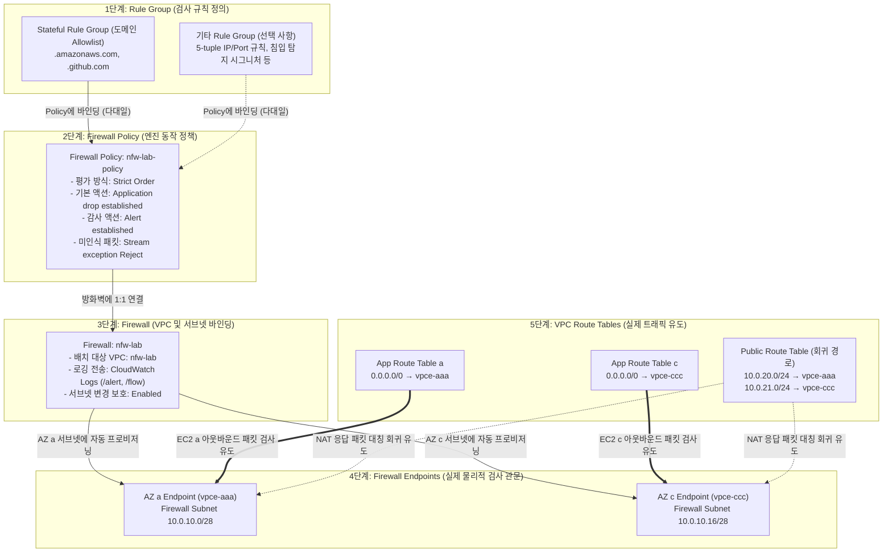
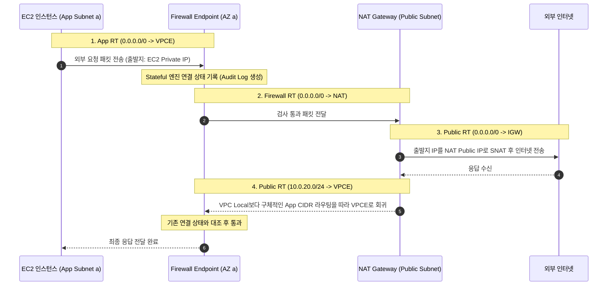

# 시나리오 2. 트래픽을 Firewall Endpoint로 유도하기

## 시나리오 개요 및 목표

VPC 내부의 Private Subnet에 위치한 애플리케이션이 외부 인터넷으로 나갈 때, 기존에는 NAT Gateway를 통해 직접 통신했습니다. 이 아웃바운드(Egress) 경로 중간에 AWS Network Firewall을 무중단으로 배치하여 모든 트래픽이 검사 지점을 거치도록 라우팅을 재구성해야 합니다.

이번 시나리오의 핵심 목표는 **서비스 중단 없이 기존 트래픽 경로를 방화벽 엔드포인트(Firewall Endpoint)로 전환하고, 트래픽을 차단하지 않는 감사(Audit) 모드로 전수 로깅을 확보하는 것**입니다.

| 구분 | 주요 내용 |
| --- | --- |
| **실습 목표** | 기존 NAT 경로 사이에 Network Firewall을 배치하여 무중단 라우팅 전환 및 전수 감사 로그(Audit) 수집 |
| **핵심 도구** | AWS Network Firewall, Gateway Load Balancer Endpoint(GWLB-E), VPC Route Table |
| **입력 상태** | AZ a, c의 Private Subnet에서 NAT Gateway로 인터넷에 접근 중인 EC2 2대, 실시간 연속 요청 스크립트(`egress-probe`) |
| **최종 달성 결과** | 서비스 단절 없이 양방향 트래픽이 방화벽을 대칭적으로 경유하고, CloudWatch Logs에 출발지 서버 IP와 목적지 도메인이 기록됨 |

---

## 핵심 아키텍처 원리 및 설계 판단

### 1. 방화벽 엔드포인트와 라우팅 테이블 제어

Security Group은 EC2의 네트워크 인터페이스(ENI)에 직접 결합되어 패킷을 제어합니다. 반면 AWS Network Firewall은 ENI에 붙는 것이 아니라, 지정한 서브넷마다 `vpce-` 형식의 **Firewall Endpoint**를 생성하고 **VPC 라우팅 테이블의 다음 홉(Target)**으로 이 엔드포인트를 지정하여 트래픽을 우회시키는 방식으로 동작합니다.

따라서 방화벽 인스턴스를 생성하더라도 라우팅 테이블을 수정하기 전까지는 실제 트래픽에 아무런 영향을 주지 않습니다.

### 2. 방화벽 리소스 간 연관관계

AWS Network Firewall은 단일 장비가 아니라, **설정 계층(Rule Group → Policy → Firewall)**과 **실제 트래픽 제어 계층(Firewall Endpoint ← Route Table)**이 단계적으로 결합되어 동작합니다.

아래 다이어그램은 상단의 검사 규칙이 정책과 방화벽을 거쳐 가용 영역별 엔드포인트로 프로비저닝되는 **설정 흐름(실선)**과, VPC 라우팅 테이블을 통해 실제 애플리케이션 패킷이 엔드포인트로 유입되는 **트래픽 흐름(굵은 이중선)**의 관계를 나타냅니다.



| 리소스 계층 | 핵심 질문 및 역할 | 본 실습 예시 | 왜 분리되어 있는가? (설계 이유) |
| --- | --- | --- | --- |
| **1. Rule Group** | "무엇을 검사하고 허용/차단할 것인가?" | `nfw-lab-egress-allow` (도메인 Allowlist) | 검사 규칙을 독립 모듈로 분리하여 여러 정책(Policy)에서 재사용하기 위함 |
| **2. Firewall Policy** | "규칙들을 어떤 순서와 기본 동작으로 실행할 것인가?" | `nfw-lab-policy` (Strict Order, Drop/Alert 설정) | 룰 그룹들의 실행 순서, 기본 Action(Drop/Alert), Stateless/Stateful 엔진 제어를 중앙 집중화하기 위함 |
| **3. Firewall** | "어느 VPC, 어느 서브넷들에 방화벽을 배치할 것인가?" | `nfw-lab` (VPC 연결, 로깅 설정) | 네트워크 배치 위치와 로깅 저장소(CloudWatch), 보호 옵션(삭제/서브넷 변경 방지)을 관리하기 위함 |
| **4. Firewall Endpoint** | 실제 네트워크 트래픽이 통과하는 L7 게이트웨이 | 가용 영역별 `vpce-...` (GWLB-E) | 가용 영역(AZ)별 독립적 장애 격리와 대칭 라우팅 경로를 제공하기 위함 |
| **5. Route Table** | "어떤 트래픽을 검사 관문으로 보낼 것인가?" | `nfw-lab-app-*`, `nfw-lab-public` | 서버 내부 설정을 건드리지 않고, VPC 서브넷 단위로 트래픽 인스펙션을 강제하기 위함 |

### 3. Firewall Endpoint와 Gateway Load Balancer의 관계

Network Firewall은 AWS 내부적으로 **Gateway Load Balancer(GWLB)** 기술을 기반으로 구현되어 있습니다. 따라서 생성된 엔드포인트의 리소스 타입도 **Gateway Load Balancer Endpoint**로 표기됩니다. 사용자가 직접 GWLB나 타깃 그룹을 배포하고 관리할 필요 없이, AWS가 완전 관리형(Managed)으로 제공합니다.

### 4. NAT Gateway 앞 배치를 통한 출발지 워크로드 IP 확보

방화벽을 배치하는 위치는 크게 두 가지가 있습니다.

- **NAT Gateway 앞 (본 실습 채택)**: 애플리케이션 서브넷과 NAT Gateway 사이에 배치합니다. 패킷이 NAT를 거치기 전이므로 방화벽 로그에 **EC2 인스턴스의 실제 Private IP**(`10.0.20.x`, `10.0.21.x`)가 출발지로 정확히 기록됩니다. 보안 감사 및 침해 사고 분석 시 어떤 인스턴스가 호출했는지 즉시 특정할 수 있습니다.
- **NAT Gateway 뒤**: NAT Gateway와 Internet Gateway 사이에 배치합니다. 이 경우 모든 Egress 트래픽의 출발지가 NAT Gateway의 IP로 변환되어 방화벽에 도달하므로, 로그만으로는 내부 워크로드 중 누가 해당 도메인을 호출했는지 알 수 없습니다.

### 5. 방화벽 전용 서브넷(Firewall Subnet) 분리 이유

VPC 라우팅 테이블은 서브넷 단위로 연결됩니다. Egress 트래픽 흐름에서 애플리케이션과 방화벽 엔드포인트는 동일한 `0.0.0.0/0` 목적지에 대해 서로 다른 다음 홉(Next Hop)을 가져야 합니다.

- **App Subnet의 라우팅**: 인터넷(`0.0.0.0/0`)으로 나갈 때 **Firewall Endpoint**를 바라보아야 합니다.
- **Firewall Subnet의 라우팅**: 검사를 마친 패킷(`0.0.0.0/0`)을 외부로 내보내기 위해 **NAT Gateway**를 바라보아야 합니다.

만약 엔드포인트를 App Subnet에 함께 두면 루프(Loop)가 발생하거나 VPC 로컬 라우팅 때문에 방화벽을 경유할 수 없게 됩니다. 따라서 엔드포인트만을 수용하기 위한 전용 서브넷(`10.0.10.0/28`, `10.0.10.16/28`)을 최소 단위인 `/28`로 분리하여 구성합니다.

### 6. 대칭 라우팅(Symmetric Routing)과 Stream Exception Policy

AWS Network Firewall의 Stateful 엔진은 커넥션 상태를 엔드포인트 메모리에서 추적합니다. 나가는 패킷(Outbound)이 AZ a의 엔드포인트를 통과했다면, 돌아오는 응답 패킷(Inbound Return) 역시 반드시 동일한 AZ a의 엔드포인트를 거쳐야 합니다.

만약 나갈 때는 방화벽을 거쳤는데 돌아올 때 우회하거나 다른 AZ의 엔드포인트로 인입되면, 방화벽은 해당 패킷을 비정상적인 흐름으로 판단하고 **Stream Exception Policy**에 따라 처리합니다.

- **Stream Exception Policy = Reject (권장 설정)**: 커넥션 상태를 알 수 없는 패킷을 감지하면 즉시 TCP RST(리셋)를 전송하여 클라이언트가 대기(Timeout)하지 않고 즉시 재연결을 시도하도록 합니다. 기본값인 Drop으로 둘 경우 연결이 타임아웃될 때까지 긴 지연이 발생할 수 있습니다.

---

## 정상 Egress 트래픽 처리 흐름

아래 시퀀스는 EC2 인스턴스(AZ a)가 외부 인터넷과 통신할 때 요청과 응답 패킷이 대칭적으로 흐르는 전체 과정입니다.



---

## 단계별 실습 가이드

본 실습은 [setup.md](./setup.md)의 배포를 완료한 상태에서 진행합니다.

| 리소스 구분 | 이름 및 식별자 | 비고 |
| --- | --- | --- |
| **VPC** | `nfw-lab` (`10.0.0.0/16`) | 기본 실습 VPC |
| **Firewall Subnet** | `nfw-lab-firewall-ap-northeast-2a`, `-2c` | 엔드포인트 배치 전용 (`/28`) |
| **Firewall Route Table** | `nfw-lab-firewall` | `0.0.0.0/0 → NAT Gateway` |
| **App Route Table** | `nfw-lab-app-ap-northeast-2a`, `-2c` | 전환 전: `0.0.0.0/0 → NAT Gateway` |
| **Public Route Table** | `nfw-lab-public` | 전환 전: `0.0.0.0/0 → IGW` |
| **EC2 인스턴스** | `nfw-lab-app-ap-northeast-2a`, `-2c` | SSM으로 접속하여 프로브 확인 |
| **Log Groups** | `/aws/network-firewall/nfw-lab/alert`, `/flow` | 감사 및 플로우 로그 저장소 |

> [!WARNING]
> 실습 진행 중에 `terraform apply`를 다시 실행하면 라우팅 테이블이 Terraform 코드의 초기 상태(NAT 직통)로 덮어씌워집니다. 실습이 완전히 끝날 때까지 apply를 실행하지 마십시오.

---

### 1단계. 방화벽 배치 대상 서브넷 및 라우팅 테이블 점검

**작업 목적**: Terraform이 사전에 프로비저닝한 방화벽 전용 서브넷과 라우팅 테이블이 올바르게 준비되어 있는지 점검합니다.

#### 1단계 콘솔 수행 절차

1. **VPC > Subnets**로 이동하여 검색창에 `nfw-lab-firewall`을 입력합니다.
   - `ap-northeast-2a`(`10.0.10.0/28`) 및 `ap-northeast-2c`(`10.0.10.16/28`) 서브넷 2개가 생성되어 있는지 확인합니다.
2. **VPC > Route tables**로 이동하여 `nfw-lab-firewall`을 선택하고 **Routes** 탭을 확인합니다.
   - `0.0.0.0/0`의 대상(Target)이 `nat-`로 지정되어 있어야 합니다. (방화벽 검사를 마친 패킷을 NAT로 보내는 경로)
3. 같은 화면의 **Subnet associations** 탭에서 위 1번의 방화벽 서브넷 2개가 정상 연결되어 있는지 확인합니다.
4. `nfw-lab-app-ap-northeast-2a`, `nfw-lab-app-ap-northeast-2c`의 **Routes** 탭을 확인합니다.
   - 현재는 `0.0.0.0/0` 대상이 `nat-`로 직접 연결되어 있습니다. (7단계에서 방화벽 엔드포인트로 전환 예정)
5. `nfw-lab-public`의 **Routes** 탭을 확인합니다.
   - `0.0.0.0/0 → igw-` 및 로컬 라우팅만 존재하는지 확인합니다.

#### 1단계 대체 CLI 명령어

아래 명령을 통해 방화벽 준비 상태 및 라우팅 테이블 구성을 한 번에 조회할 수 있습니다.

```bash
aws network-firewall list-firewalls --query 'Firewalls[].FirewallName'
aws ec2 describe-route-tables --filters Name=vpc-id,Values=$(terraform -chdir=terraform output -raw vpc_id) \
  --query 'RouteTables[].{name:Tags[?Key==`Name`]|[0].Value,routes:Routes[].[DestinationCidrBlock,NatGatewayId||GatewayId]}'
```

---

### 2단계. 기존 NAT Egress 경로 및 연속 프로브(Probe) 실행

**작업 목적**: 현재 서비스가 정상적으로 외부와 통신하고 있는지 확인하고, 이후 라우팅 전환 과정에서 트래픽 단절이 발생하는지 실시간으로 관측할 수 있도록 백그라운드 프로브 로그를 모니터링합니다.

#### 2단계 콘솔 및 터미널 수행 절차

1. **EC2 > Instances** 콘솔에서 `nfw-lab-app-ap-northeast-2a`를 선택하고 **Connect > Session Manager > Connect**를 클릭하여 세션을 엽니다.
2. 접속된 세션 터미널에서 아래 명령을 실행하여 실시간 HTTP 통신 상태를 모니터링합니다. (시나리오 3 실습 완료 시까지 창을 유지합니다.)

EC2 인스턴스에서 실행 중인 `egress-probe` 서비스의 실시간 로그를 출력합니다.

```bash
journalctl -u egress-probe -f -o cat
```

**정상 출력 예시**: 2초 간격으로 외부 도메인에 대한 HTTP 200 응답이 출력됩니다.

```text
06:08:41 checkip.amazonaws.com=200 www.google.com=200
06:08:43 checkip.amazonaws.com=200 www.google.com=200
```

1. 동일한 방식으로 `nfw-lab-app-ap-northeast-2c` 인스턴스에도 Session Manager로 접속하여 프로브 로그를 실행해 둡니다.

---

### 3단계. 감사(Audit) 전용 방화벽 정책(Firewall Policy) 생성

**작업 목적**: 트래픽을 차단하지 않고 모든 외부 연결을 CloudWatch Logs에 기록하는 감사 모드 방화벽 정책을 생성합니다. 트래픽의 실제 패턴을 파악하기 전에 차단 규칙을 적용하면 정상 서비스가 중단될 위험이 있기 때문입니다.

#### 핵심 정책 설정값 매트릭스

| 항목 | 권장 설정값 | 설정 이유 |
| --- | --- | --- |
| **Policy Name** | `nfw-lab-policy` | 방화벽 본체에 연결할 정책 식별자 |
| **Stream exception policy** | **Reject** | 상태를 모르는 패킷 인입 시 즉시 TCP RST를 응답하여 빠른 재연결 유도 |
| **Stateless default actions** | **Forward to stateful rules** | Stateless 규칙을 거치지 않고 모든 검사를 L7 Stateful 엔진에 위임 |
| **Active Threat Defense** | **비활성화 (체크 해제)** | 추가 과금(\$0.005/GB)이 발생하는 관리형 위협 인텔리전스 방어 옵션 제외 |
| **Rule evaluation order** | **Strict order** | 정의한 우선순위 순서대로 엄격히 평가 (생성 후 변경 불가) |
| **Stateful default actions: drop** | **선택 안 함 (None)** | 감사 모드이므로 어떠한 트래픽도 차단하지 않음 |
| **Stateful default actions: alert** | **Alert established 선택** | 정상 수립된 TCP 연결 흐름을 Alert 로그에 기록 |
| **Rule groups** | 없음 | 시나리오 3에서 도메인 허용 규칙 그룹 추가 예정 |

#### 3단계 콘솔 수행 절차

1. **VPC > Network Firewall > Firewall policies**로 이동하여 **Create firewall policy**를 클릭합니다.
2. **Name**에 `nfw-lab-policy`를 입력합니다.
3. **Stream exception policy**를 기본값(Drop)에서 **Reject**로 변경하고 **Next**를 누릅니다.
4. **Add rule groups** 화면의 **Stateless default actions**에서 Fragmented 및 Full 패킷 모두 **Forward to stateful rules**로 설정되어 있는지 확인합니다.
5. **Enable Active Threat Defense** 체크박스가 활성화되어 있다면 체크를 해제합니다.
6. **Stateful rule evaluation order and default actions** 영역에서 **Rule evaluation order**를 **Strict order**로 지정합니다.
7. **Drop action** 목록에서 선택된 항목을 모두 해제하거나 **None**을 선택합니다.
   > [!IMPORTANT]
   > 최신 콘솔에서는 `Application drop established (server-directed only)`가 기본 선택되어 있을 수 있습니다. 이를 반드시 해제해야 7단계 라우팅 전환 시 트래픽이 차단되지 않습니다.
8. **Alert action** 목록에서 **Alert established**만 선택합니다.
9. **Stateful rule groups** 및 **Stateless rule groups**는 빈 상태로 두고 **Next**를 누릅니다.
10. 나머지 고급 설정은 기본값으로 유지하고 최종 검토 후 **Create firewall policy**를 클릭합니다.

#### 3단계 대체 CLI 명령어

아래 CLI 명령을 실행하면 위 1~10단계의 설정을 한 번에 생성할 수 있습니다.

```bash
aws network-firewall create-firewall-policy --firewall-policy-name nfw-lab-policy \
  --firewall-policy '{
    "StatelessDefaultActions": ["aws:forward_to_sfe"],
    "StatelessFragmentDefaultActions": ["aws:forward_to_sfe"],
    "StatefulDefaultActions": ["aws:alert_established"],
    "StatefulEngineOptions": {"RuleOrder": "STRICT_ORDER", "StreamExceptionPolicy": "REJECT"}
  }'
```

---

### 4단계. Network Firewall 생성 및 AZ별 엔드포인트 프로비저닝

**작업 목적**: 앞서 생성한 정책(`nfw-lab-policy`)을 적용받는 방화벽 리소스를 생성하고, 가용 영역별 방화벽 서브넷에 엔드포인트를 프로비저닝합니다.

#### 4단계 콘솔 수행 절차

1. **VPC > Network Firewall > Firewalls**에서 **Create firewall**을 클릭합니다.
2. **Name**에 `nfw-lab`을 입력합니다.
3. **Attachment type**에서 **VPC**를 선택합니다.
4. **VPC** 드롭다운에서 `nfw-lab`을 선택합니다.
5. **Firewall subnets**에서 가용 영역별로 전용 서브넷을 매핑합니다.
   - `ap-northeast-2a`: `nfw-lab-firewall-ap-northeast-2a`
   - `ap-northeast-2c`: `nfw-lab-firewall-ap-northeast-2c`
   - *(주의: App 서브넷이나 Public 서브넷을 선택하지 마십시오.)*
6. **Associate firewall policy**에서 **Associate an existing firewall policy**를 선택하고 `nfw-lab-policy`를 지정합니다.
7. 보호 설정(Protection settings)을 점검합니다.
   - **Subnet change protection**: **선택 (Enabled)** (운영 중 서브넷 분리로 인한 엔드포인트 유실 및 트래픽 블랙홀 방지)
   - **Delete protection**: 해제 (실습 종료 후 삭제를 위함. 실제 운영 시에는 활성화 권장)
   - **Firewall policy change protection**: 해제
8. **Create firewall**을 클릭합니다.
9. 방화벽 상태가 **Provisioning**에서 **Ready**로 바뀔 때까지 기다립니다. (클라우드 환경에 따라 통상 4~6분 소요)
10. 생성이 완료되면 **Firewall details** 탭 하단의 **Firewall endpoints** 테이블에서 AZ a와 AZ c의 엔드포인트 ID(`vpce-...`)를 확인하고 복사해 둡니다. (7단계 라우팅 테이블 변경 시 사용)

#### 4단계 대체 CLI 명령어

Terraform 출력값을 읽어 방화벽을 프로비저닝하는 CLI 명령입니다.

```bash
POLICY_ARN=$(aws network-firewall describe-firewall-policy --firewall-policy-name nfw-lab-policy \
  --query 'FirewallPolicyResponse.FirewallPolicyArn' --output text)

aws network-firewall create-firewall --firewall-name nfw-lab \
  --firewall-policy-arn "$POLICY_ARN" \
  --vpc-id $(terraform -chdir=terraform output -raw vpc_id) \
  --subnet-mappings $(terraform -chdir=terraform output -json firewall_subnet_ids | jq -r '.[] | "SubnetId=" + .') \
  --subnet-change-protection
```

---

### 5단계. Alert 및 Flow 로깅과 모니터링 대시보드 활성화

**작업 목적**: 방화벽이 처리하는 L7 트래픽 이벤트(Alert) 및 네트워크 플로우(Flow)를 CloudWatch Logs로 전송하도록 설정하고, 콘솔 내장 모니터링 탭을 활성화합니다.

#### 5단계 콘솔 수행 절차

1. **Firewalls > nfw-lab**의 **Firewall details** 탭에서 **Logging** 영역의 **Edit**를 클릭합니다.
2. **Log type**에서 **Alert**와 **Flow**를 체크합니다.
   - **Alert** 대상: **CloudWatch log group** 선택 후 `/aws/network-firewall/nfw-lab/alert` 지정
   - **Flow** 대상: **CloudWatch log group** 선택 후 `/aws/network-firewall/nfw-lab/flow` 지정
3. **Firewall monitoring dashboard** 옵션에서 **Enable**을 선택합니다.
4. **Save**를 클릭합니다.
5. 2단계의 터미널 창을 확인하여 여전히 프로브가 `200`을 정상 출력하고 있는지 확인합니다. (아직 라우팅을 바꾸지 않았으므로 트래픽 영향 없음)

#### 5단계 대체 CLI 명령어

AWS CLI의 `update-logging-configuration`은 한 번 호출 시 로그 타입을 하나씩 등록해야 하므로, Alert 등록 후 Flow와 대시보드를 추가하는 방식으로 2회 호출합니다.

```bash
# Alert 로그 설정 등록
aws network-firewall update-logging-configuration --firewall-name nfw-lab \
  --logging-configuration '{"LogDestinationConfigs":[{"LogType":"ALERT","LogDestinationType":"CloudWatchLogs","LogDestination":{"logGroup":"/aws/network-firewall/nfw-lab/alert"}}]}'

# Flow 로그 추가 및 콘솔 모니터링 대시보드 활성화
aws network-firewall update-logging-configuration --firewall-name nfw-lab \
  --logging-configuration '{"LogDestinationConfigs":[{"LogType":"ALERT","LogDestinationType":"CloudWatchLogs","LogDestination":{"logGroup":"/aws/network-firewall/nfw-lab/alert"}},{"LogType":"FLOW","LogDestinationType":"CloudWatchLogs","LogDestination":{"logGroup":"/aws/network-firewall/nfw-lab/flow"}}]}' \
  --enable-monitoring-dashboard
```

---

### 6단계. 라우팅 전환 전 방화벽 및 정책 사전 검증

**작업 목적**: 라우팅 테이블을 변경하는 순간부터 실제 트래픽이 방화벽을 통과하므로, 의도치 않은 패킷 차단 옵션이 켜져 있지 않은지 사전에 철저히 검증합니다.

#### 필수 체크리스트

- [ ] **Firewalls > nfw-lab**: 방화벽 상태가 **Ready**이고, AZ a/c 엔드포인트가 모두 정상 생성되었는가?
- [ ] **Firewall policies > nfw-lab-policy**: **Drop action**이 완전히 비어 있거나 `None`인가? (Drop이 켜져 있으면 전환 즉시 서비스 통신 두절)
- [ ] **Default alert action**에 `Alert established`가 등록되어 있는가?
- [ ] **Stream exception policy**가 `Reject`로 설정되어 있는가?

#### 6단계 대체 CLI 명령어

```bash
aws network-firewall describe-firewall --firewall-name nfw-lab \
  --query '{status:FirewallStatus.Status,endpoints:FirewallStatus.SyncStates.*.Attachment.[SubnetId,EndpointId,Status]}'

aws network-firewall describe-firewall-policy --firewall-policy-name nfw-lab-policy \
  --query 'FirewallPolicy.{default:StatefulDefaultActions,engine:StatefulEngineOptions,ruleGroups:StatefulRuleGroupReferences}'
```

---

### 7단계. 라우팅 테이블 전환 및 방화벽 경유 검증

**작업 목적**: 트래픽의 실제 경로를 Firewall Endpoint로 유도합니다. 이때 **비대칭 라우팅(Asymmetric Routing)으로 인한 패킷 유실을 막기 위해 가용 영역(AZ) 단위로 회귀 경로와 출발 경로를 연속해서 전환**해야 합니다.

> [!CAUTION] 비대칭 라우팅과 전환 순서 주의
>
> - Public Route Table에 응답 경로(`App CIDR → VPCE`)를 먼저 추가하지 않은 채 App Route Table만 변경하면, 응답 패킷이 방화벽을 우회하여 통신이 끊어집니다.
> - 반대로 모든 AZ의 응답 경로를 미리 넣어두고 출발 경로 변경을 지연시키면, 나갈 때는 NAT로 가고 들어올 때만 방화벽으로 들어오는 비대칭 상태가 되어 새 연결이 즉시 실패합니다.
> - 따라서 **AZ a의 응답 경로 추가 직후 AZ a의 출발 경로를 변경하고, 이어서 AZ c를 동일하게 순차 진행**해야 서비스 영향도를 최소화할 수 있습니다.

#### 7단계 콘솔 수행 절차

1. **AZ a 경로 전환**:
   1. **VPC > Route tables > nfw-lab-public**을 선택하고 **Routes > Edit routes**를 클릭합니다.
   2. 대상에 `10.0.20.0/24`(App a CIDR), 타깃 종류로 **Gateway Load Balancer Endpoint**를 선택하고 **AZ a의 Firewall Endpoint ID**를 지정한 뒤 저장합니다.
   3. **즉시** **nfw-lab-app-ap-northeast-2a** 라우팅 테이블로 이동하여 `0.0.0.0/0`의 타깃을 **Gateway Load Balancer Endpoint** → **AZ a의 Firewall Endpoint ID**로 수정하고 저장합니다.
   4. 2단계의 AZ a 프로브 터미널을 확인합니다. 두 작업 사이 수 초의 전환 구간 동안 1~2회의 일시적 실패(`000`)가 발생할 수 있으나, 전환 즉시 `200` 정상 상태로 복구되어야 합니다.
2. **AZ c 경로 전환**:
   1. **nfw-lab-public** 라우팅 테이블에 `10.0.21.0/24`(App c CIDR) → **AZ c의 Firewall Endpoint ID** 경로를 추가하고 저장합니다.
   2. **즉시** **nfw-lab-app-ap-northeast-2c** 라우팅 테이블의 `0.0.0.0/0` 타깃을 **AZ c의 Firewall Endpoint ID**로 수정하고 저장합니다.
   3. AZ c 프로브 터미널에서 통신이 정상 유지되는지 확인합니다.

#### 7단계 대체 CLI 명령어

```bash
PUBLIC_RT_ID=$(terraform -chdir=terraform output -raw public_route_table_id)
APP_A_RT_ID=$(terraform -chdir=terraform output -json app_route_table_ids | jq -r '."ap-northeast-2a"')
APP_C_RT_ID=$(terraform -chdir=terraform output -json app_route_table_ids | jq -r '."ap-northeast-2c"')
EP_A=$(aws network-firewall describe-firewall --firewall-name nfw-lab --query 'FirewallStatus.SyncStates."ap-northeast-2a".Attachment.EndpointId' --output text)
EP_C=$(aws network-firewall describe-firewall --firewall-name nfw-lab --query 'FirewallStatus.SyncStates."ap-northeast-2c".Attachment.EndpointId' --output text)

# AZ a 라우팅 연속 전환
aws ec2 create-route --route-table-id "$PUBLIC_RT_ID" --destination-cidr-block 10.0.20.0/24 --vpc-endpoint-id "$EP_A"
aws ec2 replace-route --route-table-id "$APP_A_RT_ID" --destination-cidr-block 0.0.0.0/0 --vpc-endpoint-id "$EP_A"

# AZ c 라우팅 연속 전환
aws ec2 create-route --route-table-id "$PUBLIC_RT_ID" --destination-cidr-block 10.0.21.0/24 --vpc-endpoint-id "$EP_C"
aws ec2 replace-route --route-table-id "$APP_C_RT_ID" --destination-cidr-block 0.0.0.0/0 --vpc-endpoint-id "$EP_C"
```

#### 7단계 전환 결과 검증

1. **감사 로그 확인 (약 3~5분 후)**:
   - **CloudWatch > Log groups > /aws/network-firewall/nfw-lab/alert**로 이동합니다.
   - `event.alert.action`이 `allowed`로 기록되는 로그들을 확인합니다.
   - `event.src_ip`에 NAT IP가 아닌 실제 EC2 인스턴스의 Private IP(`10.0.20.x`, `10.0.21.x`)가 출력되는지 확인합니다.
   - `event.tls.sni`에 프로브 대상 도메인(`checkip.amazonaws.com`, `www.google.com`)이 명확히 수집되는지 검증합니다.
2. **CloudWatch 메트릭 확인**:
   - **CloudWatch > Metrics > NetworkFirewall**에서 `ReceivedPackets` 지표가 AZ a와 AZ c 양쪽에서 모두 상승하는지 확인합니다.

---

### 8단계. 비상 롤백(Rollback) 절차

**작업 목적**: 라우팅 전환 후 서비스 장애가 감지되었을 때 수 초 이내에 기존 NAT 직통 경로로 되돌리는 절차를 숙지합니다.

> [!NOTE]
> 본 실습에서는 다음 시나리오(시나리오 3, 4)를 계속 진행해야 하므로 **지금은 롤백을 실행하지 마십시오**. 실습이 끝난 후 정리 단계([setup.md의 Down](./setup.md#down))에서 본 절차를 활용합니다.

1. **App Route Table 원복**:
   - `nfw-lab-app-ap-northeast-2a` 및 `nfw-lab-app-ap-northeast-2c`의 `0.0.0.0/0` 타깃을 기존 **NAT Gateway**(`nat-...`)로 변경합니다.
2. **Public Route Table 응답 경로 제거**:
   - `nfw-lab-public` 라우팅 테이블에서 7단계 때 추가했던 `10.0.20.0/24` 및 `10.0.21.0/24` 엔드포인트 라우팅을 삭제합니다.

---

## 부록: 실무 시사점 및 운영 팁

- **신속한 롤백 설계**: 방화벽 리소스 자체의 생성(약 5분)과 삭제(약 4분)는 시간이 다소 걸립니다. 하지만 라우팅 테이블 변경은 수 초 이내에 즉시 반영되고 되돌릴 수 있습니다. 따라서 점검 작업 시 방화벽을 미리 배포해 둔 상태에서 라우팅 스위칭만으로 안전하게 전환 및 롤백을 통제하는 것이 실무 표준입니다.
- **기존 활성 커넥션(Long-lived Connection) 주의**: 라우팅이 전환되는 순간 이전에 이미 연결되어 있던 장기 세션(DB 커넥션 풀 등)은 방화벽 엔진에 초기 핸드셰이크 상태가 없으므로 `Stream Exception Policy`에 걸릴 수 있습니다. 짧은 HTTP 요청 위주인 웹 서비스는 영향이 극히 드물지만, 영속 커넥션이 많은 서비스는 애플리케이션 재시작 또는 트래픽 최소화 시간대에 컷오버를 진행해야 합니다. (실측 및 세부 분석은 [knowledge topic](../knowledge/topics/route-cutover-existing-flows.md) 참고)
- **감사 모드(Alert-only) 선행의 필수성**: 기본 폴리시 생성 시 Drop 옵션이 하나라도 켜져 있으면 라우팅을 전환하는 즉시 모든 외부 트래픽이 차단됩니다. 반드시 Alert 전용 정책으로 시작하여 베이스라인 로그를 먼저 수집해야 합니다.

---

## 참고 문서

1. [AWS Network Firewall Developer Guide](https://docs.aws.amazon.com/network-firewall/latest/developerguide/)
2. [Asymmetric routing and AWS Network Firewall](https://docs.aws.amazon.com/network-firewall/latest/developerguide/asymmetric-routing.html)
3. [Stream exception policy in AWS Network Firewall](https://docs.aws.amazon.com/network-firewall/latest/developerguide/stream-exception-policy.html)
