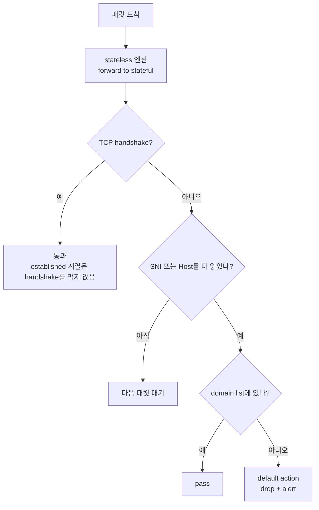

# 시나리오 3. 도메인 허용 목록으로 egress 막기

## 이 시나리오의 목표

| 항목 | 내용 |
| --- | --- |
| 기능 | 목적지 도메인으로 나가는 트래픽 허용과 차단 |
| 쓰는 도구 | firewall policy의 strict order와 stateful default action, stateful domain list rule group |
| 입력 | 시나리오 2에서 route를 바꾼 firewall `nfw-lab`, 허용할 도메인 `.amazonaws.com`, `.github.com` |
| 작업 | 실습 1~2단계: 허용 목록 추가, default action에 drop 추가 |
| 달성할 것 | `www.google.com`, `example.com`은 timeout, `checkip.amazonaws.com`, `github.com`, Session Manager는 그대로 동작 |

## 도메인 필터링은 handshake 뒤에 판단하는 기능이다

firewall은 DNS 질의가 아니라 연결 내부의 서버 이름을 검사합니다. HTTPS는 TLS ClientHello의 SNI, HTTP는 요청 헤더의 Host입니다. 둘 다 TCP 3-way handshake가 끝난 다음에 오므로, firewall은 handshake를 먼저 통과시켜야 도메인을 판단할 수 있습니다. 이 순서가 default action 선택을 결정합니다.

이 기능이 다루지 않는 것도 있습니다. TLS 안의 URL 경로는 TLS inspection을 켜지 않으면 보지 못하고, ECH(Encrypted Client Hello)로 SNI를 숨긴 연결은 도메인으로 판단할 수 없습니다.

### 용어

| 용어 | 뜻 | 이 실습의 예 |
| --- | --- | --- |
| Stateless 엔진 | 패킷 하나씩 우선순위대로 보고 처음 맞는 규칙에서 멈춤. NACL과 같은 방식 | default action **Forward to stateful rules**(`aws:forward_to_sfe`) |
| Stateful 엔진 | Suricata 호환 엔진. 흐름을 추적하고 TLS, HTTP를 읽음. 2026-07-20에 Suricata 8.0.3으로 올라감 | 모든 판단을 여기서 함 |
| Rule group | 실제 규칙. capacity와 타입은 만든 뒤 바꿀 수 없음 | `nfw-lab-egress-allow`, capacity `100` |
| Domain list | `TLS_SNI`, `HTTP_HOST`로 도메인을 허용하거나 차단하는 stateful 규칙 형식 | `.amazonaws.com`, `.github.com` |
| Strict order | rule group을 priority 순서로, 규칙은 쓴 순서대로 평가. policy를 만든 뒤 바꿀 수 없음 | `nfw-lab-policy` |
| Stateful default action | strict order에서 어떤 규칙에도 맞지 않은 트래픽의 처리 | `aws:drop_established_app_layer_to_server` |

stateful 규칙은 domain list 말고도 5-tuple(프로토콜, IP, 포트) 형식과 Suricata 규칙 문자열(`geoip`, `ja4`, `http.uri` 등)로 쓸 수 있습니다. AWS managed rule group(위협 시그니처, 악성 도메인 목록)과 2026-01에 나온 도메인 카테고리 필터링(`aws_domain_category`)도 있습니다.

## 도메인으로 막아야 하는 이유

서버가 실제로 나가야 하는 곳은 AWS API, 패키지 저장소, 코드 저장소처럼 몇 개의 도메인입니다. 이 도메인들은 CDN 뒤에 있어 IP가 계속 바뀌므로, security group에 IP를 적는 방식은 언젠가 서비스를 끊거나 너무 넓게 엽니다. 반대로 아무것도 막지 않으면 침해된 서버가 임의의 외부 서버로 데이터를 보내도 네트워크에서 막을 수 없습니다. 도메인 허용 목록은 "나가야 하는 곳"을 사람이 읽을 수 있는 이름으로 유지하게 합니다.

## 대안 비교

| 방식 | 판단 기준 | 우회 가능성 | 이 실습에서 고르지 않은 이유 |
| --- | --- | --- | --- |
| Network Firewall domain list | SNI, Host | ECH, SNI와 다른 Host로 접속하는 domain fronting | 고름 |
| Route 53 Resolver DNS Firewall | DNS 질의 | IP로 직접 접속하거나 다른 DNS 서버 사용 | 연결 자체는 막지 못함 |
| Suricata 규칙 직접 작성 | 무엇이든 | 규칙에 따라 다름 | domain list로 충분하고 규칙 관리 부담이 큼 |
| 프록시 서버 | 프록시가 받은 요청 | 프록시 설정을 무시하는 프로세스 | 시나리오 2의 대안 비교와 같음 |

## 컴포넌트 역할

| 컴포넌트 | 역할 |
| --- | --- |
| stateless default action | **Forward to stateful rules**. stateless 규칙은 방향마다 따로 써야 해서 비대칭이 생기므로 판단을 stateful 엔진에 넘김 |
| domain list rule group (Allow) | 목록의 도메인을 pass. strict order에서는 목록에 없는 도메인을 막는 규칙을 만들지 않음 |
| stateful default action (drop) | 어떤 규칙에도 맞지 않은 흐름을 막음. 실제로 차단하는 주체 |
| stateful default action (alert) | 막거나 허용한 흐름을 alert 로그로 남김. drop 하나와 alert 하나를 함께 고름 |

stateful default action은 네 가지입니다.

| default action | API 값 | 동작 |
| --- | --- | --- |
| Drop all | `aws:drop_strict` | 맞는 규칙이 없으면 TCP handshake부터 막음 |
| Drop established | `aws:drop_established` | handshake는 통과시키고, 연결이 맺어진 뒤 맞는 규칙이 없으면 막음 |
| Application drop established | `aws:drop_established_app_layer` | SNI나 Host를 다 읽을 때까지 기다린 뒤 막음 |
| Application drop established (server-directed only) | `aws:drop_established_app_layer_to_server` | 위와 같지만 client→server 방향만 막음. 2026-06-22부터 새 policy의 기본값 |

- **Drop all**은 SYN에 맞는 규칙이 없어서 handshake부터 막으므로 domain list가 평가될 기회가 없습니다.
- **Drop established**는 ClientHello가 패킷 여러 개로 쪼개지면 첫 조각에서 SNI를 못 찾고 막을 수 있습니다.
- 2026-06에 기본값이 server-directed only로 바뀐 이유는 양방향 버전이 server→client 방향의 window update, keep-alive, RST까지 막았기 때문입니다.

Action order policy에서는 Allow domain list가 목록에 없는 HTTP, TLS를 막는 규칙을 함께 만듭니다. strict order에서는 이 암묵적 deny가 없어서, Allow 목록만 넣고 default action을 alert로 두면 아무것도 막히지 않습니다. 실습 1단계가 이것을 보여 줍니다.

## 흐름



## 실습

시나리오 2의 7단계까지 마친 상태에서 시작하며, probe 세션 두 개를 계속 유지합니다.

### 1. 허용 목록 추가 후 default action 동작 확인 (약 3분)

1. **VPC > Network Firewall > Network Firewall rule groups**에서 **Create rule group**을 누릅니다.
2. 타입은 **Stateful rule group**, 형식은 **Domain list**를 고릅니다.
3. 이름을 `nfw-lab-egress-allow`, **Capacity**를 `100`으로 입력합니다.
4. **Stateful rule evaluation order**를 **Strict order**로 둡니다. policy와 같아야 연결할 수 있습니다.
5. **Domain list**에 두 줄을 입력합니다.
   - `.amazonaws.com`
   - `.github.com`
6. **Protocols**에서 **HTTP**와 **HTTPS**를 모두 고르고, **Action**은 **Allow**를 고릅니다.
7. **Create rule group**을 누릅니다.
8. **Firewall policies > nfw-lab-policy > Stateful rule groups > Actions > Add unmanaged stateful rule groups**에서 `nfw-lab-egress-allow`를 추가합니다.
9. **Firewalls > nfw-lab**에서 configuration sync가 끝날 때까지 기다립니다.
   - 실측 약 55초 걸렸습니다.
10. probe 출력의 응답 코드를 확인합니다.
    - `www.google.com`은 허용 목록에 없지만 default action이 drop이 아니므로 `200`이 그대로 출력됩니다.

`.amazonaws.com`처럼 점으로 시작하면 모든 하위 도메인이 맞습니다. SSM agent가 쓰는 `ssm`, `ssmmessages`, `ec2messages.ap-northeast-2.amazonaws.com`도 여기에 들어가므로 Session Manager 창이 유지됩니다.

### 2. default action drop 활성화 및 차단 검증 (약 3분)

1. **Firewall policies > nfw-lab-policy > Stateful rule evaluation order and default actions > Edit**를 누릅니다.
2. drop은 **Application drop established (server-directed only)**를 고릅니다.
3. alert는 **Alert established**를 해제하고 **Application alert established (server-directed only)**를 고릅니다.
   - established와 Application established 계열은 섞어 고를 수 없습니다.
4. **Save**를 누릅니다.
5. probe 출력의 응답 코드를 확인합니다.
   - 저장하고 약 45초 뒤부터 `www.google.com=000`으로 바뀝니다. `000`은 curl이 응답을 받지 못했다는 뜻입니다.
6. probe 창에서 `Ctrl+C`로 빠져나와 아래 명령으로 막힌 모습을 직접 확인합니다.
7. 3~5분 뒤 alert log group에서 `"blocked"`로 검색합니다.
   - `event.alert.action`이 `blocked`, `event.verdict.action`이 `drop`, `event.alert.signature`가 `aws:alert_established_app_layer_to_server action`입니다.
   - `event.ts_progress`가 `client_hello_done`입니다. ClientHello를 다 읽은 뒤 SNI로 판단했다는 뜻입니다.

5단계의 probe 출력이며, 시각은 실행마다 다릅니다.

```text
06:14:20 checkip.amazonaws.com=200 www.google.com=200
06:14:25 checkip.amazonaws.com=200 www.google.com=000
```

6단계에서 실행하는 명령입니다.

```bash
for u in https://github.com https://www.google.com http://example.com; do
  curl -sS -o /dev/null -m 5 -w "$u=%{http_code}\n" "$u"
done
```

6단계의 실측 출력입니다. HTTPS는 ClientHello가 버려져 TLS handshake가 끝나지 않고, HTTP는 TCP 연결은 맺어진 뒤 요청이 버려집니다.

```text
https://github.com=200
curl: (28) Connection timed out after 5002 milliseconds
https://www.google.com=000
curl: (28) Operation timed out after 5002 milliseconds with 0 bytes received
http://example.com=000
```

7단계에서 본 alert 로그 한 줄의 주요 필드입니다. `pkt_src`의 `geneve encapsulation`은 Gateway Load Balancer가 GENEVE로 감싸 firewall로 보낸 패킷이라는 뜻입니다.

```json
{
  "firewall_name": "nfw-lab",
  "availability_zone": "ap-northeast-2a",
  "event": {
    "event_type": "alert",
    "src_ip": "10.0.20.100",
    "dest_ip": "142.251.153.119",
    "dest_port": 443,
    "app_proto": "tls",
    "alert": {
      "action": "blocked",
      "signature": "aws:alert_established_app_layer_to_server action"
    },
    "verdict": { "action": "drop" },
    "tls": { "sni": "www.google.com", "version": "TLS 1.3" },
    "ts_progress": "client_hello_done",
    "pkt_src": "geneve encapsulation",
    "direction": "to_server"
  }
}
```

firewall은 다음 시나리오에서 대시보드로 보기 위해 지우지 않고 둡니다.

## 부록. 실무 시사점

- domain이 비어 있는 `blocked` 기록이 나옵니다. 실측에서는 `event.app_proto`가 `ntp`인 UDP 123이었습니다. drop established 계열은 TLS, HTTP가 아닌 트래픽도 막으므로, 허용 목록을 만들 때 도메인 밖의 트래픽을 5-tuple 규칙으로 따로 봐야 합니다. Amazon Linux 2023은 `169.254.169.123`(Amazon Time Sync)으로 시간을 맞추고 이 주소는 firewall을 지나지 않아 영향이 없었습니다.
- policy 변경은 저장 후 약 45~55초 뒤에 반영됩니다. 규칙 변경은 이미 허용된 흐름에 적용되지 않으므로, 새로 막은 도메인의 기존 연결까지 끊으려면 flow flush를 실행합니다.
- 허용 목록 추가와 drop 전환이 별도 단계라서, 허용 목록을 넣은 뒤 alert 로그로 "막힐 트래픽"을 미리 볼 수 있습니다. 운영 적용 순서는 [5-production-rollout.md](./5-production-rollout.md)에 있습니다.

## 참고 문서

1. Stateful default actions, <https://docs.aws.amazon.com/network-firewall/latest/developerguide/firewall-policy-settings.html>
2. Default drop action 변경 공지 (2026-06), <https://aws.amazon.com/about-aws/whats-new/2026/06/aws-network-firewall-updates-default-drop-action/>
3. AWS Network Firewall Developer Guide, <https://docs.aws.amazon.com/network-firewall/latest/developerguide/>
