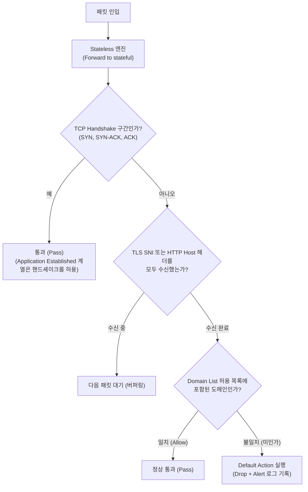

# 시나리오 3. 도메인 허용 목록(Allowlist) 기반 Egress 트래픽 차단

## 시나리오 개요 및 목표

시나리오 2를 통해 VPC의 모든 Egress 트래픽을 Network Firewall로 유도하고 무중단 감사(Audit) 모드를 구축했습니다. 이제 수집된 트래픽 기록을 바탕으로 인가된 외부 서비스 도메인만 통과시키고, 인가되지 않은 외부 접근을 네트워크 레벨에서 원천 차단(Drop)하는 방화벽 정책을 수립해야 합니다.

이번 시나리오의 핵심 목표는 **Strict Order 방식의 방화벽 정책에 도메인 허용 목록(Domain Allowlist) Rule Group을 적용하고, Default Action을 Drop으로 전환하여 인가된 도메인 외의 모든 아웃바운드 연결을 안전하게 차단하는 것**입니다.

| 구분 | 주요 내용 |
| --- | --- |
| **실습 목표** | 도메인 허용 목록(Allowlist) 기반의 Stateful Rule Group을 구성하고, Default Action Drop을 통해 비인가 Egress 차단 구현 |
| **핵심 도구** | Stateful Domain List Rule Group, Stateful Default Actions (`Application drop established`) |
| **입력 상태** | 시나리오 2에서 라우팅 전환을 완료한 방화벽(`nfw-lab`), 백그라운드 프로브가 실행 중인 EC2 2대 |
| **최종 달성 결과** | 허용 도메인(`checkip.amazonaws.com`, `.github.com`, AWS SSM)은 정상 통신을 유지하고, 미허용 도메인(`www.google.com`, `example.com`)은 타임아웃으로 차단되며 차단 로그가 남음 |

---

## 핵심 아키텍처 원리 및 설계 판단

### 1. L7 도메인 필터링과 TCP 핸드셰이크의 관계

Network Firewall은 DNS 질의 단계가 아니라, 실제 네트워크 패킷 내부의 애플리케이션 계층(L7) 서버 식별 정보를 검사합니다.

- **HTTPS 트래픽**: TLS ClientHello 메시지의 **SNI (Server Name Indication)** 헤더를 검사합니다.
- **HTTP 트래픽**: HTTP 요청 헤더의 **Host** 값을 검사합니다.

중요한 점은 **SNI와 Host 헤더 모두 TCP 3-way Handshake가 정상 완료된 이후에 전달된다**는 사실입니다. 따라서 도메인을 검사하려면 방화벽이 TCP 핸드셰이크 단계(SYN, SYN-ACK, ACK)를 먼저 통과시켜 주어야 합니다. 이 원리가 Default Drop 액션을 선택할 때 핵심 기준이 됩니다.



### 2. Stateful Default Action의 동작 방식 비교

Strict Order 평가 방식에서는 룰 그룹의 어떤 규칙과도 일치하지 않는 트래픽을 어떻게 처리할지 결정하는 **Default Action**을 제공합니다.

| Default Action 종류 | API 식별자 | 동작 원리 및 평가 |
| --- | --- | --- |
| **Drop all** | `aws:drop_strict` | TCP SYN 패킷부터 즉시 차단합니다. SYN 패킷에는 도메인 정보가 없으므로 도메인 허용 목록을 평가할 기회조차 갖지 못하고 **모든 TCP 연결이 전면 차단**됩니다. |
| **Drop established** | `aws:drop_established` | 핸드셰이크 직후부터 차단합니다. 만약 ClientHello가 여러 패킷으로 쪼개져 첫 패킷에서 SNI를 파싱하지 못하면 정상 도메인임에도 오차단될 위험이 있습니다. |
| **Application drop established (server-directed only)** (권장 표준 설정) | `aws:drop_established_app_layer_to_server` | TCP 핸드셰이크를 허용하고, **L7 SNI/Host 헤더를 끝까지 읽은 뒤 허용 목록에 없으면 클라이언트→서버 방향의 패킷만 선별 차단**합니다. 양방향 제어 패킷(RST, Window Update 등)을 차단하지 않아 네트워크 안정성이 가장 우수합니다. |

### 3. Strict Order에서 Allow 규칙과 차단의 분리

이전 세대의 Action Order(Default Order) 정책에서는 Domain List에 Allow를 지정하면 목록 외의 도메인에 대해 '암묵적 거부(Implicit Deny)' 규칙이 자동 생성되었습니다.

하지만 본 실습에서 채택한 **Strict Order** 방식에서는 암묵적 차단이 동작하지 않습니다. Allow 규칙은 단지 일치하는 트래픽을 통과시킬 뿐이며, **목록에 없는 트래픽을 실제로 차단하는 주체는 Stateful Default Action(Drop)**입니다.

덕분에 운영 환경에서는 **도메인 허용 목록을 먼저 등록하여 정상 트래픽이 매칭되는지 확인한 뒤, 다음 단계에서 Drop 액션을 켬으로써 무중단으로 단계적 차단을 적용**할 수 있습니다.

---

## 컴포넌트 구성 요소 요약

| 구성 요소 | 역할 및 동작 |
| --- | --- |
| **Stateless Default Action** | `Forward to stateful rules`. Stateless 규칙은 양방향을 수동 정의해야 하므로 관리가 복잡해지므로 모든 판단을 L7 Stateful 엔진으로 위임합니다. |
| **Domain List Rule Group** | `.amazonaws.com`, `.github.com` 등 업무 필수 도메인을 등록하여 매칭 시 트래픽을 Pass 시킵니다. |
| **Stateful Default Drop Action** | `Application drop established (server-directed only)`. 허용 목록에 매칭되지 않은 모든 외부 연결을 차단합니다. |
| **Stateful Default Alert Action** | `Application alert established (server-directed only)`. 차단된 연결에 대해 출발지 IP와 도메인 정보를 Alert 로그로 남깁니다. (Drop과 동일 계열 지정 필수) |

---

## 단계별 실습 가이드

본 실습은 시나리오 2의 7단계를 완료하여 프로브 세션(AZ a, c)이 정상 구동 중인 상태에서 진행합니다.

---

### 1단계. 도메인 허용 목록(Allowlist) Rule Group 추가 및 동작 확인

**작업 목적**: 서비스에 필수적인 도메인 허용 목록을 Rule Group으로 등록하고 방화벽 정책에 바인딩합니다. Strict Order 특성상 아직 Default Drop을 켜지 않았으므로 허용 목록 외의 도메인도 계속 정상 통신되는지 확인합니다.

#### 1단계 콘솔 수행 절차

1. **VPC > Network Firewall > Network Firewall rule groups**로 이동하여 **Create rule group**을 클릭합니다.
2. 기본 설정:
   - **Type**: **Stateful rule group**
   - **Capacity**: `100` (예상 도메인 수에 맞춰 충분히 지정. 생성 후 용량 증설 불가)
   - **Name**: `nfw-lab-egress-allow`
   - **Rule evaluation order**: **Strict order** (방화벽 정책과 일치해야 연결 가능)
3. **Stateful rule group options**에서 **Domain list** 형식을 선택합니다.
4. **Domain list** 입력창에 허용할 도메인을 입력합니다.
   - `.amazonaws.com` (앞에 점(`.`)을 붙이면 모든 서브도메인이 포함되어 SSM 에이전트 및 AWS API 정상 작동)
   - `.github.com`
5. **Protocols**: **HTTP**, **HTTPS** 모두 선택합니다.
6. **Actions**: **Allow**를 선택합니다.
7. **Create rule group**을 클릭합니다.
8. 정책 연결:
   - **Firewall policies > nfw-lab-policy**를 엽니다.
   - **Stateful rule groups** 섹션의 **Actions > Add unmanaged stateful rule groups**를 클릭합니다.
   - 방금 생성한 `nfw-lab-egress-allow`를 선택하고 **Add rule group**을 클릭합니다.
9. **Firewalls > nfw-lab**으로 이동하여 설정 동기화(**Configuration sync status**)가 **In sync**로 완료될 때까지 대기합니다. (약 1분 소요)
10. 프로브 터미널을 확인합니다.
    - `www.google.com`은 허용 목록에 없지만, 아직 Default Drop을 켜지 않았으므로 여전히 `200` 정상 응답을 출력합니다.

---

### 2단계. Default Action Drop 활성화 및 미인가 도메인 차단 검증

**작업 목적**: 허용 목록 외의 모든 Egress 트래픽을 차단하는 Default Drop 액션을 활성화하고, 허용 도메인은 통과하며 미허용 도메인은 즉시 차단되는지 실시간으로 검증합니다.

#### 2단계 콘솔 수행 절차

1. **Firewall policies > nfw-lab-policy**로 이동합니다.
2. **Stateful rule evaluation order and default actions** 섹션의 **Edit**를 클릭합니다.
3. **Drop action**: **Application drop established (server-directed only)**를 선택합니다.
4. **Alert action**: 기존 `Alert established`를 체크 해제하고, Drop과 동일한 계열인 **Application alert established (server-directed only)**를 선택합니다.
   > [!NOTE]
   > Alert 액션과 Drop 액션은 계열(General Established vs Application Established)이 일치해야 설정 저장이 가능합니다.
5. **Save**를 클릭합니다.
6. 정책 변경이 엔드포인트에 동기화되는 약 30~50초 후부터 프로브 터미널의 출력을 확인합니다.
   - `checkip.amazonaws.com`은 계속 `200`을 유지합니다.
   - `www.google.com`의 응답 코드가 `000`(연결 실패 및 타임아웃)으로 변경됩니다.

```text
# 프로브 터미널 출력 변화 예시
06:14:20 checkip.amazonaws.com=200 www.google.com=200
06:14:25 checkip.amazonaws.com=200 www.google.com=000
```

#### 명령어를 통한 명시적 차단 검증

프로브 터미널에서 `Ctrl + C`로 로그 출력을 일시 종료한 후, 아래 명령어를 실행하여 도메인별 응답 동작을 직접 비교합니다.

다양한 외부 도메인에 대해 HTTP 응답 코드를 확인합니다.

```bash
for u in https://github.com https://www.google.com http://example.com; do
  curl -sS -o /dev/null -m 5 -w "$u=%{http_code}\n" "$u"
done
```

**실제 실행 결과**:

```text
https://github.com=200
curl: (28) Connection timed out after 5002 milliseconds
https://www.google.com=000
curl: (28) Operation timed out after 5002 milliseconds with 0 bytes received
http://example.com=000
```

- `github.com`: 허용 목록(`.github.com`)에 매칭되어 `200` 정상 통과.
- `google.com` (HTTPS): TCP 3-way 핸드셰이크는 맺어졌으나 방화벽이 ClientHello(SNI)를 확인한 후 패킷을 버리므로 TLS 타임아웃 발생(`000`).
- `example.com` (HTTP): TCP 핸드셰이크 이후 HTTP Request의 Host 헤더를 확인한 후 패킷을 버리므로 수신 데이터 타임아웃 발생(`000`).

#### CloudWatch Logs 차단 이벤트 검증

1. 약 3~5분 후 **CloudWatch > Log groups > /aws/network-firewall/nfw-lab/alert**로 이동합니다.
2. 검색창에 `"blocked"`를 입력하여 차단 로그를 조회합니다.
3. 차단된 이벤트의 상세 필드를 확인합니다.

```json
{
  "firewall_name": "nfw-lab",
  "availability_zone": "ap-northeast-2a",
  "event": {
    "event_type": "alert",
    "src_ip": "10.0.20.100",
    "dest_ip": "142.251.153.119",
    "dest_port": 443,
    "app_proto": "tls",
    "alert": {
      "action": "blocked",
      "signature": "aws:alert_established_app_layer_to_server action"
    },
    "verdict": { "action": "drop" },
    "tls": { "sni": "www.google.com", "version": "TLS 1.3" },
    "ts_progress": "client_hello_done",
    "direction": "to_server"
  }
}
```

- `event.alert.action`: `blocked`
- `event.verdict.action`: `drop`
- `event.tls.sni`: 차단된 목적지 도메인(`www.google.com`)
- `event.ts_progress`: `client_hello_done` (ClientHello를 확인한 후 L7 계층에서 판단되었음을 증명)
- `event.src_ip`: 차단을 유발한 내부 EC2의 Private IP

> [!NOTE]
> 다음 시나리오(시나리오 4. 모니터링)에서 본 차단 로그와 메트릭을 대시보드로 시각화하므로 리소스를 삭제하지 않고 유지합니다.

---

## 부록: 실무 시사점 및 운영 팁

- **비(Non) HTTP/HTTPS 트래픽 주의**: Drop Established 계열 정책은 도메인이 없는 일반 TCP/UDP 트래픽(예: DNS UDP 53, NTP UDP 123)도 모두 차단 대상이 됩니다. 따라서 실제 운영 환경에서는 허용 도메인 목록 외에도 필수 네트워크 프로토콜을 통과시키기 위한 5-tuple Stateful 규칙을 함께 구성해야 합니다. (본 실습 환경의 Amazon Linux 2023은 링크 로컬 주소인 `169.254.169.123` Time Sync를 사용하므로 방화벽을 통과하지 않아 영향을 받지 않았습니다.)
- **도메인 선두 마침표(`.`)의 의미**: 도메인 목록에 `.amazonaws.com`과 같이 선두 마침표를 기재하면 모든 서브도메인이 자동으로 포함됩니다. AWS SSM 세션 매니저를 사용하는 경우 `ssm.ap-northeast-2.amazonaws.com`, `ssmmessages`, `ec2messages` 등이 모두 허용되어 관리자 원격 접속이 끊어지지 않습니다.
- **기존 활성 세션에 대한 Flush**: 방화벽 정책 변경은 이미 허용되어 유지되고 있는 기존 TCP 연결에는 소급 적용되지 않습니다. 신규 차단 정책을 기존 세션에 즉시 강제 적용하려면 Network Firewall의 Flow Flush 기능을 활용해야 합니다.

---

## 참고 문서

1. [Firewall policy settings in AWS Network Firewall](https://docs.aws.amazon.com/network-firewall/latest/developerguide/firewall-policy-settings.html)
2. [Domain list inspection in AWS Network Firewall](https://docs.aws.amazon.com/network-firewall/latest/developerguide/stateful-rule-groups-domain-names.html)
3. [AWS Network Firewall Developer Guide](https://docs.aws.amazon.com/network-firewall/latest/developerguide/)
