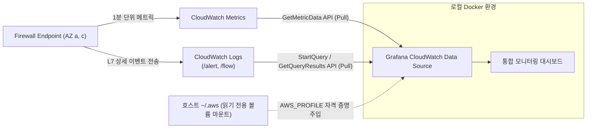
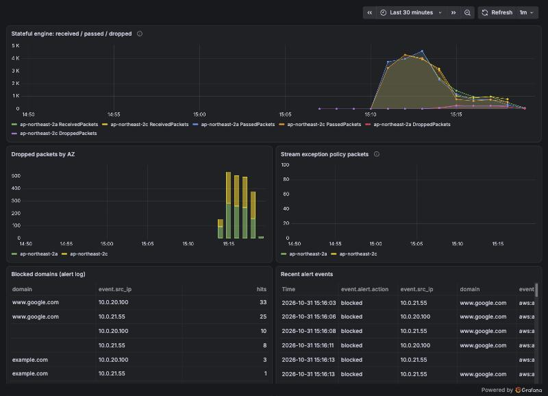

# 시나리오 4. 차단된 트래픽 관측 및 로컬 Grafana 대시보드 구축

## 시나리오 개요 및 목표

도메인 기반 Egress 차단 정책을 운영할 때 가장 주의해야 할 문제는 "서비스에 필요한 정상 외부 통신이 실수로 차단되는 상황"입니다. 외부 서비스 연결 실패 시 애플리케이션에는 단순한 타임아웃(Timeout) 오류만 발생하므로, 네트워크 방화벽이 실제로 패킷을 차단했는지 즉시 확인할 수 있는 관측성(Observability)이 반드시 확보되어야 합니다.

이번 시나리오의 핵심 목표는 **AWS Network Firewall이 제공하는 CloudWatch 메트릭과 L7 Alert 로그를 통합하여, 차단된 트래픽의 수량과 구체적인 도메인 및 출발지 서버 IP를 로컬 Grafana 대시보드를 통해 실시간으로 관측하는 것**입니다.

| 구분 | 주요 내용 |
| --- | --- |
| **실습 목표** | 방화벽 메트릭과 상세 감사 로그를 연계 분석하고, 로컬 Grafana를 통해 통합 모니터링 대시보드 운영 |
| **핵심 도구** | CloudWatch Metrics (`AWS/NetworkFirewall`), CloudWatch Logs Insights, 로컬 Docker Grafana 13.x |
| **입력 상태** | 시나리오 3에서 도메인 차단(Drop)이 활성화된 방화벽(`nfw-lab`)과 CloudWatch 로그 그룹 |
| **최종 달성 결과** | AZ별 실시간 패킷 처리량 및 Drop 추이를 확인하고, 상위 차단 도메인과 출발지 인스턴스 IP를 대시보드에서 분석 |

---

## 핵심 아키텍처 원리 및 관측 체계

### 1. 메트릭(Metric)과 로그(Log)의 역할 분담

Network Firewall의 모니터링은 메트릭과 로그의 상호 보완적인 결합으로 완성됩니다.

- **CloudWatch Metrics ("얼마나 차단되었는가?")**:
  - `AWS/NetworkFirewall` 네임스페이스를 통해 가용 영역(AZ)별 처리량(`ReceivedPackets`), 통과량(`PassedPackets`), 차단량(`DroppedPackets`)을 수치로 제공합니다.
  - 초단위 추이와 급격한 이상 징후를 감지하고 알람을 설정하는 용도로 적합하지만, 패킷의 구체적인 URL이나 도메인 정보는 포함되지 않습니다.
- **CloudWatch Logs ("누가, 어디로 가려다 차단되었는가?")**:
  - Alert 로그 그룹에 개별 차단 이벤트의 L7 상세 정보가 기록됩니다.
  - L7 정보(출발지 Private IP, 목적지 IP, TLS SNI, HTTP Host, 프로토콜, 차단 사유 등)를 전수 기록하므로, Logs Insights 쿼리를 통해 "어떤 서버가 어떤 도메인을 호출했는지" 완벽하게 역추적할 수 있습니다.

### 2. Grafana의 CloudWatch Pull 아키텍처

본 핸즈온의 Grafana 환경은 방화벽이나 AWS 리소스에 별도의 에이전트(Agent)나 익스포터(Exporter)를 설치하지 않습니다.



- 방화벽 엔드포인트가 메트릭과 로그를 CloudWatch로 지속 전송합니다.
- 로컬 Docker로 실행된 Grafana의 CloudWatch Data Source가 AWS SDK를 통해 주기적으로 CloudWatch API를 직접 호출(Pull)하여 차트와 테이블을 렌더링합니다.
- 호스트의 `~/.aws` 디렉터리를 컨테이너 내부에 읽기 전용으로 마운트하고, 환경변수로 지정한 `AWS_PROFILE`을 활용하므로 소스 코드나 설정 파일에 AWS 시크릿 키가 노출되지 않습니다.

---

## 단계별 실습 가이드

본 실습은 시나리오 3을 완료하여 `www.google.com` 등 미인가 도메인의 차단 로그가 발생한 상태에서 진행합니다.

---

### 1단계. CloudWatch 콘솔에서 방화벽 메트릭 확인

**작업 목적**: AWS 기본 콘솔에서 Network Firewall의 패킷 통과 및 차단 메트릭을 가용 영역별로 확인합니다.

#### 1단계 콘솔 수행 절차

1. **CloudWatch > Metrics > All metrics**로 이동합니다.
2. **Browse** 탭에서 **NetworkFirewall** 네임스페이스를 클릭합니다.
3. **AvailabilityZone, Engine, FirewallName** 차원을 선택합니다.
   > [!NOTE]
   > Network Firewall 메트릭은 이 세 가지 차원 조합으로만 제공됩니다. 트래픽이 한 번도 흐르지 않은 방화벽은 목록에 나타나지 않습니다.
4. 검색창에 `nfw-lab Stateful`을 입력하고, AZ a와 AZ c 양쪽에 대해 `ReceivedPackets`, `PassedPackets`, `DroppedPackets`를 체크합니다.
5. 상단의 **Graphed metrics** 탭을 클릭한 뒤 통계 방식을 조정합니다.
   - **Statistic**: **Sum**
   - **Period**: **1 minute**
6. 그래프 확인 포인트:
   - 시나리오 2에서 라우팅을 전환한 시점부터 `ReceivedPackets`가 상승합니다.
   - 시나리오 3에서 Default Drop을 활성화한 시점부터 `DroppedPackets` 수치가 나타납니다.
   - `StreamExceptionPolicyPackets` 지표를 검색하여 값이 0인지 확인합니다. (값이 0이어야 대칭 라우팅이 정상 유지되고 있음을 의미)

---

### 2단계. CloudWatch Logs Insights를 통한 차단 도메인 쿼리

**작업 목적**: Alert 로그 그룹에 쌓인 대량의 이벤트에서 실제 차단된 도메인과 요청한 인스턴스의 Private IP를 집계하여 확인합니다.

#### 2단계 콘솔 수행 절차

1. **CloudWatch > Logs > Log groups**로 이동하여 `/aws/network-firewall/nfw-lab/alert` 로그 그룹을 선택합니다.
2. 상단의 **Search all log streams**를 클릭하고 필터 검색창에 `blocked`를 입력하여 개별 차단 로그가 인입되고 있는지 확인합니다.
3. 좌측 메뉴에서 **Logs Insights**로 이동합니다.
4. 상단 로그 그룹 선택창에서 `/aws/network-firewall/nfw-lab/alert`를 지정합니다.
5. 아래 쿼리를 입력하고 우측의 **Run query**를 클릭합니다.

차단(Blocked)된 트래픽에서 목적지 도메인(TLS SNI 또는 HTTP Host)과 출발지 서버 IP를 추출하여 횟수별로 집계합니다.

```text
filter event.alert.action = "blocked"
| fields coalesce(event.tls.sni, event.http.hostname) as domain
| stats count(*) as hits by domain, event.src_ip
| sort hits desc
| limit 20
```

1. 쿼리 결과 확인:
   - `domain` 컬럼에 차단된 `www.google.com`, `example.com` 등이 집계됩니다.
   - `event.src_ip` 컬럼에 요청을 발생시킨 내부 EC2의 Private IP(`10.0.20.x`, `10.0.21.x`)가 명확히 출력되는지 확인합니다.

---

### 3단계. Network Firewall 콘솔 내장 모니터링 탭 확인

**작업 목적**: AWS 콘솔이 제공하는 기본 내장 모니터링 탭을 통해 별도의 대시보드 설치 없이도 제공되는 L7 트래픽 분석 뷰를 확인합니다.

#### 3단계 콘솔 수행 절차

1. **VPC > Network Firewall > Firewalls**에서 `nfw-lab`을 선택합니다.
2. 상세 화면에서 **Monitoring** 탭을 클릭합니다.
   - (시나리오 2의 5단계에서 모니터링 대시보드를 켜두었으므로 차트가 표시됩니다.)
3. 시간 범위를 **최근 1시간 (1h)**으로 설정합니다.
4. 주요 패널 확인:
   - **Top traffic flows**: 내부 워크로드별 전체 통신량 및 상위 목적지 확인
   - **TLS SNI**: 감지된 도메인 리스트 및 통신 비율 확인
   - **출발지 IP 필터링**: 필터 입력란에 AZ a의 EC2 Private IP를 입력하여 특정 서버 하나의 Egress 패턴만 분리 조회해 봅니다.

---

### 4단계. 로컬 Docker Grafana 대시보드 접속

**작업 목적**: [setup.md](./setup.md)에서 프로비저닝된 로컬 Grafana 컨테이너에 접속하여 코드로 관리되는 통합 모니터링 대시보드를 확인합니다.

#### 4단계 사전 자격 증명 점검

Grafana가 호스트의 AWS 권한을 정상적으로 참조하고 있는지 터미널에서 API 헬스체크를 수행합니다.

Grafana Data Source의 CloudWatch 메트릭 및 로그 API 연결 상태를 점검합니다.

```bash
curl -s localhost:3000/api/datasources/uid/cloudwatch/health
```

**정상 출력**:

```text
1. Successfully queried the CloudWatch metrics API.
2. Successfully queried the CloudWatch logs API.
```

#### 4단계 대시보드 접속

1. 웹 브라우저에서 `http://localhost:3000`에 접속합니다. (별도 로그인 없이 바로 접근 가능)
2. 좌측 메뉴에서 **Dashboards > Network Firewall**을 클릭합니다.



---

### 5단계. Grafana 대시보드 패널별 핵심 지표 해석

**작업 목적**: 대시보드의 각 패널이 의미하는 네트워크 상태와 장애 징후를 명확히 해석합니다.

| 대시보드 패널명 | 데이터 출처 | 정상 상태 기준 및 모니터링 핵심 |
| --- | --- | --- |
| **Stateful engine: received / passed / dropped** | CloudWatch Metrics (`Engine=Stateful`) | AZ a와 AZ c 양쪽 엔드포인트 모두에서 패킷이 고르게 유입되고 처리되는지 확인합니다. 한쪽 AZ의 수치가 0이면 라우팅 누락을 의미합니다. |
| **Dropped packets by AZ** | CloudWatch Metrics (`DroppedPackets`) | 시나리오 3에서 Default Drop을 적용한 이후 차단된 패킷 추이를 보여줍니다. 정상 운영 중 수치가 급증하면 새 외부 의존성(API 등)이 추가되었는지 점검해야 합니다. |
| **Stream exception policy packets** | CloudWatch Metrics (`StreamExceptionPolicyPackets`) | **정상 상태에서는 반드시 0이어야 합니다.** 이 수치가 발생하면 비대칭 라우팅이나 라우팅 테이블 불일치가 발생하고 있다는 강력한 경고입니다. |
| **Blocked domains (alert log)** | CloudWatch Logs Insights (Alert Log Group) | 2단계에서 콘솔로 실행했던 쿼리를 Grafana 테이블 패널에 실시간 렌더링한 것으로, 차단된 도메인과 출발지 서버 IP를 즉시 확인합니다. |
| **Recent alert events** | CloudWatch Logs Insights (Alert Log Group) | 최근 발생한 세부 감사/차단 이벤트 50건을 최신순으로 출력합니다. |

> [!NOTE]
> CloudWatch Logs는 스트림 인입 및 인덱싱까지 약 3~5분의 지연이 발생할 수 있습니다. 메트릭 패널에는 Drop이 즉시 찍히지만 로그 패널에는 약간 늦게 반영될 수 있으므로, 실시간 대시보드 조회 시 이를 감안하시기 바랍니다.

모든 확인을 마친 후 실습 환경을 정리하려면 [setup.md의 Down](./setup.md#down) 절차를 진행합니다.

---

## 부록: 실무 시사점 및 운영 팁

- **정확한 CloudWatch Metric Dimension 구성**: `AWS/NetworkFirewall` 메트릭을 쿼리할 때는 반드시 `FirewallName`, `AvailabilityZone`, `Engine` 3개의 Dimension이 모두 포함되어야 정상 조회됩니다. 하나라도 누락되면 CloudWatch는 빈 결과를 반환합니다.
- **다중 가용 영역 처리 확인**: NAT Gateway가 특정 AZ(예: AZ a)에만 하나 존재하더라도, 방화벽 엔드포인트는 AZ a와 AZ c 각각의 애플리케이션 서브넷에서 발생하는 트래픽을 독립적으로 받아 처리하고 있음을 대시보드의 AZ별 메트릭을 통해 직접 입증할 수 있습니다.
- **로그 저장 비용 최적화**: Flow 로그는 모든 네트워크 패킷을 기록하므로 대규모 트래픽 환경에서는 로그 저장 비용이 급증할 수 있습니다. 운영 환경에서는 Alert 로그만 CloudWatch Logs로 실시간 수집하고, Flow 로그는 S3 버킷으로 직접 내보내어 Athena로 주기적 감사하는 구성을 권장합니다.

---

## 참고 문서

1. [Monitoring AWS Network Firewall with Amazon CloudWatch](https://docs.aws.amazon.com/network-firewall/latest/developerguide/monitoring-cloudwatch.html)
2. [Logging network traffic from AWS Network Firewall](https://docs.aws.amazon.com/network-firewall/latest/developerguide/firewall-logging.html)
3. [Firewall monitoring in the Network Firewall console](https://docs.aws.amazon.com/network-firewall/latest/developerguide/nwfw-detailed-monitoring.html)
