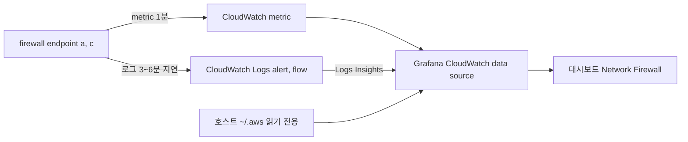

# 시나리오 4. 막힌 트래픽을 로컬 Grafana로 관측하기

## 이 시나리오의 목표

| 항목 | 내용 |
| --- | --- |
| 기능 | firewall이 무엇을 얼마나 막았는지, 어느 서버가 어느 도메인에서 막혔는지 관측 |
| 쓰는 도구 | CloudWatch metric(`AWS/NetworkFirewall`), alert 로그(CloudWatch Logs), 로컬 Docker Grafana |
| 입력 | 시나리오 3에서 drop을 켠 firewall `nfw-lab`, alert log group |
| 작업 | 실습 1~5단계: AWS 콘솔에서 metric과 로그 확인, Network Firewall Monitoring 탭 확인, Grafana 대시보드 접속과 패널 해석 |
| 달성할 것 | AZ별 처리량과 drop, 막힌 도메인과 출발지 서버 IP를 AWS 콘솔과 Grafana에서 확인 |

## 관측은 metric과 로그가 나눠서 맡는다

firewall은 두 종류의 기록을 남깁니다. metric은 "얼마나"를, alert 로그는 "누가 어디로"를 답합니다. metric에는 도메인 정보가 없어서, 어느 도메인이 막혔는지는 로그에서 셉니다.

### 용어

| 용어 | 뜻 | 이 실습의 예 |
| --- | --- | --- |
| `AWS/NetworkFirewall` | firewall metric의 CloudWatch namespace. `FirewallName`, `AvailabilityZone`, `Engine` 세 dimension 조합으로만 기록하고 값이 0이면 기록하지 않음 | `FirewallName=nfw-lab`, `Engine=Stateful` |
| Alert 로그 | alert, drop, reject 규칙에 걸린 흐름. `event.alert.action`이 `allowed` 또는 `blocked` | `/aws/network-firewall/nfw-lab/alert` |
| Flow 로그 | stateful 엔진이 본 모든 흐름의 netflow 기록. 방향마다 한 줄 | `/aws/network-firewall/nfw-lab/flow` |
| Logs Insights | CloudWatch Logs의 쿼리 언어. Grafana CloudWatch data source가 그대로 실행함 | 막힌 도메인 패널 |

## firewall을 관측해야 하는 이유

허용 목록 방식은 "막지 말아야 할 것을 막는" 실패가 기본 위험입니다. 새 외부 의존성이 생기면 서비스는 timeout으로만 실패하고, 애플리케이션 로그에는 firewall이라는 단서가 없습니다. `DroppedPackets`와 막힌 도메인 목록이 보여야 timeout을 firewall과 연결할 수 있습니다. 시나리오 2에서 본 대칭 라우팅 실패도 `StreamExceptionPolicyPackets`로만 드러납니다.

## 대안 비교

| 방식 | 장점 | 이 실습에서 고르지 않은 이유 |
| --- | --- | --- |
| 로컬 Docker Grafana + CloudWatch data source | metric과 로그를 한 대시보드에, 대시보드를 JSON으로 저장소에 둠 | 고름 |
| CloudWatch 콘솔 대시보드 | 설치 없음 | 대시보드를 코드로 저장소에 두기 번거로움 |
| Network Firewall monitoring dashboard | 설치 없음, 로그 기반 top flow와 도메인 집계를 바로 제공 | 패널이 고정되어 있고 화면 갱신마다 Logs Insights 쿼리 요금 발생. 실습 3단계에서 함께 확인 |
| Amazon Managed Grafana | 운영용 인증과 공유 | 실습 하나에 workspace 비용과 SSO 설정이 과함 |

## 컴포넌트 역할

| 컴포넌트 | 역할 |
| --- | --- |
| firewall logging 설정 | alert, flow 로그를 CloudWatch Logs로 보냄. 도착까지 3~6분 |
| log resource policy `nfw-lab-firewall-logs` | `delivery.logs.amazonaws.com`이 log group에 쓰도록 허용. Terraform이 만들어 계정 공유 policy를 건드리지 않음 |
| `compose.yaml` | Grafana 13.2.5를 `127.0.0.1:3000`에 띄우고 호스트 `~/.aws`를 읽기 전용으로 마운트 |
| CloudWatch data source | `authType: default`. AWS SDK 기본 자격 증명 체인이 export한 `AWS_PROFILE`을 찾음 |
| `grafana/dashboards/network-firewall.json` | provisioning으로 올라가는 대시보드 |

`compose.yaml`의 인증 설정이며, 액세스 키를 Grafana 설정이나 저장소에 기록하지 않는 구조입니다.

```yaml
environment:
  AWS_PROFILE: ${AWS_PROFILE:?export AWS_PROFILE first}
volumes:
  - ~/.aws:/usr/share/grafana/.aws:ro
```

`AWS_PROFILE`을 export하지 않고 `docker compose up`을 실행하면 compose가 바로 실패합니다. 프로파일에 필요한 권한은 `cloudwatch:GetMetricData`, `cloudwatch:ListMetrics`, `logs:StartQuery`, `logs:GetQueryResults`, `logs:DescribeLogGroups`입니다.

## Grafana는 CloudWatch API를 호출해 값을 가져온다

firewall은 Grafana로 아무것도 보내지 않습니다. firewall endpoint가 metric과 로그를 CloudWatch에 쌓고, Grafana는 패널을 그릴 때마다 CloudWatch API를 호출해 그 값을 읽어 옵니다(pull 방식). 그래서 Grafana에는 agent나 exporter가 없고 data source 하나만 있습니다.

| 패널 종류 | Grafana가 호출하는 API | 쿼리에 들어가는 값 |
| --- | --- | --- |
| metric 패널 | `cloudwatch:GetMetricData` | namespace `AWS/NetworkFirewall`, metric 이름, dimension 3개, statistic `Sum`, period `60` |
| 로그 패널 | `logs:StartQuery`, `logs:GetQueryResults` | log group `/aws/network-firewall/nfw-lab/alert`, Logs Insights 쿼리 |

API를 호출할 자격 증명은 Grafana 컨테이너 안의 AWS SDK가 찾습니다. data source의 `authType: default`는 SDK 기본 자격 증명 체인을 쓰라는 뜻이고, 체인은 compose가 넘긴 `AWS_PROFILE`과 마운트한 `~/.aws`에서 그 프로파일을 읽습니다.

대시보드의 metric 패널 쿼리입니다. `AvailabilityZone`을 `*`로 두어 AZ마다 series가 하나씩 나옵니다.

```json
{
  "namespace": "AWS/NetworkFirewall",
  "metricName": "ReceivedPackets",
  "dimensions": { "FirewallName": ["nfw-lab"], "AvailabilityZone": ["*"], "Engine": ["Stateful"] },
  "statistic": "Sum",
  "period": "60"
}
```

data source가 두 API에 모두 접근하는지는 Grafana API로 확인합니다. firewall을 만들기 전에도 확인할 수 있습니다.

```bash
curl -s localhost:3000/api/datasources/uid/cloudwatch/health
```

실측 결과이며, 둘 중 하나라도 실패하면 프로파일의 IAM 권한을 점검합니다.

```text
1. Successfully queried the CloudWatch metrics API.
2. Successfully queried the CloudWatch logs API.
```

## 흐름



## 실습

[setup.md](./setup.md)의 Up이 Grafana 컨테이너도 함께 기동합니다. 시나리오 3의 2단계까지 마친 상태에서 시작합니다. 1~3단계는 Grafana 없이 AWS 콘솔에서 같은 값을 확인하고, 4~5단계는 Grafana에서 확인합니다.

### 1. CloudWatch 콘솔에서 metric 확인 (약 3분)

1. **CloudWatch > Metrics > All metrics**로 이동합니다.
2. **Browse** 탭에서 **NetworkFirewall**을 누릅니다.
3. **AvailabilityZone, Engine, FirewallName**을 누릅니다.
   - dimension 조합이 이것 하나뿐입니다. firewall을 만든 뒤 트래픽이 지나가야 목록에 나타납니다.
4. 검색창에 `nfw-lab Stateful`을 넣고 `ReceivedPackets`, `PassedPackets`, `DroppedPackets`를 AZ a, c 모두 체크합니다.
5. **Graphed metrics** 탭에서 **Statistic**을 `Sum`, **Period**를 `1 minute`으로 바꿉니다.
   - drop을 켠 시각부터 `DroppedPackets`가 생깁니다.
   - 값이 0인 구간은 점이 찍히지 않습니다. `AWS/NetworkFirewall`은 0을 기록하지 않기 때문입니다.
6. 검색창을 `nfw-lab StreamExceptionPolicyPackets`로 바꿔 이 metric이 없거나 0인지 확인합니다.

### 2. Network Firewall 로그 설정과 CloudWatch Logs 확인 (약 5분)

1. **VPC > Network Firewall > Firewalls > nfw-lab**의 **Firewall details** 탭에서 **Logging configuration**을 확인합니다.
   - `Alert`와 `Flow`가 각각 `/aws/network-firewall/nfw-lab/alert`, `/aws/network-firewall/nfw-lab/flow`로 전달되도록 설정되어 있는지 확인합니다.
2. **CloudWatch > Logs > Log groups > /aws/network-firewall/nfw-lab/alert**를 엽니다.
   - log stream은 endpoint마다 하나씩 생성되며, 로깅 활성화 후 3~6분이 지나야 첫 stream이 나타납니다.
3. **Search all log streams**를 누르고 필터에 `blocked`를 넣습니다.
   - `event.alert.action`이 `blocked`이고 `event.tls.sni`가 `www.google.com`인 줄이 보입니다.
4. **CloudWatch > Logs > Logs Insights**로 이동해 log group으로 `/aws/network-firewall/nfw-lab/alert`를 고릅니다.
5. 아래 쿼리를 넣고 **Run query**를 누릅니다.
   - 막힌 도메인과 출발지 EC2 private IP가 횟수 순으로 나옵니다. 5단계의 Blocked domains 패널과 같은 결과입니다.

5단계에 넣는 Logs Insights 쿼리입니다.

```text
filter event.alert.action = "blocked"
| fields coalesce(event.tls.sni, event.http.hostname) as domain
| stats count(*) as hits by domain, event.src_ip
| sort hits desc
| limit 20
```

flow 로그는 `/aws/network-firewall/nfw-lab/flow`에서 같은 방법으로 조회합니다. 허용된 흐름까지 모두 남아 alert 로그보다 줄이 훨씬 많습니다.

### 3. Network Firewall Monitoring 탭 대시보드 확인 (약 3분)

시나리오 2의 5단계에서 켠 Firewall monitoring dashboard는 별도 설치 없이 콘솔에서 alert와 flow 로그를 집계해 보여 줍니다. 화면을 열거나 범위를 바꿀 때마다 log group에 Logs Insights 쿼리가 실행되므로, 같은 화면을 반복해서 새로 고치지 않습니다.

1. **VPC > Network Firewall > Firewalls > nfw-lab**의 **Monitoring** 탭을 엽니다.
   - 대시보드가 꺼져 있다는 안내가 보이면 이 화면에서 바로 켜거나, 시나리오 2의 5단계로 돌아가 켭니다.
2. 시간 범위 선택기에서 drop을 켠 시각이 포함되도록 최근 1시간을 고릅니다.
3. **Top traffic flows**에서 출발지 EC2 private IP(`10.0.20.x`, `10.0.21.x`)와 목적지별 트래픽 양을 확인합니다.
4. **TLS SNI** 영역에서 `checkip.amazonaws.com`, `www.google.com` 같은 목적지 도메인이 집계되는지 확인합니다.
   - 2단계의 Logs Insights 쿼리 결과와 같은 도메인이 보이면 됩니다.
5. **TCP handshake 실패 흐름**과 **장시간 유지된 TCP 흐름** 영역을 확인합니다.
   - 차단한 도메인과 연결 실패가 함께 보이면, 정책 변경이 어떤 서버의 연결에 영향을 줬는지 추적하는 단서가 됩니다.
6. 출발지 IP 입력란에 AZ a EC2의 private IP를 넣어 서버 한 대의 통신만 걸러 봅니다.

콘솔 대시보드는 설치 없이 바로 쓸 수 있지만 패널 구성이 고정되어 있습니다. 4~5단계의 Grafana는 대시보드를 JSON으로 저장소에 두고 패널과 쿼리를 직접 정할 수 있습니다.

### 4. Grafana 대시보드 접속 (1분)

1. 브라우저에서 `http://localhost:3000`을 엽니다. 로그인 없이 열립니다.
2. **Dashboards > Network Firewall**을 엽니다.


### 5. 패널별 지표 해석 (약 3분)

| 패널 | 출처 | 보는 것 |
| --- | --- | --- |
| Stateful engine: received / passed / dropped | `AWS/NetworkFirewall`, `Engine=Stateful` | AZ별 처리량. endpoint 두 개가 각자 트래픽을 받는지 |
| Dropped packets by AZ | `DroppedPackets` | drop을 켠 뒤 막힌 양 |
| Stream exception policy packets | `StreamExceptionPolicyPackets` | 상태 없는 패킷. route 변경, flow flush, 비대칭 라우팅 신호 |
| Blocked domains (alert log) | alert log group, Logs Insights | 막힌 도메인과 출발지 서버 IP |
| Recent alert events | alert log group, Logs Insights | 최근 alert 기록 50개 |

1. **Stateful engine** 패널에서 route를 바꾼 시각부터 AZ a, c 모두 `ReceivedPackets`가 올라오는지 확인합니다.
   - 실측 15:11(KST)에 route를 바꾸자 AZ마다 분당 약 4천 개로 올라왔습니다.
2. **Dropped packets by AZ**에서 drop을 켠 시각부터 값이 생기는지 확인합니다.
   - 실측 15:14에 drop을 켜자 나타났습니다.
3. **Stream exception policy packets**가 0인지 확인합니다.
   - 실측 실습 내내 0이었습니다.
4. **Blocked domains** 표에서 막힌 도메인과 서버 IP를 확인합니다.
   - 실측 `www.google.com`, `example.com`, domain이 빈 줄(NTP)이 보였고, `event.src_ip`는 EC2의 private IP였습니다.

Blocked domains 패널은 2단계에서 콘솔로 실행한 Logs Insights 쿼리를 그대로 실행합니다.

로그는 3~6분 늦게 도착합니다. metric 패널에 drop이 보이는데 로그 패널이 비어 있으면 몇 분 뒤 다시 조회합니다. 확인이 끝나면 [setup.md의 Down](./setup.md#down)으로 정리합니다.

## 부록. 실무 시사점

- metric 쿼리는 `FirewallName`, `AvailabilityZone`, `Engine` 세 dimension을 모두 지정해야 값이 나옵니다. `AvailabilityZone`을 `*`로 두면 AZ마다 series가 하나씩 나옵니다.
- NAT가 AZ a에 하나뿐이어도 endpoint는 AZ마다 자기 subnet의 트래픽을 받는 것이 metric에서 바로 보입니다.
- 대시보드에는 firewall 이름 `nfw-lab`과 log group 이름 `/aws/network-firewall/nfw-lab/alert`가 고정되어 있습니다. 다른 firewall에 쓰려면 이 두 값을 바꿉니다. 리전을 바꿨으면 `grafana/provisioning/datasources/cloudwatch.yaml`의 `defaultRegion`도 같은 값으로 바꾸고, `docker compose up` 전에 `AWS_REGION`을 export합니다.
- 운영에서 알람을 걸 metric은 [5-production-rollout.md의 5단계](./5-production-rollout.md#5단계-핵심-지표-알람-구성)에 있습니다.

## 참고 문서

1. Network Firewall CloudWatch metrics, <https://docs.aws.amazon.com/network-firewall/latest/developerguide/monitoring-cloudwatch.html>
2. Network Firewall logging, <https://docs.aws.amazon.com/network-firewall/latest/developerguide/firewall-logging.html>
3. Firewall monitoring in the Network Firewall console, <https://docs.aws.amazon.com/network-firewall/latest/developerguide/nwfw-detailed-monitoring.html>
