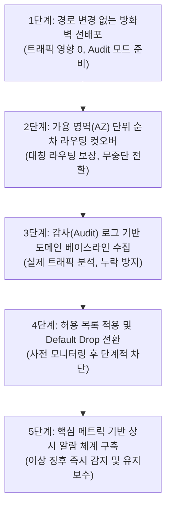
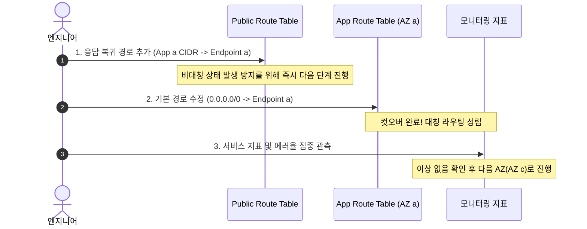

# 시나리오 5. 운영 중인 프로덕션 환경에 Network Firewall을 무중단 적용하는 순서

## 시나리오 개요 및 목표

실제 서비스가 활발히 운영 중인 프로덕션 VPC에 Network Firewall을 도입할 때, 가장 치명적인 위험이 발생하는 순간은 크게 두 번입니다.

1. **라우팅을 변경하여 트래픽을 방화벽으로 유도하는 순간** (비대칭 라우팅이나 잘못된 라우팅으로 인한 네트워크 단절)
2. **방화벽 정책의 Default Action을 Drop으로 전환하는 순간** (누락된 외부 의존성으로 인한 비즈니스 로직 장애)

이 가이드의 핵심 목표는 **두 위험 지점을 완전히 분리하고, 각 단계마다 언제든 이전 상태로 즉각 되돌릴 수 있는 5단계 무중단 롤아웃 플레이북(Playbook)을 구축하는 것**입니다.



---

## 1단계: 경로 변경 없는 방화벽 선배포

방화벽 본체와 엔드포인트를 먼저 생성하지만, 라우팅 테이블은 전혀 수정하지 않습니다. 실제 트래픽은 기존 NAT Gateway를 통해 그대로 흐르므로 서비스에 미치는 영향은 전혀 없습니다.

- **전용 서브넷 분리**: 가용 영역(AZ)마다 방화벽 전용 서브넷(`/28`)을 생성하고, 서브넷 라우팅 테이블은 `0.0.0.0/0 → NAT Gateway`로 미리 구성합니다. 서비스 워크로드가 존재하는 모든 AZ에 엔드포인트를 두어야 합니다.
- **Strict Order 정책 선적용**: Rule Order는 방화벽 정책 생성 이후에 변경할 수 없습니다. 따라서 초기 생성 시 반드시 **Strict Order**로 생성합니다.
- **감사 모드(Alert-only) 구성**: Stateful Default Action의 Drop 옵션을 모두 해제하고, **Alert established**(`aws:alert_established`)만 선택합니다. 어떠한 패킷도 차단하지 않는 순수 감사 모드로 대기시킵니다.
- **Stream Exception Policy = Reject**: 라우팅 전환 시점에 이미 열려 있던 기존 커넥션에 대해 TCP RST를 응답하여 클라이언트가 대기(Timeout) 없이 즉시 재연결을 시도하도록 설정합니다. (기본값인 Drop은 타임아웃까지 긴 지연 발생)
- **로깅 활성화**: 3단계 분석의 근거 데이터가 되므로 Alert 및 Flow 로깅을 CloudWatch Logs 또는 S3로 즉시 연결합니다.
- **보호 설정(Protection) 활성화**: **Subnet change protection**, **Delete protection**, **Firewall policy change protection**을 모두 활성화합니다. 특히 서브넷이 실수로 제거되면 해당 AZ의 라우팅이 블랙홀이 되므로 엄격히 보호해야 합니다.
- **충분한 Rule Group 용량(Capacity) 예약**: Rule Group의 Capacity는 생성 후 증설이 불가능합니다. 향후 도메인 추가를 고려하여 넉넉하게 예약합니다.

---

## 2단계: AZ 단위 순차 route 전환

VPC 라우팅 테이블 수정은 수 초 이내에 즉시 반영되며, 문제 발생 시 즉각 원복할 수 있습니다. 따라서 전체 VPC를 한 번에 전환하지 않고, **가용 영역(AZ) 단위로 하나씩 순차 전환하며 지표를 확인**합니다.



### 작업 절차

1. **회귀 경로 선추가**: Public Route Table에 `App Subnet CIDR → 해당 AZ의 Firewall Endpoint` 경로를 추가합니다.
2. **출발 경로 스위칭**: App Subnet Route Table의 `0.0.0.0/0` 타깃을 NAT Gateway에서 `해당 AZ의 Firewall Endpoint`로 즉시 변경합니다.
3. **지표 집중 관측**: 애플리케이션 서비스 에러율, NAT Gateway의 `ErrorPortAllocation`, 방화벽의 `StreamExceptionPolicyPackets` 지표를 관측합니다.
4. **이상 없을 시 다음 AZ 반복**: 첫 번째 AZ가 안정화되면 동일한 절차로 다음 AZ를 전환합니다.

> [!CAUTION] 전환 순서와 타이밍의 중요성
>
> - 1번(회귀 경로)과 2번(출발 경로) 사이의 간격을 최소화해야 합니다. 1번만 적용된 상태에서는 나갈 때는 NAT로 가고 들어올 때만 방화벽으로 들어오는 비대칭 라우팅 상태가 되어 신규 TCP 연결이 실패합니다.
> - 따라서 AZ a의 1번과 2번을 연달아 실행하여 즉시 컷오버하고, 다른 AZ의 1번 경로를 미리 넣어두지 마십시오.

### 기존 장기 세션(Long-lived Connection) 단절 대응

라우팅이 전환되는 순간 이전에 이미 맺어져 있던 기존 TCP 연결은 방화벽 엔진 입장에서 핸드셰이크를 보지 못한 상태입니다. 이 패킷들은 `Stream Exception Policy (Reject)`에 의해 일시적으로 리셋될 수 있습니다.

- 단발성 HTTP API 요청은 다음 요청 시 새 연결을 맺으므로 서비스 영향이 거의 없습니다.
- DB 커넥션 풀, gRPC 스트림, WebSocket 등 영속 커넥션을 유지하는 워크로드는 서비스 재연결이 수반되므로, 트래픽이 가장 적은 점검 시간대에 진행하는 것을 권장합니다.

---

## 3단계: alert 로그 기반 허용 목록 도출

감사 모드로 전환된 상태에서 최소 수일에서 수주 동안 운영 트래픽을 관측하여, 서비스가 정상 구동되는 데 필요한 외부 목적지 도메인을 추출합니다.

CloudWatch Logs Insights를 통해 감사 로그에서 호출 도메인을 집계합니다.

```text
filter event.event_type = "alert"
| fields coalesce(event.tls.sni, event.http.hostname) as domain
| stats count(*) as hits by domain
| sort hits desc
```

### 분석 시 핵심 점검 사항

- **도메인이 없는 일반 트래픽 확인**: `domain` 필드가 비어 있는 트래픽은 HTTP/TLS가 아닌 일반 TCP/UDP 패킷입니다. 포트와 IP를 분석하여 5-tuple 규칙으로 사전 허용해야 합니다.
- **클라우드 인프라 필수 도메인 확인**: AWS SSM 에이전트 도메인(`.amazonaws.com`), 리눅스 패키지 미러(yum, apt), 사내 내부 패키지 레지스트리(npm, pip) 도메인이 누락되지 않도록 철저히 검증합니다.
- **Traffic Analysis Mode 활용**: Network Firewall 콘솔의 트래픽 분석 모드를 활성화하면 관측된 트래픽을 기반으로 Domain List를 자동 생성해 줍니다. AWS에서는 차단 정책 수립 약 30일 전에 이를 켜둘 것을 권장합니다.

---

## 4단계: 허용 목록 적용과 default action drop 전환

실제 트래픽 차단이 활성화되는 단계입니다.

1. **도메인 허용 Rule Group 정책 등록**: 도출된 허용 목록을 Rule Group으로 생성하여 Firewall Policy에 바인딩합니다. Strict Order에서는 Allow 규칙만 등록했다고 해서 목록 외 트래픽이 차단되지 않으므로 서비스 중단 없이 안전하게 등록할 수 있습니다.
2. **미차단 상태에서 사전 시뮬레이션**: Alert 로그를 모니터링하며 허용 목록에 매칭되지 않는 트래픽이 무엇인지 확인합니다. 이 트래픽들이 바로 다음 단계에서 차단될 대상입니다.
3. **Stateful Default Action Drop 전환**:
   - Drop Action: **Application drop established (server-directed only)** 선택
   - Alert Action: **Application alert established (server-directed only)** 선택
4. **차단 모니터링**: CloudWatch 메트릭의 `DroppedPackets`와 Alert 로그의 `blocked` 이벤트를 실시간 모니터링합니다. 누락된 업무 도메인이 발견되면 Rule Group에 즉시 추가합니다.

> [!TIP]
> 정책 변경 사항은 수 분 이내에 모든 엔드포인트에 즉시 반영됩니다. 만약 차단 이후 심각한 서비스 장애가 발생할 경우, Default Action에서 Drop만 해제(None)하면 즉시 모든 트래픽이 다시 통과합니다.

---

## 5단계: 핵심 지표 알람 구성

운영 환경에서 잠재적 장애와 비인가 접근을 상시 감시하기 위해 아래 핵심 메트릭에 대해 Amazon CloudWatch Alarm을 구성합니다.

| 메트릭 명칭 | 임계치 및 알람 기준 | 실무적 의미 및 대응 절차 |
| --- | --- | --- |
| **`DroppedPackets`** | 평시 베이스라인 대비 비정상 급증 시 | 인가되지 않은 외부 도메인 접근 시도 또는 새로 배포된 서비스의 외부 API 누락 여부 확인 |
| **`StreamExceptionPolicyPackets`** | **> 0 (발생 즉시 경고)** | 비대칭 라우팅 발생 또는 라우팅 테이블 설정 오류 신호. 라우팅 테이블 점검 필요 |
| **`OtherDroppedPackets`** | **> 0 (발생 즉시 경고)** | 트래픽 급증으로 인해 방화벽 엔드포인트가 자동 확장(Scale-out)되는 동안 버려진 패킷 여부 확인 |
| **`RejectedPackets`** | 평시 대비 급증 시 | Reject 규칙이나 비정상 패킷으로 인해 방화벽이 TCP RST를 응답한 횟수 확인 |

통합 모니터링 대시보드 구축 및 세부 지표 분석 방법은 [4-monitoring.md](./4-monitoring.md)를 참고하시기 바랍니다.

---

## 참고 문서

1. [AWS Security Services Best Practices: AWS Network Firewall](https://aws.github.io/aws-security-services-best-practices/guides/network-firewall/)
2. [Stream exception policy in AWS Network Firewall](https://docs.aws.amazon.com/network-firewall/latest/developerguide/stream-exception-policy.html)
3. [Enhanced network security control and flow management with AWS Network Firewall](https://aws.amazon.com/blogs/security/enhanced-network-security-control-flow-management-with-aws-network-firewall/)
