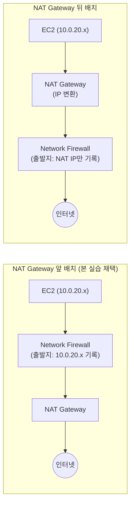
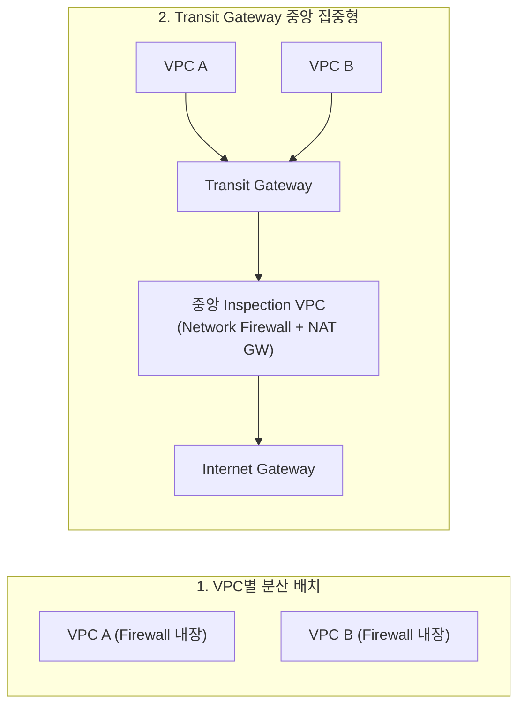

# Network Firewall 배치 아키텍처 의사결정

## 의사결정 배경

AWS Network Firewall을 인프라에 도입할 때 엔지니어가 반드시 결정해야 하는 핵심 아키텍처 질문은 크게 두 가지입니다.

1. **단일 VPC 내부에서 방화벽을 트래픽 경로의 어느 지점(NAT Gateway 앞 vs 뒤)에 배치할 것인가?**
2. **다중 VPC 환경에서 방화벽을 VPC마다 분산 배치할 것인가, Transit Gateway(TGW)를 통해 중앙 집중형으로 통합할 것인가?**

본 핸즈온은 단일 VPC 환경에서 **NAT Gateway 앞(App Subnet과 NAT Gateway 사이) 배치**를 선택했습니다. 이 문서는 해당 아키텍처를 선택한 기술적 판단 근거와 함께, 향후 VPC가 확장되었을 때 TGW 중앙 집중 구성을 검토하기 위한 비용 및 운영 손익분기 기준을 제시합니다.

---

## 의사결정 요약

| 의사결정 항목 | 본 핸즈온의 선택 | 대안 구성 | 대안 선택이 권장되는 조건 |
| --- | --- | --- | --- |
| **VPC 내부 검사 위치** | **NAT Gateway 앞** (App Subnet과 NAT 사이) | **NAT Gateway 뒤** (Public Subnet과 IGW 사이) | 출발지 워크로드 IP 식별이 필요 없고, 인바운드와 아웃바운드를 단일 엔드포인트에서 동시에 검사하고자 할 때 |
| **다중 VPC 배치 모델** | **VPC별 분산 배치** | **TGW 중앙 집중형** 또는 Secondary Endpoint 공유 | 관리 대상 VPC가 다수(3개 이상)이거나, VPC 간(East-West) 및 온프레미스 통신까지 중앙 감사해야 할 때 |
| **방화벽 Attachment 방식** | **VPC Attachment** | **TGW Attachment** | TGW 중앙 집중형 아키텍처를 구성할 때 |

---

## VPC 내부 위치 선정: NAT Gateway 앞 배치

보안 감사(Audit)의 핵심 가치는 **"침해되거나 외부와 통신한 워크로드의 실체(출발지 IP)를 명확히 규명할 수 있는가"**에 있습니다.

- **NAT Gateway 뒤 배치의 한계**: 패킷이 이미 NAT Gateway를 거치면서 출발지 IP가 NAT의 Private IP로 변환(SNAT)된 상태로 방화벽에 도달합니다. 따라서 방화벽 Alert 로그에는 오직 NAT IP만 남아, 내부의 수많은 인스턴스 중 누가 외부 도메인을 호출했는지 추적할 수 없습니다.
- **NAT Gateway 앞 배치의 이점 (본 실습)**: 패킷이 NAT를 거치기 전에 방화벽 엔드포인트를 먼저 통과하므로, 로그의 `event.src_ip`에 실제 워크로드의 Private IP(`10.0.20.x`, `10.0.21.x`)가 온전히 보존됩니다.
- **트레이드오프(Trade-off)**: 출발지 IP를 확보하는 대가로, 가용 영역(AZ)별 App Route Table을 분리하고 Public Route Table에 응답 복귀 경로(`App CIDR → VPCE`)를 명시하여 대칭 라우팅(Symmetric Routing)을 직접 설계해야 합니다. (세부 구현은 [2-traffic-inspection.md](./2-traffic-inspection.md#4-nat-gateway-앞-배치를-통한-출발지-워크로드-ip-확보) 참고)

---

## 다중 VPC 환경에서의 배치 아키텍처 비교

VPC가 2개 이상으로 늘어나는 환경에서는 세 가지 배치 모델을 검토할 수 있습니다.

| 아키텍처 모델 | 트래픽 경로 | 적합한 운영 환경 | 주요 고려사항 |
| --- | --- | --- | --- |
| **VPC별 분산 배치** (본 핸즈온 기준) | VPC마다 전용 방화벽과 AZ별 엔드포인트 배치 | VPC 수가 적거나(1~2개), VPC마다 독립적인 보안 정책과 담당 팀이 분리된 환경 | 장애 반경이 개별 VPC로 격리되나, VPC 수에 비례하여 방화벽 시간 비용이 선형 증가 |
| **TGW 중앙 집중형** | Spoke VPC → TGW → 중앙 검사 VPC(또는 TGW 방화벽) → NAT → IGW | 다수의 VPC(3개 이상)를 운영하며 보안팀이 전사 정책을 중앙에서 일괄 통제하는 환경 | 방화벽 엔드포인트 수를 1세트로 고정할 수 있으나, TGW 데이터 처리 비용 및 아키텍처 복잡성 증가 |
| **Secondary Endpoint 공유** | 하나의 방화벽 정책에 다른 VPC의 엔드포인트를 추가 바인딩 | TGW가 없으며 2~4개 수준의 소규모 VPC가 동일한 정책을 공유할 때 | TGW 없이 엔드포인트 비용을 절감할 수 있는 중간 선택지 (시간당 \$0.158) |

> [!NOTE]
> Transit Gateway 중앙 집중형 아키텍처에서는 중앙 Inspection VPC를 별도로 두는 방식 외에도, Network Firewall을 TGW에 직접 연결하는 **TGW Attachment** 방식을 활용할 수 있습니다. TGW Attachment 방식을 적용하면 Inspection VPC 서브넷 관리 부담이 줄어들고 대칭 라우팅을 AWS가 자동으로 처리합니다.

---

## VPC 수에 따른 비용 손익분기

비용 측면만 고려할 경우, TGW 중앙 집중형 구성은 생각보다 이른 시점에 분산 배치보다 경제적으로 유리해집니다. 방화벽 엔드포인트의 시간당 고정 요금(\$0.395/hr)이 TGW Attachment 요금(\$0.07/hr)보다 5배 이상 높기 때문입니다.

아래 표는 서울 리전(ap-northeast-2) 단가를 기준으로 AZ 2개를 사용하는 VPC 환경의 월간(730시간) 고정 비용을 비교한 결과입니다.

| 관리 대상 VPC 수 | VPC별 분산 배치 고정비 | TGW 중앙 집중형 고정비 (트래픽 제외) | Secondary Endpoint 공유 고정비 |
| :---: | :---: | :---: | :---: |
| **2개** | \$1,153 | **\$730** | \$807 |
| **3개** | \$1,730 | **\$781** | \$1,038 |
| **5개** | \$2,884 | **\$883** | \$1,499 |
| **10개** | \$5,767 | **\$1,139** | \$2,653 |

> 참고 가정: 각 VPC당 AZ 2개 사용, TGW 중앙 구성은 중앙 방화벽 엔드포인트 2개 운영 기준

### 트래픽 처리 비용(GB당 요금)에 따른 실제 손익분기

다만 Transit Gateway는 통과하는 데이터 1GB당 \$0.02의 처리 수수료가 발생합니다. 따라서 아웃바운드 트래픽 용량이 매우 큰 환경에서는 TGW 데이터 비용이 엔드포인트 절감액을 상쇄할 수 있습니다.

| 월간 Egress 트래픽 볼륨 | TGW 중앙 집중형 구성이 더 저렴해지는 VPC 수 임계점 |
| --- | :--- |
| **일반적 수준 (< 10 TB)** | **VPC 2개 이상부터 즉시 유리** |
| **50 TB** | **VPC 4개 이상부터 유리** |
| **100 TB 이상** | **VPC 5개 이상부터 유리** |

이미 사내에 VPC 간 통신이나 온프레미스 연동을 위해 TGW를 운영 중이라면 Attachment 비용은 기투자 비용이므로, VPC 2개 시점부터 중앙 집중형 구성이 압도적으로 유리합니다.

---

## 비용 외 아키텍처 의사결정 체크리스트

실제 엔지니어링 환경에서는 비용 외에도 조직 구조와 운영 복잡성에 따라 최적의 아키텍처가 달라집니다.

| 평가 기준 | 분산 배치가 유리한 경우 | TGW 중앙 집중형이 유리한 경우 |
| --- | --- | --- |
| **장애 격리 반경 (Blast Radius)** | 특정 방화벽 장애나 라우팅 변경 실수가 다른 서비스 VPC로 전파되지 않아야 하는 환경 | 변경 영향도를 엄격한 배포 파이프라인과 승인 절차로 통제할 수 있는 환경 |
| **보안 거버넌스 및 정책 주체** | 서비스 개발팀이 자기 도메인의 허용 목록(Allowlist)을 자율적으로 관리 | 전사 CISO 및 중앙 보안팀이 모든 아웃바운드 정책을 단일 창구에서 일괄 통제 |
| **트래픽 검사 범위** | 외부 인터넷 아웃바운드(Egress)만 검사 | VPC 간 통신(East-West) 및 온프레미스(VPN/Direct Connect) 연동 트래픽까지 통합 검사 |
| **네트워크 지연 시간 (Latency)** | 추가 네트워크 홉(Hop) 없이 최소 지연을 유지해야 하는 고성능 워크로드 | TGW 경유로 인한 1~2ms 수준의 추가 홉 지연을 허용할 수 있는 일반 워크로드 |

---

## 종합 판단 가이드

1. **단일 VPC 환경**: 추가적인 네트워크 복잡성을 피하고 본 핸즈온처럼 VPC 내부 분산 배치(NAT 앞)를 적용합니다.
2. **다중 VPC 환경 (2~3개 이상)**: 이미 TGW를 사용 중이거나 중앙 보안팀 중심의 통합 거버넌스가 필요하다면 **TGW 중앙 집중형 아키텍처(TGW Attachment 방식 권장)**를 최우선으로 검토합니다.
3. **도메인 자율 관리 및 장애 격리 우선**: 비용이 다소 증가하더라도 서비스별 독립성이 최우선이라면 분산 배치를 유지하고, AWS Firewall Manager를 도입하여 전사 공통 기본 정책(차단 룰 등)을 중앙에서 배포하는 하이브리드 방식을 적용합니다.

---

## 참고 문서

1. [AWS Network Firewall deployment models](https://docs.aws.amazon.com/network-firewall/latest/developerguide/architectures.html)
2. [AWS Network Firewall pricing](https://aws.amazon.com/network-firewall/pricing/)
3. [AWS Transit Gateway pricing](https://aws.amazon.com/transit-gateway/pricing/)
4. [Transit Gateway appliance mode for stateful inspection](https://docs.aws.amazon.com/vpc/latest/tgw/transit-gateway-appliance-scenarios.html)
