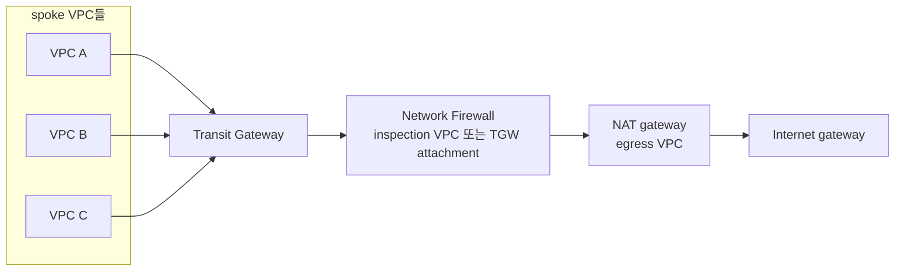

# Network Firewall 배치 아키텍처 의사결정

Network Firewall을 도입할 때 정해야 하는 것은 크게 두 가지입니다. 하나는 VPC 안에서 firewall을 경로의 어느 지점에 두는가이고, 다른 하나는 VPC가 여러 개일 때 firewall을 VPC마다 둘지 한곳으로 모을지입니다. 이 핸즈온은 VPC 하나에 NAT 앞 배치를 골랐고, 이 문서는 그 선택의 근거와 VPC가 늘어났을 때 Transit Gateway(TGW) 구성을 검토하는 기준을 정리합니다. 정답이 정해진 문제가 아니라서, 아래 기준은 비용과 운영 조건에 따라 판단을 돕는 용도입니다.

## 결정 요약

| 결정 | 이 핸즈온의 선택 | 다른 선택지 | 선택이 바뀌는 조건 |
| --- | --- | --- | --- |
| VPC 안의 위치 | NAT 앞(app subnet과 NAT 사이) | NAT 뒤(public subnet과 IGW 사이) | audit에 서버 IP가 필요 없고 inbound까지 한 지점에서 검사할 때 |
| VPC가 여러 개일 때 | VPC 하나라 VPC별 분산 | firewall 공유(secondary endpoint), TGW 중앙 집중 | VPC가 2개 이상이거나 east-west 트래픽까지 audit할 때 |
| attachment 방식 | VPC attachment | TGW attachment | TGW 중앙 구성을 고를 때 |

## VPC 안의 위치: NAT 앞 배치

audit 목표에서는 로그의 출발지가 실제 서버여야 합니다. firewall을 NAT 뒤에 두면 firewall이 보는 출발지는 NAT의 private IP라 alert 로그만으로 어느 서버가 어느 도메인을 호출했는지 알 수 없습니다. NAT 앞에 두면 `event.src_ip`가 서버의 private IP로 남으므로 이 핸즈온은 NAT 앞을 골랐습니다. 대가로 AZ마다 app route table을 따로 두고, public route table에 응답 경로(app CIDR → 같은 AZ endpoint)를 넣어 대칭 라우팅을 직접 맞춰야 합니다. 세부 구성은 [2-traffic-inspection.md](./2-traffic-inspection.md#firewall을-nat-앞에-두면-로그에-서버-ip가-남는다)에 있습니다.

## VPC가 여러 개일 때의 선택지

| 구성 | 트래픽 경로 | 맞는 상황 |
| --- | --- | --- |
| VPC별 분산 (이 핸즈온) | VPC마다 firewall과 AZ별 endpoint | VPC가 적거나 VPC마다 정책과 담당 팀이 다름 |
| firewall 공유 (secondary endpoint) | firewall 하나에 다른 VPC의 endpoint를 추가로 연결 | TGW 없이 여러 VPC가 같은 정책을 써야 함 |
| TGW 중앙 집중 | spoke VPC → TGW → inspection VPC의 firewall → NAT → IGW | VPC가 많고 보안팀이 audit과 정책을 한곳에서 관리 |

TGW 중앙 집중에는 구현이 두 가지 있습니다. inspection VPC를 직접 만들고 그 안의 firewall subnet에 endpoint를 두는 방식과, Network Firewall을 TGW에 직접 붙이는 TGW attachment 방식입니다. TGW attachment 방식은 inspection VPC와 firewall subnet을 만들지 않아도 되고 대칭 라우팅도 AWS가 처리하므로, 새로 구성한다면 먼저 검토할 만합니다.

## VPC 수에 따른 비용 손익분기

비용만 보면 TGW 중앙 구성은 생각보다 이른 시점에 유리해집니다. firewall endpoint 시간 요금($0.395)이 TGW attachment 시간 요금($0.07)보다 5배 이상 비싸서, endpoint 수를 고정하는 효과가 TGW 추가 비용을 빠르게 넘어서기 때문입니다.

아래 표는 2026-11-01 AWS Price List API로 조회한 서울 리전 단가로 계산한 한 달(730시간) 고정비입니다. 계산 가정은 다음과 같습니다.

- 모든 VPC는 AZ 2개를 쓰고, 분산 구성은 VPC마다 endpoint 2개를 둡니다.
- TGW 중앙 구성은 inspection VPC 하나에 endpoint 2개, TGW attachment는 VPC 수 + 1개입니다.
- firewall의 GB당 처리 요금($0.065)과 NAT 요금(endpoint만큼 면제)은 두 구성에서 같아 계산에서 뺍니다.
- secondary endpoint는 $0.158/시간으로 고정비만 반영했고, 데이터 처리 요금 체계는 확인하지 않았습니다.

| VPC 수 | VPC별 분산 | TGW 중앙 (트래픽 제외) | firewall 공유 (secondary endpoint) |
| --- | --- | --- | --- |
| 2 | $1,153 | $730 | $807 |
| 3 | $1,730 | $781 | $1,038 |
| 5 | $2,884 | $883 | $1,499 |
| 10 | $5,767 | $1,139 | $2,653 |

TGW는 처리한 데이터 GB당 $0.02를 받으므로 egress 트래픽이 많을수록 손익분기가 뒤로 밀립니다. egress 1GB에 TGW 처리 요금을 한 번 붙여 계산한 손익분기는 다음과 같습니다. 응답 트래픽에도 처리 요금이 붙는 경우까지 넣으면 손익분기는 조금 더 늦어집니다.

| 월 egress 트래픽 | TGW 중앙 구성이 더 저렴해지는 VPC 수 |
| --- | --- |
| 거의 없음 | 2개 |
| 10TB | 2개 |
| 50TB | 4개 |
| 100TB | 5개 |

VPC 사이 연결 때문에 이미 TGW를 운영 중이라면 attachment 비용은 원래 내던 비용이므로 중앙 구성이 더 일찍 유리해집니다. 반대로 AZ를 3개 쓰는 VPC가 많으면 분산 구성의 endpoint 수가 1.5배로 늘어 손익분기가 더 앞당겨집니다.

## 비용 외에 고민해야 하는 조건

비용 손익분기가 VPC 2~3개에서 넘어가더라도, 실제 선택은 아래 운영 조건에서 갈리는 경우가 많습니다.

| 조건 | 분산 구성이 맞는 경우 | TGW 중앙 구성이 맞는 경우 |
| --- | --- | --- |
| 장애 반경 | firewall이나 route 실수의 영향이 VPC 하나에 그쳐야 함 | 중앙 변경 하나가 모든 VPC egress에 영향을 주는 것을 운영 절차로 통제할 수 있음 |
| 정책 관리 주체 | 서비스 팀마다 자기 VPC의 허용 목록을 관리 | 보안팀 한 곳이 audit과 차단·허용 정책을 관리 |
| 검사 범위 | 인터넷 egress만 audit | VPC 사이(east-west), 온프레미스(VPN, Direct Connect) 트래픽까지 audit |
| 대칭 라우팅 | AZ별 route table로 직접 맞춤 | inspection VPC 방식이면 TGW attachment에 appliance mode를 켜야 함. 켜지 않으면 요청과 응답이 다른 AZ endpoint를 지나 stream exception으로 끊김 |
| 지연과 데이터 전송 | 경로가 짧음 | TGW hop이 하나 늘고, AZ를 맞추지 않으면 AZ 간 전송 요금이 붙음 |
| 계정 구조 | 계정 하나 또는 소수 | AWS Organizations의 여러 계정. 분산 firewall에 정책을 일괄 배포하는 Firewall Manager도 함께 비교 |

어느 구성이든 audit 목표를 유지하려면 firewall이 NAT보다 앞에 있어야 합니다. TGW는 NAT를 하지 않으므로, 중앙 구성에서 firewall을 egress VPC의 NAT 앞에 두면 spoke VPC 서버의 private IP가 그대로 alert 로그에 남습니다.

## 판단 기준

- VPC 1개이고 인터넷 egress audit이 목적이면 이 핸즈온처럼 VPC별 분산 구성으로 충분합니다.
- VPC가 2개 이상이고 이미 TGW를 운영 중이며 보안팀이 정책을 관리하면 TGW 중앙 구성(가능하면 TGW attachment 방식)을 우선 검토합니다.
- TGW가 없고 VPC가 2~4개 수준이면 secondary endpoint로 firewall 하나를 공유하는 구성이 중간 선택지입니다.
- 서비스 중요도가 높아 장애 반경을 VPC 단위로 끊어야 하면 비용이 더 들더라도 분산 구성을 유지하고, 정책 일관성은 Firewall Manager로 보완합니다.

중앙 구성으로 옮길 때도 [5-production-rollout.md](./5-production-rollout.md)의 단계 구성은 그대로 적용됩니다. 다만 전환 단위를 AZ 하나에서 VPC 하나로 키우고, VPC마다 audit 모드 → 허용 목록 도출 → drop 전환 순서를 반복합니다.

## 참고 문서

1. AWS Network Firewall deployment models, <https://docs.aws.amazon.com/network-firewall/latest/developerguide/architectures.html>
2. AWS Network Firewall pricing, <https://aws.amazon.com/network-firewall/pricing/>
3. AWS Transit Gateway pricing, <https://aws.amazon.com/transit-gateway/pricing/>
4. Transit Gateway appliance mode, <https://docs.aws.amazon.com/vpc/latest/tgw/transit-gateway-appliance-scenarios.html>
