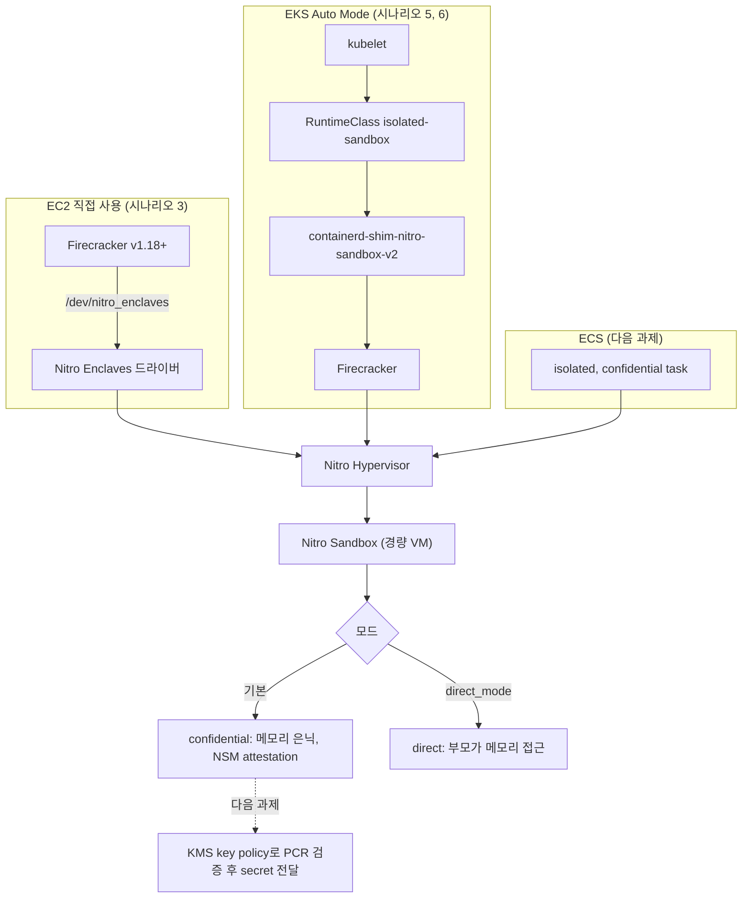

# 시나리오 1. Nitro Sandboxes 기능 지도

## 이 시나리오의 목표

| 항목 | 내용 |
|---|---|
| 기능 | 인스턴스 한 대를 여러 워크로드가 나눠 쓰면서, 워크로드마다 하드웨어로 격리된 VM 경계를 두는 기능 |
| 쓰는 도구 | 없음. 전체 지도와 읽는 순서만 정합니다 |
| 입력 | 2026년 11월 AWS 발표와 EC2, EKS 공식 문서 |
| 작업 | 1. 기능 전체 지도 확인 2. 시나리오 순서 확인 |
| 달성할 것 | 어떤 기능을 어떤 도구로, 몇 번 시나리오에서 확인하는지 안다 |

## Nitro Sandboxes는 컨테이너마다 붙는 작은 EC2입니다

같은 노드에 뜬 컨테이너는 Linux 커널 하나를 공유합니다. namespace와 cgroup은 커널이 그어 주는 경계라서, 커널 취약점이나 container escape가 하나 터지면 옆 컨테이너와 노드까지 같이 노출됩니다. 그래서 지금까지는 신뢰할 수 없는 코드(사용자가 올린 코드, LLM이 만든 코드, 다른 고객의 빌드 잡)를 돌릴 때 인스턴스를 고객마다 따로 띄우거나 gVisor, Kata Containers처럼 커널 경계를 하나 더 두는 방법을 썼습니다.

AWS Nitro Sandboxes는 그 경계를 Nitro Hypervisor가 직접 긋습니다. 부모 인스턴스(parent instance)가 자기 vCPU와 메모리 일부를 내놓으면, Nitro Hypervisor가 그 자원으로 경량 VM을 만들고 부모 인스턴스 옆에 나란히 실행합니다. 이 VM이 Nitro Sandbox입니다. 중첩 가상화(nested virtualization)가 아니라 EC2 인스턴스와 같은 1단계 guest라서 vCPU 성능이 인스턴스 수준으로 나옵니다.

헷갈리기 쉬운 경계는 다음과 같습니다.

- Nitro Sandboxes가 다루는 것: 워크로드 사이의 CPU와 메모리 격리, 부모 인스턴스로부터의 메모리 은닉(confidential 모드), 이미지 측정과 attestation.
- Nitro Sandboxes가 다루지 않는 것: 네트워크 경로와 디스크 내용. 네트워크 트래픽과 블록 디바이스는 부모 인스턴스를 거치므로 부모 인스턴스가 볼 수 있습니다. 이 부분은 직접 암호화해야 합니다.
- Nitro Enclaves와의 관계: Nitro Sandboxes는 Nitro Enclaves 드라이버(`/dev/nitro_enclaves`) 위에 만든 기능입니다. Enclave는 네트워크와 저장소가 없고 vsock 하나만 있는 최소 VM이고, Sandbox는 네트워크, 블록 디바이스, 일반 애플리케이션을 그대로 돌리는 범용 VM입니다.

### 용어

| 용어 | 뜻 | 이 실습의 예 |
|---|---|---|
| 부모 인스턴스 (parent instance) | Nitro Sandbox에 vCPU와 메모리를 내놓는 EC2 인스턴스. Nitro Enclaves를 켜고 띄워야 합니다 | `m7g.large`, `enclave_options.enabled = true` |
| Nitro Sandbox | 부모 인스턴스 옆에서 Nitro Hypervisor가 실행하는 경량 VM | Firecracker가 띄운 VM 1개, EKS pod 1개당 VM 1개 |
| VMM (virtual machine monitor) | Sandbox를 만들고 virtio 디바이스 backend를 제공하는 부모 인스턴스의 프로세스. 지금은 Firecracker만 지원합니다 | Firecracker v1.18.0 |
| confidential 모드 | 기본 모드. Sandbox 메모리를 부모 인스턴스에서 떼어 내고, NSM이 attestation을 제공합니다 | `"enclave": {}` |
| direct 모드 | 부모 인스턴스가 Sandbox 메모리를 읽고 쓸 수 있는 모드. 신뢰 모델이 중첩 VM과 같습니다 | `"direct_mode": true` |
| NSM (Nitro Security Module) | confidential 모드 Sandbox 안의 디바이스. 측정값에 서명한 attestation 문서를 만듭니다 | guest의 `/dev/nsm` |
| memory pool | 부모 인스턴스가 부팅할 때 Sandbox용으로 예약하는 메모리(CMA) | `nitro_enclaves.mempool=2G@0` |
| isolated pod | `runtimeClassName: isolated-sandbox`인 pod. 부모 노드는 신뢰하고 pod을 의심합니다 | `isolated-pod` |
| confidential pod | `runtimeClassName: confidential-sandbox`인 pod. 부모 노드도 의심합니다 | 이번 실습에서 실행하지 않음 |

## 시스템이 이 기능을 제공해야 하는 이유

격리를 애플리케이션이나 운영 절차로 해결하면 비용과 위험 중 하나를 고르게 됩니다.

- 테넌트마다 인스턴스를 따로 띄우면 격리는 확실하지만, 대부분 놀고 있는 인스턴스 비용을 냅니다. AI 에이전트처럼 짧게 코드를 돌리고 끝나는 워크로드일수록 낭비가 커집니다.
- 한 노드에 컨테이너로 모으면 활용률은 오르지만, 커널 하나가 모든 테넌트의 경계가 됩니다.
- 노드 안에서 KVM으로 VM을 직접 띄우려면 x86 Intel의 nested virtualization이 필요하고, 그 경계는 AWS가 아니라 내가 운영하는 hypervisor가 책임집니다.

Nitro Sandboxes는 세 번째 방법의 경계를 AWS의 Nitro System으로 옮깁니다. 인스턴스 한 대를 나눠 쓰면서도 경계는 EC2 인스턴스끼리의 경계와 같은 계층에 있습니다. 추가 요금은 없고, 부모 인스턴스 요금만 냅니다.

## 대안 비교

| 방식 | 격리 경계 | 경계를 운영하는 주체 | 인스턴스 공유 | 이번 실습 |
|---|---|---|---|---|
| 일반 컨테이너 (runc) | 공유 커널의 namespace, cgroup | 나 | 됨 | 시나리오 5에서 비교 대상 |
| gVisor, Kata Containers | 사용자 공간 커널 또는 중첩 VM | 나 | 됨 | 하지 않음 |
| 테넌트마다 EC2 | Nitro Hypervisor | AWS | 안 됨 | 하지 않음 |
| Nitro Enclaves | Nitro Hypervisor, vsock만 있는 최소 VM | AWS | 됨 | 하지 않음 |
| AWS Lambda MicroVMs | Firecracker | AWS (인스턴스도 AWS) | 해당 없음 | 하지 않음 |
| Nitro Sandboxes | Nitro Hypervisor, 범용 VM | AWS | 됨 | 시나리오 3, 5 |

## 기능 지도

Nitro Sandboxes를 쓰는 방법은 세 가지이고, 아래쪽으로 갈수록 AWS가 대신 해 주는 일이 많습니다.

| 기능 | 쓰는 도구 | 시나리오 |
|---|---|---|
| 부모 인스턴스 준비 (Enclaves, memory pool) | Terraform, `grubby` | [2-setup-ec2.md](2-setup-ec2.md), [3](3-ec2-firecracker-sandbox.md) |
| Firecracker로 Sandbox 실행, confidential과 direct 비교 | Firecracker, Python | [3-ec2-firecracker-sandbox.md](3-ec2-firecracker-sandbox.md) |
| Sandbox에서 부모 IMDS 차단 | nftables | [3-ec2-firecracker-sandbox.md](3-ec2-firecracker-sandbox.md) |
| EKS pod을 Sandbox로 실행 | EKS Auto Mode, RuntimeClass | [4-setup-eks.md](4-setup-eks.md), [5](5-eks-isolated-pod.md) |
| pod 네트워크 제거 | `sandbox.amazonaws.com/network-isolated` | [5-eks-isolated-pod.md](5-eks-isolated-pod.md) |
| LLM이 만든 코드를 sandbox에서 실행, 로그와 메트릭 확인 | Ollama `gemma2:2b`, CloudWatch, metrics-server | [6-ai-agent-code-sandbox.md](6-ai-agent-code-sandbox.md) |
| confidential pod, attestation, ECS | KMS, Cedar policy, ECS | [7-next-steps.md](7-next-steps.md) |

## 시나리오 순서

EKS에서는 `runtimeClassName` 한 줄이면 pod이 Sandbox로 뜹니다. 그 한 줄 아래에서 무엇이 일어나는지 모르면 "왜 pod 하나에 16MiB씩 더 잡히는가", "왜 IMDS가 404인가"에 답할 수 없습니다. 그래서 EC2에서 Firecracker로 Sandbox를 손으로 띄워 부품을 먼저 보고, 그다음 EKS가 같은 부품을 어떻게 감싸는지 확인합니다.

1. [2-setup-ec2.md](2-setup-ec2.md): EC2 부모 인스턴스 환경
2. [3-ec2-firecracker-sandbox.md](3-ec2-firecracker-sandbox.md): Firecracker로 Sandbox 실행, 모드 비교, IMDS 차단
3. [4-setup-eks.md](4-setup-eks.md): EKS 1.37 Auto Mode 환경
4. [5-eks-isolated-pod.md](5-eks-isolated-pod.md): runc pod과 isolated pod 비교, 네트워크 제거
5. [6-ai-agent-code-sandbox.md](6-ai-agent-code-sandbox.md): Gemma 2B가 만든 코드를 runc와 sandbox에서 실행해 막히는 것과 관측 비교
6. [7-next-steps.md](7-next-steps.md): 이번에 하지 않은 것과 다음 과제

## 참고 문서

1. [AWS What's New: Nitro Sandboxes for EKS, ECS, EC2](https://aws.amazon.com/ko/about-aws/whats-new/2026/11/nitro-sandboxes-eks-ecs-ec2/)
2. [Isolate workloads with AWS Nitro Sandboxes (EC2 User Guide)](https://docs.aws.amazon.com/AWSEC2/latest/UserGuide/amazon-ec2-nitro-sandboxes.html)
3. [Sandboxing on Amazon EKS with isolated and confidential pods](https://docs.aws.amazon.com/eks/latest/userguide/sandboxing.html)
4. [Isolated and confidential tasks (ECS Developer Guide)](https://docs.aws.amazon.com/AmazonECS/latest/developerguide/isolated-confidential-tasks.html)
