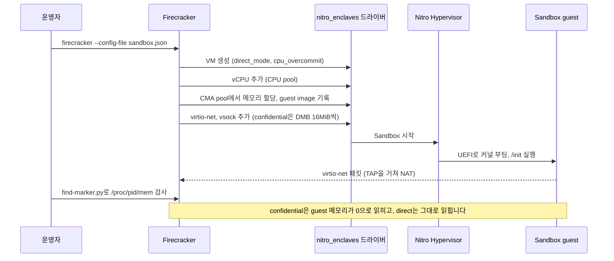

# 시나리오 3. EC2에서 Firecracker로 Nitro Sandbox 실행

## 이 시나리오의 목표

| 항목 | 내용 |
|---|---|
| 기능 | 부모 인스턴스 자원으로 하드웨어 격리 VM을 띄우고, 부모가 그 VM의 메모리를 볼 수 있는지를 모드로 고르는 기능 |
| 쓰는 도구 | Firecracker v1.18.0, dracut, nftables, Python(`find-marker.py`) |
| 입력 | [2-setup-ec2.md](2-setup-ec2.md)의 부모 인스턴스, [guest/](../guest/)의 init script와 Firecracker 설정 |
| 작업 | 1~2 Firecracker와 guest image 준비 3 memory pool 없이 실행 4~5 memory pool 예약 6~7 네트워크 준비 8~9 confidential 모드 실행과 메모리 검사 10~11 IMDS 차단과 direct 모드 메모리 검사 12 CPU overcommit 끄고 실행 |
| 달성할 것 | confidential 모드에서 부모가 guest 메모리를 읽지 못하고, direct 모드에서는 읽는 것을 같은 스크립트로 확인합니다 |

## Nitro Sandbox는 Firecracker가 KVM 대신 Nitro에 요청해 만드는 VM입니다

Firecracker는 원래 `/dev/kvm`으로 microVM을 만드는 VMM입니다. v1.18부터 설정 파일에 `enclave` 키가 있으면 KVM 대신 Nitro Enclaves 드라이버(`/dev/nitro_enclaves`)에 VM 생성을 요청합니다. 그러면 VM은 부모 인스턴스 커널 안이 아니라 Nitro Hypervisor 위에서 부모 인스턴스와 나란히 실행됩니다. Firecracker는 API socket과 virtio 디바이스 backend(network, block, vsock)만 맡습니다.

이 구조 때문에 경계가 두 가지로 나뉩니다.

- CPU와 메모리는 Nitro Hypervisor가 격리합니다. 부모 인스턴스 커널이 뚫려도 guest의 레지스터와 (confidential 모드라면) 메모리에는 닿지 못합니다.
- 디바이스 트래픽은 부모 인스턴스의 Firecracker가 중계합니다. 네트워크 패킷과 디스크 블록은 부모가 볼 수 있고, guest가 어디로 나가는지도 부모가 정합니다.

### 용어

| 용어 | 뜻 | 이 실습의 예 |
|---|---|---|
| guest image | EFI stub 커널, initrd, 커널 command line 세 가지. confidential 모드에서는 셋 다 측정됩니다 | `vmlinuz`(부모 커널 복사본), `initrd.img` |
| CMA pool | 부팅할 때 커널이 연속 메모리로 예약하는 Sandbox 전용 메모리 | `nitro_enclaves: CMA pool: 2048 MiB reserved` |
| slot | 실행 중인 Sandbox 하나가 차지하는 자리. memory pool이 있으면 4개로 시작하고 8개씩 늘립니다 | `pcie_slots` 4, `pcie_slots_total` 10 |
| DMB (device memory buffer) | confidential 모드에서 virtio 디바이스마다 따로 잡는 데이터 교환용 버퍼 | 디바이스당 16MiB |
| CPU overcommit | Sandbox vCPU가 부모 vCPU를 시분할로 나눠 쓰는 설정. 끄면 전용 코어를 받습니다 | `"cpu_overcommit": true` |
| debug mode | guest console을 Firecracker 표준 출력으로 보여 주는 개발용 설정. 측정값이 0이 됩니다 | `"debug_mode": true` |

## 시스템이 이 기능을 제공해야 하는 이유

노드 위에서 VM을 직접 띄우는 방법은 이전에도 있었습니다. 문제는 경계를 누가 책임지느냐입니다. 부모 인스턴스에서 KVM으로 VM을 띄우면 그 VM의 메모리는 부모 커널이 관리하는 페이지입니다. 부모 인스턴스 root는 `/proc/<VMM pid>/mem`으로 guest 메모리를 그대로 읽을 수 있습니다. 실습 11단계의 direct 모드가 이 상태를 재현하고, 부모가 guest의 표식 문자열을 1,988번 찾아냅니다.

다른 고객의 코드나 민감한 데이터를 다루는 서비스에서는 "노드 운영자가 데이터를 볼 수 없다"를 증명해야 할 때가 있습니다. 운영 절차로는 증명이 안 되고, 하드웨어가 메모리를 떼어 내야 합니다. confidential 모드에서는 Nitro System이 Sandbox 메모리를 부모 인스턴스에서 회수합니다. 같은 스크립트로 같은 영역을 읽어도 실습 9단계처럼 512MiB 전체가 0으로 읽힙니다.

## 대안 비교

| 방식 | 부모가 guest 메모리를 읽는가 | 지원 CPU | attestation | 경계를 운영하는 주체 |
|---|---|---|---|---|
| 부모 인스턴스에서 KVM + Firecracker | 읽음 | nested virtualization이 되는 Intel만 | 없음 | 나 |
| Nitro Sandbox direct 모드 | 읽음 | Intel, AMD, Graviton | 없음 | AWS |
| Nitro Sandbox confidential 모드 | 못 읽음 | Intel, AMD, Graviton | NSM | AWS |
| Nitro Enclave | 못 읽음 | Intel, AMD, Graviton | NSM | AWS. 대신 네트워크와 저장소가 없음 |

## 컴포넌트 역할

| 컴포넌트 | 위치 | 역할 |
|---|---|---|
| `enclave_options.enabled` | EC2 launch 설정 | 부모 인스턴스에 Nitro Enclaves 디바이스를 붙입니다 |
| `nitro_enclaves` 드라이버 | 부모 커널 6.18 | CMA pool, CPU pool, slot을 관리하고 Nitro Hypervisor에 VM 생성을 요청합니다 |
| Firecracker | 부모 프로세스 | 설정을 읽어 Sandbox를 만들고, TAP과 vsock backend를 제공합니다 |
| TAP + nftables | 부모 네트워크 | Sandbox의 `eth0`를 NAT로 바깥에 연결하고, IMDS로 가는 패킷을 거부합니다 |
| `sandbox-init` | guest PID 1 | 네트워크를 설정하고, 표식을 메모리에 쓰고, 연결을 검사합니다 |
| `find-marker.py` | 부모, root | Firecracker 프로세스의 메모리 구간을 전부 읽어 표식을 셉니다 |

## 흐름

구성 요소 사이의 흐름은 다음과 같습니다.



## 실습

모든 명령은 부모 인스턴스의 `ec2-user` 홈 디렉터리에서 실행합니다. 환경 준비는 [2-setup-ec2.md](2-setup-ec2.md)에 있습니다.

### 1. 부모 인스턴스 커널과 Enclaves 디바이스 확인

부모 인스턴스의 커널 버전과 `/dev/nitro_enclaves` 디바이스, 초기 PCIe slot 및 CPU/memory pool 상태를 확인합니다.

```bash
uname -r
ls -l /dev/nitro_enclaves
cat /sys/class/misc/nitro_enclaves/pcie_slots /sys/class/misc/nitro_enclaves/pcie_slots_total
cat /sys/class/misc/nitro_enclaves/cpu_pool/total /sys/class/misc/nitro_enclaves/mem_pool/total
```

커널 버전은 AMI 시점에 따라 달라집니다. `6.18.51-120.162` 이상이면 됩니다. CPU pool이 1인 이유는 드라이버가 첫 번째 코어를 부모 몫으로 남기기 때문입니다. memory pool은 아직 0입니다.

```text
6.18.56-126.188.amzn2023.aarch64
crw-rw----. 1 root root 10, 259 Nov 10 23:49 /dev/nitro_enclaves
4
10
1
0
```

### 2. Firecracker 설치와 guest image 빌드

Firecracker v1.18.0 바이너리를 내려받아 `/usr/local/bin/firecracker`에 설치하고 버전을 확인합니다.

```bash
VERSION=1.18.0; ARCH=$(uname -m)
curl -sSfL -o firecracker.tgz \
  https://github.com/firecracker-microvm/firecracker/releases/download/v${VERSION}/firecracker-v${VERSION}-${ARCH}.tgz
tar -xzf firecracker.tgz
sudo install -m 755 release-v${VERSION}-${ARCH}/firecracker-v${VERSION}-${ARCH} /usr/local/bin/firecracker
firecracker --version
```

guest 커널은 부모 커널을 그대로 복사합니다. AL2023 6.18 커널은 EFI stub과 DMB를 모두 지원합니다. initrd에는 [sandbox-init](../guest/sandbox-init)이 부르는 프로그램만 넣습니다. dracut의 `base` 모듈을 넣으면 자체 `/init`이 `sandbox-init`을 덮어쓰므로 `bash` 모듈만 씁니다.

```bash
chmod +x sandbox-init
cp /boot/vmlinuz-$(uname -r) vmlinuz
sudo dracut --force --no-hostonly --reproducible --no-early-microcode --modules bash \
  --add-drivers "virtio_pci virtio_net vmw_vsock_virtio_transport nsm" \
  --install "mount modprobe ip sleep uname nproc grep ls wc seq timeout" \
  --include "$PWD/sandbox-init" /init --kver $(uname -r) initrd.img
sudo chown "$(id -un):" initrd.img
ls -lh vmlinuz initrd.img
```

출력은 다음과 같습니다.

```text
Firecracker v1.18.0
-rw-------. 1 ec2-user ec2-user 7.9M Nov 10 23:51 initrd.img
-rwxr-xr-x. 1 ec2-user ec2-user  13M Nov 10 23:51 vmlinuz
```

### 3. memory pool 없이 Sandbox 실행 시도

[sandbox.json](../guest/sandbox.json)은 vCPU 1개, 메모리 512MiB, `eth0`와 vsock을 붙이고 `cpu_overcommit`과 `debug_mode`를 켠 confidential 모드 설정입니다. 네트워크를 준비하기 전이라도 메모리 할당 단계에서 결과가 나옵니다.

```bash
sudo ip tuntap add dev tap0 mode tap
sudo mkdir -p /run/sandbox; sudo rm -f /run/sandbox/v.sock
sudo timeout 20 firecracker --no-api --config-file sandbox.json 2>&1 | grep -E "created|CMA|Error:"
```

`free -m`로는 7GiB 넘게 비어 있는데도 실패합니다. Sandbox 메모리는 일반 페이지가 아니라 부팅 때 예약한 CMA pool에서만 나오기 때문입니다.

```text
... Enclave VM created: slot=0x1a1c7df8e0b6c6c, direct_mode=false, cpu_overcommit=true, ...
... CMA allocation failed: size=536870912 bytes gpa=0x40000000 parent_numa=0 prot=0x3: Cannot create mmap region: Out of memory (os error 12)
Error: RunWithoutApiError(BuildMicroVMFromJson(StartMicroVM(Enclave(EnclaveVm(CmaAlloc(...))))))
```

### 4. 커널 command line에 memory pool 추가 후 재부팅

pool 크기는 동시에 띄울 Sandbox 메모리 합계에 오버헤드를 더해 정합니다. 이 실습은 512MiB Sandbox를 하나씩 띄우므로 2GiB로 넉넉히 잡습니다. 커널 부팅 인자를 갱신하고 재부팅합니다(재부팅 중 SSH 연결이 끊어지므로 약 30초 후 부모 인스턴스에 다시 접속합니다).

```bash
sudo grubby --update-kernel=ALL --args="nitro_enclaves.mempool=2G@0"
sudo reboot
```

### 5. memory pool 예약 확인

다시 SSH 접속한 뒤, 부팅 로그와 sysfs를 통해 2GiB CMA pool이 정상 예약되었는지 확인합니다.

```bash
sudo dmesg | grep "CMA pool"
cat /sys/class/misc/nitro_enclaves/mem_pool/total /sys/class/misc/nitro_enclaves/mem_pool/free
```

출력은 다음과 같습니다.

```text
[    0.000000] nitro_enclaves: CMA pool: 2048 MiB reserved in 8 region(s), 2048 MiB requested
2147483648
2143289344
```

- 재부팅 직후에도 free가 total보다 4MiB 적습니다. 실행 중인 Sandbox가 없어도 드라이버가 기본 slot 몫을 먼저 씁니다.
- CMA 영역은 Sandbox가 쓰기 전까지 커널이 이동 가능한 페이지로 빌려 쓰므로 `free -m`의 total은 줄지 않습니다.

### 6. TAP 디바이스와 IP forwarding 설정

TAP, IP forwarding, nftables 규칙, vsock socket 디렉터리(`/run/sandbox`, tmpfs)는 재부팅하면 사라집니다. 4단계에서 재부팅했으므로 여기서 다시 만듭니다.

```bash
sudo mkdir -p /run/sandbox
sudo ip tuntap add dev tap0 mode tap
sudo ip addr add 192.0.2.1/24 dev tap0
sudo ip link set tap0 up
sudo sysctl -w net.ipv4.ip_forward=1
```

### 7. NAT 규칙 적용 (IMDS 차단 전)

먼저 NAT 규칙만 적용해 IMDS가 차단되지 않은 상태의 동작을 확인합니다.

```bash
sudo dnf install -y nftables
IFACE=$(ip route show default | awk '{print $5; exit}')
sudo nft -f - <<EOF
table ip sandbox {
  chain postrouting {
    type nat hook postrouting priority srcnat; policy accept;
    iifname "tap0" oifname "$IFACE" masquerade
  }
}
EOF
```

### 8. confidential 모드 Sandbox 실행

Firecracker를 백그라운드로 띄우고 guest console 출력을 파일로 받습니다. debug mode라서 guest의 `echo`가 Firecracker 표준 출력에 나옵니다.

```bash
sudo rm -f /run/sandbox/v.sock
(sudo nohup firecracker --no-api --config-file sandbox.json > fc-confidential.log 2>&1 &)
sleep 15
grep -E "Enclave VM created|\[guest\]" fc-confidential.log
cat /sys/class/misc/nitro_enclaves/pcie_slots_in_use /sys/class/misc/nitro_enclaves/mem_pool/free
```

`marker parts` 두 숫자는 실행마다 달라집니다. 다음 단계에 그대로 넘깁니다.

```text
... Enclave VM created: slot=0x1a1c7e0aa28bce1, direct_mode=false, cpu_overcommit=true, ...
[guest] kernel: 6.18.56-126.188.amzn2023.aarch64
[guest] vcpus: 1, MemTotal:         448964 kB
[guest] processes visible: 123
[guest] nsm device: /dev/nsm
[guest] marker parts: 2604927768 86541341
[guest] tcp 1.1.1.1:80 -> open
[guest] tcp 169.254.169.254:80 (parent IMDS) -> open
1
1570766848
```

- guest는 부모와 같은 버전이지만 별도로 부팅한 커널을 씁니다. `processes visible`은 guest 커널의 프로세스와 커널 스레드 수이고, 부모 프로세스는 보이지 않습니다.
- memory pool에서 빠진 양은 2,143,289,344 − 1,570,766,848 = 546MiB입니다. Sandbox 메모리 512MiB, Sandbox당 2MiB, confidential 모드 디바이스 2개(`eth0`, vsock)의 DMB 16MiB씩을 더한 값과 정확히 같습니다.
- IMDS 차단 규칙이 없어서 guest가 부모의 `169.254.169.254`에 닿습니다. 부모에 IAM role이 붙어 있으면 guest가 그 자격 증명을 읽을 수 있다는 뜻입니다.

### 9. 부모에서 confidential guest 메모리 검사

[find-marker.py](../guest/find-marker.py)는 Firecracker 프로세스의 `/proc/<pid>/maps` 구간을 권한 비트와 상관없이 전부 읽어 `NSBX<part_a><part_b>MARK`를 셉니다. guest는 이 문자열을 2,000번 메모리(initramfs의 `/secret.txt`)에 썼고, console에는 조각만 찍었으므로 Firecracker의 console 버퍼에서는 이어진 문자열이 나오지 않습니다. 아래 명령의 마지막 두 인자에는 8단계 출력에서 확인한 `marker parts` 숫자를 그대로 넣습니다.

```bash
sudo python3 find-marker.py $(pgrep -x firecracker) 2604927768 86541341
```

출력은 다음과 같습니다.

```text
  16 MiB rw-s /dev/nitro_enclaves -> hits: 0
  16 MiB rw-s /dev/nitro_enclaves -> hits: 0
 512 MiB ---s /dev/nitro_enclaves -> hits: 0
scanned 549 MiB, total marker hits: 0
```

- 512MiB 구간이 guest 메모리이고 권한이 `---s`입니다. root가 `/proc/<pid>/mem`으로 강제로 읽으면 오류 없이 읽히지만, 실측한 결과 536,870,912바이트가 전부 0이었습니다.
- 16MiB `rw-s` 구간 두 개가 `eth0`와 vsock의 DMB입니다. 부모가 읽고 쓸 수 있는 영역은 이 버퍼뿐이라서, 디바이스로 나가는 데이터는 guest가 암호화해야 합니다.

### 10. IMDS 차단 규칙 추가 후 Sandbox 종료

실행 중인 confidential 모드 Firecracker를 종료하고, `tap0`에서 부모 IMDS(`169.254.169.254`)로 향하는 포워딩 패킷을 차단하는 nftables 규칙을 추가한 뒤 반환된 slot과 메모리를 확인합니다.

```bash
sudo pkill -x firecracker
sudo nft add chain ip sandbox forward '{ type filter hook forward priority filter; policy accept; }'
sudo nft add rule ip sandbox forward iifname "tap0" ip daddr 169.254.169.254 reject
sudo nft list chain ip sandbox forward
cat /sys/class/misc/nitro_enclaves/pcie_slots_in_use /sys/class/misc/nitro_enclaves/mem_pool/free
```

Sandbox가 멈추면 slot과 메모리가 pool로 돌아옵니다.

```text
table ip sandbox {
 chain forward {
  type filter hook forward priority filter; policy accept;
  iifname "tap0" ip daddr 169.254.169.254 reject
 }
}
0
2143289344
```

### 11. direct 모드 Sandbox 실행과 메모리 검사

설정에서 `direct_mode`만 켭니다.

```bash
python3 -c 'import json; c=json.load(open("sandbox.json")); c["enclave"]["direct_mode"]=True; json.dump(c, open("sandbox-direct.json","w"), indent=2)'
sudo rm -f /run/sandbox/v.sock
(sudo nohup firecracker --no-api --config-file sandbox-direct.json > fc-direct.log 2>&1 &)
sleep 15
grep -E "Enclave VM created|\[guest\]" fc-direct.log
cat /sys/class/misc/nitro_enclaves/mem_pool/free
```

출력은 다음과 같습니다.

```text
... Enclave VM created: slot=0x1a1c7e171a8cd3f, direct_mode=true, cpu_overcommit=true, ...
[guest] kernel: 6.18.56-126.188.amzn2023.aarch64
[guest] vcpus: 1, MemTotal:         451008 kB
[guest] processes visible: 122
[guest] nsm device: ls: cannot access '/dev/nsm': No such file or directory
[guest] marker parts: 706712300 1906029754
[guest] tcp 1.1.1.1:80 -> open
[guest] tcp 169.254.169.254:80 (parent IMDS) -> blocked
1604321280
```

- pool에서 빠진 양은 514MiB입니다. direct 모드는 DMB를 쓰지 않으므로 512MiB와 Sandbox당 2MiB만 빠집니다.
- direct 모드에는 NSM이 없어 attestation을 할 수 없습니다.
- 10단계의 `reject` 규칙으로 IMDS가 막혔고, 바깥 IP는 여전히 열려 있습니다.

같은 스크립트로 메모리를 검사합니다.

```bash
sudo python3 find-marker.py $(pgrep -x firecracker) 706712300 1906029754
```

출력은 다음과 같습니다.

```text
 512 MiB rw-s /dev/nitro_enclaves -> hits: 1988
scanned 517 MiB, total marker hits: 1988
```

guest 메모리 구간이 `rw-s`로 매핑되어 부모가 표식을 1,988번 찾습니다. 2,000번에 못 미치는 이유는 확인하지 않았습니다. initramfs 파일이 페이지 경계에서 잘린 조각은 정규식에 걸리지 않으므로 그 영향으로 추정합니다.

### 12. CPU overcommit 끄고 vCPU 2개, 1개로 실행

`cpu_overcommit`을 빼면 Sandbox vCPU가 부모의 전용 코어를 받습니다. `m7g.large`는 CPU pool이 1이므로 vCPU 2개는 실패해야 합니다.

```bash
sudo pkill -x firecracker
for v in 2 1; do
  python3 -c "import json; c=json.load(open('sandbox.json')); c['enclave'].pop('cpu_overcommit'); c['machine-config']['vcpu_count']=$v; json.dump(c, open('sandbox-dedicated.json','w'), indent=2)"
  sudo rm -f /run/sandbox/v.sock
  (sudo nohup firecracker --no-api --config-file sandbox-dedicated.json > fc-dedicated-$v.log 2>&1 &)
  sleep 15
  echo "== vcpu_count=$v"; grep -E "Error:|\[guest\] vcpus" fc-dedicated-$v.log | cut -c1-200
  cat /sys/class/misc/nitro_enclaves/cpu_pool/in_use
done
sudo pkill -x firecracker
```

출력은 다음과 같습니다.

```text
== vcpu_count=2
Error: RunWithoutApiError(...AddAnyVcpu { ... error: "NE_ERR_NO_CPUS_AVAIL_IN_POOL (errno=272): no CPUs are available in the NE CPU pool" } ...)
0
== vcpu_count=1
[guest] vcpus: 1, MemTotal:         448964 kB
1
```

실습을 마쳤으면 [2-setup-ec2.md](2-setup-ec2.md)의 down으로 정리합니다.

## 부록. 실무에서 얻는 것

- memory pool은 부팅 때 정하므로 용량 계획이 부팅 설정이 됩니다. Sandbox 크기 합계에 Sandbox당 2MiB, confidential이면 디바이스당 16MiB, slot 8개 단위로 128MiB를 더해 잡습니다. 이번 실측에서 이 공식과 pool 감소량이 MiB 단위까지 맞았습니다.
- 부모에 IAM role이 있고 Sandbox를 NAT로 내보내면, Sandbox가 IMDS로 부모의 자격 증명을 읽습니다. IMDSv2와 hop limit 2는 이 경로를 막지 못하므로 `169.254.169.254`로 가는 forward 패킷을 부모에서 `reject`합니다.
- CPU overcommit을 끄면 Sandbox가 전용 코어를 받는 대신, 첫 번째 코어를 뺀 나머지만 쓸 수 있습니다. 2 vCPU 인스턴스에서는 전용 vCPU 1개짜리 Sandbox 하나가 한계입니다. 밀도가 필요하면 overcommit을 켜고 vCPU 합계를 부모의 5배까지 쓸 수 있습니다.
- confidential 모드도 블록 디바이스와 네트워크 내용은 숨기지 못합니다. 부모가 읽을 수 있는 DMB를 실측으로 확인했으므로, 민감한 데이터는 attestation을 거쳐 KMS가 내준 키로 guest 안에서 암호화해야 합니다. 이 부분은 [7-next-steps.md](7-next-steps.md)에 남깁니다.
- debug mode는 console을 보여 주지만 attestation 측정값을 0으로 만듭니다. 이번 실습은 debug mode로 결과를 읽었으므로, attestation 실습에서는 debug mode를 끄고 결과를 vsock으로 받아야 합니다.

## 참고 문서

1. [Run Nitro Sandboxes with Firecracker](https://docs.aws.amazon.com/AWSEC2/latest/UserGuide/nitro-sandboxes-run-firecracker.html)
2. [Nitro Sandboxes considerations and limitations](https://docs.aws.amazon.com/AWSEC2/latest/UserGuide/amazon-ec2-nitro-sandboxes.html#nitro-sandboxes-considerations)
3. [Firecracker releases](https://github.com/firecracker-microvm/firecracker/releases)
