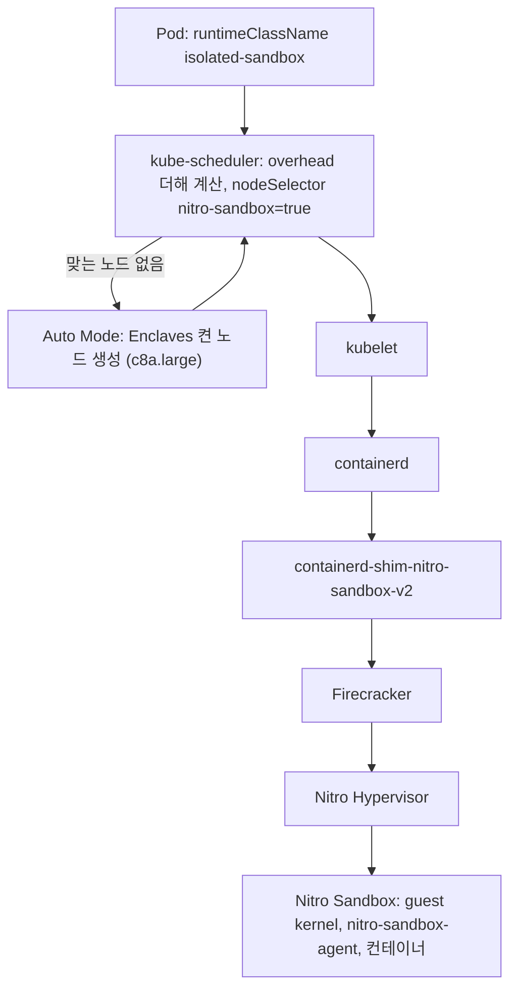

# 시나리오 5. EKS에서 pod을 Nitro Sandbox로 실행

## 이 시나리오의 목표

| 항목 | 내용 |
|---|---|
| 기능 | pod spec 한 줄로 pod마다 Nitro Sandbox를 하나씩 주고, 노드 커널을 다른 pod과 공유하지 않게 하는 기능 |
| 쓰는 도구 | EKS 1.37 Auto Mode, RuntimeClass `isolated-sandbox`, annotation `sandbox.amazonaws.com/network-isolated` |
| 입력 | [4-setup-eks.md](4-setup-eks.md)의 클러스터, [manifests/](../manifests/)의 pod 5개 |
| 작업 | 1 RuntimeClass 확인 2 일반 pod과 isolated pod 생성 3 노드 비교 4 pod 안에서 커널, CPU, 메모리, IMDS 비교 5 hostPID로 보이는 범위 비교 6 네트워크 제거 pod |
| 달성할 것 | isolated pod은 노드와 다른 커널에서 돌고, `hostPID: true`여도 노드 프로세스를 못 보는 것을 확인합니다 |

## isolated pod은 kubelet이 runc 대신 Firecracker를 부르는 pod입니다

시나리오 3에서 손으로 했던 일을 EKS 노드에서는 containerd shim이 합니다. kubelet이 `runtimeClassName: isolated-sandbox`인 pod을 받으면 containerd가 `containerd-shim-nitro-sandbox-v2`를 실행하고, shim이 Firecracker로 Nitro Sandbox를 하나 띄웁니다. Sandbox 안에서는 `nitro-sandbox-agent`가 자기 containerd로 컨테이너를 실행합니다. pod 하나가 Sandbox 하나이고, 같은 pod의 컨테이너들은 Sandbox를 같이 씁니다.

RuntimeClass는 두 개입니다.

| RuntimeClass | 신뢰하는 쪽 | 막으려는 것 | Cedar policy |
|---|---|---|---|
| `isolated-sandbox` | 노드 | 뚫린 컨테이너가 노드와 다른 pod에 닿는 것 | 없어도 됨. 기본 policy가 전부 허용 |
| `confidential-sandbox` | Sandbox 안 | 노드 운영자가 pod 데이터를 보는 것 | 필수. image digest, args, env, mount를 고정하고 `exec`를 막음 |

이 시나리오는 `isolated-sandbox`만 실행합니다. confidential pod은 [7-next-steps.md](7-next-steps.md)에 남깁니다.

### 용어

| 용어 | 뜻 | 이 실습의 예 |
|---|---|---|
| RuntimeClass | pod이 쓸 container runtime handler를 고르는 Kubernetes 객체 | `isolated-sandbox` (handler도 같은 이름) |
| pod overhead | RuntimeClass가 pod마다 더하는 자원. scheduler와 kubelet이 pod 자원에 더해 계산합니다 | `memory: 256Mi`, `eks.amazonaws.com/nitro-sandbox: "1"` |
| `eks.amazonaws.com/nitro-sandbox` | Sandbox 노드가 내놓는 extended resource와 노드 label | `c8a.large` 노드의 capacity 10 |
| `nitro-sandbox-agent` | Sandbox 안에서 컨테이너를 실행하는 agent | `isolated-hostpid-pod`에서 보이는 프로세스 |
| network-isolated | Sandbox를 네트워크 디바이스 없이 부팅하는 annotation | `isolated-network-off-pod` |

## 시스템이 이 기능을 제공해야 하는 이유

Kubernetes에서 pod 경계는 노드 커널 하나가 지킵니다. 실습 5단계에서 `hostPID: true`를 준 일반 pod은 노드의 `kubelet`, `eks-pod-identity-agent`, Bottlerocket `apiserver`까지 193개 프로세스를 봅니다. 설정 한 줄로 노드 전체가 보인다는 것은, 커널 취약점 하나나 잘못된 securityContext 하나로 pod이 노드를 넘볼 수 있다는 뜻입니다. AI 에이전트가 만든 코드나 고객이 올린 빌드 스크립트를 이 노드에서 돌리면 그 코드도 같은 경계 안에 있습니다.

같은 설정을 isolated pod에 주면 Sandbox 안의 124개 프로세스만 보이고, 노드 프로세스는 하나도 보이지 않습니다. 경계가 namespace 설정이 아니라 Nitro Hypervisor에 있어서 pod spec으로 넘을 수 없기 때문입니다.

## 대안 비교

| 방식 | pod 커널 | 노드 준비 | 이번 실습 |
|---|---|---|---|
| runc (기본) | 노드 커널 공유 | 없음 | `runc-pod` |
| gVisor (`runsc`) | 사용자 공간 커널 | runtime 설치, RuntimeClass 작성 | 하지 않음 |
| Kata Containers | 중첩 VM 커널 | nested virtualization 또는 bare metal | 하지 않음 |
| 테넌트별 노드 분리 | 노드 커널, 대신 노드가 다름 | node pool과 taint 분리 | 하지 않음 |
| Nitro Sandbox (`isolated-sandbox`) | Sandbox 커널 | Auto Mode는 없음 | `isolated-pod` |

## 컴포넌트 역할

| 컴포넌트 | 위치 | 역할 |
|---|---|---|
| RuntimeClass `isolated-sandbox` | 클러스터 | handler를 지정하고, pod overhead와 `eks.amazonaws.com/nitro-sandbox: "true"` nodeSelector를 붙입니다 |
| Auto Mode `general-purpose` node pool | AWS 관리 | Sandbox resource를 요구하는 pod을 보면 Nitro Enclaves를 켠 노드를 띄웁니다 |
| `containerd-shim-nitro-sandbox-v2` | 노드 | pod마다 Firecracker로 Sandbox를 만듭니다 |
| `nitro-sandbox-agent` | Sandbox | Cedar policy를 평가하고 컨테이너를 실행합니다 |
| IMDS proxy | 노드와 Sandbox 사이 | region, AZ 같은 placement 경로만 응답하고 나머지는 404로 막습니다 |

## 흐름

구성 요소 사이의 흐름은 다음과 같습니다.



## 실습

명령은 workspace 루트(`aws/nitro-sandboxes`)에서 실행합니다. 환경 준비는 [4-setup-eks.md](4-setup-eks.md)에 있습니다.

### 1. RuntimeClass의 overhead와 nodeSelector 확인

Auto Mode 클러스터에는 두 RuntimeClass가 처음부터 있습니다.

```bash
kubectl get runtimeclass
kubectl get runtimeclass isolated-sandbox -o yaml
```

출력은 다음과 같습니다.

```text
NAME                   HANDLER                AGE
confidential-sandbox   confidential-sandbox   2m21s
isolated-sandbox       isolated-sandbox       2m21s
```

출력의 주요 부분은 다음과 같습니다.

```yaml
handler: isolated-sandbox
overhead:
  podFixed:
    eks.amazonaws.com/nitro-sandbox: "1"
    memory: 256Mi
scheduling:
  nodeSelector:
    eks.amazonaws.com/nitro-sandbox: "true"
```

pod마다 메모리 256Mi와 Sandbox slot 하나가 더 잡힙니다. 256Mi는 시나리오 3에서 본 guest 커널, Sandbox당 2MiB, 디바이스당 16MiB DMB를 덮는 고정 예산으로 보입니다. 정확한 구성은 확인 필요입니다.

### 2. 일반 pod과 isolated pod 생성

두 manifest는 image, 명령, resources가 같고 [isolated-pod.yaml](../manifests/isolated-pod.yaml)에만 `runtimeClassName: isolated-sandbox`가 있습니다.

```bash
kubectl apply -f manifests/runc-pod.yaml -f manifests/isolated-pod.yaml
kubectl wait --for=condition=Ready pod/runc-pod pod/isolated-pod --timeout=600s
kubectl get pods -o wide
```

노드가 없는 상태에서 두 pod 모두 40초 안에 Ready가 됐습니다. 노드 이름과 IP는 실행마다 다릅니다.

```text
NAME           READY   STATUS    RESTARTS   AGE   IP            NODE
isolated-pod   1/1     Running   0          39s   10.20.10.64   i-041dadb8abb5d8a8b
runc-pod       1/1     Running   0          39s   10.20.11.16   i-046e3a8a428d46953
```

### 3. 두 pod이 올라간 노드 비교

다음 명령을 실행합니다.

```bash
kubectl get nodes -L node.kubernetes.io/instance-type,eks.amazonaws.com/nitro-sandbox
kubectl get nodes -o custom-columns='NAME:.metadata.name,MEM_ALLOC:.status.allocatable.memory,SANDBOX:.status.allocatable.eks\.amazonaws\.com/nitro-sandbox'
aws ec2 describe-instances --region us-west-2 \
  --filters Name=tag:eks:eks-cluster-name,Values=nitro-sandbox Name=instance-state-name,Values=running \
  --query 'Reservations[].Instances[].[InstanceType,EnclaveOptions.Enabled,CpuOptions.ThreadsPerCore]' --output text
```

출력은 다음과 같습니다.

```text
NAME                  STATUS   ROLES    AGE   VERSION               INSTANCE-TYPE   NITRO-SANDBOX
i-041dadb8abb5d8a8b   Ready    <none>   11s   v1.37.0-eks-29d7970   c8a.large       true
i-046e3a8a428d46953   Ready    <none>   23s   v1.37.0-eks-29d7970   c6a.large       false

NAME                  MEM_ALLOC   SANDBOX
i-041dadb8abb5d8a8b   2349Mi      10
i-046e3a8a428d46953   3138072Ki   <none>

c8a.large True 1
c6a.large False 2
```

- Auto Mode는 isolated pod을 위해 Nitro Enclaves를 켠 노드를 따로 띄웠습니다. 일반 pod은 Sandbox 노드에 갈 이유가 없어 다른 노드로 갔습니다.
- Auto Mode가 고른 `c8a.large`는 코어당 스레드가 1입니다. 코어당 스레드가 2인 타입은 Sandbox가 쓸 수 있는 CPU가 절반쯤으로 줄어듭니다.
- Sandbox capacity 10은 vCPU 2개의 5배입니다. EC2 문서의 "vCPU당 Sandbox 5개" 한도가 그대로 extended resource가 됐습니다.
- 메모리 capacity는 둘 다 3.7GiB 안팎인데, Sandbox 노드의 allocatable이 약 715Mi 적습니다. 시나리오 3의 memory pool처럼 Sandbox용 메모리를 따로 예약한 것으로 추정합니다. 확인 필요입니다.

### 4. pod 안에서 커널, CPU, 메모리, IMDS 비교

같은 명령을 두 pod에서 실행합니다.

```bash
for p in runc-pod isolated-pod; do
  echo "===== $p"
  kubectl exec $p -- sh -c '
    echo "kernel: $(uname -r)"; echo "nproc: $(nproc)"; grep MemTotal /proc/meminfo
    T=$(curl -s -m3 -X PUT http://169.254.169.254/latest/api/token -H "X-aws-ec2-metadata-token-ttl-seconds: 60")
    echo "imds region: $(curl -s -m3 -H "X-aws-ec2-metadata-token: $T" http://169.254.169.254/latest/meta-data/placement/region)"
    echo "imds instance-id: $(curl -s -m3 -o /dev/null -w "%{http_code}" -H "X-aws-ec2-metadata-token: $T" http://169.254.169.254/latest/meta-data/instance-id)"
    echo "imds iam: $(curl -s -m3 -o /dev/null -w "%{http_code}" -H "X-aws-ec2-metadata-token: $T" http://169.254.169.254/latest/meta-data/iam/security-credentials/)"'
done
kubectl get nodes -o custom-columns='NAME:.metadata.name,KERNEL:.status.nodeInfo.kernelVersion,OS:.status.nodeInfo.osImage'
```

출력은 다음과 같습니다.

```text
===== runc-pod
kernel: 6.18.56
nproc: 2
MemTotal:        3882520 kB
imds region:
imds instance-id: 401
imds iam: 401
===== isolated-pod
kernel: 6.18.54
nproc: 1
MemTotal:         402640 kB
imds region: us-west-2
imds instance-id: 404
imds iam: 404

NAME                  KERNEL    OS
i-041dadb8abb5d8a8b   6.18.56   Bottlerocket (EKS Auto, Standard) 2026.10.31 (aws-k8s-1.37-standard)
i-046e3a8a428d46953   6.18.56   Bottlerocket (EKS Auto, Standard) 2026.10.31 (aws-k8s-1.37-standard)
```

| 항목 | runc-pod | isolated-pod | 해석 |
|---|---|---|---|
| 커널 | 6.18.56 | 6.18.54 | isolated pod은 노드(6.18.56)와 다른 Sandbox 커널로 부팅했습니다 |
| `nproc` | 2 | 1 | runc는 cgroup으로 제한해도 노드 CPU가 다 보이고, Sandbox는 `limits.cpu: "1"`만큼의 vCPU만 받습니다 |
| `MemTotal` | 노드 전체 3.7GiB | 393MiB | Sandbox는 `limits.memory: 512Mi` 크기 VM이고, 그 안의 커널이 일부를 씁니다 |
| IMDS | 토큰 발급 실패(401) | region만 응답, 나머지 404 | Auto Mode 노드는 hop limit이 1이라 일반 pod이 토큰을 못 받습니다. Sandbox는 placement 경로만 열어 줍니다 |

isolated pod에서 IAM 자격 증명 경로는 404입니다. 시나리오 3에서 NAT로 내보낸 Sandbox가 부모 IMDS에 닿았던 문제를 EKS는 IMDS proxy로 막아 둡니다. pod에 AWS 권한이 필요하면 EKS Pod Identity를 씁니다.

### 5. hostPID로 보이는 프로세스 범위 비교

[runc-hostpid-pod.yaml](../manifests/runc-hostpid-pod.yaml)과 [isolated-hostpid-pod.yaml](../manifests/isolated-hostpid-pod.yaml)은 2단계 pod에 `hostPID: true`만 더한 것입니다.

```bash
kubectl apply -f manifests/runc-hostpid-pod.yaml -f manifests/isolated-hostpid-pod.yaml
kubectl wait --for=condition=Ready pod/runc-hostpid-pod pod/isolated-hostpid-pod --timeout=600s
for p in runc-hostpid-pod isolated-hostpid-pod; do
  echo "===== $p"
  kubectl exec $p -- sh -c 'echo "processes: $(ls -d /proc/[0-9]* | wc -l)"
    for d in /proc/[0-9]*; do tr "\0" " " < $d/cmdline 2>/dev/null | cut -c1-60; echo; done \
      | grep -v "^$" | sort -u | grep -E "kubelet|containerd|sleep|agent|apiserver"' 2>/dev/null
done
```

Sandbox 노드가 이미 떠 있어서 이번에는 두 pod 모두 5초 안에 Ready가 됐습니다.

```text
===== runc-hostpid-pod
processes: 193
/usr/bin/apiserver --datastore-path /var/lib/bottlerocket/da
/usr/bin/aws-network-policy-agent --kubeconfig /etc/kubernet
/usr/bin/coreutils --coreutils-prog-shebang=sleep /usr/bin/s
/usr/bin/eks-node-monitoring-agent --kubeconfig /etc/kuberne
/usr/bin/eks-pod-identity-agent server --metrics-address 127
/usr/bin/kubelet --cloud-provider external --kubeconfig /etc
===== isolated-hostpid-pod
processes: 124
/usr/bin/coreutils --coreutils-prog-shebang=sleep /usr/bin/s
/usr/sbin/nitro-sandbox-agent
```

isolated pod의 "host"는 노드가 아니라 Sandbox입니다. 노드의 `kubelet`, containerd, 같은 노드에 있는 `isolated-pod`의 프로세스도 보이지 않습니다.

### 6. 네트워크 디바이스 없는 pod 실행

[isolated-network-off-pod.yaml](../manifests/isolated-network-off-pod.yaml)은 pod template annotation에 `sandbox.amazonaws.com/network-isolated: "true"`를 붙였습니다.

```bash
kubectl apply -f manifests/isolated-network-off-pod.yaml
kubectl wait --for=condition=Ready pod/isolated-network-off-pod --timeout=600s
kubectl exec isolated-network-off-pod -- sh -c '
  cat /proc/net/dev | tail -n +3 | cut -d: -f1
  echo "internet: $(curl -s -m5 -o /dev/null -w "%{http_code}" https://checkip.amazonaws.com || echo fail)"
  echo "imds: $(curl -s -m3 -o /dev/null -w "%{http_code}" http://169.254.169.254/ || echo fail)"'
kubectl get pod isolated-network-off-pod -o jsonpath='{.status.podIP}{"\n"}'
```

출력은 다음과 같습니다.

```text
    lo
dummy0
internet: 000fail
imds: 000fail
10.20.10.66
```

- 4단계의 isolated pod에는 `eth0`가 있었고, 이 pod에는 `lo`와 `dummy0`뿐입니다. 패킷을 필터링하는 것이 아니라 디바이스가 없습니다.
- Kubernetes는 여전히 pod IP를 배정하지만, Sandbox 안에는 그 IP로 이어지는 디바이스가 없습니다. 그래서 HTTP probe와 `kubectl port-forward`는 동작하지 않고, exec probe를 써야 합니다.
- `kubectl exec`와 logs는 vsock으로 동작합니다. 이 실습의 `kubectl exec`도 그 경로를 썼습니다.

실습을 마쳤으면 [4-setup-eks.md](4-setup-eks.md)의 down으로 정리합니다.

## 부록. 실무에서 얻는 것

- 스케줄링 계산이 달라집니다. `requests.memory: 256Mi`인 isolated pod은 노드에서 512Mi(overhead 256Mi 포함)를 차지했습니다. 작은 pod을 많이 띄우는 워크로드일수록 overhead 비중이 커지고, 노드 allocatable도 Sandbox 예약만큼 줄어 있습니다.
- `limits`가 곧 VM 크기입니다. `nproc`과 `MemTotal`이 limit을 따르므로, 노드 CPU 수를 보고 worker 수를 정하는 런타임(JVM, Node.js worker, Go `GOMAXPROCS`)은 runc pod보다 정확한 값을 봅니다. 대신 in-place resize는 되지 않고 pod을 다시 만들어야 합니다.
- 첫 pod은 노드 생성 시간이 듭니다. 이번에는 노드 없이 40초, 노드가 있을 때 5초였습니다. 에이전트 실행처럼 지연에 민감하면 Sandbox 노드를 미리 띄워 두는 warm pool을 고려합니다.
- `hostNetwork: true`, user namespace(`hostUsers: false`), GPU는 isolated pod에서 동작하지 않습니다. DaemonSet이나 GPU 워크로드는 runc로 남기고, 신뢰할 수 없는 코드만 Sandbox로 보내는 혼합 구성이 현실적입니다.
- isolated 모드는 노드를 신뢰합니다. 노드 운영자로부터 데이터를 숨기려면 confidential pod과 KMS attestation까지 가야 합니다.

## 참고 문서

1. [Sandboxing on Amazon EKS with isolated and confidential pods](https://docs.aws.amazon.com/eks/latest/userguide/sandboxing.html)
2. [Run a pod in isolated mode](https://docs.aws.amazon.com/eks/latest/userguide/sandboxing-isolated-setup.html)
3. [Sandboxing considerations](https://docs.aws.amazon.com/eks/latest/userguide/sandboxing-limitations.html)
4. [Network isolation](https://docs.aws.amazon.com/eks/latest/userguide/sandboxing-network-isolation.html)
