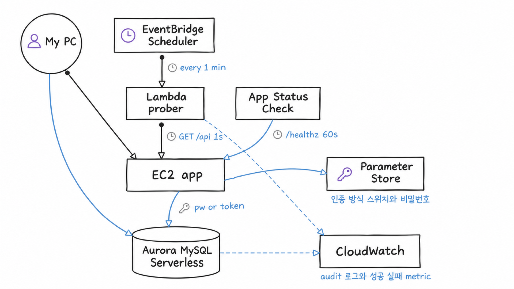
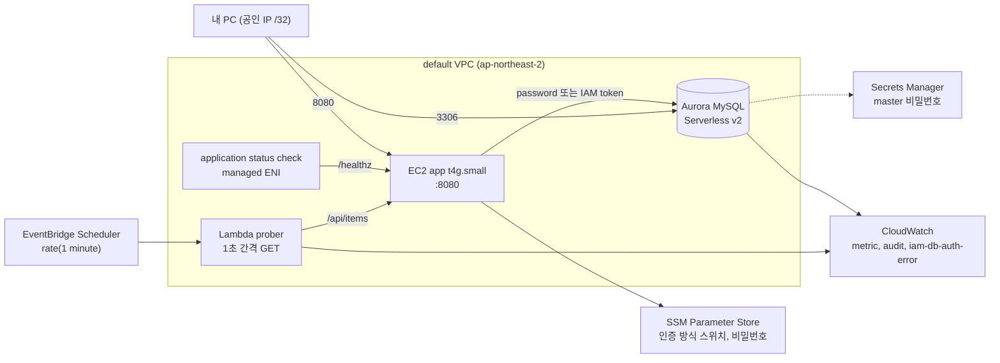
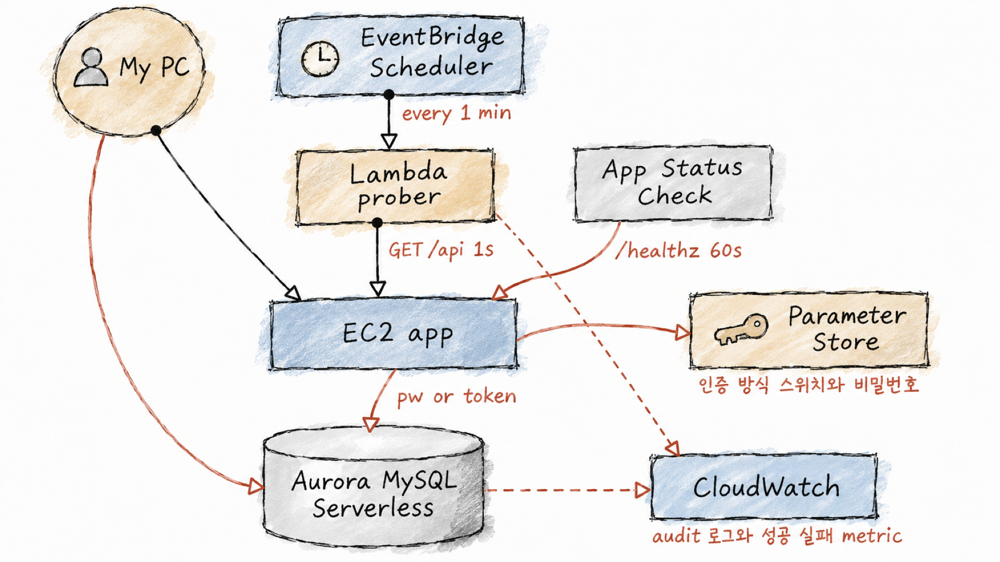
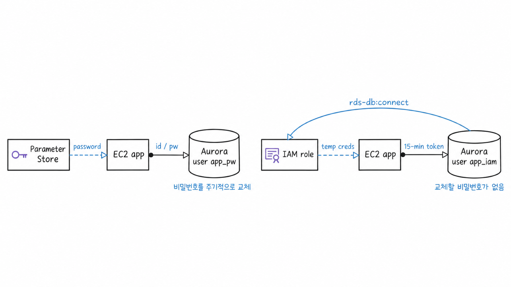
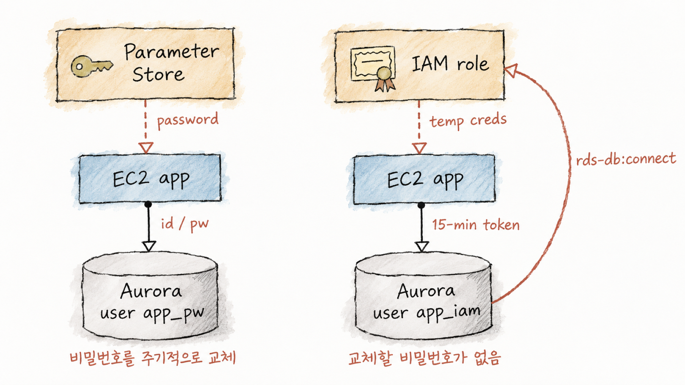

# Aurora MySQL IAM DB 인증과 무중단 마이그레이션 핸즈온

Aurora MySQL의 IAM DB 인증으로 교체할 DB 비밀번호를 없애고, 이미 password로 운영 중인 애플리케이션을 IAM 인증으로 무중단 전환하는 핸즈온입니다. 1초 간격 클라이언트 트래픽을 흘리면서 전환하고, 오류 0건을 prober metric, RDS `IamDbAuth*` metric, audit 로그로 증명합니다. 무중단이 불가능한 경우의 중단 전환 절차와 운영 주의사항도 실측값과 함께 정리합니다.

## 아키텍처

default VPC 하나에 Aurora Serverless v2(MySQL), EC2 앱, VPC Lambda prober를 둡니다. EC2와 Aurora는 apply한 PC의 공인 IP와 security group 참조로만 열립니다.

같은 구성 요소와 화살표를 haru 손그림 다이어그램과 wash 수채 그림체로 각각 그린 그림입니다.

| haru | wash |
| --- | --- |
|  |  |
|  |  |

## 문서

| 문서 | 내용 |
| --- | --- |
| [docs/setup.md](./docs/setup.md) | 실습 환경 구축, 비용, 삭제 |
| [docs/1-feature-map.md](./docs/1-feature-map.md) | 시나리오 1. 기능 지도와 시나리오 순서 |
| [docs/2-iam-db-auth.md](./docs/2-iam-db-auth.md) | 시나리오 2. IAM DB 인증 원리, token 로그인, 실패 유형과 `iam-db-auth-error` 로그, token 실제 만료 시점 |
| [docs/3-observability.md](./docs/3-observability.md) | 시나리오 3. prober, IAM metric, audit 로그, EC2 application status check |
| [docs/4-zero-downtime-migration.md](./docs/4-zero-downtime-migration.md) | 시나리오 4. password → IAM 무중단 전환과 검증 |
| [docs/5-downtime-migration.md](./docs/5-downtime-migration.md) | 시나리오 5. 같은 사용자를 유지해야 할 때의 중단 전환 |
| [docs/6-production-caveats.md](./docs/6-production-caveats.md) | 시나리오 6. 단점과 운영 주의사항 |
| [docs/troubleshooting.md](./docs/troubleshooting.md) | 실습 중 겪은 문제와 해결 |

## 디렉터리

| 경로 | 내용 |
| --- | --- |
| `terraform/` | Aurora, EC2, Lambda, Scheduler, application status check, SSM |
| `app/app.py` | EC2 API 서버. 인증 방식 스위치를 읽어 password 또는 token으로 접속 |
| `prober/prober.py` | Lambda prober. 요청마다 EMF metric 기록 |
| `sql/` | IAM 사용자 생성, 옛 사용자 잠금 |
| `scripts/` | DB 초기화, in-place 전환 실험 |
