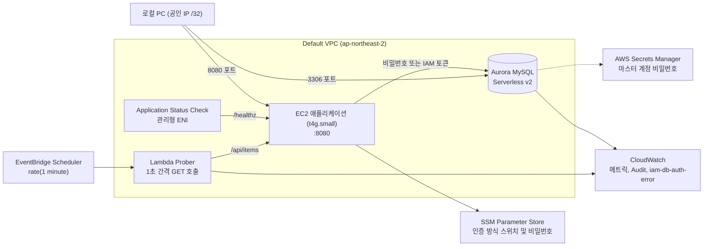

# Aurora MySQL IAM DB 인증과 무중단 마이그레이션 핸즈온

Aurora MySQL의 IAM DB 인증을 도입하여 데이터베이스 비밀번호를 완전히 제거하고, 기존에 비밀번호(Password) 방식으로 운영 중이던 애플리케이션을 IAM 인증으로 무중단 전환하는 핸즈온입니다.

1초 간격의 클라이언트 트래픽을 지속 주입하면서 인증 방식을 전환하고, 전환 전 구간에서 오류 0건을 Prober 메트릭, RDS `IamDbAuth*` 메트릭, 그리고 Aurora Audit 로그로 증명합니다. 아울러 계정명 유지가 강제되어 무중단이 불가능한 경우의 In-Place 중단 전환 절차와 운영 트레이드오프도 실측값과 함께 다룹니다.

## 아키텍처

Default VPC 내에 Aurora Serverless v2(MySQL), EC2 애플리케이션, VPC Lambda Prober를 배치합니다. EC2와 Aurora는 인프라를 배포한 로컬 PC의 공인 IP(`/32`) 및 보안 그룹 참조를 통해서만 안전하게 접근할 수 있습니다.

아키텍처 및 무중단 전환 개념 다이어그램 비교입니다.

| Haru 스타일 | Wash 수채 스타일 |
| --- | --- |
|  |  |
|  |  |

## 시나리오별 문서 안내

| 문서 | 핵심 내용 |
| --- | --- |
| [docs/setup.md](./docs/setup.md) | 실습 환경 일괄 프로비저닝, 예상 비용 분석, 자원 완전 삭제 |
| [docs/1-feature-map.md](./docs/1-feature-map.md) | 시나리오 1. 기능 지도 및 전체 핸즈온 학습 로드맵 |
| [docs/2-iam-db-auth.md](./docs/2-iam-db-auth.md) | 시나리오 2. IAM DB 인증 동작 원리, 토큰 발급 및 로그인, 실패 유형 4가지 분석 및 실제 만료 시점 측정 |
| [docs/3-observability.md](./docs/3-observability.md) | 시나리오 3. 4계층 Observability 체계 구축: Lambda Prober, RDS IAM 메트릭, Audit 로그, EC2 Application Status Check |
| [docs/4-zero-downtime-migration.md](./docs/4-zero-downtime-migration.md) | 시나리오 4. 비밀번호 → IAM 토큰 무중단 전환 실습, 즉시 롤백 검증, 계정 잠금 및 삭제 |
| [docs/5-downtime-migration.md](./docs/5-downtime-migration.md) | 시나리오 5. 동일 계정 유지 시의 In-Place 중단 전환 실험, 단절 구간 및 메트릭 분석 |
| [docs/6-production-caveats.md](./docs/6-production-caveats.md) | 시나리오 6. 트레이드오프 분석(초당 200회 연결 제한, 지연 오버헤드, 메모리), 아키텍처 권장안 및 체크리스트 |
| [docs/troubleshooting.md](./docs/troubleshooting.md) | 핸즈온 수행 및 운영 중 자주 마주치는 문제 해결 가이드 |

## 디렉터리 구성

| 경로 | 주요 내용 |
| --- | --- |
| `terraform/` | Aurora Serverless v2, EC2, Lambda Prober, EventBridge Scheduler, Application Status Check, SSM 코드 |
| `app/app.py` | EC2 Python HTTP 서버. SSM 파라미터 스위치를 읽어 비밀번호 또는 IAM 토큰으로 DB에 접속 |
| `prober/prober.py` | VPC Lambda Prober. 매초 API를 호출하고 결과를 CloudWatch EMF 메트릭으로 기록 |
| `sql/` | 신규 IAM DB 사용자 생성 및 레거시 패스워드 사용자 잠금/삭제 SQL 스크립트 |
| `scripts/` | 데이터베이스 테이블 초기화(`db-init.sh`) 및 In-Place 전환 실험(`inplace_alter_demo.py`) 스크립트 |
