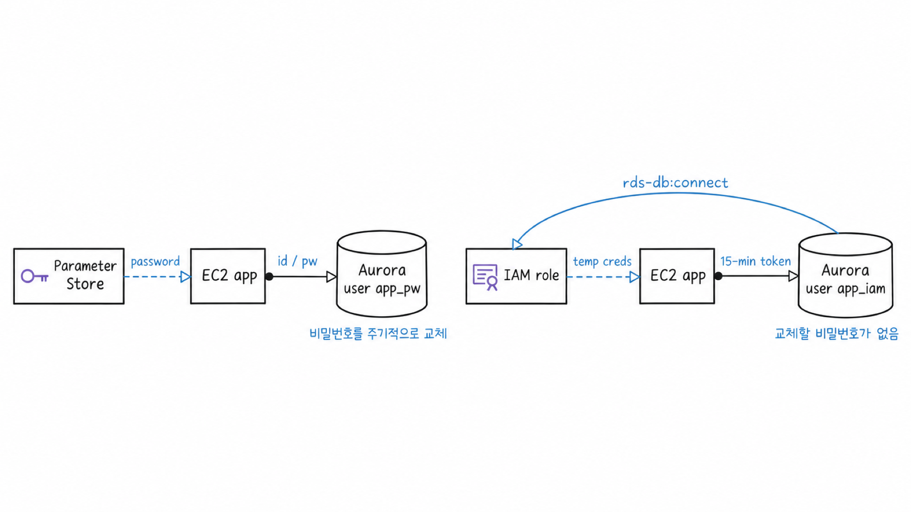
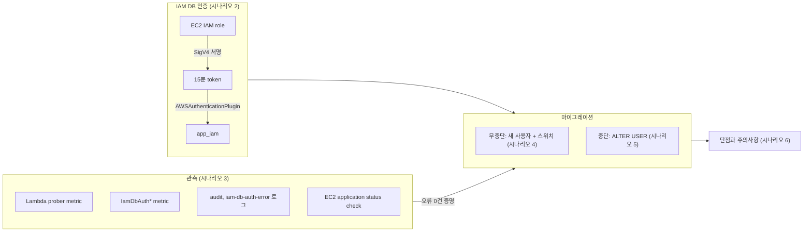
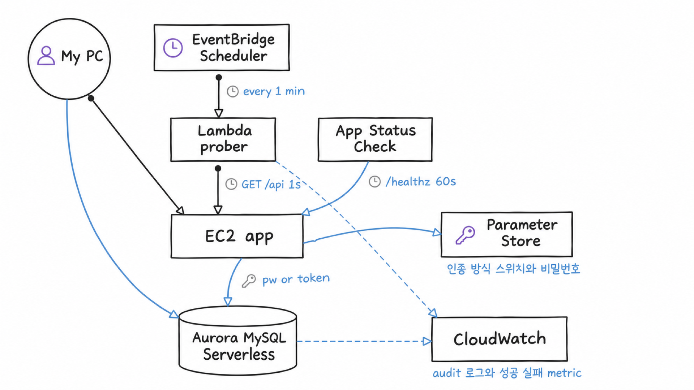

# 시나리오 1. 기능 지도: 교체할 비밀번호를 없애는 DB 인증

## 이 시나리오의 목표

| 항목 | 내용 |
| --- | --- |
| 기능 | 장기 비밀번호 없이 DB에 접속하는 IAM DB 인증과, 운영 중 그 방식으로 갈아타는 마이그레이션 |
| 쓰는 도구 | Aurora MySQL, IAM, SSM Parameter Store, CloudWatch, EC2 application status check |
| 입력 | password(`app_pw`)로 Aurora를 조회하는 EC2 애플리케이션과 1초 간격 클라이언트 트래픽 |
| 작업 | 시나리오 2~6 |
| 달성할 것 | 트래픽 오류 0건으로 `app_pw`를 IAM 사용자 `app_iam`으로 교체하고, 그 사실을 로그와 metric으로 증명 |

## 최종 목표는 사원증 출입이다

사무실 출입에 비유하면 지금 애플리케이션은 공용 비밀번호 도어락을 씁니다. 비밀번호가 새면 모두가 들어오고, 바꾸려면 아는 사람 전원에게 새 번호를 다시 알려야 합니다. DB 비밀번호 교체가 어려운 이유와 같습니다.

IAM DB 인증은 사원증 출입입니다. 문은 비밀번호를 저장하지 않고, 출입할 때마다 "이 사원증이 진짜이고 이 문을 열 권한이 있는가"를 인사 시스템(IAM)에 확인합니다. 사원증은 15분 동안만 유효한 출입 토큰으로 발급되므로 새더라도 곧 쓸모가 없어집니다. 교체할 비밀번호가 처음부터 없습니다.

이 핸즈온은 그 상태를 목표로, 거기까지 가는 데 필요한 것을 거꾸로 짚습니다.

1. 사원증 출입이 어떻게 동작하고 어디서 막히는지 알아야 합니다. (시나리오 2)
2. 공사 중에 출입이 끊겼는지 알려면 관측 장치를 먼저 달아야 합니다. (시나리오 3)
3. 도어락을 떼지 않고 사원증 리더기를 옆에 달아 사람들을 옮깁니다. (시나리오 4)
4. 리더기를 옆에 달 수 없는 문이라면 공사 시간을 잡고 바꿉니다. (시나리오 5)
5. 사원증 출입에도 한계가 있습니다. (시나리오 6)

## 기능 지도

시나리오마다 다루는 기능과 그 기능이 마이그레이션에 어떻게 쓰이는지 잇는 그림입니다.

| 기능 | 쓰는 도구 | 시나리오 |
| --- | --- | --- |
| token 발급과 DB 로그인 | `aws rds generate-db-auth-token`, boto3 `generate_db_auth_token` | [2](./2-iam-db-auth.md) |
| 인증 실패 원인 추적 | `iam-db-auth-error` 로그, `IamDbAuthConnectionFailure*` metric | [2](./2-iam-db-auth.md), [3](./3-observability.md) |
| 클라이언트가 본 오류 측정 | EventBridge Scheduler + Lambda prober, CloudWatch EMF | [3](./3-observability.md) |
| 누가 어떤 사용자로 접속했는지 | Aurora `audit` 로그(`server_audit_events=CONNECT`) | [3](./3-observability.md), [4](./4-zero-downtime-migration.md) |
| 애플리케이션 생존 확인 | EC2 application status check | [3](./3-observability.md) |
| 무중단 전환 | 새 DB 사용자, SSM 인증 방식 스위치 | [4](./4-zero-downtime-migration.md) |
| 중단 전환 | `ALTER USER ... IDENTIFIED WITH AWSAuthenticationPlugin` | [5](./5-downtime-migration.md) |

## 실습 아키텍처

EventBridge Scheduler가 매분 Lambda prober를 실행하고, prober는 약 56초 동안 1초마다 EC2의 `/api/items`를 호출합니다. 애플리케이션은 요청마다 Aurora에 새 연결을 맺습니다. 그래서 인증 방식 스위치를 바꾸면 다음 요청부터 바로 새 방식으로 로그인하고, 전환 중 실패한 로그인은 prober의 오류로 그대로 드러납니다.

환경 구축은 [setup.md](./setup.md)를 따릅니다.
