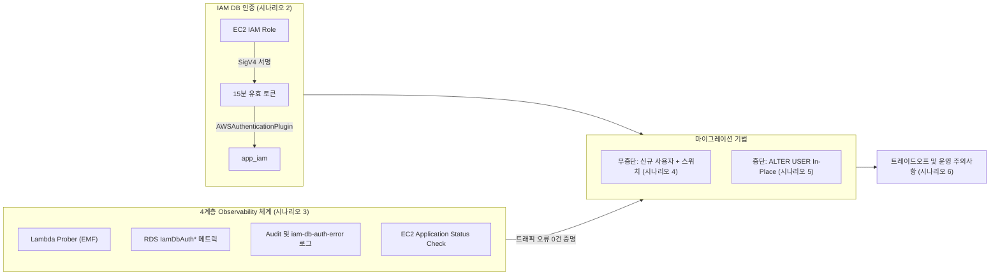

# 시나리오 1. 기능 지도 및 핸즈온 학습 로드맵

## 시나리오 개요 및 핵심 목표

| 항목 | 상세 내용 |
| --- | --- |
| **핵심 주제** | 데이터베이스 비밀번호를 완전히 제거하는 IAM DB 인증의 원리 및 운영 중 무중단 마이그레이션 기법 |
| **활용 기술** | Amazon Aurora MySQL, AWS IAM, AWS Systems Manager Parameter Store, Amazon CloudWatch Logs & Metrics, EC2 Application Status Check |
| **사전 상태** | 기존 패스워드 방식(`app_pw`)으로 Aurora에 연결하여 1초 간격의 트래픽을 처리 중인 EC2 웹 애플리케이션 |
| **수행 작업** | 시나리오 2부터 6까지 단계별 실습 수행 |
| **최종 달성 목표** | 실시간 트래픽 오류 0건을 유지하며 비밀번호 사용자(`app_pw`)를 IAM 인증 사용자(`app_iam`)로 완전 교체하고, 이를 Prober 메트릭과 Audit 로그로 입증 |

## 아키텍처 핵심 개념: DB 비밀번호와 IAM 토큰 (사원증 출입 모델)

기존의 데이터베이스 비밀번호 관리 방식을 사무실 출입 보안에 비유하면 **공용 비밀번호 도어락**과 유사합니다. 비밀번호가 외부에 노출되면 누구든 데이터베이스에 접근할 수 있고, 보안을 위해 비밀번호를 변경하려면 이를 참조하는 모든 애플리케이션과 클라이언트에게 새로운 비밀번호를 일시에 동기화해야 합니다. 이것이 실무에서 DB 비밀번호 교체가 항상 장애 위험을 동반하는 근본적인 이유입니다.

반면 **IAM DB 인증**은 **사원증(스마트 출입증) 기반 출입 시스템**과 동일한 방식으로 동작합니다. 데이터베이스는 정적 비밀번호를 직접 보관하지 않으며, 클라이언트가 접속을 시도할 때마다 중앙의 인증 시스템(IAM)에 "이 요청이 유효하게 서명된 자격증명인가", "해당 데이터베이스 사용자 계정으로 들어갈 권한(`rds-db:connect`)이 있는가"를 실시간으로 확인합니다.

이때 클라이언트는 AWS Signature Version 4(SigV4)로 서명된 **15분 유효기간의 임시 인증 토큰**을 비밀번호 대신 제출합니다. 토큰이 외부로 유출되더라도 짧은 시간 내에 자동 만료되므로 보안 위험이 극히 낮으며, 애플리케이션과 데이터베이스 어디에도 정적인 장기 비밀번호를 저장하거나 순환(Rotation)할 필요가 없습니다.

본 핸즈온은 정적 비밀번호를 완전히 없앤 무중단 운영 상태를 목표로, 다음 단계의 논리적 흐름에 따라 진행됩니다.

1. **원리 이해 및 실패 분석**: IAM 토큰 인증이 내부적으로 어떻게 동작하며 어떤 실패 유형이 발생하는지 파악합니다. ([시나리오 2](./2-iam-db-auth.md))
2. **Observability 체계 구축**: 전환 작업 중 단 1건의 요청 단절도 놓치지 않도록 클라이언트 중심의 4계층 Observability 체계를 먼저 세웁니다. ([시나리오 3](./3-observability.md))
3. **무중단 마이그레이션**: 기존 비밀번호를 바로 수정하지 않고 신규 IAM 사용자를 추가하여 이중 자격증명 기간을 거쳐 안전하게 전환합니다. ([시나리오 4](./4-zero-downtime-migration.md))
4. **In-Place 전환 한계 분석**: 사용자 계정명을 유지해야만 할 때 발생하는 불가피한 서비스 중단과 복구 시간을 실측합니다. ([시나리오 5](./5-downtime-migration.md))
5. **프로덕션 고려사항**: 처리량 한계, 연결 지연, 메모리 오버헤드 등 실무 도입 시 반드시 검토해야 할 기술적 트레이드오프를 확인합니다. ([시나리오 6](./6-production-caveats.md))

## 기능 지도 및 전체 시나리오 구성

각 시나리오에서 다루는 핵심 기능과 도구, 그리고 마이그레이션 과정에서의 역할 관계를 나타낸 구조도입니다.

시나리오별 다루는 세부 기능과 도구 목록입니다.

| 기능 영역 | 주요 기술 및 도구 | 관련 문서 |
| --- | --- | --- |
| **토큰 발급 및 접속 검증** | `aws rds generate-db-auth-token`, Boto3 SDK, `AWSAuthenticationPlugin` | [시나리오 2](./2-iam-db-auth.md) |
| **인증 실패 원인 정밀 분석** | RDS `iam-db-auth-error` 로그, `IamDbAuthConnectionFailure*` 메트릭 | [시나리오 2](./2-iam-db-auth.md), [시나리오 3](./3-observability.md) |
| **클라이언트 체감 오류 측정** | EventBridge Scheduler + VPC Lambda Prober, CloudWatch EMF | [시나리오 3](./3-observability.md) |
| **접속 계정 감사 추적** | Aurora MySQL Advanced Auditing (`server_audit_events=CONNECT`) | [시나리오 3](./3-observability.md), [시나리오 4](./4-zero-downtime-migration.md) |
| **인스턴스 및 앱 생존 확인** | EC2 Application Status Check (관리형 ENI 기반 `:8080/healthz` 검사) | [시나리오 3](./3-observability.md) |
| **무중단 마이그레이션** | 신규 DB 계정(`app_iam`), SSM Parameter Store 동적 스위치, `ACCOUNT LOCK` | [시나리오 4](./4-zero-downtime-migration.md) |
| **In-Place 중단 전환** | `ALTER USER ... IDENTIFIED WITH AWSAuthenticationPlugin`, 다운타임 실측 | [시나리오 5](./5-downtime-migration.md) |
| **운영 트레이드오프 분석** | 연결 지연 오버헤드, 초당 연결 수 한계, RDS Proxy 도입 기준, 메모리 요건 | [시나리오 6](./6-production-caveats.md) |

## 실습 아키텍처 및 트래픽 검증 구조

핸즈온 환경은 전환 작업 중 서비스 단절이 발생하는지 실시간으로 검증할 수 있도록 설계되었습니다.

- **지속적 트래픽 주입**: EventBridge Scheduler가 매분 Lambda Prober를 기동하며, Prober는 약 56초 동안 매 1초마다 EC2의 `/api/items` 엔드포인트를 호출합니다.
- **인증 방식 동적 전환**: EC2 애플리케이션은 들어오는 각 요청마다 데이터베이스 연결을 새로 수립합니다. 따라서 SSM Parameter Store의 인증 모드 플래그가 변경되면 즉시 다음 요청부터 신규 인증 방식을 사용하게 되며, 전환 과정에서 단 1건이라도 인증이 실패하면 Prober 메트릭에 즉각 반영됩니다.

환경 설정 및 초기 배포에 관한 구체적인 절차는 [setup.md](./setup.md) 문서를 참고하시기 바랍니다.
