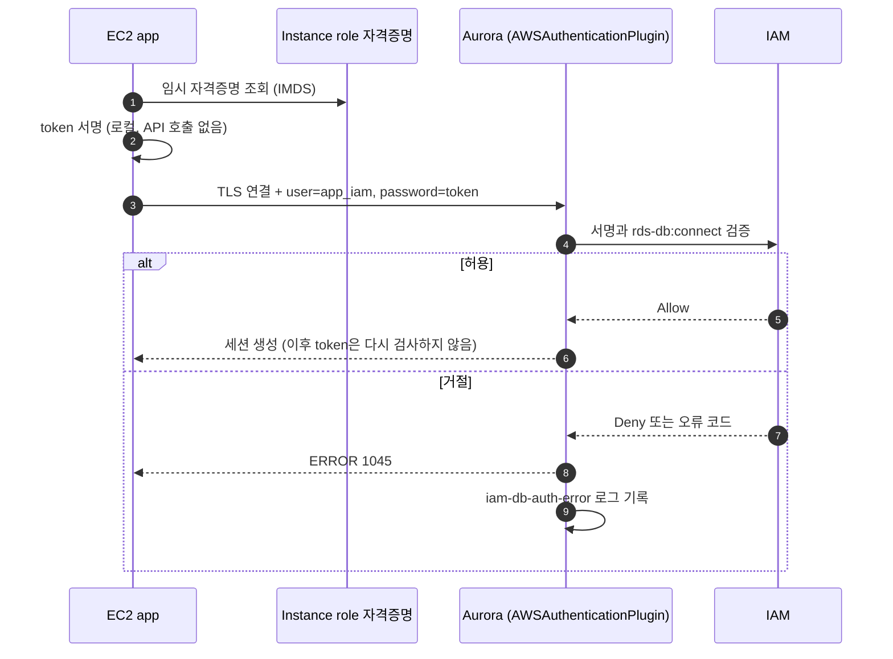

# 시나리오 2. IAM DB 인증은 비밀번호 자리에 15분짜리 서명을 넣는다

## 이 시나리오의 목표

| 항목 | 내용 |
| --- | --- |
| 기능 | IAM 자격증명으로 서명한 token으로 Aurora MySQL에 로그인 |
| 쓰는 도구 | `aws rds generate-db-auth-token`, `AWSAuthenticationPlugin`, IAM policy `rds-db:connect` |
| 입력 | IAM DB 인증을 켠 클러스터, IAM 사용자 `app_iam`, 내 PC의 IAM 자격증명, EC2 instance role |
| 작업 | 실습 1~6 |
| 달성할 것 | token 로그인 성공, 실패 유형 4가지와 `iam-db-auth-error` 로그 확인, token이 실제로 만료되는 시점 측정 |

## IAM DB 인증이 하는 일과 하지 않는 일

IAM DB 인증은 DB 비밀번호 자리에 **AWS Signature Version 4(SigV4)로 서명한 문자열**을 넣는 방식입니다. 클라이언트는 자기 IAM 자격증명으로 "이 호스트의 이 DB 사용자로 접속하겠다"는 요청을 서명하고, 그 서명된 URL 전체를 비밀번호처럼 보냅니다. Aurora는 서명을 IAM에 검증하고, 서명한 주체가 `rds-db:connect` 권한을 가졌으면 로그인을 허용합니다.

token 생성은 AWS API 호출이 아닙니다. SDK가 로컬에서 자격증명으로 서명만 합니다. 그래서 token 생성은 네트워크 없이 끝나고, CloudTrail에도 남지 않습니다. 검증은 Aurora가 로그인 순간에 합니다.

경계를 오해하기 쉬운 부분은 아래와 같습니다.

| 다루는 것 | 다루지 않는 것 |
| --- | --- |
| 로그인 순간의 인증. token은 연결을 맺을 때 한 번 검사됩니다 | 이미 맺은 세션. token이 만료되거나 IAM 권한을 회수해도 열린 연결은 끊기지 않습니다 |
| 어느 IAM 주체가 어느 DB 사용자로 들어올 수 있는가 | DB 안의 권한. 테이블 권한은 여전히 `GRANT`가 정합니다 |
| 장기 비밀번호 제거 | master 사용자(`admin`). master는 password 사용자로 남고 Secrets Manager가 관리합니다 |
| TLS 강제. token은 평문 플러그인으로 보내므로 TLS 없이는 클라이언트가 보내지 않습니다 | 네트워크 접근 제어. 3306 포트는 여전히 security group이 막습니다 |

### 용어

| 용어 | 뜻 | 이 실습의 예 |
| --- | --- | --- |
| authentication token | SigV4로 서명한 presigned URL. 비밀번호로 씁니다 | `<cluster endpoint>:3306/?Action=connect&DBUser=app_iam&X-Amz-...` |
| `X-Amz-Expires` | token 유효 시간(초) | `900` (15분) |
| `AWSAuthenticationPlugin` | Aurora MySQL이 token을 IAM에 검증하는 인증 플러그인 | `CREATE USER 'app_iam'@'%' IDENTIFIED WITH AWSAuthenticationPlugin AS 'RDS'` |
| `rds-db:connect` | 특정 DB 사용자로 접속할 권한을 주는 IAM action | EC2 role `aurora-iam-lab-app`에 부여 |
| DB 사용자 ARN | `rds-db:connect`의 대상 리소스 | `arn:aws:rds-db:ap-northeast-2:<account-id>:dbuser:<cluster-resource-id>/app_iam` |
| cluster resource ID | 클러스터 이름이 아닌 불변 ID. ARN에 이름이 아니라 이 값이 들어갑니다 | `cluster-XXXXXXXXXXXXXXXXXXXXXXXXXX` |
| `mysql_clear_password` | token을 그대로 서버에 보내는 MySQL client 플러그인 | `mysql --enable-cleartext-plugin` |

## 비밀번호 교체가 운영 부담인 이유

DB 비밀번호는 보안 정책상 주기적으로 바꿔야 하지만, 바꾸는 순간 그 비밀번호를 쥔 모든 클라이언트가 동시에 새 값을 알아야 합니다. Secrets Manager 자동 교체를 써도 단일 사용자 교체는 "DB 비밀번호가 바뀐 시점"과 "앱이 새 값을 다시 읽는 시점" 사이에 로그인 실패 구간이 생깁니다. 그 구간을 없애려면 사용자 두 개를 번갈아 쓰는 교체 전략과 앱의 재시도 로직이 필요합니다.

IAM DB 인증에는 저장된 비밀이 없으므로 교체 대상도 없습니다. 장기 자격증명은 EC2 instance role의 임시 자격증명으로 대체되고, 그 임시 자격증명은 AWS가 자동으로 갱신합니다. 접속 권한을 끊을 때도 비밀번호를 바꾸지 않고 IAM policy에서 `rds-db:connect`를 지웁니다.

## 대안 비교

| 방식 | 앱이 보관하는 비밀 | 교체 | 비용 | 접속 시 추가 비용 |
| --- | --- | --- | --- | --- |
| Parameter Store SecureString | DB 비밀번호 | 수동. 교체 시점 조율이 필요 | Standard 무료 | 없음 |
| Secrets Manager + 자동 교체 | DB 비밀번호(주기적으로 다시 읽음) | 자동. 단일 사용자 교체는 실패 구간, 교대 사용자 교체는 사용자 2개 필요 | secret당 $0.40/월 + API 호출 | 없음 |
| IAM DB 인증 | 없음(instance role) | 없음 | 무료 | token 서명과 IAM 검증. 실습에서 연결 시간 약 +8 ms(요청 p50 기준 +15 ms) |
| RDS Proxy + IAM | 없음(Proxy 앞단) | Proxy가 DB 비밀번호를 Secrets Manager로 관리 | Proxy 시간당 과금 | Proxy 홉 |

같은 일을 하는 선택지가 여럿이라 정답은 상황이 정합니다. 연결을 오래 유지하는 커넥션 풀 기반 서비스는 IAM DB 인증의 접속 비용이 거의 보이지 않습니다. 반대로 요청마다 연결을 새로 맺고 초당 수백 연결을 넘기는 서비스는 [시나리오 6](./6-production-caveats.md)의 처리량 한계에 먼저 걸립니다.

## 컴포넌트 역할

| 컴포넌트 | 역할 |
| --- | --- |
| 클라이언트(앱, `mysql`) | 자격증명으로 token을 서명하고, TLS 위에서 token을 비밀번호로 보냄 |
| IAM 주체(EC2 role, IAM 사용자) | `rds-db:connect` 권한의 주인. token에 서명한 자격증명 |
| Aurora `AWSAuthenticationPlugin` | 받은 token을 IAM에 검증하고 만료, 서명, 권한을 확인 |
| IAM | 서명이 유효한지, 서명한 주체의 policy가 그 DB 사용자를 허용하는지 판단 |
| `iam-db-auth-error` 로그 | 거절된 로그인마다 원인 코드(`InvalidToken`, `ExpiredToken`, `NotAuthorized` 등) 기록 |

## 흐름

EC2 앱이 token을 만들어 로그인하기까지의 순서입니다. token 서명은 앱 안에서 끝나고, IAM을 부르는 쪽은 Aurora입니다.



## 실습

[setup.md](./setup.md)로 환경을 만든 상태에서 시작합니다. 명령은 `aws/rds/aurora-iam-auth`에서 실행합니다.

```bash
cd aws/rds/aurora-iam-auth
HOST=$(terraform -chdir=terraform output -raw cluster_endpoint)
SECRET=$(terraform -chdir=terraform output -raw master_secret_arn)
curl -fsSL -o /tmp/rds-ca.pem https://truststore.pki.rds.amazonaws.com/ap-northeast-2/ap-northeast-2-bundle.pem
```

### 1. 클러스터의 IAM DB 인증 활성화

`iam_auth_enabled`를 켜면 클러스터 설정과 EC2 role의 `rds-db:connect` 권한이 함께 바뀝니다.

```bash
echo 'iam_auth_enabled = true' > terraform/terraform.tfvars
terraform -chdir=terraform apply
```

```text
aws_rds_cluster.this: Modifications complete after 31s [id=aurora-iam-lab]
aws_iam_role_policy.app_rds_connect[0]: Creation complete after 1s
Apply complete! Resources: 1 added, 1 changed, 0 destroyed.
```

- 이 31초 동안 prober가 보낸 요청은 전부 성공했고, RDS 이벤트에 재시작 기록이 없었습니다. 측정 방법은 [시나리오 3](./3-observability.md), 결과 해석은 [시나리오 4](./4-zero-downtime-migration.md)에 있습니다.

### 2. IAM 인증 전용 DB 사용자 생성

master 비밀번호는 Secrets Manager에서 읽습니다.

```bash
export MYSQL_PWD=$(aws secretsmanager get-secret-value --secret-id "$SECRET" --query SecretString --output text | jq -r .password)
mysql -h $HOST -u admin --ssl-mode=REQUIRED < sql/create-iam-user.sql
mysql -h $HOST -u admin --ssl-mode=REQUIRED -t -e "SELECT user, host, plugin, ssl_type FROM mysql.user WHERE user LIKE 'app%'"
unset MYSQL_PWD
```

```text
+---------+------+-------------------------+----------+
| user    | host | plugin                  | ssl_type |
+---------+------+-------------------------+----------+
| app_iam | %    | AWSAuthenticationPlugin | ANY      |
| app_pw  | %    | mysql_native_password   | ANY      |
+---------+------+-------------------------+----------+
```

- `app_pw`는 그대로 두고 `app_iam`을 옆에 만듭니다. 같은 사용자를 바꾸지 않는 이유는 [시나리오 5](./5-downtime-migration.md)에서 실험합니다.

### 3. 내 PC의 IAM 자격증명으로 token 생성

token을 만들고 query string의 키만 출력해 구조를 봅니다.

```bash
TOKEN=$(aws rds generate-db-auth-token --hostname $HOST --port 3306 --username app_iam)
echo "length: ${#TOKEN}"; echo "$TOKEN" | tr '&' '\n' | sed 's/=.*//'
```

```text
length: 379
<cluster endpoint>:3306/?Action
DBUser
X-Amz-Algorithm
X-Amz-Credential
X-Amz-Date
X-Amz-Expires
X-Amz-SignedHeaders
X-Amz-Signature
```

- 장기 access key로 서명한 token은 379자였습니다. EC2 role처럼 임시 자격증명으로 서명하면 `X-Amz-Security-Token`이 붙어 1,869자가 됩니다(실습 5). 드라이버가 비밀번호 길이를 자르면 이 차이에서 문제가 됩니다.

### 4. token으로 로그인

token을 비밀번호 자리에 넣고 TLS 인증서까지 검증하며 접속합니다.

```bash
mysql -h $HOST -u app_iam --password="$TOKEN" --enable-cleartext-plugin \
  --ssl-mode=VERIFY_IDENTITY --ssl-ca=/tmp/rds-ca.pem \
  -t -e "SELECT CURRENT_USER(), USER(), @@aurora_version"
```

```text
+----------------+---------------------+------------------+
| CURRENT_USER() | USER()              | @@aurora_version |
+----------------+---------------------+------------------+
| app_iam@%      | app_iam@<내 IP>     | 3.10.3           |
+----------------+---------------------+------------------+
```

### 5. 실패 유형별 오류와 iam-db-auth-error 로그 확인

같은 사용자에게 일부러 잘못된 방식으로 로그인합니다.

| 시도 | client 오류 | `iam-db-auth-error` 로그 |
| --- | --- | --- |
| `--enable-cleartext-plugin` 없이 token | `ERROR 2059 ... 'mysql_clear_password' cannot be loaded` | 없음. client가 보내지 않음 |
| 위조 token(`not-a-token`) | `ERROR 1045 ... (using password: YES)` | `InvalidToken` (400) |
| `app_iam`에 `app_pw`의 비밀번호 | `ERROR 1045 ... (using password: YES)` | `InvalidToken` (400). 비밀번호도 token으로 해석됨 |
| TLS 없이(`--ssl-mode=DISABLED`) token | `ERROR 1045 ... (using password: NO)` | 없음. client가 평문 전송을 거부함 |

EC2 role의 권한 범위도 확인합니다. role에는 `app_iam`에 대한 `rds-db:connect`만 있습니다. 같은 권한의 IAM 사용자 `report_iam`을 하나 더 만들고, EC2에서 두 사용자로 로그인합니다.

```bash
INSTANCE_ID=$(terraform -chdir=terraform output -raw instance_id)
aws ssm start-session --target $INSTANCE_ID
```

EC2 셸에서 실행합니다. `HOST`에는 내 PC에서 확인한 cluster endpoint를 넣습니다.

```bash
HOST=<cluster endpoint>
for u in app_iam report_iam; do
  T=$(aws rds generate-db-auth-token --region ap-northeast-2 --hostname $HOST --port 3306 --username $u)
  echo "== $u length ${#T}"
  mysql -h $HOST -u $u --password="$T" --enable-cleartext-plugin --ssl-ca=/opt/app/rds-ca.pem -N -e 'SELECT CURRENT_USER()'
done
```

```text
== app_iam length 1869
app_iam@%
== report_iam length 1872
ERROR 1045 (28000): Access denied for user 'report_iam'@'<EC2 private IP>' (using password: YES)
```

로그를 확인합니다.

```bash
aws logs filter-log-events --log-group-name /aws/rds/cluster/aurora-iam-lab/iam-db-auth-error \
  --start-time $(( ($(date +%s)-1200)*1000 )) --query 'events[].message' --output text
```

```text
... [ERROR] Failed to authenticate the connection request for user 'app_iam' because the provided token is malformed or otherwise invalid. (Status Code: 400, Error Code: InvalidToken)
... [ERROR] Failed to authorize the connection request for user 'report_iam' because the IAM policy assumed by the caller 'arn:aws:sts::<account-id>:assumed-role/aurora-iam-lab-app/<instance-id>' is not authorized to perform `rds-db:connect` on the DB instance. (Status Code: 403, Error Code: NotAuthorized)
```

- client는 모든 실패에서 같은 `ERROR 1045`만 받습니다. 원인 구분은 서버 쪽 `iam-db-auth-error` 로그에서만 가능하고, 403 로그에는 거절된 role ARN과 instance ID까지 남습니다.
- 확인한 뒤 `report_iam`은 지웁니다: `DROP USER 'report_iam'@'%';`

### 6. token이 실제로 거절되는 시점 측정

token 하나를 파일에 저장하고 시간을 두고 다시 씁니다.

```bash
aws rds generate-db-auth-token --hostname $HOST --port 3306 --username app_iam > /tmp/old_token
# 15분, 20분 뒤에 각각 실행
mysql -h $HOST -u app_iam --password="$(cat /tmp/old_token)" --enable-cleartext-plugin --ssl-mode=REQUIRED -N -e 'select 1'
```

| 경과(`X-Amz-Date` 기준) | 결과 |
| --- | --- |
| 15분 26초 | 로그인 성공 |
| 19분 48초 | 로그인 성공 |
| 20분 18초 | `ERROR 1045`, 로그 `the token age is longer than 15 minutes ... ExpiredToken` |

- `X-Amz-Expires=900`이지만 실제 거절은 약 20분에 일어났습니다. 시계 오차를 허용하는 여유로 보이며 AWS 문서에 적힌 값은 아닙니다(`확인 필요`). 앱은 15분 안쪽(이 실습의 앱은 10분)에 token을 새로 만들면 되고, 이 여유에 기대지 않습니다.

## 부록. 실무에서 얻는 것

- **실패 원인은 client가 아니라 서버 로그에 있습니다.** 앱 로그의 `1045`만으로는 token 만료, 권한 누락, 잘못된 서명을 구분할 수 없습니다. `iam-db-auth-error` 로그 내보내기를 IAM 인증을 켜는 날 함께 켭니다.
- **IAM 사용자에게 비밀번호를 보내면 `InvalidToken`으로 집계됩니다.** 전환 후 옛 비밀번호를 쓰는 클라이언트는 `IamDbAuthConnectionFailureInvalidToken` metric으로 드러납니다([시나리오 5](./5-downtime-migration.md)).
- **권한 경계는 DB 사용자 이름입니다.** policy의 리소스 `dbuser:<cluster-resource-id>/app_iam`이 role과 DB 사용자를 1:1로 묶습니다. 와일드카드(`dbuser:*/*`)는 그 role이 같은 계정의 모든 IAM DB 사용자로 들어올 수 있다는 뜻입니다.
- **token 서명은 오프라인입니다.** CloudTrail에 `generate-db-auth-token`이 남지 않으므로 "누가 언제 DB에 들어왔나"의 감사 기록은 DB audit 로그가 유일합니다.

## 참고 문서

1. [IAM database authentication - Amazon Aurora](https://docs.aws.amazon.com/AmazonRDS/latest/AuroraUserGuide/UsingWithRDS.IAMDBAuth.html)
2. [Creating a database account using IAM authentication](https://docs.aws.amazon.com/AmazonRDS/latest/AuroraUserGuide/UsingWithRDS.IAMDBAuth.DBAccounts.html)
3. [Troubleshooting for IAM DB authentication](https://docs.aws.amazon.com/AmazonRDS/latest/AuroraUserGuide/UsingWithRDS.IAMDBAuth.Troubleshooting.html)
