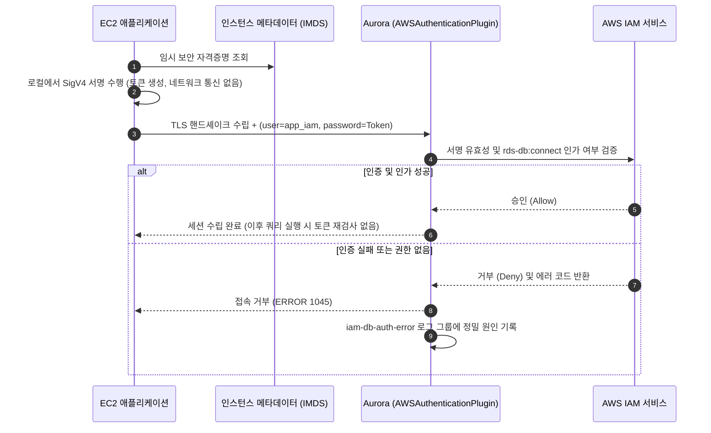

# 시나리오 2. IAM DB 인증의 동작 원리와 토큰 인증 실습

## 시나리오 개요 및 핵심 목표

| 항목 | 상세 내용 |
| --- | --- |
| **핵심 기능** | IAM 자격증명으로 서명된 임시 토큰을 데이터베이스 비밀번호 자리에 전달하여 Aurora MySQL에 로그인 |
| **활용 도구** | `aws rds generate-db-auth-token`, MySQL 플러그인 `AWSAuthenticationPlugin`, IAM 액션 `rds-db:connect` |
| **입력 자원** | IAM DB 인증이 활성화된 Aurora 클러스터, 신규 DB 계정 `app_iam`, 로컬 IAM 자격증명, EC2 IAM 인스턴스 프로파일 |
| **실습 작업** | 단계별 핸즈온 실습 1~6 |
| **최종 달성 목표** | 임시 토큰 기반의 데이터베이스 로그인 성공, 주요 실패 유형 4가지 분석 및 `iam-db-auth-error` 로그 식별, 토큰의 실제 유효 만료 시점 측정 |

## IAM DB 인증의 핵심 원리와 책임 경계 (Scope)

IAM 데이터베이스 인증은 데이터베이스 비밀번호 자리에 **AWS Signature Version 4(SigV4)로 서명된 Presigned URL 문자열**을 전달하는 인증 메커니즘입니다.

클라이언트는 자신이 보유한 AWS 자격증명(로컬 IAM User Access Key 또는 EC2/ECS 인스턴스 프로파일 임시 자격증명)을 바탕으로 "이 호스트의 특정 DB 사용자로 접속하겠다"는 요청을 로컬에서 서명하고, 생성된 긴 서명 문자열 전체를 패스워드처럼 데이터베이스로 전송합니다. Aurora는 전달받은 서명을 내부적으로 IAM 서비스에 검증 요청하여, 서명한 주체에게 `rds-db:connect` 권한이 부여되어 있는지 확인한 후 연결을 승인합니다.

이때 **토큰 생성 과정 자체는 AWS API 호출이 아닙니다.** AWS SDK 내부에서 로컬 자격증명을 사용해 문자열을 서명(Hashing & Signature)하는 오프라인 연산이므로, 토큰 생성에는 네트워크 지연이 발생하지 않으며 AWS CloudTrail 이벤트에도 기록되지 않습니다. 실제 검증 네트워크 통신은 클라이언트가 아니라 Aurora 데이터베이스가 로그인 순간에 수행합니다.

IAM DB 인증이 담당하는 영역과 다루지 않는 책임 경계는 다음과 같습니다.

| 담당하는 영역 (Scope) | 다루지 않는 영역 (Out of Scope) |
| --- | --- |
| **연결 수립 시점의 인증**: 토큰 검증은 클라이언트가 처음 세션을 맺을 때 단 1회 수행됩니다. | **이미 수립된 세션의 유지**: 토큰의 15분 수명이 만료되거나 IAM 권한이 박탈되더라도, 이미 연결된 DB 세션은 끊어지지 않고 유지됩니다. |
| **DB 사용자 접근 권한 식별**: 어떤 IAM 주체가 어떤 데이터베이스 사용자 계정으로 로그인할 수 있는지를 IAM Policy로 제어합니다. | **데이터베이스 내부 테이블/객체 권한**: 테이블 읽기/쓰기 권한은 여전히 데이터베이스 내부의 `GRANT` 명령어로 관리됩니다. |
| **애플리케이션의 장기 비밀번호 제거**: 애플리케이션의 정적 비밀번호를 제거하고 임시 자격증명 기반으로 대체합니다. | **마스터 계정(`admin`)의 인증**: 관리자 마스터 계정은 전통적인 비밀번호 방식으로 남으며, AWS Secrets Manager 등을 통해 별도로 보호해야 합니다. |
| **전송 구간 암호화(TLS) 강제**: 토큰은 평문 플러그인(`mysql_clear_password`)을 통해 전송되므로, TLS 연결이 활성화되지 않으면 클라이언트가 토큰 전송을 거부합니다. | **네트워크 레벨의 인바운드 통제**: DB 포트(3306) 접근 제어는 여전히 보안 그룹(Security Group)과 서브넷 라우팅이 담당합니다. |

### 핵심 용어 정의

| 용어 | 정의 | 실습 적용 사례 |
| --- | --- | --- |
| **인증 토큰 (Authentication Token)** | SigV4 알고리즘으로 서명된 Presigned URL 문자열로, DB 비밀번호 파라미터로 사용 | `<cluster-endpoint>:3306/?Action=connect&DBUser=app_iam&X-Amz-...` |
| `X-Amz-Expires` | 발급된 인증 토큰의 유효 기간(초 단위) | `900` (15분) |
| `AWSAuthenticationPlugin` | Aurora MySQL 엔진 내부에서 전달받은 토큰을 IAM 서비스에 검증하는 전용 플러그인 | `CREATE USER 'app_iam'@'%' IDENTIFIED WITH AWSAuthenticationPlugin AS 'RDS'` |
| `rds-db:connect` | 특정 Aurora 클러스터의 특정 DB 사용자로의 연결을 허용하는 IAM 정책 액션 | EC2 인스턴스 롤 `aurora-iam-lab-app`에 할당 |
| **DB 사용자 ARN** | IAM 정책에서 `rds-db:connect`의 대상(Resource)으로 지정하는 고유 식별자 | `arn:aws:rds-db:ap-northeast-2:<account-id>:dbuser:<cluster-resource-id>/app_iam` |
| **클러스터 리소스 ID** | 클러스터 이름과 무관한 내부 불변 식별자로, DB 사용자 ARN의 리소스 경로에 포함 | `cluster-XXXXXXXXXXXXXXXXXXXXXXXXXX` |
| `mysql_clear_password` | 긴 서명 토큰 문자열을 변형 없이 데이터베이스 엔진으로 투명하게 전달하기 위한 MySQL 클라이언트 플러그인 | `mysql --enable-cleartext-plugin` |

## 정적 비밀번호 관리의 한계와 IAM 인증의 필요성

기존의 정적 데이터베이스 비밀번호는 보안 정책상 정기적인 교체(Rotation)가 필수적입니다. 그러나 단일 계정 기반의 비밀번호 교체는 "DB 상에서 비밀번호가 변경되는 순간"과 "애플리케이션이 새로운 비밀번호를 다시 읽어 적용하는 시점" 사이에 필연적으로 인증 실패(Connection Failure) 구간이 발생합니다.

이러한 문제를 해결하기 위해 AWS Secrets Manager 자동 교체 기능을 활용하더라도, 교대 사용자(Dual User) 전략을 구축하고 애플리케이션에 정교한 재시도 로직을 구현하지 않는 이상 다운타임을 완전히 배제하기 어렵습니다.

IAM DB 인증을 도입하면 애플리케이션 내부에 저장되거나 공유되는 장기 비밀번호 자체가 완전히 사라집니다. 애플리케이션은 인스턴스 메타데이터(IMDS)를 통해 AWS가 자동으로 순환시켜 주는 임시 자격증명을 사용하므로 비밀번호 교체 작업 자체가 불필요해집니다. 또한 특정 서비스의 DB 접속을 차단해야 할 때도 DB 비밀번호를 바꿀 필요 없이 해당 IAM 정책에서 `rds-db:connect` 권한만 회수하면 즉시 적용됩니다.

## 데이터베이스 자격증명 관리 방식 비교

| 관리 방식 | 앱이 보관하는 비밀 | 자격증명 순환(Rotation) | 인프라 비용 | 연결 시 오버헤드 |
| --- | --- | --- | --- | --- |
| **Parameter Store SecureString** | 암호화된 DB 정적 비밀번호 | 수동 교체 필요 (애플리케이션 재기동 또는 설정 동기화 조율 수반) | Standard 계층 무료 | 없음 (순수 MySQL 연결) |
| **Secrets Manager + 자동 로테이션** | 동적으로 갱신되는 DB 비밀번호 | 완전 자동화 가능 (단, 단일 계정 사용 시 전환 갭 발생, 교대 계정 구성 필요) | Secret당 $0.40/월 + API 호출 비용 | 없음 (DB 비밀번호 직접 인증) |
| **IAM DB 인증 (권장)** | 없음 (IAM 인스턴스 롤의 임시 자격증명 활용) | 별도 순환 불필요 (15분 만료 임시 토큰 동적 발급) | 기본 무료 | 로컬 토큰 서명 및 Aurora-IAM 간 검증 통신 (+8~15 ms) |
| **RDS Proxy + IAM 인증** | 없음 (클라이언트와 프록시 간 IAM 인증) | 프록시가 내부적으로 Secrets Manager를 통해 DB 비밀번호 관리 | 프록시 vCPU-hour 과금 | 프록시 경유 오버헤드 미세 발생, 연결 풀링으로 상쇄 |

상시 가동되며 커넥션 풀(Connection Pool)을 유지하는 일반적인 백엔드 웹 애플리케이션에서는 풀 생성 시점에만 토큰 검증이 일어나므로 연결 지연 오버헤드가 체감되지 않습니다. 반면, 요청마다 연결을 새로 수립하고 초당 수백 회 이상의 단기 연결이 발생하는 워크로드의 경우 [시나리오 6](./6-production-caveats.md)에서 다루는 IAM 처리량 제약에 유의해야 합니다.

## 시스템 구성 요소 및 역할

| 구성 요소 | 주요 역할 |
| --- | --- |
| **클라이언트 (앱, MySQL Client)** | 로컬 AWS 자격증명으로 토큰을 SigV4 서명하고, TLS 보안 채널 상에서 토큰을 패스워드로 전송 |
| **IAM 주체 (EC2 Role, IAM User)** | `rds-db:connect` 권한의 소유자이자 토큰 서명에 사용된 AWS 자격증명의 주체 |
| **Aurora `AWSAuthenticationPlugin`** | 수신된 토큰을 IAM 서비스에 질의하여 서명 유효성, 만료 여부, 계정 권한을 판별 |
| **AWS IAM 서비스** | 전달된 서명이 유효한지 검증하고 해당 IAM Role의 정책이 해당 DB 계정을 허용하는지 최종 인가(Authorization) |
| `iam-db-auth-error` 로그 | 인증 실패 시 구체적인 거절 사유(`InvalidToken`, `ExpiredToken`, `NotAuthorized` 등)를 기록하는 전용 로그 |

## 인증 처리 시퀀스

EC2 애플리케이션이 IAM 토큰을 발급받아 Aurora MySQL에 접속하기까지의 세부 동작 순서입니다.



## 실습 진행: 토큰 발급 및 접속 검증

[setup.md](./setup.md)의 환경 배포가 완료된 상태에서 실습을 진행합니다. 작업 디렉터리는 프로젝트 루트(`aws/rds/aurora-iam-auth`)입니다.

필요한 엔드포인트 정보와 마스터 시크릿 ARN을 변수에 담고, TLS 검증에 사용할 RDS 글로벌 신뢰 번들 CA 인증서를 다운로드합니다.

```bash
cd aws/rds/aurora-iam-auth
HOST=$(terraform -chdir=terraform output -raw cluster_endpoint)
SECRET=$(terraform -chdir=terraform output -raw master_secret_arn)
curl -fsSL -o /tmp/rds-ca.pem https://truststore.pki.rds.amazonaws.com/ap-northeast-2/ap-northeast-2-bundle.pem
```

### 1. 클러스터의 IAM DB 인증 활성화

Terraform 설정을 통해 클러스터 레벨의 IAM DB 인증 플래그를 활성화하고, EC2 인스턴스 롤에 `rds-db:connect` 정책을 바인딩합니다.

Terraform 변수 파일을 생성하고 변경 사항을 반영합니다.

```bash
echo 'iam_auth_enabled = true' > terraform/terraform.tfvars
terraform -chdir=terraform apply
```

명령 실행 시 다음과 같이 클러스터 설정 수정과 IAM 정책 생성이 완료됩니다.

```text
aws_rds_cluster.aurora: Modifications complete after 31s [id=aurora-iam-lab]
aws_iam_role_policy.app_rds_connect[0]: Creation complete after 1s
Apply complete! Resources: 1 added, 1 changed, 0 destroyed.
```

- 클러스터 수정에 약 31초가 소요되지만, 이 과정에서 DB 인스턴스 재부팅은 발생하지 않으며 기존 패스워드 트래픽도 단절 없이 지속됩니다.

### 2. IAM 인증 전용 DB 사용자 생성

Secrets Manager에서 마스터 계정(`admin`)의 패스워드를 추출하여 Aurora에 접속한 뒤, `AWSAuthenticationPlugin`을 사용하는 전용 DB 사용자 `app_iam`을 프로비저닝합니다.

마스터 비밀번호를 환경 변수에 임시 주입하고 SQL 스크립트를 실행하여 사용자를 생성합니다.

```bash
export MYSQL_PWD=$(aws secretsmanager get-secret-value --secret-id "$SECRET" --query SecretString --output text | jq -r .password)
mysql -h $HOST -u admin --ssl-mode=REQUIRED < sql/create-iam-user.sql
mysql -h $HOST -u admin --ssl-mode=REQUIRED -t -e "SELECT user, host, plugin, ssl_type FROM mysql.user WHERE user LIKE 'app%'"
unset MYSQL_PWD
```

생성된 계정의 인증 플러그인이 `AWSAuthenticationPlugin`으로 지정된 것을 확인합니다.

```text
+---------+------+-------------------------+----------+
| user    | host | plugin                  | ssl_type |
+---------+------+-------------------------+----------+
| app_iam | %    | AWSAuthenticationPlugin | ANY      |
| app_pw  | %    | mysql_native_password   | ANY      |
+---------+------+-------------------------+----------+
```

기존 패스워드 사용자 `app_pw`를 변경하지 않고 `app_iam`을 별도 계정으로 병행 생성합니다. 같은 계정의 플러그인을 직접 수정할 경우 즉시 서비스 중단이 발생하기 때문입니다.

### 3. 로컬 환경에서 IAM 인증 토큰 생성

AWS CLI의 `rds generate-db-auth-token` 명령을 실행하여 로컬 자격증명 기반의 서명 토큰을 생성하고 구조를 분석합니다.

토큰을 생성하고 쿼리 스트링의 파라미터 키를 분리하여 확인합니다.

```bash
TOKEN=$(aws rds generate-db-auth-token --hostname $HOST --port 3306 --username app_iam)
echo "length: ${#TOKEN}"; echo "$TOKEN" | tr '&' '\n' | sed 's/=.*//'
```

생성된 토큰 길이와 포함된 SigV4 파라미터 목록이 출력됩니다.

```text
length: 379
<cluster endpoint>:3306/?Action
DBUser
X-Amz-Algorithm
X-Amz-Credential
X-Amz-Date
X-Amz-Expires
X-Amz-SignedHeaders
X-Amz-Signature
```

- 로컬 IAM User의 영구 액세스 키(Access Key ID)로 서명한 토큰의 길이는 379자입니다. 반면 EC2 인스턴스 프로파일처럼 STS 임시 자격증명(Session Token)을 사용하는 환경에서는 세션 토큰이 추가되므로 약 1,869자 수준으로 대폭 늘어납니다.

### 4. 발급된 토큰을 통한 DB 접속 검증

생성한 토큰을 `--password` 옵션에 지정하고, CA 인증서를 통한 TLS 검증 및 클리어텍스트 플러그인을 활성화하여 데이터베이스에 접속합니다.

토큰 기반 접속을 수행하고 세션 정보를 확인합니다.

```bash
mysql -h $HOST -u app_iam --password="$TOKEN" --enable-cleartext-plugin \
  --ssl-mode=VERIFY_IDENTITY --ssl-ca=/tmp/rds-ca.pem \
  -t -e "SELECT CURRENT_USER(), USER(), @@aurora_version"
```

성공적으로 로그인되어 현재 세션 계정이 `app_iam@%`로 출력됩니다.

```text
+----------------+---------------------+------------------+
| CURRENT_USER() | USER()              | @@aurora_version |
+----------------+---------------------+------------------+
| app_iam@%      | app_iam@<내 IP>     | 3.10.3           |
+----------------+---------------------+------------------+
```

### 5. 실패 유형별 오류와 iam-db-auth-error 로그 확인

인증 실패 상황을 모의하여 클라이언트 측 에러와 서버 측 에러 로그의 차이를 비교합니다.

| 실패 시나리오 | 클라이언트 수신 에러 | 서버 측 `iam-db-auth-error` 로그 기록 |
| --- | --- | --- |
| `--enable-cleartext-plugin` 누락 | `ERROR 2059 ... 'mysql_clear_password' cannot be loaded` | **없음** (클라이언트 라이브러리가 전송 자체를 차단) |
| 유효하지 않은 임의 문자열 토큰 전달 | `ERROR 1045 ... (using password: YES)` | `InvalidToken` (HTTP 400) |
| `app_iam` 계정에 기존 `app_pw` 비밀번호 입력 | `ERROR 1045 ... (using password: YES)` | `InvalidToken` (HTTP 400, 비밀번호를 토큰 형식으로 파싱 시도) |
| TLS 암호화 비활성화 (`--ssl-mode=DISABLED`) | `ERROR 1045 ... (using password: NO)` | **없음** (평문 토큰 전송 거부) |

이어서 EC2 인스턴스 롤의 인가(Authorization) 경계를 확인합니다. 현재 EC2 인스턴스 롤에는 `app_iam`에 대한 `rds-db:connect` 권한만 부여되어 있습니다. 동일하게 IAM 인증을 요구하지만 정책에서 누락된 `report_iam` 계정을 생성한 뒤, EC2 내부에서 각각 로그인을 시도해 봅니다.

테스트용 계정 `report_iam`을 생성합니다.

```bash
export MYSQL_PWD=$(aws secretsmanager get-secret-value --secret-id "$SECRET" --query SecretString --output text | jq -r .password)
mysql -h $HOST -u admin --ssl-mode=REQUIRED -e "CREATE USER 'report_iam'@'%' IDENTIFIED WITH AWSAuthenticationPlugin AS 'RDS' REQUIRE SSL; GRANT SELECT ON labdb.* TO 'report_iam'@'%';"
unset MYSQL_PWD
```

AWS Systems Manager Session Manager를 통해 EC2 애플리케이션 인스턴스의 셸에 접속합니다.

```bash
INSTANCE_ID=$(terraform -chdir=terraform output -raw instance_id)
aws ssm start-session --target $INSTANCE_ID
```

EC2 인스턴스 셸 환경에서 두 계정(`app_iam`, `report_iam`)에 대해 각각 토큰을 생성하고 로그인을 시도합니다. (`<cluster endpoint>` 자리에 실제 엔드포인트 주소를 입력합니다.)

```bash
HOST=<cluster endpoint>
for u in app_iam report_iam; do
  T=$(aws rds generate-db-auth-token --region ap-northeast-2 --hostname $HOST --port 3306 --username $u)
  echo "== $u length ${#T}"
  mysql -h $HOST -u $u --password="$T" --enable-cleartext-plugin --ssl-ca=/opt/app/rds-ca.pem -N -e 'SELECT CURRENT_USER()'
done
```

실행 결과, `app_iam`은 성공하지만 권한이 없는 `report_iam`은 `ERROR 1045`로 거절됩니다.

```text
== app_iam length 1869
app_iam@%
== report_iam length 1872
ERROR 1045 (28000): Access denied for user 'report_iam'@'<EC2 private IP>' (using password: YES)
```

Session Manager 세션을 종료(`exit`)하고 로컬 PC로 복귀한 뒤, CloudWatch Logs에서 Aurora가 기록한 에러 로그를 조회합니다.

CloudWatch Logs의 `iam-db-auth-error` 로그 그룹에서 최근 발생한 에러 이벤트를 필터링합니다.

```bash
aws logs filter-log-events --log-group-name /aws/rds/cluster/aurora-iam-lab/iam-db-auth-error \
  --start-time $(( ($(date +%s)-1200)*1000 )) --query 'events[].message' --output text
```

로그 메시지에서 클라이언트는 알 수 없는 세부 거절 사유가 정확히 식별됩니다.

```text
... [ERROR] Failed to authenticate the connection request for user 'app_iam' because the provided token is malformed or otherwise invalid. (Status Code: 400, Error Code: InvalidToken)
... [ERROR] Failed to authorize the connection request for user 'report_iam' because the IAM policy assumed by the caller 'arn:aws:sts::<account-id>:assumed-role/aurora-iam-lab-app/<instance-id>' is not authorized to perform `rds-db:connect` on the DB instance. (Status Code: 403, Error Code: NotAuthorized)
```

- 클라이언트는 토큰 위조든 권한 누락이든 동일한 MySQL 범용 에러인 `ERROR 1045`만 수신합니다. 정확한 장애 원인 파악은 오직 데이터베이스의 `iam-db-auth-error` 로그를 통해서만 가능하며, 403 인가 실패 로그에는 호출자의 IAM Role ARN과 인스턴스 ID까지 상세히 기록됩니다.

테스트가 완료되었으므로 로컬 PC에서 테스트용 계정 `report_iam`을 정리합니다.

```bash
export MYSQL_PWD=$(aws secretsmanager get-secret-value --secret-id "$SECRET" --query SecretString --output text | jq -r .password)
mysql -h $HOST -u admin --ssl-mode=REQUIRED -e "DROP USER 'report_iam'@'%';"
unset MYSQL_PWD
```

### 6. 토큰 만료 시간 및 실제 거절 시점 측정

토큰을 발급받아 파일로 저장한 후, 시간 경과에 따라 실제로 언제까지 로그인이 허용되는지 측정합니다.

토큰을 로컬 파일로 저장하고 일정 시간 후 재사용하여 접속 가능 여부를 테스트합니다.

```bash
aws rds generate-db-auth-token --hostname $HOST --port 3306 --username app_iam > /tmp/old_token

# 발급 15분 및 20분 경과 후 각각 아래 명령을 실행합니다.
mysql -h $HOST -u app_iam --password="$(cat /tmp/old_token)" --enable-cleartext-plugin --ssl-mode=REQUIRED -N -e 'select 1'
```

경과 시간에 따른 실측 결과입니다.

| 발급 후 경과 시간 (`X-Amz-Date` 기준) | 로그인 시도 결과 |
| --- | --- |
| **15분 26초** | 정상 로그인 성공 |
| **19분 48초** | 정상 로그인 성공 |
| **20분 18초** | 로그인 실패 (`ERROR 1045`), 서버 로그: `the token age is longer than 15 minutes ... ExpiredToken` |

- 서명 상의 `X-Amz-Expires=900`(15분) 만료 시간에도 불구하고, 실제 서버 측 거절은 시스템 간 시계 오차(Clock Skew)를 감안한 여유 시간(약 5분)이 지난 **약 20분 시점**에 발생했습니다. 애플리케이션은 이러한 내부 여유 마진에 의존하지 않고 안전하게 10~15분 이내 주기로 토큰을 갱신하도록 설계해야 합니다.

## 부록: 실무 시사점 및 운영 팁

- **인증 실패의 원인 분석은 클라이언트가 아닌 서버 로그가 핵심입니다.** 애플리케이션 에러 로그의 `1045 (Access Denied)`만으로는 토큰 만료, IAM 정책 누락, 서명 불일치를 구분할 수 없습니다. 따라서 프로덕션 환경에서 IAM DB 인증을 켤 때는 반드시 `iam-db-auth-error` CloudWatch 로그 내보내기 설정을 동시에 활성화해야 합니다.
- **IAM 계정에 정적 비밀번호를 입력하면 `InvalidToken`으로 집계됩니다.** 마이그레이션 이후 구버전 설정이나 잘못된 비밀번호를 전송하는 클라이언트가 존재하면 CloudWatch의 `IamDbAuthConnectionFailureInvalidToken` 지표가 증가하므로 낙오 클라이언트를 식별할 수 있습니다.
- **IAM 인가 권한의 최소 단위는 DB 사용자 계정명입니다.** IAM 정책의 Resource 절에 `dbuser:<cluster-resource-id>/app_iam`과 같이 사용자 이름을 명시함으로써 특정 인스턴스 롤이 오직 지정된 DB 계정으로만 접속하도록 엄격히 격리해야 합니다. `dbuser:*/*`와 같은 와일드카드 사용은 지양합니다.
- **토큰 서명은 오프라인으로 완결됩니다.** CloudTrail에는 `generate-db-auth-token` 기록이 남지 않으므로, 데이터베이스에 실제 누가 언제 접속했는지를 감사(Audit)하기 위해서는 Aurora MySQL의 Advanced Auditing(`CONNECT` 이벤트) 로그를 필수적으로 구축해야 합니다.

## 참고 문서

1. [IAM database authentication - Amazon Aurora](https://docs.aws.amazon.com/AmazonRDS/latest/AuroraUserGuide/UsingWithRDS.IAMDBAuth.html)
2. [Creating a database account using IAM authentication](https://docs.aws.amazon.com/AmazonRDS/latest/AuroraUserGuide/UsingWithRDS.IAMDBAuth.DBAccounts.html)
3. [Troubleshooting for IAM DB authentication](https://docs.aws.amazon.com/AmazonRDS/latest/AuroraUserGuide/UsingWithRDS.IAMDBAuth.Troubleshooting.html)
