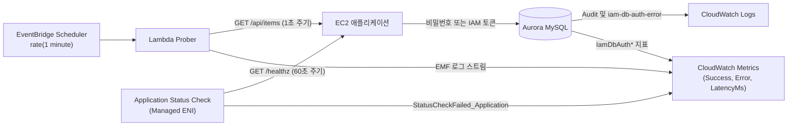

# 시나리오 3. 무중단 전환 검증을 위한 4계층 Observability 체계 구축

## 시나리오 개요 및 핵심 목표

| 항목 | 상세 내용 |
| --- | --- |
| **핵심 기능** | 데이터베이스 인증 전환 중 클라이언트 체감 오류, 실제 DB 접속 계정, IAM 인증 처리 결과, 인스턴스/앱 프로세스 생존 상태를 다각도로 모니터링 및 Observability 확보 |
| **활용 도구** | EventBridge Scheduler + VPC Lambda Prober (CloudWatch EMF), RDS `IamDbAuth*` 메트릭, Aurora MySQL Audit 로그, EC2 Application Status Check |
| **입력 자원** | 기본 패스워드 모드로 동작 중인 EC2 애플리케이션 및 1초 주기로 유입되는 연속 트래픽 |
| **실습 작업** | 단계별 핸즈온 실습 1~4 |
| **최종 달성 목표** | Logs Insights 쿼리를 통해 분 단위 트래픽 성공/실패율 및 인증 방식별 응답 지연을 집계하고, 프로세스 중단 시 Application Status Check가 `impaired`로 감지하는 전 과정을 검증 |

## 무중단 검증의 핵심 원칙: 클라이언트 중심의 4계층 Observability 체계

"무중단으로 마이그레이션을 완료했다"는 선언은 주관적 판단이 아니라 **전환 작업 시간 동안 클라이언트가 수신한 실패 요청이 0건이었다는 객관적 지표**로 증명되어야 합니다.

데이터베이스 자체는 유입되지 못한 연결 실패를 인지하지 못하며, 애플리케이션 서버 역시 네트워크 문제나 사전 거절로 인해 자신에게 도달하지 못한 트래픽을 알 수 없습니다. 따라서 무중단 여부는 반드시 **호출 주체인 클라이언트 관점**에서 실시간으로 계측해야 합니다.

본 핸즈온은 인증 마이그레이션의 전 과정을 검증하기 위해 다음과 같이 네 개의 상호 보완적인 Observability 계층을 구성합니다.

| Observability 계층 | 모니터링 도구 및 데이터 소스 | 검증 질문 및 목적 |
| --- | --- | --- |
| **1. 클라이언트 계층** | Lambda Prober의 `Success`, `Error`, `LatencyMs` 메트릭 (`AuthMode` 차원) | 사용자가 실제로 에러를 경험했는가? 인증 방식 변경으로 지연 시간이 증가했는가? |
| **2. DB 접속 계층** | Aurora MySQL Advanced Auditing 로그 (`CONNECT`, `FAILED_CONNECT`) | 실제 어떤 DB 계정(`app_pw` vs `app_iam`)으로 접속이 발생하고 있는가? 구 계정 접속이 완전히 소멸했는가? |
| **3. IAM 인증 계층** | RDS CloudWatch `IamDbAuthConnection*` 메트릭 및 `iam-db-auth-error` 로그 | IAM 인증 요청이 몇 건 인입되었고, 실패 시 그 구체적 원인(토큰 오류, 권한 누락 등)은 무엇인가? |
| **4. 인스턴스/앱 계층** | EC2 Application Status Check (`StatusCheckFailed_Application` 메트릭) | 웹 애플리케이션 프로세스가 정상 기동되어 HTTP 응답을 올바르게 반환하고 있는가? |

### 핵심 용어 정의

| 용어 | 정의 | 실습 적용 사례 |
| --- | --- | --- |
| **프로버 (Prober)** | 실제 사용자를 대신하여 일정한 주기로 API를 지속 호출하는 합성 트래픽(Synthetic Traffic) 발생기 | Lambda `aurora-iam-lab-prober` (1초 간격, 분당 약 56회 요청 전송) |
| **EMF (Embedded Metric Format)** | 표준 JSON 로그 구조 내에 메트릭 메타데이터를 선언하여 별도 API 호출 없이 로그 스트림을 메트릭으로 자동 변환하는 CloudWatch 규격 | Namespace `aurora-iam-lab`, Dimension `AuthMode` |
| **감사(Audit) 로그** | Aurora MySQL 엔진에서 발생하는 클라이언트 연결 및 쿼리 실행 이력을 기록하는 보안 로그 | `server_audit_events=CONNECT` 설정으로 연결 이벤트 추적 |
| **Application Status Check** | EC2 하이퍼바이저 외부의 관리형 ENI에서 인스턴스 내부의 특정 HTTP 경로를 주기적으로 호출하여 프로세스 생존을 진단하는 EC2 기능 | `GET :8080/healthz`, 기대 HTTP 상태 코드 `200` |
| **관리형 ENI (Managed ENI)** | Application Status Check가 인스턴스로 프로빙 패킷을 전송하기 위해 VPC 내부에 자동 생성하는 네트워크 인터페이스 | 소스 보안 그룹 `aurora-iam-lab-healthcheck` 참조 |

## 헬스체크 설계 원칙: 프로세스 상태와 외부 의존성의 분리

EC2 Application Status Check(2026년 8월 출시)는 기존 EC2 시스템/인스턴스 상태 검사가 하이퍼바이저와 OS 수준까지만 감지하여 웹 서버 프로세스가 다운되어도 `ok`로 표시되던 한계를 해결하기 위해 도입되었습니다.

실무에서 상태 검사를 설계할 때 가장 주의해야 할 원칙은 **기본 헬스체크 경로가 데이터베이스와 같은 공유 외부 의존성을 직접 조회해서는 안 된다는 점**입니다. 만약 헬스체크 경로(`/healthz`)가 DB 쿼리를 수행하도록 구성되어 있다면, 일시적인 DB 부하나 인증 변경 지연으로 인해 모든 웹 서버의 헬스체크가 동시에 실패하게 됩니다. 이 경우 Auto Scaling 그룹이 정상적인 인스턴스들까지 일제히 비정상(`impaired`)으로 판단하여 강제 교체(Mass Replacement)하는 연쇄 장애로 번질 수 있습니다.

따라서 다음과 같이 역할을 철저히 분리해야 합니다.

- **`/healthz` (Liveness / Application Status Check 대상)**: 웹 서버 프로세스가 살아있는지만 빠르게 반환(200 OK)합니다. 인스턴스 불필요 교체를 방지합니다.
- **`/readyz` 또는 `/api/items` (Readiness / Prober 모니터링 대상)**: 실제 DB 연결 및 비즈니스 쿼리를 수행합니다. 무중단 검증 지표는 이 경로를 호출하는 Prober가 수집합니다.

## 상태 검사 및 트래픽 프로빙 방식 비교

| 구현 방식 | 점검 대상 | 인프라 비용 | 특성 및 이번 실습 선택 이유 |
| --- | --- | --- | --- |
| **EC2 Application Status Check** | 인스턴스 내부 프로세스 응답 코드 | 관리형 ENI당 $0.01/h | **선택**: 로드 밸런서가 없는 환경에서도 인스턴스 단위의 앱 상태를 EC2 네이티브 지표로 감시 가능 |
| **ALB Target Group Health Check** | 로드 밸런서 뒤 타깃 앱 응답 코드 | ALB 기본 시간당 요금 | 로드 밸런서를 구성하지 않는 간소화된 핸즈온 아키텍처이므로 제외 |
| **Route 53 Health Check** | 퍼블릭 엔드포인트 HTTP 응답 | 헬스체크당 월정액 과금 | 퍼블릭 IP 개방 범위가 넓어져 보안 그룹 제어가 복잡해지므로 제외 |
| **Lambda Prober + Scheduler** | 1초 주기 API 엔드포인트 프로빙 | Lambda 실행 비용 (Free Tier 충족) | **선택**: 1초 간격의 고밀도 트래픽을 저비용으로 안정적으로 주입하여 단절 여부를 초 단위로 검증 |

## Observability 시스템 구성 요소 및 역할

| 구성 요소 | 주요 역할 |
| --- | --- |
| **EventBridge Scheduler** | `rate(1 minute)` 주기로 VPC 내부의 Lambda Prober를 기동 |
| **Lambda Prober** | 1초마다 `/api/items`를 호출하고 응답 상태, 소요 시간, 사용 계정을 EMF JSON 로그로 출력 |
| **EC2 애플리케이션** | `/healthz`(프로세스 응답) 및 `/api/items`(실제 DB 쿼리) 엔드포인트 제공 |
| **Aurora Advanced Auditing** | DB 세션이 수립되거나 거절될 때마다 계정명, 클라이언트 IP, 반환 코드를 CloudWatch Logs로 전송 |
| **EC2 Application Status Check** | 60초마다 `/healthz`를 호출하고 실패 시 `StatusCheckFailed_Application` 지표 발행 |

## Observability 데이터 흐름 및 아키텍처

트래픽의 주입 경로와 각 계층에서 CloudWatch로 집계되는 Observability 파이프라인의 구조도입니다.



## 실습 진행: Observability 지표 및 로그 검증

### 1. Prober의 CloudWatch EMF 로그 구조 확인

최근 실행된 Lambda Prober 로그 스트림에서 정상 처리된 요청 1건을 조회하여 EMF 메타데이터 형식을 확인합니다.

CloudWatch Logs에서 성공 플래그(`Success = 1`)가 포함된 최근 Prober 이벤트를 조회합니다.

```bash
aws logs filter-log-events --log-group-name /aws/lambda/aurora-iam-lab-prober \
  --start-time $(( ($(date +%s)-120)*1000 )) --filter-pattern '{ $.Success = 1 }' \
  --max-items 1 --query 'events[0].message' --output text
```

로그 메시지 내에 CloudWatch 지표 정의와 애플리케이션 응답 결과가 포함되어 있습니다.

```text
{"_aws":{"CloudWatchMetrics":[{"Namespace":"aurora-iam-lab","Dimensions":[["AuthMode"],[]],"Metrics":[...]}]},"AuthMode":"password","Success":1,"Error":0,"LatencyMs":26.4,"status":200,"db_user":"app_pw@%","error":null}
```

- Lambda 1회 실행 시간은 약 56초(`Duration: 56008 ms`)이며, 매분 약 56회의 API 호출을 1초 간격으로 균등하게 전송합니다.

### 2. CloudWatch Logs Insights를 활용한 분 단위 성공·실패 집계

CloudWatch Logs Insights 콘솔 또는 AWS CLI를 통해 Prober 로그 그룹(`/aws/lambda/aurora-iam-lab-prober`)을 대상으로 트래픽 통계를 조회합니다. 이 쿼리는 마이그레이션 전 구간에 걸쳐 무중단 여부를 증명하는 단일 기준(Single Source of Truth)으로 사용됩니다.

Logs Insights 콘솔의 쿼리 입력창에 다음 문을 실행합니다.

```text
filter ispresent(AuthMode)
| stats sum(Success) as ok, sum(Error) as err, avg(LatencyMs) as avg_ms, pct(LatencyMs, 99) as p99_ms
  by bin(1m) as t, AuthMode
| sort t asc
```

집계 결과 예시입니다. 1분마다 약 56~57건의 요청이 인입되며 에러는 0건으로 유지됩니다.

```text
t                    AuthMode  ok  err  avg_ms  p99_ms
2026-11-07 04:50:00  password  57  0    49.0    230.2
2026-11-07 04:51:00  password  56  0    48.1    223.6
```

> [!NOTE]
> 인프라를 처음 배포한 직후 1~2분 구간에는 일시적으로 에러(`Can't connect to MySQL` 또는 `Access denied for user app_pw`)가 집계될 수 있습니다. 이는 EC2 애플리케이션이 Aurora 인스턴스보다 먼저 기동되거나 초기화 스크립트 실행 직전의 일시적 현상이며, 초기화가 끝난 후 에러가 0으로 안정화된 시점부터 마이그레이션 실습을 진행합니다.

### 3. Aurora Audit 로그를 통한 사용자별 DB 접속 추적

클러스터 감사 로그 그룹(`/aws/rds/cluster/aurora-iam-lab/audit`)을 쿼리하여 실제 Aurora MySQL에 어떤 DB 사용자로 연결이 맺어지고 있는지 확인합니다.

감사 로그 한 줄의 포맷은 `타임스탬프, 서버명, 사용자명, 클라이언트IP, 연결ID, 쿼리ID, 작업유형, DB명, 객체명, 반환코드`로 구성됩니다.

Logs Insights에서 연결(`CONNECT`) 및 연결 실패(`FAILED_CONNECT`) 이벤트를 집계합니다.

```text
parse @message "*,*,*,*,*,*,*,*,*,*" as ts, server, db_user, client, conn_id, query_id, op, db, obj, retcode
| filter op in ["CONNECT", "FAILED_CONNECT"]
| stats count() as n, max(@timestamp) as last by db_user, op, retcode
```

현재는 마이그레이션 전이므로 패스워드 사용자 `app_pw`로만 정상 접속(`retcode 0`)이 발생하고 있음을 확인할 수 있습니다.

```text
db_user  op       retcode  n    last
app_pw   CONNECT  0        215  2026-11-07 04:55:20.983
```

- Aurora Audit 로그는 버퍼링으로 인해 CloudWatch Logs에 약 1~2분 정도 지연되어 도달합니다. 따라서 전환 작업 후 "구 사용자 접속이 0건인가"를 검증할 때는 전환 완료 후 2분 이상 지난 뒤에 집계해야 정확합니다.

### 4. 장애 모의 주입 및 EC2 Application Status Check 상태 전이 확인

EC2 인스턴스 내부의 애플리케이션 서비스를 임의로 중단시켜 Application Status Check가 이를 감지하고 인스턴스 상태를 `impaired`로 변경하는지 확인합니다.

SSM Run Command를 통해 EC2 내부의 애플리케이션 서비스를 정지합니다.

```bash
INSTANCE_ID=$(terraform -chdir=terraform output -raw instance_id)
aws ssm send-command --instance-ids $INSTANCE_ID --document-name AWS-RunShellScript \
  --parameters 'commands=["systemctl stop app"]'
```

애플리케이션 상태 검사 결과를 실시간으로 모니터링합니다.

```bash
aws ec2 describe-application-status --instance-ids $INSTANCE_ID --output json \
  | jq -r '.ApplicationStatuses.Instances[0].ApplicationStatus | "\(.Status) \(.Details[0].Status) \(.Details[0].Reason.Code)"'
```

시간 경과에 따른 상태 전이 이력입니다.

| 시각 (UTC) | 수행 작업 및 감지 상태 | 상태 상세 설명 |
| --- | --- | --- |
| **04:59:10** | `systemctl stop app` 실행 | 프로세스 중단 |
| **05:01:06** | `ok passed ConnectionRefused` | 1차 검사 실패 감지 (임계값 도달 전이므로 상태는 아직 ok 유지) |
| **05:02:10** | `impaired failed ConnectionRefused` | 연속 2회 실패로 인해 최종 **`impaired`** 상태 확정 |
| **05:02:19** | `systemctl start app` 실행 | 프로세스 재기동 |
| **05:03:02** | `impaired failed ResponseCodeMatched` | 1차 검사 정상 복구 확인 |
| **05:04:05** | `ok passed ResponseCodeMatched` | 연속 2회 성공으로 최종 **`ok`** 상태 복귀 |

동일 시각에 기존 인스턴스 상태 검사(System / Instance Status Check)를 조회합니다.

```bash
aws ec2 describe-instance-status --instance-ids $INSTANCE_ID --output json \
  | jq -c '.InstanceStatuses[0] | {system: .SystemStatus.Status, instance: .InstanceStatus.Status, app: .ApplicationStatus}'
```

인스턴스 하이퍼바이저와 OS는 정상(`ok`)이지만 애플리케이션만 정확히 `impaired`로 분리 감지됨을 확인할 수 있습니다.

```text
{"system":"ok","instance":"ok","app":{"Status":"impaired","ImpairedSince":"2026-11-07T05:01:08.787000+00:00"}}
```

상태 전이 확인을 마쳤으면 다음 시나리오를 위해 애플리케이션 서비스를 다시 기동합니다.

```bash
aws ssm send-command --instance-ids $INSTANCE_ID --document-name AWS-RunShellScript \
  --parameters 'commands=["systemctl start app"]'
```

- 상태 검사 주기가 60초이고 실패/성공 임계값(`threshold`)이 각각 2로 설정되어 있으므로, 실제 장애 발생부터 `impaired` 감지까지 약 2~3분이 소요됩니다. 따라서 초 단위 무중단 판정에는 실시간 Lambda Prober를 함께 병행하여 모니터링해야 합니다.

## 부록: 실무 시사점 및 운영 팁

- **Application Status Check의 프로비저닝 구조**: Terraform의 공식 `hashicorp/aws` 프로바이더에는 해당 리소스가 아직 머지되지 않은 상태(2026년 11월 기준)입니다. 본 실습에서는 AWS Cloud Control API 프로바이더(`awscc_ec2_application_status_check`)로 검사 객체를 생성하고, 인스턴스 연결은 AWS CLI 명령어(`associate-application-status-check`)를 로컬 프로비저너로 결합하여 자동화했습니다.
- **보안 그룹 소스 제어**: Application Status Check가 인스턴스로 보내는 프로브 패킷은 AWS 관리형 ENI를 통과합니다. 이때 `health_check_paths`에 전용 소스 보안 그룹을 명시하지 않으면 인바운드 허용 규칙을 좁힐 수 없으므로, 반드시 전용 보안 그룹을 지정하여 최소 권한을 유지해야 합니다.
- **예정된 배포 시 Suppression 활용**: 무중단 롤링 배포나 인스턴스 재시작 작업 중 일시적인 앱 다운으로 인해 Auto Scaling이 인스턴스를 조기 제거하지 않도록, `aws ec2 enable-application-status-check-suppression --duration-seconds <초>`를 호출하여 검사를 일시 유예할 수 있습니다.
- **Prober 운영 비용 최적화**: 매 1초마다 Lambda Prober를 24시간 상시 가동하면 월간 무료 티어(400,000 GB-초)의 대부분을 소진할 수 있습니다. 상시 운영 환경에서는 CloudWatch Synthetics Canaries 또는 사내 모니터링 에이전트를 활용하고, 이 핸즈온 형태의 고밀도 Lambda Prober는 마이그레이션 작업 전후 검증 기간에 집중적으로 활용하는 것이 경제적입니다.

## 참고 문서

1. [Application status checks - Amazon EC2](https://docs.aws.amazon.com/AWSEC2/latest/UserGuide/application-status-checks.html)
2. [Amazon EC2 introduces application status checks (2026-08)](https://aws.amazon.com/about-aws/whats-new/2026/08/amazon-ec2-application-status-checks/)
3. [Implementing health checks - Amazon Builders' Library](https://aws.amazon.com/builders-library/implementing-health-checks/)
4. [Using Advanced Auditing with an Amazon Aurora MySQL DB cluster](https://docs.aws.amazon.com/AmazonRDS/latest/AuroraUserGuide/AuroraMySQL.Auditing.html)
5. [Specification: Embedded metric format](https://docs.aws.amazon.com/AmazonCloudWatch/latest/monitoring/CloudWatch_Embedded_Metric_Format_Specification.html)
